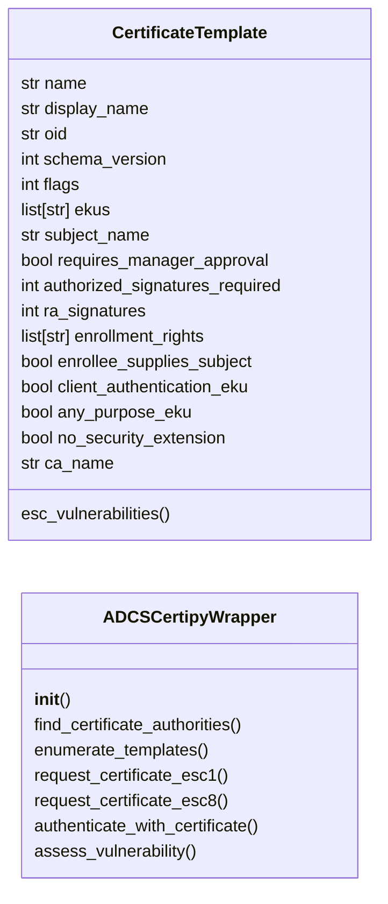
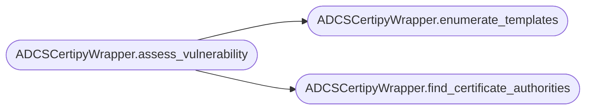

# `modules.adcs_attacks`

> Source: [modules/adcs_attacks.py:1](../../modules/adcs_attacks.py#L1) | language `py` | coverage 100.0% | [API index](../index.md)

Active Directory Certificate Services (AD CS) attack module.

Implements ESC1 through ESC8 attack techniques for privilege escalation
via certificate templates and AD CS misconfigurations.

## Contents

- **Classes:** [`CertificateTemplate`](#certificatetemplate), [`ADCSCertipyWrapper`](#adcscertipywrapper)

## Type Diagram



## Call Graph

Solid arrows stay in this module, dashed arrows leave it.



## Classes

<a id="certificatetemplate"></a>

### `CertificateTemplate`

`class` `dataclass` | [modules/adcs_attacks.py:14](../../modules/adcs_attacks.py#L14)

Decorators: `@dataclass`

```python
class CertificateTemplate
```

Represents a vulnerable AD CS certificate template.

**Attributes**

| Name | Type | Default | Description |
|---|---|---|---|
| [`name`](#certificatetemplate-name) | `str` |  |  |
| [`display_name`](#certificatetemplate-display_name) | `str` | `''` |  |
| [`oid`](#certificatetemplate-oid) | `str` | `''` |  |
| [`schema_version`](#certificatetemplate-schema_version) | `int` | `1` |  |
| [`flags`](#certificatetemplate-flags) | `int` | `0` |  |
| [`ekus`](#certificatetemplate-ekus) | `list[str]` | `field(default_factory=list)` |  |
| [`subject_name`](#certificatetemplate-subject_name) | `str` | `''` |  |
| [`requires_manager_approval`](#certificatetemplate-requires_manager_approval) | `bool` | `False` |  |
| [`authorized_signatures_required`](#certificatetemplate-authorized_signatures_required) | `int` | `0` |  |
| [`ra_signatures`](#certificatetemplate-ra_signatures) | `int` | `0` |  |
| [`enrollment_rights`](#certificatetemplate-enrollment_rights) | `list[str]` | `field(default_factory=list)` |  |
| [`enrollee_supplies_subject`](#certificatetemplate-enrollee_supplies_subject) | `bool` | `False` |  |
| [`client_authentication_eku`](#certificatetemplate-client_authentication_eku) | `bool` | `False` |  |
| [`any_purpose_eku`](#certificatetemplate-any_purpose_eku) | `bool` | `False` |  |
| [`no_security_extension`](#certificatetemplate-no_security_extension) | `bool` | `False` |  |
| [`ca_name`](#certificatetemplate-ca_name) | `str` | `''` |  |

**Members**

| Member | Kind | Summary |
|---|---|---|
| [`esc_vulnerabilities`](#certificatetemplate-esc_vulnerabilities) | property | Determine which ESC attack paths apply to this template. |

<a id="certificatetemplate-esc_vulnerabilities"></a>

#### `CertificateTemplate.esc_vulnerabilities`

`property` | [modules/adcs_attacks.py:35](../../modules/adcs_attacks.py#L35)

Decorators: `@property`

```python
def esc_vulnerabilities(self) -> list[str]
```

Determine which ESC attack paths apply to this template.

**Returns:** `list[str]` - List of ESC attack identifiers (ESC1-ESC8).

---

<a id="adcscertipywrapper"></a>

### `ADCSCertipyWrapper`

`class` | [modules/adcs_attacks.py:69](../../modules/adcs_attacks.py#L69)

```python
class ADCSCertipyWrapper
```

High-level wrapper around Certipy for AD CS attacks.

Provides simplified interfaces for certificate template enumeration,
exploitation, and the full ESC1-ESC8 attack chain.

**Parameters**

| Name | Type | Default | Description |
|---|---|---|---|
| `certipy_path` |  |  | Path to certipy executable. Auto-detects if None. |
| `timeout` |  |  | Default timeout for subprocess calls in seconds. |

**Members**

| Member | Kind | Summary |
|---|---|---|
| [`__init__`](#adcscertipywrapper-__init__) | constructor |  |
| [`find_certificate_authorities`](#adcscertipywrapper-find_certificate_authorities) | method | Enumerate certificate authorities in an Active Directory domain. |
| [`enumerate_templates`](#adcscertipywrapper-enumerate_templates) | method | Enumerate vulnerable certificate templates. |
| [`request_certificate_esc1`](#adcscertipywrapper-request_certificate_esc1) | method | ESC1: Request a certificate with a user-supplied subject alternative name. |
| [`request_certificate_esc8`](#adcscertipywrapper-request_certificate_esc8) | method | ESC8: HTTP-based certificate enrollment (NTLM relay to AD CS). |
| [`authenticate_with_certificate`](#adcscertipywrapper-authenticate_with_certificate) | method | Authenticate to the domain using a certificate and retrieve NT hash. |
| [`assess_vulnerability`](#adcscertipywrapper-assess_vulnerability) | method | Run a full AD CS vulnerability assessment. |

<a id="adcscertipywrapper-__init__"></a>

#### `ADCSCertipyWrapper.__init__`

`constructor` | [modules/adcs_attacks.py:80](../../modules/adcs_attacks.py#L80)

```python
def __init__(self, certipy_path: str | None = None, timeout: int = 120)
```

**Parameters**

| Name | Type | Default | Description |
|---|---|---|---|
| `certipy_path` | `str \| None` | `None` | Path to certipy executable. Auto-detects if None. |
| `timeout` | `int` | `120` | Default timeout for subprocess calls in seconds. |

*Called by:* [`ExploitMigratedCommandSet.do_adcs_check`](cli.commands.exploit_migrated.py.md#exploitmigratedcommandset-do_adcs_check)

<a id="adcscertipywrapper-find_certificate_authorities"></a>

#### `ADCSCertipyWrapper.find_certificate_authorities`

`method` | [modules/adcs_attacks.py:113](../../modules/adcs_attacks.py#L113)

```python
def find_certificate_authorities(self, username: str, password: str, domain: str, dc_ip: str, hashes: str | None = None) -> list[dict]
```

Enumerate certificate authorities in an Active Directory domain.

**Parameters**

| Name | Type | Default | Description |
|---|---|---|---|
| `username` | `str` |  | Domain username for authentication. |
| `password` | `str` |  | Domain password for authentication. |
| `domain` | `str` |  | FQDN of the domain. |
| `dc_ip` | `str` |  | Domain controller IP address. |
| `hashes` | `str \| None` | `None` | Optional NTLM hashes for pass-the-hash. |

**Returns:** `list[dict]` - List of CA dictionaries with name, dns_hostname, and ca_type.

*Called by:* [`ADCSCertipyWrapper.assess_vulnerability`](#adcscertipywrapper-assess_vulnerability)

<a id="adcscertipywrapper-enumerate_templates"></a>

#### `ADCSCertipyWrapper.enumerate_templates`

`method` | [modules/adcs_attacks.py:189](../../modules/adcs_attacks.py#L189)

```python
def enumerate_templates(self, username: str, password: str, domain: str, dc_ip: str, hashes: str | None = None) -> list[CertificateTemplate]
```

Enumerate vulnerable certificate templates.

**Parameters**

| Name | Type | Default | Description |
|---|---|---|---|
| `username` | `str` |  | Domain username. |
| `password` | `str` |  | Domain password. |
| `domain` | `str` |  | Domain FQDN. |
| `dc_ip` | `str` |  | Domain controller IP. |
| `hashes` | `str \| None` | `None` | Optional NTLM hashes. |

**Returns:** `list[CertificateTemplate]` - List of CertificateTemplate objects.

*Called by:* [`ADCSCertipyWrapper.assess_vulnerability`](#adcscertipywrapper-assess_vulnerability)

<a id="adcscertipywrapper-request_certificate_esc1"></a>

#### `ADCSCertipyWrapper.request_certificate_esc1`

`method` | [modules/adcs_attacks.py:268](../../modules/adcs_attacks.py#L268)

```python
def request_certificate_esc1(self, username: str, password: str, domain: str, dc_ip: str, ca_name: str, template_name: str, target_user: str, output_file: str | None = None) -> bool
```

ESC1: Request a certificate with a user-supplied subject alternative name.

Exploits certificate templates where:
- Enrollee can supply a subject alternative name (SAN)
- Template has Client Authentication EKU
- No manager approval required

**Parameters**

| Name | Type | Default | Description |
|---|---|---|---|
| `username` | `str` |  | Authenticated user. |
| `password` | `str` |  | Authenticated user's password. |
| `domain` | `str` |  | Domain FQDN. |
| `dc_ip` | `str` |  | Domain controller IP. |
| `ca_name` | `str` |  | Target certificate authority name. |
| `template_name` | `str` |  | Vulnerable template name. |
| `target_user` | `str` |  | User to impersonate (e.g., 'Administrator'). |
| `output_file` | `str \| None` | `None` | Path to save the .pfx certificate. |

**Returns:** `bool` - True if certificate was successfully requested.

<a id="adcscertipywrapper-request_certificate_esc8"></a>

#### `ADCSCertipyWrapper.request_certificate_esc8`

`method` | [modules/adcs_attacks.py:322](../../modules/adcs_attacks.py#L322)

```python
def request_certificate_esc8(self, username: str, password: str, domain: str, dc_ip: str, ca_server: str, template_name: str = 'SubCA', output_file: str | None = None) -> bool
```

ESC8: HTTP-based certificate enrollment (NTLM relay to AD CS).

**Parameters**

| Name | Type | Default | Description |
|---|---|---|---|
| `username` | `str` |  | Authenticated user. |
| `password` | `str` |  | Authenticated user's password. |
| `domain` | `str` |  | Domain FQDN. |
| `dc_ip` | `str` |  | Domain controller IP. |
| `ca_server` | `str` |  | CA server hostname. |
| `template_name` | `str` | `'SubCA'` | Template to request. |
| `output_file` | `str \| None` | `None` | Output .pfx path. |

**Returns:** `bool` - True if successful.

<a id="adcscertipywrapper-authenticate_with_certificate"></a>

#### `ADCSCertipyWrapper.authenticate_with_certificate`

`method` | [modules/adcs_attacks.py:367](../../modules/adcs_attacks.py#L367)

```python
def authenticate_with_certificate(self, cert_file: str, domain: str, dc_ip: str, username: str | None = None) -> str | None
```

Authenticate to the domain using a certificate and retrieve NT hash.

**Parameters**

| Name | Type | Default | Description |
|---|---|---|---|
| `cert_file` | `str` |  | Path to the .pfx certificate file. |
| `domain` | `str` |  | Domain FQDN. |
| `dc_ip` | `str` |  | Domain controller IP. |
| `username` | `str \| None` | `None` | Optional username override. |

**Returns:** `str | None` - NT hash string if successful, None otherwise.

<a id="adcscertipywrapper-assess_vulnerability"></a>

#### `ADCSCertipyWrapper.assess_vulnerability`

`method` | [modules/adcs_attacks.py:411](../../modules/adcs_attacks.py#L411)

```python
def assess_vulnerability(self, username: str, password: str, domain: str, dc_ip: str, hashes: str | None = None) -> dict[str, list[dict]]
```

Run a full AD CS vulnerability assessment.

Enumerates all certificate templates and maps them to
applicable ESC attack techniques.

**Parameters**

| Name | Type | Default | Description |
|---|---|---|---|
| `username` | `str` |  | Domain user. |
| `password` | `str` |  | Domain password. |
| `domain` | `str` |  | Domain FQDN. |
| `dc_ip` | `str` |  | Domain controller IP. |
| `hashes` | `str \| None` | `None` | Optional NTLM hashes. |

**Returns:** `dict[str, list[dict]]` - Dict mapping ESC IDs to lists of vulnerable template dicts.

*Calls:* [`ADCSCertipyWrapper.enumerate_templates`](#adcscertipywrapper-enumerate_templates), [`ADCSCertipyWrapper.find_certificate_authorities`](#adcscertipywrapper-find_certificate_authorities)

*Called by:* [`ExploitMigratedCommandSet.do_adcs_check`](cli.commands.exploit_migrated.py.md#exploitmigratedcommandset-do_adcs_check)

---
