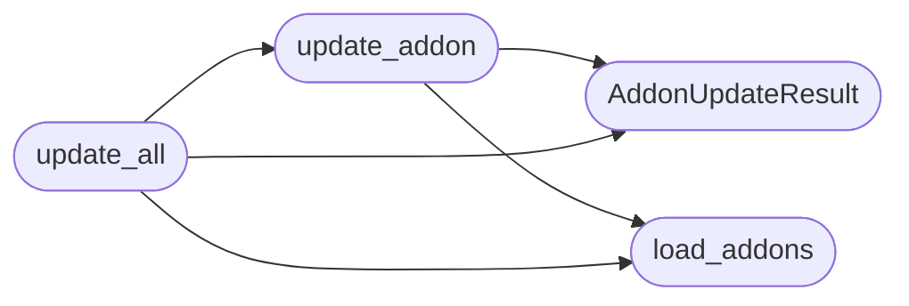

# `modules.addon_updater`

> Source: [modules/addon_updater.py:1](../../modules/addon_updater.py#L1) | language `py` | coverage 100.0% | [API index](../index.md)

Git update contract for lazyaddons.

An addon opts in with ``update: true``. The updater only touches an
existing git worktree inside the repository, refuses dirty trees, never
follows ``..`` or absolute install paths, never clones over a missing
directory and never runs through a shell. Every decision is audited to
``sessions/addon_updates.jsonl``.

## Contents

- **Classes:** [`AddonUpdateResult`](#addonupdateresult)
- **Functions:** [`load_addons`](#load_addons), [`update_addon`](#update_addon), [`update_all`](#update_all)
- **Constants:** [`LAZYADDONS_DIR`](#lazyaddons_dir), [`AUDIT_PATH`](#audit_path), [`GIT_TIMEOUT`](#git_timeout)

## Call Graph

Solid arrows stay in this module, dashed arrows leave it.



## Classes

<a id="addonupdateresult"></a>

### `AddonUpdateResult`

`class` `dataclass` | [modules/addon_updater.py:33](../../modules/addon_updater.py#L33)

Decorators: `@dataclass`

```python
class AddonUpdateResult
```

Outcome of one addon update attempt.

**Attributes**

| Name | Type | Default | Description |
|---|---|---|---|
| [`name`](#addonupdateresult-name) | `str` | `''` |  |
| [`status`](#addonupdateresult-status) | `str` | `'skipped'` |  |
| [`reason`](#addonupdateresult-reason) | `str` | `''` |  |
| [`path`](#addonupdateresult-path) | `str` | `''` |  |
| [`repo_url`](#addonupdateresult-repo_url) | `str` | `''` |  |
| [`branch`](#addonupdateresult-branch) | `str` | `''` |  |
| [`before`](#addonupdateresult-before) | `str` | `''` |  |
| [`after`](#addonupdateresult-after) | `str` | `''` |  |
| [`duration_ms`](#addonupdateresult-duration_ms) | `float` | `0.0` |  |

**Members**

| Member | Kind | Summary |
|---|---|---|
| [`to_dict`](#addonupdateresult-to_dict) | method | Return a JSON-serializable view. |

<a id="addonupdateresult-to_dict"></a>

#### `AddonUpdateResult.to_dict`

`method` | [modules/addon_updater.py:46](../../modules/addon_updater.py#L46)

```python
def to_dict(self) -> dict[str, Any]
```

Return a JSON-serializable view.

**Returns:** `dict[str, Any]`

---

## Functions

<a id="load_addons"></a>

### `load_addons`

`function` | [modules/addon_updater.py:73](../../modules/addon_updater.py#L73)

```python
def load_addons(lazyaddons_dir: Path | str = LAZYADDONS_DIR) -> list[dict]
```

Load every lazyaddon with its update metadata.

**Parameters**

| Name | Type | Default | Description |
|---|---|---|---|
| `lazyaddons_dir` | `Path \| str` | `LAZYADDONS_DIR` | Directory holding one YAML per addon. |

**Returns:** `list[dict]` - List of mappings with name, path, enabled, update, repo_url and
install_path.

*Called by:* [`update_addon`](#update_addon), [`update_all`](#update_all)

---

<a id="update_addon"></a>

### `update_addon`

`function` | [modules/addon_updater.py:166](../../modules/addon_updater.py#L166)

```python
def update_addon(name: str, lazyaddons_dir: Path | str = LAZYADDONS_DIR, root: Path | str = BASE_DIR, dry_run: bool = False) -> AddonUpdateResult
```

Update one addon through ``git pull --ff-only``.

**Parameters**

| Name | Type | Default | Description |
|---|---|---|---|
| `name` | `str` |  | Addon name or filename stem. |
| `lazyaddons_dir` | `Path \| str` | `LAZYADDONS_DIR` | Addon directory. |
| `root` | `Path \| str` | `BASE_DIR` | Repository root. |
| `dry_run` | `bool` | `False` | Report what would happen without pulling. |

**Returns:** `AddonUpdateResult` - Structured result. Never raises for expected conditions.

*Calls:* [`AddonUpdateResult`](#addonupdateresult), [`load_addons`](#load_addons)

*Called by:* [`update_all`](#update_all)

---

<a id="update_all"></a>

### `update_all`

`function` | [modules/addon_updater.py:260](../../modules/addon_updater.py#L260)

```python
def update_all(names: list[str] | None = None, lazyaddons_dir: Path | str = LAZYADDONS_DIR, root: Path | str = BASE_DIR, dry_run: bool = False, audit_path: Path | str = AUDIT_PATH) -> dict[str, Any]
```

Update every opted-in addon or an explicit name list.

**Parameters**

| Name | Type | Default | Description |
|---|---|---|---|
| `names` | `list[str] \| None` | `None` | Optional names; empty means every addon. |
| `lazyaddons_dir` | `Path \| str` | `LAZYADDONS_DIR` | Addon directory. |
| `root` | `Path \| str` | `BASE_DIR` | Repository root. |
| `dry_run` | `bool` | `False` | Report without pulling. |
| `audit_path` | `Path \| str` | `AUDIT_PATH` | JSONL audit destination. |

**Returns:** `dict[str, Any]` - Summary with results and counts.

*Calls:* [`AddonUpdateResult`](#addonupdateresult), [`load_addons`](#load_addons), [`update_addon`](#update_addon)

*Called by:* [`LazyCommandSet.do_lazy_addon`](cli.commands.lazyops.py.md#lazycommandset-do_lazy_addon)

---

## Constants

<a id="lazyaddons_dir"></a>

### `LAZYADDONS_DIR`

`constant` | [modules/addon_updater.py:26](../../modules/addon_updater.py#L26)

```python
LAZYADDONS_DIR = BASE_DIR / 'lazyaddons'
```

---

<a id="audit_path"></a>

### `AUDIT_PATH`

`constant` | [modules/addon_updater.py:27](../../modules/addon_updater.py#L27)

```python
AUDIT_PATH = BASE_DIR / 'sessions' / 'addon_updates.jsonl'
```

---

<a id="git_timeout"></a>

### `GIT_TIMEOUT`

`constant` | [modules/addon_updater.py:28](../../modules/addon_updater.py#L28)

```python
GIT_TIMEOUT = 120
```

---
