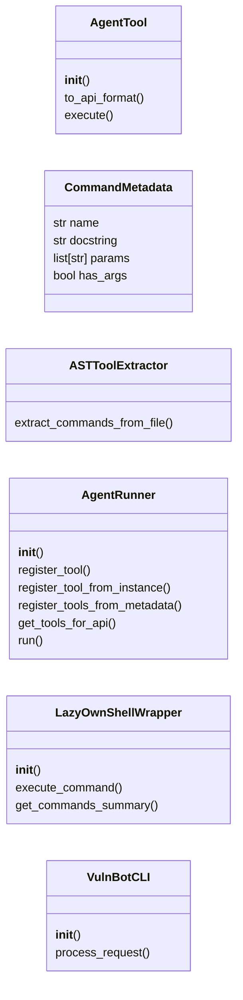
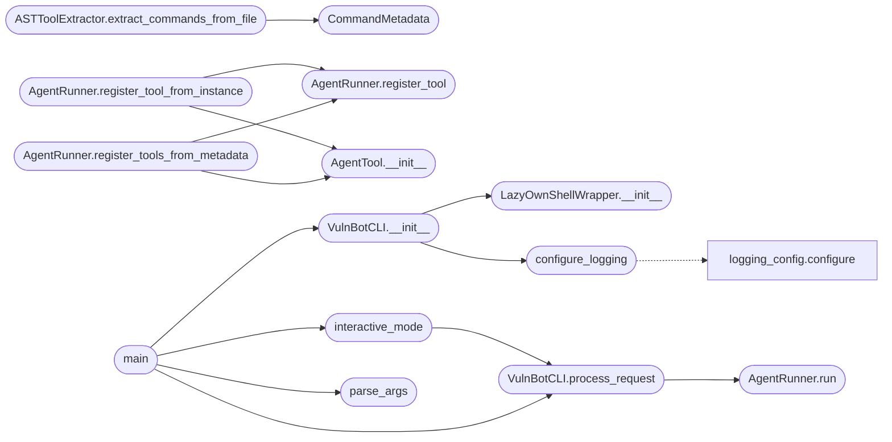

# `modules.agent_runner`

> Source: [modules/agent_runner.py:1](../../modules/agent_runner.py#L1) | language `py` | coverage 30.8% | [API index](../index.md)

LazyOwn AI Agent - Ultimate Edition Mejoras: Anti-Hang (Timeout), Gestión de Memoria, Validación de Argumentos y Anti-Loop.

## Contents

- **Classes:** [`AgentTool`](#agenttool), [`CommandMetadata`](#commandmetadata), [`ASTToolExtractor`](#asttoolextractor), [`AgentRunner`](#agentrunner), [`LazyOwnShellWrapper`](#lazyownshellwrapper), [`VulnBotCLI`](#vulnbotcli)
- **Functions:** [`configure_logging`](#configure_logging), [`interactive_mode`](#interactive_mode), [`parse_args`](#parse_args), [`main`](#main)
- **Constants:** [`BANNER`](#banner), [`MAX_OUTPUT_LENGTH`](#max_output_length), [`COMMAND_TIMEOUT`](#command_timeout), [`MAX_HISTORY_MSGS`](#max_history_msgs)

## Type Diagram



## Call Graph

Solid arrows stay in this module, dashed arrows leave it.



## Classes

<a id="agenttool"></a>

### `AgentTool`

`class` | [modules/agent_runner.py:66](../../modules/agent_runner.py#L66)

```python
class AgentTool
```

Herramienta ejecutable con validación y truncado

**Members**

| Member | Kind | Summary |
|---|---|---|
| [`__init__`](#agenttool-__init__) | constructor |  |
| [`to_api_format`](#agenttool-to_api_format) | method |  |
| [`execute`](#agenttool-execute) | method | Ejecuta con validación de argumentos y formato claro |

<a id="agenttool-__init__"></a>

#### `AgentTool.__init__`

`constructor` | [modules/agent_runner.py:69](../../modules/agent_runner.py#L69)

```python
def __init__(self, name: str, description: str, func: Callable, parameters: dict[str, Any], required: list[str] = None)
```

**Parameters**

| Name | Type | Default | Description |
|---|---|---|---|
| `name` | `str` |  |  |
| `description` | `str` |  |  |
| `func` | `Callable` |  |  |
| `parameters` | `dict[str, Any]` |  |  |
| `required` | `list[str]` | `None` |  |

*Called by:* [`AgentRunner.register_tool_from_instance`](#agentrunner-register_tool_from_instance), [`AgentRunner.register_tools_from_metadata`](#agentrunner-register_tools_from_metadata), [`register_tools`](modules.lazy_agent.py.md#register_tools)

<a id="agenttool-to_api_format"></a>

#### `AgentTool.to_api_format`

`method` | [modules/agent_runner.py:77](../../modules/agent_runner.py#L77)

```python
def to_api_format(self) -> dict[str, Any]
```

**Returns:** `dict[str, Any]`

<a id="agenttool-execute"></a>

#### `AgentTool.execute`

`method` | [modules/agent_runner.py:83](../../modules/agent_runner.py#L83)

```python
def execute(self, **kwargs) -> str
```

Ejecuta con validación de argumentos y formato claro

**Parameters**

| Name | Type | Default | Description |
|---|---|---|---|
| `**kwargs` |  |  |  |

**Returns:** `str`

---

<a id="commandmetadata"></a>

### `CommandMetadata`

`class` `dataclass` | [modules/agent_runner.py:127](../../modules/agent_runner.py#L127)

Decorators: `@dataclass`

```python
class CommandMetadata
```

**Attributes**

| Name | Type | Default | Description |
|---|---|---|---|
| [`name`](#commandmetadata-name) | `str` |  |  |
| [`docstring`](#commandmetadata-docstring) | `str` |  |  |
| [`params`](#commandmetadata-params) | `list[str]` |  |  |
| [`has_args`](#commandmetadata-has_args) | `bool` |  |  |

---

<a id="asttoolextractor"></a>

### `ASTToolExtractor`

`class` | [modules/agent_runner.py:134](../../modules/agent_runner.py#L134)

```python
class ASTToolExtractor
```

Extractor inteligente usando AST

**Members**

| Member | Kind | Summary |
|---|---|---|
| [`extract_commands_from_file`](#asttoolextractor-extract_commands_from_file) | staticmethod |  |

<a id="asttoolextractor-extract_commands_from_file"></a>

#### `ASTToolExtractor.extract_commands_from_file`

`staticmethod` | [modules/agent_runner.py:138](../../modules/agent_runner.py#L138)

Decorators: `@staticmethod`

```python
def extract_commands_from_file(file_path: str, prefix: str = 'do_') -> list[CommandMetadata]
```

**Parameters**

| Name | Type | Default | Description |
|---|---|---|---|
| `file_path` | `str` |  |  |
| `prefix` | `str` | `'do_'` |  |

**Returns:** `list[CommandMetadata]`

*Calls:* [`CommandMetadata`](#commandmetadata)

---

<a id="agentrunner"></a>

### `AgentRunner`

`class` | [modules/agent_runner.py:190](../../modules/agent_runner.py#L190)

```python
class AgentRunner
```

Subclasses: [`ObservableAgentRunner`](modules.lazy_agent.py.md#observableagentrunner)

Motor del agente con Límite de Uso por Herramienta (Anti-Spam)

**Members**

| Member | Kind | Summary |
|---|---|---|
| [`__init__`](#agentrunner-__init__) | constructor |  |
| [`register_tool`](#agentrunner-register_tool) | method |  |
| [`register_tool_from_instance`](#agentrunner-register_tool_from_instance) | method | Wrap a plain function as an AgentTool using its signature and docstring. |
| [`register_tools_from_metadata`](#agentrunner-register_tools_from_metadata) | method |  |
| [`get_tools_for_api`](#agentrunner-get_tools_for_api) | method |  |
| [`run`](#agentrunner-run) | method |  |

<a id="agentrunner-__init__"></a>

#### `AgentRunner.__init__`

`constructor` | [modules/agent_runner.py:193](../../modules/agent_runner.py#L193)

```python
def __init__(self, model: Any, system_prompt: str = None, max_iterations: int = 10)
```

**Parameters**

| Name | Type | Default | Description |
|---|---|---|---|
| `model` | `Any` |  |  |
| `system_prompt` | `str` | `None` |  |
| `max_iterations` | `int` | `10` |  |

<a id="agentrunner-register_tool"></a>

#### `AgentRunner.register_tool`

`method` | [modules/agent_runner.py:218](../../modules/agent_runner.py#L218)

```python
def register_tool(self, tool: AgentTool)
```

**Parameters**

| Name | Type | Default | Description |
|---|---|---|---|
| `tool` | `AgentTool` |  |  |

*Called by:* [`AgentRunner.register_tool_from_instance`](#agentrunner-register_tool_from_instance), [`AgentRunner.register_tools_from_metadata`](#agentrunner-register_tools_from_metadata), [`register_tools`](modules.lazy_agent.py.md#register_tools)

<a id="agentrunner-register_tool_from_instance"></a>

#### `AgentRunner.register_tool_from_instance`

`method` | [modules/agent_runner.py:221](../../modules/agent_runner.py#L221)

```python
def register_tool_from_instance(self, func: Callable)
```

Wrap a plain function as an AgentTool using its signature and docstring.

**Parameters**

| Name | Type | Default | Description |
|---|---|---|---|
| `func` | `Callable` |  |  |

*Calls:* [`AgentRunner.register_tool`](#agentrunner-register_tool), [`AgentTool.__init__`](#agenttool-__init__)

<a id="agentrunner-register_tools_from_metadata"></a>

#### `AgentRunner.register_tools_from_metadata`

`method` | [modules/agent_runner.py:239](../../modules/agent_runner.py#L239)

```python
def register_tools_from_metadata(self, commands: list[CommandMetadata], executor: Callable[[str], str])
```

**Parameters**

| Name | Type | Default | Description |
|---|---|---|---|
| `commands` | `list[CommandMetadata]` |  |  |
| `executor` | `Callable[[str], str]` |  |  |

*Calls:* [`AgentRunner.register_tool`](#agentrunner-register_tool), [`AgentTool.__init__`](#agenttool-__init__)

<a id="agentrunner-get_tools_for_api"></a>

#### `AgentRunner.get_tools_for_api`

`method` | [modules/agent_runner.py:266](../../modules/agent_runner.py#L266)

```python
def get_tools_for_api(self) -> list[dict[str, Any]] | None
```

**Returns:** `list[dict[str, Any]] | None`

<a id="agentrunner-run"></a>

#### `AgentRunner.run`

`method` | [modules/agent_runner.py:271](../../modules/agent_runner.py#L271)

```python
def run(self, user_input: str) -> str
```

**Parameters**

| Name | Type | Default | Description |
|---|---|---|---|
| `user_input` | `str` |  |  |

**Returns:** `str`

*Called by:* [`VulnBotCLI.process_request`](#vulnbotcli-process_request)

---

<a id="lazyownshellwrapper"></a>

### `LazyOwnShellWrapper`

`class` | [modules/agent_runner.py:482](../../modules/agent_runner.py#L482)

```python
class LazyOwnShellWrapper
```

Wrapper que ejecuta comandos en hilos seguros

**Members**

| Member | Kind | Summary |
|---|---|---|
| [`__init__`](#lazyownshellwrapper-__init__) | constructor |  |
| [`execute_command`](#lazyownshellwrapper-execute_command) | method | Ejecuta comando con timeout usando threading |
| [`get_commands_summary`](#lazyownshellwrapper-get_commands_summary) | method |  |

<a id="lazyownshellwrapper-__init__"></a>

#### `LazyOwnShellWrapper.__init__`

`constructor` | [modules/agent_runner.py:485](../../modules/agent_runner.py#L485)

```python
def __init__(self, script_path: str)
```

**Parameters**

| Name | Type | Default | Description |
|---|---|---|---|
| `script_path` | `str` |  |  |

*Called by:* [`VulnBotCLI.__init__`](#vulnbotcli-__init__)

<a id="lazyownshellwrapper-execute_command"></a>

#### `LazyOwnShellWrapper.execute_command`

`method` | [modules/agent_runner.py:515](../../modules/agent_runner.py#L515)

```python
def execute_command(self, command: str) -> str
```

Ejecuta comando con timeout usando threading

**Parameters**

| Name | Type | Default | Description |
|---|---|---|---|
| `command` | `str` |  |  |

**Returns:** `str`

<a id="lazyownshellwrapper-get_commands_summary"></a>

#### `LazyOwnShellWrapper.get_commands_summary`

`method` | [modules/agent_runner.py:552](../../modules/agent_runner.py#L552)

```python
def get_commands_summary(self) -> str
```

**Returns:** `str`

---

<a id="vulnbotcli"></a>

### `VulnBotCLI`

`class` | [modules/agent_runner.py:559](../../modules/agent_runner.py#L559)

```python
class VulnBotCLI
```

**Members**

| Member | Kind | Summary |
|---|---|---|
| [`__init__`](#vulnbotcli-__init__) | constructor |  |
| [`process_request`](#vulnbotcli-process_request) | method |  |

<a id="vulnbotcli-__init__"></a>

#### `VulnBotCLI.__init__`

`constructor` | [modules/agent_runner.py:560](../../modules/agent_runner.py#L560)

```python
def __init__(self, provider: str, mode: str, debug: bool, script_path: str)
```

**Parameters**

| Name | Type | Default | Description |
|---|---|---|---|
| `provider` | `str` |  |  |
| `mode` | `str` |  |  |
| `debug` | `bool` |  |  |
| `script_path` | `str` |  |  |

*Calls:* [`LazyOwnShellWrapper.__init__`](#lazyownshellwrapper-__init__), [`configure_logging`](#configure_logging)

*Called by:* [`main`](#main)

<a id="vulnbotcli-process_request"></a>

#### `VulnBotCLI.process_request`

`method` | [modules/agent_runner.py:615](../../modules/agent_runner.py#L615)

```python
def process_request(self, user_input: str) -> str
```

**Parameters**

| Name | Type | Default | Description |
|---|---|---|---|
| `user_input` | `str` |  |  |

**Returns:** `str`

*Calls:* [`AgentRunner.run`](#agentrunner-run)

*Called by:* [`interactive_mode`](#interactive_mode), [`main`](#main)

---

## Functions

<a id="configure_logging"></a>

### `configure_logging`

`function` | [modules/agent_runner.py:60](../../modules/agent_runner.py#L60)

```python
def configure_logging(debug: bool = False)
```

**Parameters**

| Name | Type | Default | Description |
|---|---|---|---|
| `debug` | `bool` | `False` |  |

*Calls:* [`configure`](modules.logging_config.py.md#configure)

*Called by:* [`VulnBotCLI.__init__`](#vulnbotcli-__init__)

---

<a id="interactive_mode"></a>

### `interactive_mode`

`function` | [modules/agent_runner.py:620](../../modules/agent_runner.py#L620)

```python
def interactive_mode(bot: VulnBotCLI)
```

**Parameters**

| Name | Type | Default | Description |
|---|---|---|---|
| `bot` | `VulnBotCLI` |  |  |

*Calls:* [`VulnBotCLI.process_request`](#vulnbotcli-process_request)

*Called by:* [`main`](#main)

---

<a id="parse_args"></a>

### `parse_args`

`function` | [modules/agent_runner.py:644](../../modules/agent_runner.py#L644)

```python
def parse_args()
```

*Called by:* [`main`](#main)

---

<a id="main"></a>

### `main`

`function` | [modules/agent_runner.py:654](../../modules/agent_runner.py#L654)

```python
def main()
```

*Calls:* [`VulnBotCLI.__init__`](#vulnbotcli-__init__), [`VulnBotCLI.process_request`](#vulnbotcli-process_request), [`interactive_mode`](#interactive_mode), [`parse_args`](#parse_args)

---

## Constants

<a id="banner"></a>

### `BANNER`

`constant` | [modules/agent_runner.py:45](../../modules/agent_runner.py#L45)

```python
BANNER
```

---

<a id="max_output_length"></a>

### `MAX_OUTPUT_LENGTH`

`constant` | [modules/agent_runner.py:55](../../modules/agent_runner.py#L55)

```python
MAX_OUTPUT_LENGTH = 3000
```

---

<a id="command_timeout"></a>

### `COMMAND_TIMEOUT`

`constant` | [modules/agent_runner.py:56](../../modules/agent_runner.py#L56)

```python
COMMAND_TIMEOUT = 60
```

---

<a id="max_history_msgs"></a>

### `MAX_HISTORY_MSGS`

`constant` | [modules/agent_runner.py:57](../../modules/agent_runner.py#L57)

```python
MAX_HISTORY_MSGS = 15
```

---
