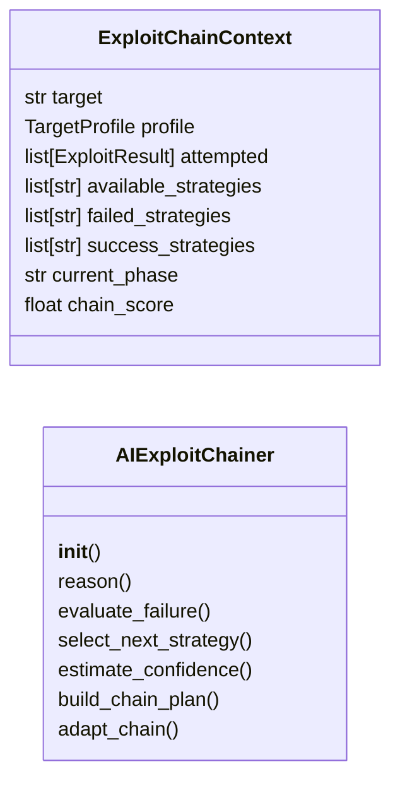
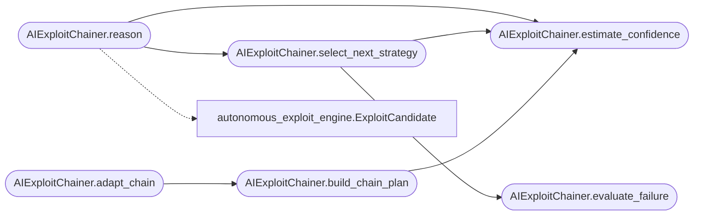

# `modules.ai_exploit_chain`

> Source: [modules/ai_exploit_chain.py:1](../../modules/ai_exploit_chain.py#L1) | language `py` | coverage 90.0% | [API index](../index.md)

AI-Driven Exploit Chaining Engine.

Multi-step reasoning for exploit attempts. When one exploit fails the
engine analyzes WHY it failed and pivots to a different strategy using
a heuristic decision matrix. No external API calls required.

Usage:
    from modules.ai_exploit_chain import AIExploitChainer, ExploitChainContext
    chainer = AIExploitChainer()
    ctx = ExploitChainContext(target="10.10.11.5", profile=profile)
    candidate = chainer.reason(ctx)

## Contents

- **Classes:** [`ExploitChainContext`](#exploitchaincontext), [`AIExploitChainer`](#aiexploitchainer)
- **Constants:** [`DIRECT`](#direct), [`BRUTE_FORCE`](#brute_force), [`PATH_TRAVERSAL`](#path_traversal), [`DESERIALIZATION`](#deserialization), [`COMMAND_INJECTION`](#command_injection), [`SQL_INJECTION`](#sql_injection), [`AUTH_BYPASS`](#auth_bypass), [`PRIVESC_LINUX`](#privesc_linux), [`PRIVESC_WINDOWS`](#privesc_windows), [`LATERAL_SMB`](#lateral_smb), [`LATERAL_WINRM`](#lateral_winrm), [`LATERAL_SSH`](#lateral_ssh), [`PIVOT_SOCKS`](#pivot_socks), [`WEB_ENUM`](#web_enum), [`NULL_SESSION`](#null_session), [`CREDENTIAL_REUSE`](#credential_reuse), [`UNAUTH_ACCESS`](#unauth_access), [`ENUMERATION`](#enumeration), [`KNOWN_EXPLOIT`](#known_exploit), [`ANONYMOUS_LOGIN`](#anonymous_login), [`ALL_STRATEGIES`](#all_strategies)

## Type Diagram



## Call Graph

Solid arrows stay in this module, dashed arrows leave it.



## Classes

<a id="exploitchaincontext"></a>

### `ExploitChainContext`

`class` `dataclass` | [modules/ai_exploit_chain.py:223](../../modules/ai_exploit_chain.py#L223)

Decorators: `@dataclass`

```python
class ExploitChainContext
```

Mutable context tracking state across chained exploit attempts.

**Attributes**

| Name | Type | Default | Description |
|---|---|---|---|
| [`target`](#exploitchaincontext-target) | `str` |  | IP or hostname of the target. |
| [`profile`](#exploitchaincontext-profile) | `TargetProfile` |  | Immutable TargetProfile snapshot. |
| [`attempted`](#exploitchaincontext-attempted) | `list[ExploitResult]` | `field(default_factory=list)` | All exploit results (success and failure). |
| [`available_strategies`](#exploitchaincontext-available_strategies) | `list[str]` | `field(default_factory=list)` | Strategies not yet tried. |
| [`failed_strategies`](#exploitchaincontext-failed_strategies) | `list[str]` | `field(default_factory=list)` | Strategies that failed. |
| [`success_strategies`](#exploitchaincontext-success_strategies) | `list[str]` | `field(default_factory=list)` | Strategies that yielded access. |
| [`current_phase`](#exploitchaincontext-current_phase) | `str` | `'enumeration'` | Active kill-chain phase label. |
| [`chain_score`](#exploitchaincontext-chain_score) | `float` | `0.0` | Aggregate chain quality (0.0-1.0). |

---

<a id="aiexploitchainer"></a>

### `AIExploitChainer`

`class` | [modules/ai_exploit_chain.py:247](../../modules/ai_exploit_chain.py#L247)

```python
class AIExploitChainer
```

Heuristic exploit chainer that reasons about failures and pivots strategies.

Public methods:
    reason(context) -> ExploitCandidate | None
    evaluate_failure(result) -> str
    select_next_strategy(context) -> str
    estimate_confidence(strategy, profile) -> float
    build_chain_plan(context) -> list[dict]
    adapt_chain(context, new_info) -> list[dict]

**Members**

| Member | Kind | Summary |
|---|---|---|
| [`__init__`](#aiexploitchainer-__init__) | constructor |  |
| [`reason`](#aiexploitchainer-reason) | method | Analyze context failures and produce the next best exploit candidate. |
| [`evaluate_failure`](#aiexploitchainer-evaluate_failure) | staticmethod | Classify the reason for an exploit failure by output pattern matching. |
| [`select_next_strategy`](#aiexploitchainer-select_next_strategy) | method | Select the next strategy to attempt based on context and failures. |
| [`estimate_confidence`](#aiexploitchainer-estimate_confidence) | method | Estimate confidence (0.0-1.0) for a strategy against a target profile. |
| [`build_chain_plan`](#aiexploitchainer-build_chain_plan) | method | Build a full multi-step exploitation plan following the kill chain. |
| [`adapt_chain`](#aiexploitchainer-adapt_chain) | method | Adapt the chain plan based on newly discovered information. |

<a id="aiexploitchainer-__init__"></a>

#### `AIExploitChainer.__init__`

`constructor` | [modules/ai_exploit_chain.py:259](../../modules/ai_exploit_chain.py#L259)

```python
def __init__(self) -> None
```

*Called by:* [`PwnCommandSet.do_exploit_chain`](cli.commands.pwn.py.md#pwncommandset-do_exploit_chain)

<a id="aiexploitchainer-reason"></a>

#### `AIExploitChainer.reason`

`method` | [modules/ai_exploit_chain.py:285](../../modules/ai_exploit_chain.py#L285)

```python
def reason(self, context: ExploitChainContext) -> ExploitCandidate | None
```

Analyze context failures and produce the next best exploit candidate.

**Parameters**

| Name | Type | Default | Description |
|---|---|---|---|
| `context` | `ExploitChainContext` |  |  |

**Returns:** `ExploitCandidate | None`

*Calls:* [`AIExploitChainer.estimate_confidence`](#aiexploitchainer-estimate_confidence), [`AIExploitChainer.select_next_strategy`](#aiexploitchainer-select_next_strategy), [`ExploitCandidate`](modules.autonomous_exploit_engine.py.md#exploitcandidate)

*Called by:* [`PwnCommandSet.do_exploit_chain`](cli.commands.pwn.py.md#pwncommandset-do_exploit_chain)

<a id="aiexploitchainer-evaluate_failure"></a>

#### `AIExploitChainer.evaluate_failure`

`staticmethod` | [modules/ai_exploit_chain.py:306](../../modules/ai_exploit_chain.py#L306)

Decorators: `@staticmethod`

```python
def evaluate_failure(result: ExploitResult) -> str
```

Classify the reason for an exploit failure by output pattern matching.

Returns a failure category string (e.g. ``auth_required``).

**Parameters**

| Name | Type | Default | Description |
|---|---|---|---|
| `result` | `ExploitResult` |  |  |

**Returns:** `str`

*Called by:* [`PwnCommandSet.do_exploit_chain`](cli.commands.pwn.py.md#pwncommandset-do_exploit_chain), [`AIExploitChainer.select_next_strategy`](#aiexploitchainer-select_next_strategy)

<a id="aiexploitchainer-select_next_strategy"></a>

#### `AIExploitChainer.select_next_strategy`

`method` | [modules/ai_exploit_chain.py:318](../../modules/ai_exploit_chain.py#L318)

```python
def select_next_strategy(self, context: ExploitChainContext) -> str
```

Select the next strategy to attempt based on context and failures.

Priority: adaptation from last failure, phase-aware escalation,
service-based heuristics, then highest confidence remaining.

**Parameters**

| Name | Type | Default | Description |
|---|---|---|---|
| `context` | `ExploitChainContext` |  |  |

**Returns:** `str`

*Calls:* [`AIExploitChainer.estimate_confidence`](#aiexploitchainer-estimate_confidence), [`AIExploitChainer.evaluate_failure`](#aiexploitchainer-evaluate_failure)

*Called by:* [`AIExploitChainer.reason`](#aiexploitchainer-reason)

<a id="aiexploitchainer-estimate_confidence"></a>

#### `AIExploitChainer.estimate_confidence`

`method` | [modules/ai_exploit_chain.py:349](../../modules/ai_exploit_chain.py#L349)

```python
def estimate_confidence(self, strategy: str, profile: TargetProfile) -> float
```

Estimate confidence (0.0-1.0) for a strategy against a target profile.

Adjusts base score using open ports, credentials, OS type, and
known vulns from the profile. Returns a clamped value.

**Parameters**

| Name | Type | Default | Description |
|---|---|---|---|
| `strategy` | `str` |  |  |
| `profile` | `TargetProfile` |  |  |

**Returns:** `float`

*Called by:* [`AIExploitChainer.build_chain_plan`](#aiexploitchainer-build_chain_plan), [`AIExploitChainer.reason`](#aiexploitchainer-reason), [`AIExploitChainer.select_next_strategy`](#aiexploitchainer-select_next_strategy)

<a id="aiexploitchainer-build_chain_plan"></a>

#### `AIExploitChainer.build_chain_plan`

`method` | [modules/ai_exploit_chain.py:391](../../modules/ai_exploit_chain.py#L391)

```python
def build_chain_plan(self, context: ExploitChainContext) -> list[dict[str, Any]]
```

Build a full multi-step exploitation plan following the kill chain.

Each phase is assigned a primary strategy and fallbacks ranked by
confidence.

**Parameters**

| Name | Type | Default | Description |
|---|---|---|---|
| `context` | `ExploitChainContext` |  |  |

**Returns:** `list[dict[str, Any]]`

*Calls:* [`AIExploitChainer.estimate_confidence`](#aiexploitchainer-estimate_confidence)

*Called by:* [`PwnCommandSet.do_exploit_chain`](cli.commands.pwn.py.md#pwncommandset-do_exploit_chain), [`AIExploitChainer.adapt_chain`](#aiexploitchainer-adapt_chain)

<a id="aiexploitchainer-adapt_chain"></a>

#### `AIExploitChainer.adapt_chain`

`method` | [modules/ai_exploit_chain.py:428](../../modules/ai_exploit_chain.py#L428)

```python
def adapt_chain(self, context: ExploitChainContext, new_info: dict[str, Any]) -> list[dict[str, Any]]
```

Adapt the chain plan based on newly discovered information.

Unlocks strategies based on new creds, ports, OS details, and
parses shell output for privilege escalation hints.

**Parameters**

| Name | Type | Default | Description |
|---|---|---|---|
| `context` | `ExploitChainContext` |  | Current exploit chain state. |
| `new_info` | `dict[str, Any]` |  | Dict with optional keys ``credentials``, ``open_ports``, ``os_type``, `[`os_version`](modules.autonomous_exploit_engine.py.md#targetprofile-os_version)`, ``access_level``, ``shell_output``. |

**Returns:** `list[dict[str, Any]]` - Rebuilt chain plan reflecting the new information.

*Calls:* [`AIExploitChainer.build_chain_plan`](#aiexploitchainer-build_chain_plan)

*Called by:* [`PwnCommandSet.do_exploit_chain`](cli.commands.pwn.py.md#pwncommandset-do_exploit_chain)

---

## Constants

<a id="direct"></a>

### `DIRECT`

`constant` | [modules/ai_exploit_chain.py:26](../../modules/ai_exploit_chain.py#L26)

```python
DIRECT = 'direct'
```

---

<a id="brute_force"></a>

### `BRUTE_FORCE`

`constant` | [modules/ai_exploit_chain.py:27](../../modules/ai_exploit_chain.py#L27)

```python
BRUTE_FORCE = 'brute_force'
```

---

<a id="path_traversal"></a>

### `PATH_TRAVERSAL`

`constant` | [modules/ai_exploit_chain.py:28](../../modules/ai_exploit_chain.py#L28)

```python
PATH_TRAVERSAL = 'path_traversal'
```

---

<a id="deserialization"></a>

### `DESERIALIZATION`

`constant` | [modules/ai_exploit_chain.py:29](../../modules/ai_exploit_chain.py#L29)

```python
DESERIALIZATION = 'deserialization'
```

---

<a id="command_injection"></a>

### `COMMAND_INJECTION`

`constant` | [modules/ai_exploit_chain.py:30](../../modules/ai_exploit_chain.py#L30)

```python
COMMAND_INJECTION = 'command_injection'
```

---

<a id="sql_injection"></a>

### `SQL_INJECTION`

`constant` | [modules/ai_exploit_chain.py:31](../../modules/ai_exploit_chain.py#L31)

```python
SQL_INJECTION = 'sql_injection'
```

---

<a id="auth_bypass"></a>

### `AUTH_BYPASS`

`constant` | [modules/ai_exploit_chain.py:32](../../modules/ai_exploit_chain.py#L32)

```python
AUTH_BYPASS = 'auth_bypass'
```

---

<a id="privesc_linux"></a>

### `PRIVESC_LINUX`

`constant` | [modules/ai_exploit_chain.py:33](../../modules/ai_exploit_chain.py#L33)

```python
PRIVESC_LINUX = 'privesc_linux'
```

---

<a id="privesc_windows"></a>

### `PRIVESC_WINDOWS`

`constant` | [modules/ai_exploit_chain.py:34](../../modules/ai_exploit_chain.py#L34)

```python
PRIVESC_WINDOWS = 'privesc_windows'
```

---

<a id="lateral_smb"></a>

### `LATERAL_SMB`

`constant` | [modules/ai_exploit_chain.py:35](../../modules/ai_exploit_chain.py#L35)

```python
LATERAL_SMB = 'lateral_smb'
```

---

<a id="lateral_winrm"></a>

### `LATERAL_WINRM`

`constant` | [modules/ai_exploit_chain.py:36](../../modules/ai_exploit_chain.py#L36)

```python
LATERAL_WINRM = 'lateral_winrm'
```

---

<a id="lateral_ssh"></a>

### `LATERAL_SSH`

`constant` | [modules/ai_exploit_chain.py:37](../../modules/ai_exploit_chain.py#L37)

```python
LATERAL_SSH = 'lateral_ssh'
```

---

<a id="pivot_socks"></a>

### `PIVOT_SOCKS`

`constant` | [modules/ai_exploit_chain.py:38](../../modules/ai_exploit_chain.py#L38)

```python
PIVOT_SOCKS = 'pivot_socks'
```

---

<a id="web_enum"></a>

### `WEB_ENUM`

`constant` | [modules/ai_exploit_chain.py:39](../../modules/ai_exploit_chain.py#L39)

```python
WEB_ENUM = 'web_enum'
```

---

<a id="null_session"></a>

### `NULL_SESSION`

`constant` | [modules/ai_exploit_chain.py:40](../../modules/ai_exploit_chain.py#L40)

```python
NULL_SESSION = 'null_session'
```

---

<a id="credential_reuse"></a>

### `CREDENTIAL_REUSE`

`constant` | [modules/ai_exploit_chain.py:41](../../modules/ai_exploit_chain.py#L41)

```python
CREDENTIAL_REUSE = 'credential_reuse'
```

---

<a id="unauth_access"></a>

### `UNAUTH_ACCESS`

`constant` | [modules/ai_exploit_chain.py:42](../../modules/ai_exploit_chain.py#L42)

```python
UNAUTH_ACCESS = 'unauth_access'
```

---

<a id="enumeration"></a>

### `ENUMERATION`

`constant` | [modules/ai_exploit_chain.py:43](../../modules/ai_exploit_chain.py#L43)

```python
ENUMERATION = 'enumeration'
```

---

<a id="known_exploit"></a>

### `KNOWN_EXPLOIT`

`constant` | [modules/ai_exploit_chain.py:44](../../modules/ai_exploit_chain.py#L44)

```python
KNOWN_EXPLOIT = 'known_exploit'
```

---

<a id="anonymous_login"></a>

### `ANONYMOUS_LOGIN`

`constant` | [modules/ai_exploit_chain.py:45](../../modules/ai_exploit_chain.py#L45)

```python
ANONYMOUS_LOGIN = 'anonymous_login'
```

---

<a id="all_strategies"></a>

### `ALL_STRATEGIES`

`constant` | [modules/ai_exploit_chain.py:47](../../modules/ai_exploit_chain.py#L47)

```python
ALL_STRATEGIES: tuple[str, ...]
```

---
