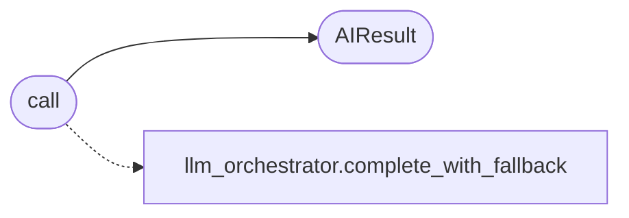

# `modules.ai_fallback`

> Source: [modules/ai_fallback.py:1](../../modules/ai_fallback.py#L1) | language `py` | coverage 66.7% | [API index](../index.md)

LazyOwn AI Fallback Chain ========================= Unified LLM caller with automatic fallback:

1. Orchestrator chain (lazy_orchestrator pool, weight-sorted legs
     executed through modules.llm_factory — groq, ollama, llamacpp,
     pi, toposwarm)
       ↓ when every chain member fails
  2. Direct Groq call with the caller-supplied key (only when the chain
     never attempted a groq leg)
       ↓ on quota / rate-limit error
  3. Ollama (local, requires ollama running + a chat model)
       ↓ if Ollama unreachable or no suitable model
  4. TopoSwarm local brain
       ↓
  5. Helpful error message with actionable steps

Used by recommender.py and timeline_narrator.py so fallback
logic lives in exactly one place.

Public API
----------
call(prompt, system, api_key, max_tokens, temperature) -> AIResult

AIResult fields:
  .text     str   — the response text (or error/help message)
  .backend  str   — "groq" | "ollama" | "toposwarm" | "error"
  .model    str   — model name used
  .error    str   — original error if fallback occurred (else "")

## Contents

- **Classes:** [`AIResult`](#airesult)
- **Functions:** [`call`](#call)

## Call Graph

Solid arrows stay in this module, dashed arrows leave it.



## Classes

<a id="airesult"></a>

### `AIResult`

`class` `dataclass` | [modules/ai_fallback.py:108](../../modules/ai_fallback.py#L108)

Decorators: `@dataclass`

```python
class AIResult
```

**Attributes**

| Name | Type | Default | Description |
|---|---|---|---|
| [`text`](#airesult-text) | `str` |  |  |
| [`backend`](#airesult-backend) | `str` |  |  |
| [`model`](#airesult-model) | `str` | `''` |  |
| [`error`](#airesult-error) | `str` | `''` |  |

---

## Functions

<a id="call"></a>

### `call`

`function` | [modules/ai_fallback.py:280](../../modules/ai_fallback.py#L280)

```python
def call(prompt: str, system: str = '', api_key: str = '', max_tokens: int = 1024, temperature: float = 0.3) -> AIResult
```

Call the orchestrator chain first, then Groq (explicit key only), Ollama, TopoSwarm, and finally return the help message.

Returns an AIResult with .text, .backend, .model, .error.

**Parameters**

| Name | Type | Default | Description |
|---|---|---|---|
| `prompt` | `str` |  |  |
| `system` | `str` | `''` |  |
| `api_key` | `str` | `''` |  |
| `max_tokens` | `int` | `1024` |  |
| `temperature` | `float` | `0.3` |  |

**Returns:** `AIResult`

*Calls:* [`AIResult`](#airesult), [`complete_with_fallback`](modules.llm_orchestrator.py.md#complete_with_fallback)

---
