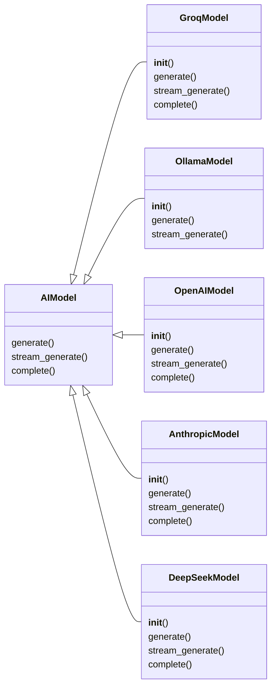
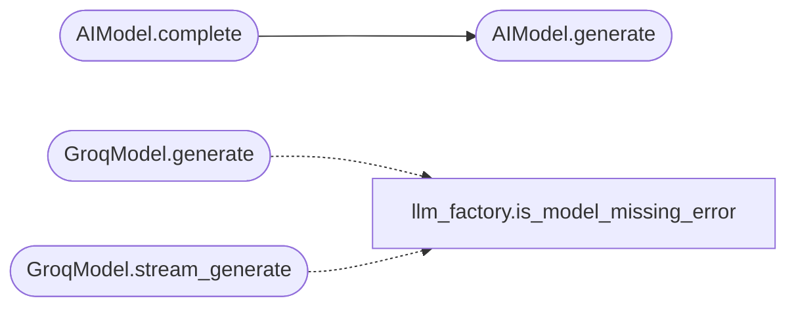

# `modules.ai_model`

> Source: [modules/ai_model.py:1](../../modules/ai_model.py#L1) | language `py` | coverage 82.8% | [API index](../index.md)

Concrete language model backends for LazyOwn.

This module exposes the abstract [`AIModel`](#aimodel) together with five
concrete implementations: [`GroqModel`](#groqmodel) (cloud),
[`OllamaModel`](#ollamamodel) (local), [`OpenAIModel`](#openaimodel) (cloud),
[`AnthropicModel`](#anthropicmodel) (cloud), and [`DeepSeekModel`](#deepseekmodel) (cloud).
Every implementation honours both the historical
`[`generate`](#aimodel-generate)`/`[`stream_generate`](#aimodel-stream_generate)` interface used by the existing AI
agents and the [`complete`](modules.llm_factory.py.md#complete) signature defined in
`[`core.protocols.LLMBackend`](core.protocols.py.md#llmbackend)`. Callers depending on the abstract type
remain decoupled from the concrete provider.

For provider selection driven by ``payload.json`` use
[`modules.llm_factory.get_llm_backend`](modules.llm_factory.py.md#get_llm_backend). Do not instantiate the
concrete classes from new code unless a test explicitly requires it.

## Contents

- **Classes:** [`AIModel`](#aimodel), [`GroqModel`](#groqmodel), [`OllamaModel`](#ollamamodel), [`OpenAIModel`](#openaimodel), [`AnthropicModel`](#anthropicmodel), [`DeepSeekModel`](#deepseekmodel)
- **Constants:** [`DEFAULT_GROQ_MODEL`](#default_groq_model), [`DEFAULT_OLLAMA_MODEL`](#default_ollama_model), [`DEFAULT_OLLAMA_HOST`](#default_ollama_host), [`DEFAULT_OPENAI_MODEL`](#default_openai_model), [`DEFAULT_ANTHROPIC_MODEL`](#default_anthropic_model), [`DEFAULT_DEEPSEEK_MODEL`](#default_deepseek_model), [`DEFAULT_COMPLETE_MAX_TOKENS`](#default_complete_max_tokens), [`DEFAULT_COMPLETE_TEMPERATURE`](#default_complete_temperature)

## Type Diagram



## Call Graph

Solid arrows stay in this module, dashed arrows leave it.



## Classes

<a id="aimodel"></a>

### `AIModel`

`class` `abstract` | [modules/ai_model.py:41](../../modules/ai_model.py#L41)

```python
class AIModel(ABC)
```

Bases: `ABC`

Subclasses: [`AnthropicModel`](#anthropicmodel), [`DeepSeekModel`](#deepseekmodel), [`GroqModel`](#groqmodel), [`OllamaModel`](#ollamamodel), [`OpenAIModel`](#openaimodel)

Abstract base class for language model backends.

Concrete subclasses must implement [`generate`](#aimodel-generate) and
[`stream_generate`](#aimodel-stream_generate). A default [`complete`](modules.llm_factory.py.md#complete) implementation
is provided that combines ``system`` and ``user`` prompts into the
historical single-prompt format so subclasses gain
`[`core.protocols.LLMBackend`](core.protocols.py.md#llmbackend)` compatibility for free.

**Members**

| Member | Kind | Summary |
|---|---|---|
| [`generate`](#aimodel-generate) | method | Return a non-streaming completion for `[`prompt`](utils.py.md#prompt)`. |
| [`stream_generate`](#aimodel-stream_generate) | method | Yield streaming completion chunks for `[`prompt`](utils.py.md#prompt)`. |
| [`complete`](#aimodel-complete) | method | Return a completion conforming to `[`core.protocols.LLMBackend`](core.protocols.py.md#llmbackend)`. |

<a id="aimodel-generate"></a>

#### `AIModel.generate`

`method` `abstract` | [modules/ai_model.py:52](../../modules/ai_model.py#L52)

Decorators: `@abstractmethod`

```python
def generate(self, prompt: str) -> Union[str, Generator[str, None, None]]
```

Return a non-streaming completion for `[`prompt`](utils.py.md#prompt)`.

**Parameters**

| Name | Type | Default | Description |
|---|---|---|---|
| `prompt` | `str` |  |  |

**Returns:** `Union[str, Generator[str, None, None]]`

*Called by:* [`AIModel.complete`](#aimodel-complete), [`VulnBotCLI.stream_response`](modules.vulnbot.py.md#vulnbotcli-stream_response)

<a id="aimodel-stream_generate"></a>

#### `AIModel.stream_generate`

`method` `abstract` | [modules/ai_model.py:56](../../modules/ai_model.py#L56)

Decorators: `@abstractmethod`

```python
def stream_generate(self, prompt: str) -> Generator[str, None, None]
```

Yield streaming completion chunks for `[`prompt`](utils.py.md#prompt)`.

**Parameters**

| Name | Type | Default | Description |
|---|---|---|---|
| `prompt` | `str` |  |  |

**Returns:** `Generator[str, None, None]`

<a id="aimodel-complete"></a>

#### `AIModel.complete`

`method` | [modules/ai_model.py:59](../../modules/ai_model.py#L59)

```python
def complete(self, system: str, user: str, max_tokens: int = DEFAULT_COMPLETE_MAX_TOKENS, temperature: float = DEFAULT_COMPLETE_TEMPERATURE) -> str
```

Return a completion conforming to `[`core.protocols.LLMBackend`](core.protocols.py.md#llmbackend)`.

The default implementation concatenates ``system`` and ``user``
with explicit role markers and delegates to [`generate`](#aimodel-generate).
Backends that natively support role-aware chat formats may
override this method for higher fidelity.

**Parameters**

| Name | Type | Default | Description |
|---|---|---|---|
| `system` | `str` |  | System prompt establishing persona, constraints, and output contract. |
| `user` | `str` |  | User-turn prompt with the concrete task. |
| `max_tokens` | `int` | `DEFAULT_COMPLETE_MAX_TOKENS` | Advisory cap accepted for protocol parity. Concrete backends honour it when their SDK supports it. |
| `temperature` | `float` | `DEFAULT_COMPLETE_TEMPERATURE` | Advisory sampling temperature accepted for protocol parity. |

**Returns:** `str` - The completion as a string.

*Calls:* [`AIModel.generate`](#aimodel-generate)

---

<a id="groqmodel"></a>

### `GroqModel`

`class` | [modules/ai_model.py:125](../../modules/ai_model.py#L125)

```python
class GroqModel(AIModel)
```

Bases: [`AIModel`](#aimodel)

Groq-hosted Llama backend.

Uses the official ``groq`` SDK. Errors are returned as readable
strings rather than raised so callers do not have to wrap every
invocation in try/except blocks for surface-level failures.

**Members**

| Member | Kind | Summary |
|---|---|---|
| [`__init__`](#groqmodel-__init__) | constructor |  |
| [`generate`](#groqmodel-generate) | method | Return a single completion for `[`prompt`](utils.py.md#prompt)`. |
| [`stream_generate`](#groqmodel-stream_generate) | method | Yield streamed completion chunks for `[`prompt`](utils.py.md#prompt)`. |
| [`complete`](#groqmodel-complete) | method | Return a chat completion using native role separation. |

<a id="groqmodel-__init__"></a>

#### `GroqModel.__init__`

`constructor` | [modules/ai_model.py:133](../../modules/ai_model.py#L133)

```python
def __init__(self, api_key: str, model: str = DEFAULT_GROQ_MODEL) -> None
```

**Parameters**

| Name | Type | Default | Description |
|---|---|---|---|
| `api_key` | `str` |  |  |
| `model` | `str` | `DEFAULT_GROQ_MODEL` |  |

<a id="groqmodel-generate"></a>

#### `GroqModel.generate`

`method` | [modules/ai_model.py:151](../../modules/ai_model.py#L151)

```python
def generate(self, prompt: str) -> str
```

Return a single completion for `[`prompt`](utils.py.md#prompt)`.

Fails over to a known-good model id when the configured one is
unavailable (Groq answers 404 model_not_found for retired ids).

**Parameters**

| Name | Type | Default | Description |
|---|---|---|---|
| `prompt` | `str` |  | The full prompt string sent to Groq. |

**Returns:** `str` - The model completion or a human-readable error string.

*Calls:* [`is_model_missing_error`](modules.llm_factory.py.md#is_model_missing_error)

<a id="groqmodel-stream_generate"></a>

#### `GroqModel.stream_generate`

`method` `generator` | [modules/ai_model.py:179](../../modules/ai_model.py#L179)

```python
def stream_generate(self, prompt: str) -> Generator[str, None, None]
```

Yield streamed completion chunks for `[`prompt`](utils.py.md#prompt)`.

Fails over to a known-good model id when the configured one is
unavailable, mirroring [`generate`](#aimodel-generate).

**Parameters**

| Name | Type | Default | Description |
|---|---|---|---|
| `prompt` | `str` |  | The full prompt string sent to Groq. |

**Returns:** `Generator[str, None, None]`

**Yields:** Successive content fragments emitted by the Groq stream.

*Calls:* [`is_model_missing_error`](modules.llm_factory.py.md#is_model_missing_error)

<a id="groqmodel-complete"></a>

#### `GroqModel.complete`

`method` | [modules/ai_model.py:212](../../modules/ai_model.py#L212)

```python
def complete(self, system: str, user: str, max_tokens: int = DEFAULT_COMPLETE_MAX_TOKENS, temperature: float = DEFAULT_COMPLETE_TEMPERATURE) -> str
```

Return a chat completion using native role separation.

Overrides the default [`AIModel.complete`](#aimodel-complete) to leverage
Groq's chat schema and to honour ``max_tokens`` / `[`temperature`](modules.moe_router.py.md#softmaxselector-temperature)`
directly.

**Parameters**

| Name | Type | Default | Description |
|---|---|---|---|
| `system` | `str` |  |  |
| `user` | `str` |  |  |
| `max_tokens` | `int` | `DEFAULT_COMPLETE_MAX_TOKENS` |  |
| `temperature` | `float` | `DEFAULT_COMPLETE_TEMPERATURE` |  |

**Returns:** `str`

---

<a id="ollamamodel"></a>

### `OllamaModel`

`class` | [modules/ai_model.py:240](../../modules/ai_model.py#L240)

```python
class OllamaModel(AIModel)
```

Bases: [`AIModel`](#aimodel)

Ollama-hosted local backend.

Communicates with a local Ollama daemon via its HTTP API. The model
identifier and host are configurable so operators can point at any
Ollama-compatible endpoint without code changes.

**Members**

| Member | Kind | Summary |
|---|---|---|
| [`__init__`](#ollamamodel-__init__) | constructor |  |
| [`generate`](#ollamamodel-generate) | method | Return a single completion for `[`prompt`](utils.py.md#prompt)`. |
| [`stream_generate`](#ollamamodel-stream_generate) | method | Yield streamed completion chunks for `[`prompt`](utils.py.md#prompt)`. |

<a id="ollamamodel-__init__"></a>

#### `OllamaModel.__init__`

`constructor` | [modules/ai_model.py:248](../../modules/ai_model.py#L248)

```python
def __init__(self, model: str = DEFAULT_OLLAMA_MODEL, host: str = DEFAULT_OLLAMA_HOST) -> None
```

**Parameters**

| Name | Type | Default | Description |
|---|---|---|---|
| `model` | `str` | `DEFAULT_OLLAMA_MODEL` |  |
| `host` | `str` | `DEFAULT_OLLAMA_HOST` |  |

<a id="ollamamodel-generate"></a>

#### `OllamaModel.generate`

`method` | [modules/ai_model.py:256](../../modules/ai_model.py#L256)

```python
def generate(self, prompt: str) -> str
```

Return a single completion for `[`prompt`](utils.py.md#prompt)`.

**Parameters**

| Name | Type | Default | Description |
|---|---|---|---|
| `prompt` | `str` |  | The full prompt string sent to Ollama. |

**Returns:** `str` - The model completion or a human-readable error string.

<a id="ollamamodel-stream_generate"></a>

#### `OllamaModel.stream_generate`

`method` `generator` | [modules/ai_model.py:276](../../modules/ai_model.py#L276)

```python
def stream_generate(self, prompt: str) -> Generator[str, None, None]
```

Yield streamed completion chunks for `[`prompt`](utils.py.md#prompt)`.

**Parameters**

| Name | Type | Default | Description |
|---|---|---|---|
| `prompt` | `str` |  | The full prompt string sent to Ollama. |

**Returns:** `Generator[str, None, None]`

**Yields:** Successive ``response`` fields from the Ollama stream.

---

<a id="openaimodel"></a>

### `OpenAIModel`

`class` | [modules/ai_model.py:307](../../modules/ai_model.py#L307)

```python
class OpenAIModel(AIModel)
```

Bases: [`AIModel`](#aimodel)

OpenAI-hosted backend (GPT-4o, GPT-4, etc.).

Uses the ``openai`` SDK. Requires an OpenAI API key.

**Members**

| Member | Kind | Summary |
|---|---|---|
| [`__init__`](#openaimodel-__init__) | constructor |  |
| [`generate`](#openaimodel-generate) | method | Return a non-streaming completion for `[`prompt`](utils.py.md#prompt)`. |
| [`stream_generate`](#openaimodel-stream_generate) | method | Yield streaming completion chunks for `[`prompt`](utils.py.md#prompt)`. |
| [`complete`](#openaimodel-complete) | method | Return a completion conforming to `[`core.protocols.LLMBackend`](core.protocols.py.md#llmbackend)`. |

<a id="openaimodel-__init__"></a>

#### `OpenAIModel.__init__`

`constructor` | [modules/ai_model.py:313](../../modules/ai_model.py#L313)

```python
def __init__(self, api_key: str, model: str = DEFAULT_OPENAI_MODEL) -> None
```

**Parameters**

| Name | Type | Default | Description |
|---|---|---|---|
| `api_key` | `str` |  |  |
| `model` | `str` | `DEFAULT_OPENAI_MODEL` |  |

<a id="openaimodel-generate"></a>

#### `OpenAIModel.generate`

`method` | [modules/ai_model.py:317](../../modules/ai_model.py#L317)

```python
def generate(self, prompt: str) -> str
```

Return a non-streaming completion for `[`prompt`](utils.py.md#prompt)`.

**Parameters**

| Name | Type | Default | Description |
|---|---|---|---|
| `prompt` | `str` |  |  |

**Returns:** `str`

> **Inherited:** Documentation from [`AIModel.generate`](#aimodel-generate) (modules/ai_model.py:52).

<a id="openaimodel-stream_generate"></a>

#### `OpenAIModel.stream_generate`

`method` `generator` | [modules/ai_model.py:328](../../modules/ai_model.py#L328)

```python
def stream_generate(self, prompt: str) -> Generator[str, None, None]
```

Yield streaming completion chunks for `[`prompt`](utils.py.md#prompt)`.

**Parameters**

| Name | Type | Default | Description |
|---|---|---|---|
| `prompt` | `str` |  |  |

**Returns:** `Generator[str, None, None]`

> **Inherited:** Documentation from [`AIModel.stream_generate`](#aimodel-stream_generate) (modules/ai_model.py:56).

<a id="openaimodel-complete"></a>

#### `OpenAIModel.complete`

`method` | [modules/ai_model.py:343](../../modules/ai_model.py#L343)

```python
def complete(self, system: str, user: str, max_tokens: int = DEFAULT_COMPLETE_MAX_TOKENS, temperature: float = DEFAULT_COMPLETE_TEMPERATURE) -> str
```

Return a completion conforming to `[`core.protocols.LLMBackend`](core.protocols.py.md#llmbackend)`.

The default implementation concatenates ``system`` and ``user``
with explicit role markers and delegates to [`generate`](#aimodel-generate).
Backends that natively support role-aware chat formats may
override this method for higher fidelity.

**Parameters**

| Name | Type | Default | Description |
|---|---|---|---|
| `system` | `str` |  | System prompt establishing persona, constraints, and output contract. |
| `user` | `str` |  | User-turn prompt with the concrete task. |
| `max_tokens` | `int` | `DEFAULT_COMPLETE_MAX_TOKENS` | Advisory cap accepted for protocol parity. Concrete backends honour it when their SDK supports it. |
| `temperature` | `float` | `DEFAULT_COMPLETE_TEMPERATURE` | Advisory sampling temperature accepted for protocol parity. |

**Returns:** `str` - The completion as a string.

> **Inherited:** Documentation from [`AIModel.complete`](#aimodel-complete) (modules/ai_model.py:59).

---

<a id="anthropicmodel"></a>

### `AnthropicModel`

`class` | [modules/ai_model.py:366](../../modules/ai_model.py#L366)

```python
class AnthropicModel(AIModel)
```

Bases: [`AIModel`](#aimodel)

Anthropic Claude backend.

Uses the ``anthropic`` SDK. Requires an Anthropic API key.

**Members**

| Member | Kind | Summary |
|---|---|---|
| [`__init__`](#anthropicmodel-__init__) | constructor |  |
| [`generate`](#anthropicmodel-generate) | method | Return a non-streaming completion for `[`prompt`](utils.py.md#prompt)`. |
| [`stream_generate`](#anthropicmodel-stream_generate) | method | Yield streaming completion chunks for `[`prompt`](utils.py.md#prompt)`. |
| [`complete`](#anthropicmodel-complete) | method | Return a completion conforming to `[`core.protocols.LLMBackend`](core.protocols.py.md#llmbackend)`. |

<a id="anthropicmodel-__init__"></a>

#### `AnthropicModel.__init__`

`constructor` | [modules/ai_model.py:372](../../modules/ai_model.py#L372)

```python
def __init__(self, api_key: str, model: str = DEFAULT_ANTHROPIC_MODEL) -> None
```

**Parameters**

| Name | Type | Default | Description |
|---|---|---|---|
| `api_key` | `str` |  |  |
| `model` | `str` | `DEFAULT_ANTHROPIC_MODEL` |  |

<a id="anthropicmodel-generate"></a>

#### `AnthropicModel.generate`

`method` | [modules/ai_model.py:376](../../modules/ai_model.py#L376)

```python
def generate(self, prompt: str) -> str
```

Return a non-streaming completion for `[`prompt`](utils.py.md#prompt)`.

**Parameters**

| Name | Type | Default | Description |
|---|---|---|---|
| `prompt` | `str` |  |  |

**Returns:** `str`

> **Inherited:** Documentation from [`AIModel.generate`](#aimodel-generate) (modules/ai_model.py:52).

<a id="anthropicmodel-stream_generate"></a>

#### `AnthropicModel.stream_generate`

`method` `generator` | [modules/ai_model.py:388](../../modules/ai_model.py#L388)

```python
def stream_generate(self, prompt: str) -> Generator[str, None, None]
```

Yield streaming completion chunks for `[`prompt`](utils.py.md#prompt)`.

**Parameters**

| Name | Type | Default | Description |
|---|---|---|---|
| `prompt` | `str` |  |  |

**Returns:** `Generator[str, None, None]`

> **Inherited:** Documentation from [`AIModel.stream_generate`](#aimodel-stream_generate) (modules/ai_model.py:56).

<a id="anthropicmodel-complete"></a>

#### `AnthropicModel.complete`

`method` | [modules/ai_model.py:402](../../modules/ai_model.py#L402)

```python
def complete(self, system: str, user: str, max_tokens: int = DEFAULT_COMPLETE_MAX_TOKENS, temperature: float = DEFAULT_COMPLETE_TEMPERATURE) -> str
```

Return a completion conforming to `[`core.protocols.LLMBackend`](core.protocols.py.md#llmbackend)`.

The default implementation concatenates ``system`` and ``user``
with explicit role markers and delegates to [`generate`](#aimodel-generate).
Backends that natively support role-aware chat formats may
override this method for higher fidelity.

**Parameters**

| Name | Type | Default | Description |
|---|---|---|---|
| `system` | `str` |  | System prompt establishing persona, constraints, and output contract. |
| `user` | `str` |  | User-turn prompt with the concrete task. |
| `max_tokens` | `int` | `DEFAULT_COMPLETE_MAX_TOKENS` | Advisory cap accepted for protocol parity. Concrete backends honour it when their SDK supports it. |
| `temperature` | `float` | `DEFAULT_COMPLETE_TEMPERATURE` | Advisory sampling temperature accepted for protocol parity. |

**Returns:** `str` - The completion as a string.

> **Inherited:** Documentation from [`AIModel.complete`](#aimodel-complete) (modules/ai_model.py:59).

---

<a id="deepseekmodel"></a>

### `DeepSeekModel`

`class` | [modules/ai_model.py:422](../../modules/ai_model.py#L422)

```python
class DeepSeekModel(AIModel)
```

Bases: [`AIModel`](#aimodel)

DeepSeek cloud backend.

Uses the OpenAI-compatible API at api.deepseek.com.
Requires a DeepSeek API key.

**Members**

| Member | Kind | Summary |
|---|---|---|
| [`__init__`](#deepseekmodel-__init__) | constructor |  |
| [`generate`](#deepseekmodel-generate) | method | Return a non-streaming completion for `[`prompt`](utils.py.md#prompt)`. |
| [`stream_generate`](#deepseekmodel-stream_generate) | method | Yield streaming completion chunks for `[`prompt`](utils.py.md#prompt)`. |
| [`complete`](#deepseekmodel-complete) | method | Return a completion conforming to `[`core.protocols.LLMBackend`](core.protocols.py.md#llmbackend)`. |

<a id="deepseekmodel-__init__"></a>

#### `DeepSeekModel.__init__`

`constructor` | [modules/ai_model.py:429](../../modules/ai_model.py#L429)

```python
def __init__(self, api_key: str, model: str = DEFAULT_DEEPSEEK_MODEL) -> None
```

**Parameters**

| Name | Type | Default | Description |
|---|---|---|---|
| `api_key` | `str` |  |  |
| `model` | `str` | `DEFAULT_DEEPSEEK_MODEL` |  |

<a id="deepseekmodel-generate"></a>

#### `DeepSeekModel.generate`

`method` | [modules/ai_model.py:436](../../modules/ai_model.py#L436)

```python
def generate(self, prompt: str) -> str
```

Return a non-streaming completion for `[`prompt`](utils.py.md#prompt)`.

**Parameters**

| Name | Type | Default | Description |
|---|---|---|---|
| `prompt` | `str` |  |  |

**Returns:** `str`

> **Inherited:** Documentation from [`AIModel.generate`](#aimodel-generate) (modules/ai_model.py:52).

<a id="deepseekmodel-stream_generate"></a>

#### `DeepSeekModel.stream_generate`

`method` `generator` | [modules/ai_model.py:447](../../modules/ai_model.py#L447)

```python
def stream_generate(self, prompt: str) -> Generator[str, None, None]
```

Yield streaming completion chunks for `[`prompt`](utils.py.md#prompt)`.

**Parameters**

| Name | Type | Default | Description |
|---|---|---|---|
| `prompt` | `str` |  |  |

**Returns:** `Generator[str, None, None]`

> **Inherited:** Documentation from [`AIModel.stream_generate`](#aimodel-stream_generate) (modules/ai_model.py:56).

<a id="deepseekmodel-complete"></a>

#### `DeepSeekModel.complete`

`method` | [modules/ai_model.py:462](../../modules/ai_model.py#L462)

```python
def complete(self, system: str, user: str, max_tokens: int = DEFAULT_COMPLETE_MAX_TOKENS, temperature: float = DEFAULT_COMPLETE_TEMPERATURE) -> str
```

Return a completion conforming to `[`core.protocols.LLMBackend`](core.protocols.py.md#llmbackend)`.

The default implementation concatenates ``system`` and ``user``
with explicit role markers and delegates to [`generate`](#aimodel-generate).
Backends that natively support role-aware chat formats may
override this method for higher fidelity.

**Parameters**

| Name | Type | Default | Description |
|---|---|---|---|
| `system` | `str` |  | System prompt establishing persona, constraints, and output contract. |
| `user` | `str` |  | User-turn prompt with the concrete task. |
| `max_tokens` | `int` | `DEFAULT_COMPLETE_MAX_TOKENS` | Advisory cap accepted for protocol parity. Concrete backends honour it when their SDK supports it. |
| `temperature` | `float` | `DEFAULT_COMPLETE_TEMPERATURE` | Advisory sampling temperature accepted for protocol parity. |

**Returns:** `str` - The completion as a string.

> **Inherited:** Documentation from [`AIModel.complete`](#aimodel-complete) (modules/ai_model.py:59).

---

## Constants

<a id="default_groq_model"></a>

### `DEFAULT_GROQ_MODEL`

`constant` | [modules/ai_model.py:30](../../modules/ai_model.py#L30)

```python
DEFAULT_GROQ_MODEL = 'llama-3.3-70b-versatile'
```

---

<a id="default_ollama_model"></a>

### `DEFAULT_OLLAMA_MODEL`

`constant` | [modules/ai_model.py:31](../../modules/ai_model.py#L31)

```python
DEFAULT_OLLAMA_MODEL = 'deepseek-r1:1.5b'
```

---

<a id="default_ollama_host"></a>

### `DEFAULT_OLLAMA_HOST`

`constant` | [modules/ai_model.py:32](../../modules/ai_model.py#L32)

```python
DEFAULT_OLLAMA_HOST = 'http://localhost:11434'
```

---

<a id="default_openai_model"></a>

### `DEFAULT_OPENAI_MODEL`

`constant` | [modules/ai_model.py:33](../../modules/ai_model.py#L33)

```python
DEFAULT_OPENAI_MODEL = 'gpt-4o'
```

---

<a id="default_anthropic_model"></a>

### `DEFAULT_ANTHROPIC_MODEL`

`constant` | [modules/ai_model.py:34](../../modules/ai_model.py#L34)

```python
DEFAULT_ANTHROPIC_MODEL = 'claude-sonnet-4-20250514'
```

---

<a id="default_deepseek_model"></a>

### `DEFAULT_DEEPSEEK_MODEL`

`constant` | [modules/ai_model.py:35](../../modules/ai_model.py#L35)

```python
DEFAULT_DEEPSEEK_MODEL = 'deepseek-chat'
```

---

<a id="default_complete_max_tokens"></a>

### `DEFAULT_COMPLETE_MAX_TOKENS`

`constant` | [modules/ai_model.py:36](../../modules/ai_model.py#L36)

```python
DEFAULT_COMPLETE_MAX_TOKENS = 1024
```

---

<a id="default_complete_temperature"></a>

### `DEFAULT_COMPLETE_TEMPERATURE`

`constant` | [modules/ai_model.py:37](../../modules/ai_model.py#L37)

```python
DEFAULT_COMPLETE_TEMPERATURE = 0.2
```

---
