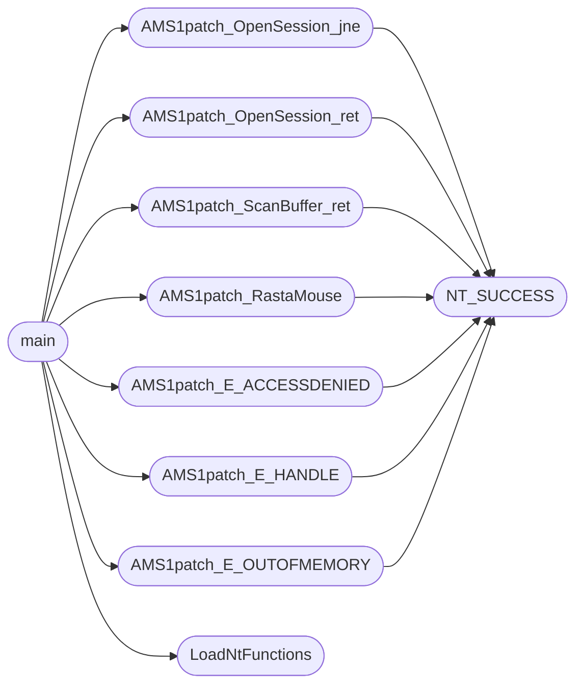

# `modules/amsi.c`

> Source: [modules/amsi.c:1](../../modules/amsi.c#L1) | language `c` | coverage 81.8% | [API index](../index.md)

¡Gracias a Saad!

## Contents

- **Functions:** [`LoadNtFunctions`](#loadntfunctions), [`AMS1patch_OpenSession_jne`](#ams1patch_opensession_jne), [`AMS1patch_OpenSession_ret`](#ams1patch_opensession_ret), [`AMS1patch_ScanBuffer_ret`](#ams1patch_scanbuffer_ret), [`AMS1patch_RastaMouse`](#ams1patch_rastamouse), [`AMS1patch_E_ACCESSDENIED`](#ams1patch_e_accessdenied), [`AMS1patch_E_HANDLE`](#ams1patch_e_handle), [`AMS1patch_E_OUTOFMEMORY`](#ams1patch_e_outofmemory), [`main`](#main)
- **Macros:** [`NT_SUCCESS`](#nt_success)

## Call Graph

Solid arrows stay in this module, dashed arrows leave it.



## Functions

<a id="loadntfunctions"></a>

### `LoadNtFunctions`

`function` | [modules/amsi.c:38](../../modules/amsi.c#L38)

```c
void LoadNtFunctions()
```

Función para cargar las funciones dinámicamente

*Called by:* [`main`](#main)

---

<a id="ams1patch_opensession_jne"></a>

### `AMS1patch_OpenSession_jne`

`function` | [modules/amsi.c:66](../../modules/amsi.c#L66)

```c
void AMS1patch_OpenSession_jne(HANDLE hproc)
```

Técnica de Saad, también conocido como @D1rkMtr (https://twitter.com/D1rkMtr/) (https://github.com/TheD1rkMtr/AMSI_patch) 1

**Parameters**

| Name | Type | Default | Description |
|---|---|---|---|
| `hproc` | `HANDLE` |  |  |

*Calls:* [`NT_SUCCESS`](#nt_success)

*Called by:* [`main`](#main)

---

<a id="ams1patch_opensession_ret"></a>

### `AMS1patch_OpenSession_ret`

`function` | [modules/amsi.c:116](../../modules/amsi.c#L116)

```c
void AMS1patch_OpenSession_ret(HANDLE hproc)
```

2

**Parameters**

| Name | Type | Default | Description |
|---|---|---|---|
| `hproc` | `HANDLE` |  |  |

*Calls:* [`NT_SUCCESS`](#nt_success)

*Called by:* [`main`](#main)

---

<a id="ams1patch_scanbuffer_ret"></a>

### `AMS1patch_ScanBuffer_ret`

`function` | [modules/amsi.c:166](../../modules/amsi.c#L166)

```c
void AMS1patch_ScanBuffer_ret(HANDLE hproc)
```

3

**Parameters**

| Name | Type | Default | Description |
|---|---|---|---|
| `hproc` | `HANDLE` |  |  |

*Calls:* [`NT_SUCCESS`](#nt_success)

*Called by:* [`main`](#main)

---

<a id="ams1patch_rastamouse"></a>

### `AMS1patch_RastaMouse`

`function` | [modules/amsi.c:215](../../modules/amsi.c#L215)

```c
void AMS1patch_RastaMouse(HANDLE hproc)
```

4

**Parameters**

| Name | Type | Default | Description |
|---|---|---|---|
| `hproc` | `HANDLE` |  |  |

*Calls:* [`NT_SUCCESS`](#nt_success)

*Called by:* [`main`](#main)

---

<a id="ams1patch_e_accessdenied"></a>

### `AMS1patch_E_ACCESSDENIED`

`function` | [modules/amsi.c:274](../../modules/amsi.c#L274)

```c
void AMS1patch_E_ACCESSDENIED(HANDLE hproc)
```

5

**Parameters**

| Name | Type | Default | Description |
|---|---|---|---|
| `hproc` | `HANDLE` |  |  |

*Calls:* [`NT_SUCCESS`](#nt_success)

*Called by:* [`main`](#main)

---

<a id="ams1patch_e_handle"></a>

### `AMS1patch_E_HANDLE`

`function` | [modules/amsi.c:326](../../modules/amsi.c#L326)

```c
void AMS1patch_E_HANDLE(HANDLE hproc)
```

6

**Parameters**

| Name | Type | Default | Description |
|---|---|---|---|
| `hproc` | `HANDLE` |  |  |

*Calls:* [`NT_SUCCESS`](#nt_success)

*Called by:* [`main`](#main)

---

<a id="ams1patch_e_outofmemory"></a>

### `AMS1patch_E_OUTOFMEMORY`

`function` | [modules/amsi.c:378](../../modules/amsi.c#L378)

```c
void AMS1patch_E_OUTOFMEMORY(HANDLE hproc)
```

7

**Parameters**

| Name | Type | Default | Description |
|---|---|---|---|
| `hproc` | `HANDLE` |  |  |

*Calls:* [`NT_SUCCESS`](#nt_success)

*Called by:* [`main`](#main)

---

<a id="main"></a>

### `main`

`function` | [modules/amsi.c:428](../../modules/amsi.c#L428)

```c
int main(int argc, char** argv)
```

**Parameters**

| Name | Type | Default | Description |
|---|---|---|---|
| `argc` | `int` |  |  |
| `argv` | `char**` |  |  |

**Returns:** `int`

*Calls:* [`AMS1patch_E_ACCESSDENIED`](#ams1patch_e_accessdenied), [`AMS1patch_E_HANDLE`](#ams1patch_e_handle), [`AMS1patch_E_OUTOFMEMORY`](#ams1patch_e_outofmemory), [`AMS1patch_OpenSession_jne`](#ams1patch_opensession_jne), [`AMS1patch_OpenSession_ret`](#ams1patch_opensession_ret), [`AMS1patch_RastaMouse`](#ams1patch_rastamouse), [`AMS1patch_ScanBuffer_ret`](#ams1patch_scanbuffer_ret), [`LoadNtFunctions`](#loadntfunctions)

---

## Macros

<a id="nt_success"></a>

### `NT_SUCCESS`

`macro` | [modules/amsi.c:11](../../modules/amsi.c#L11)

```c
#define NT_SUCCESS(Status)
```

*Called by:* [`AMS1patch_E_ACCESSDENIED`](#ams1patch_e_accessdenied), [`AMS1patch_E_HANDLE`](#ams1patch_e_handle), [`AMS1patch_E_OUTOFMEMORY`](#ams1patch_e_outofmemory), [`AMS1patch_OpenSession_jne`](#ams1patch_opensession_jne), [`AMS1patch_OpenSession_ret`](#ams1patch_opensession_ret), [`AMS1patch_RastaMouse`](#ams1patch_rastamouse), [`AMS1patch_ScanBuffer_ret`](#ams1patch_scanbuffer_ret)

---
