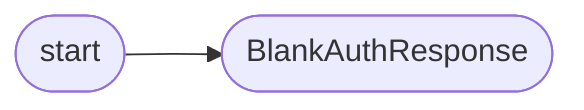

# `modules.amt_auth_bypass`

> Source: [modules/amt_auth_bypass.py:1](../../modules/amt_auth_bypass.py#L1) | language `py` | coverage 0.0% | [API index](../index.md)

## Contents

- **Classes:** [`BlankAuthResponse`](#blankauthresponse)
- **Functions:** [`start`](#start)

## Call Graph

Solid arrows stay in this module, dashed arrows leave it.



## Classes

<a id="blankauthresponse"></a>

### `BlankAuthResponse`

`class` | [modules/amt_auth_bypass.py:8](../../modules/amt_auth_bypass.py#L8)

```python
class BlankAuthResponse
```

**Attributes**

| Name | Type | Default | Description |
|---|---|---|---|
| [`RESPONSE_RE`](#blankauthresponse-response_re) |  | `re.compile('(response=".*?")', flags=re.DOTALL)` |  |

**Members**

| Member | Kind | Summary |
|---|---|---|
| [`request`](#blankauthresponse-request) | method |  |

<a id="blankauthresponse-request"></a>

#### `BlankAuthResponse.request`

`method` | [modules/amt_auth_bypass.py:11](../../modules/amt_auth_bypass.py#L11)

```python
def request(self, flow)
```

**Parameters**

| Name | Type | Default | Description |
|---|---|---|---|
| `flow` |  |  |  |

---

## Functions

<a id="start"></a>

### `start`

`function` | [modules/amt_auth_bypass.py:4](../../modules/amt_auth_bypass.py#L4)

```python
def start()
```

*Calls:* [`BlankAuthResponse`](#blankauthresponse)

---
