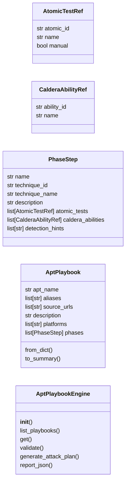
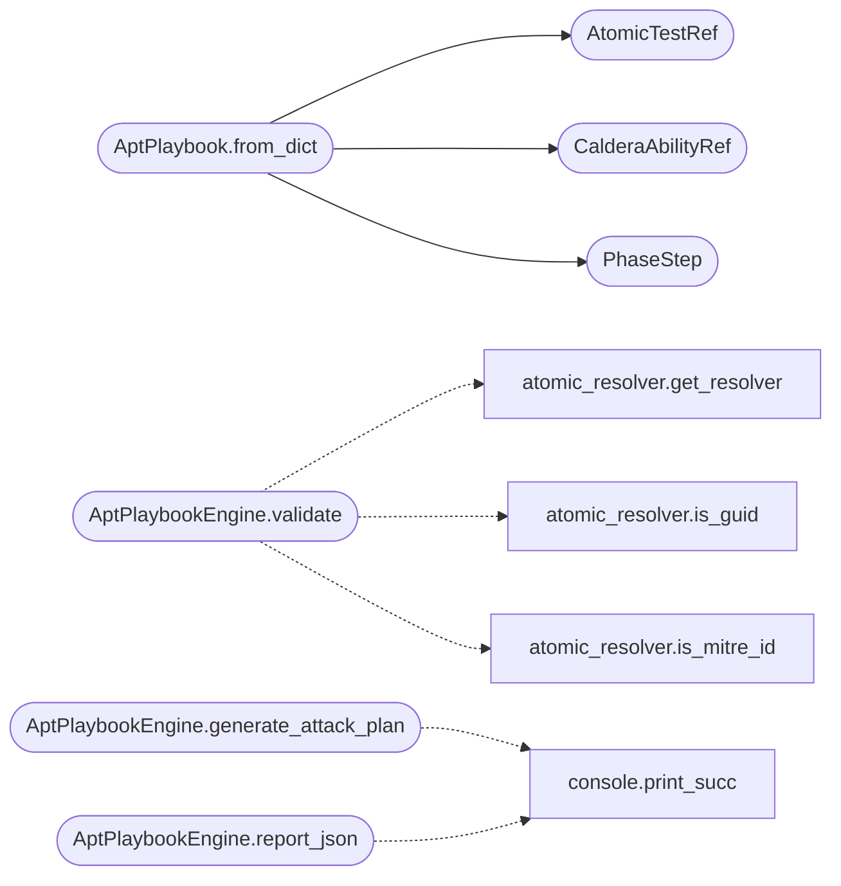

# `modules.apt_playbooks`

> Source: [modules/apt_playbooks.py:1](../../modules/apt_playbooks.py#L1) | language `py` | coverage 35.7% | [API index](../index.md)

APT Playbook Engine — map public APT reports to executable Atomic Red Team chains.

This module reads enriched playbooks from ``playbooks/apt_*.yaml`` and provides
execution, validation, and reporting without touching ``lazyown.py`` internals.

Playbook schema (enriched):
    apt_name: str
    aliases: list[str]
    source_urls: list[str]
    description: str
    platforms: list[str]
    phases:
      - name: str            # e.g. initial_access, persistence, privilege_escalation
        technique_id: str     # MITRE ATT&CK technique (e.g. T1566.001)
        technique_name: str
        description: str
        atomic_tests:
          - atomic_id: str    # ART auto_generated_guid
            name: str
            manual: bool      # If true, operator must paste command interactively
        caldera_abilities:    # Optional CALDERA ability IDs
          - ability_id: str
        detection_hints: list[str]

## Contents

- **Classes:** [`AtomicTestRef`](#atomictestref), [`CalderaAbilityRef`](#calderaabilityref), [`PhaseStep`](#phasestep), [`AptPlaybook`](#aptplaybook), [`AptPlaybookEngine`](#aptplaybookengine)

## Type Diagram



## Call Graph

Solid arrows stay in this module, dashed arrows leave it.



## Classes

<a id="atomictestref"></a>

### `AtomicTestRef`

`class` `dataclass` | [modules/apt_playbooks.py:41](../../modules/apt_playbooks.py#L41)

Decorators: `@dataclass`

```python
class AtomicTestRef
```

**Attributes**

| Name | Type | Default | Description |
|---|---|---|---|
| [`atomic_id`](#atomictestref-atomic_id) | `str` |  |  |
| [`name`](#atomictestref-name) | `str` | `''` |  |
| [`manual`](#atomictestref-manual) | `bool` | `True` |  |

---

<a id="calderaabilityref"></a>

### `CalderaAbilityRef`

`class` `dataclass` | [modules/apt_playbooks.py:48](../../modules/apt_playbooks.py#L48)

Decorators: `@dataclass`

```python
class CalderaAbilityRef
```

**Attributes**

| Name | Type | Default | Description |
|---|---|---|---|
| [`ability_id`](#calderaabilityref-ability_id) | `str` |  |  |
| [`name`](#calderaabilityref-name) | `str` | `''` |  |

---

<a id="phasestep"></a>

### `PhaseStep`

`class` `dataclass` | [modules/apt_playbooks.py:54](../../modules/apt_playbooks.py#L54)

Decorators: `@dataclass`

```python
class PhaseStep
```

**Attributes**

| Name | Type | Default | Description |
|---|---|---|---|
| [`name`](#phasestep-name) | `str` |  |  |
| [`technique_id`](#phasestep-technique_id) | `str` |  |  |
| [`technique_name`](#phasestep-technique_name) | `str` | `''` |  |
| [`description`](#phasestep-description) | `str` | `''` |  |
| [`atomic_tests`](#phasestep-atomic_tests) | `list[AtomicTestRef]` | `field(default_factory=list)` |  |
| [`caldera_abilities`](#phasestep-caldera_abilities) | `list[CalderaAbilityRef]` | `field(default_factory=list)` |  |
| [`detection_hints`](#phasestep-detection_hints) | `list[str]` | `field(default_factory=list)` |  |

---

<a id="aptplaybook"></a>

### `AptPlaybook`

`class` `dataclass` | [modules/apt_playbooks.py:65](../../modules/apt_playbooks.py#L65)

Decorators: `@dataclass`

```python
class AptPlaybook
```

**Attributes**

| Name | Type | Default | Description |
|---|---|---|---|
| [`apt_name`](#aptplaybook-apt_name) | `str` |  |  |
| [`aliases`](#aptplaybook-aliases) | `list[str]` | `field(default_factory=list)` |  |
| [`source_urls`](#aptplaybook-source_urls) | `list[str]` | `field(default_factory=list)` |  |
| [`description`](#aptplaybook-description) | `str` | `''` |  |
| [`platforms`](#aptplaybook-platforms) | `list[str]` | `field(default_factory=list)` |  |
| [`phases`](#aptplaybook-phases) | `list[PhaseStep]` | `field(default_factory=list)` |  |

**Members**

| Member | Kind | Summary |
|---|---|---|
| [`from_dict`](#aptplaybook-from_dict) | classmethod |  |
| [`to_summary`](#aptplaybook-to_summary) | method |  |

<a id="aptplaybook-from_dict"></a>

#### `AptPlaybook.from_dict`

`classmethod` | [modules/apt_playbooks.py:74](../../modules/apt_playbooks.py#L74)

Decorators: `@classmethod`

```python
def from_dict(cls, data: dict[str, Any]) -> AptPlaybook
```

**Parameters**

| Name | Type | Default | Description |
|---|---|---|---|
| `data` | `dict[str, Any]` |  |  |

**Returns:** `AptPlaybook`

*Calls:* [`AtomicTestRef`](#atomictestref), [`CalderaAbilityRef`](#calderaabilityref), [`PhaseStep`](#phasestep)

*Called by:* [`OperationManager.plan_from_apt`](modules.operation.py.md#operationmanager-plan_from_apt)

<a id="aptplaybook-to_summary"></a>

#### `AptPlaybook.to_summary`

`method` | [modules/apt_playbooks.py:99](../../modules/apt_playbooks.py#L99)

```python
def to_summary(self) -> dict[str, Any]
```

**Returns:** `dict[str, Any]`

---

<a id="aptplaybookengine"></a>

### `AptPlaybookEngine`

`class` | [modules/apt_playbooks.py:111](../../modules/apt_playbooks.py#L111)

```python
class AptPlaybookEngine
```

Load, list, validate and execute APT playbooks.

**Members**

| Member | Kind | Summary |
|---|---|---|
| [`__init__`](#aptplaybookengine-__init__) | constructor |  |
| [`list_playbooks`](#aptplaybookengine-list_playbooks) | method |  |
| [`get`](#aptplaybookengine-get) | method |  |
| [`validate`](#aptplaybookengine-validate) | method | Validate that all referenced atomic tests exist locally. |
| [`generate_attack_plan`](#aptplaybookengine-generate_attack_plan) | method | Generate a legacy ``attack_plan.yaml`` from an enriched APT playbook. |
| [`report_json`](#aptplaybookengine-report_json) | method | Write a structured JSON report of the playbook for the operator. |

<a id="aptplaybookengine-__init__"></a>

#### `AptPlaybookEngine.__init__`

`constructor` | [modules/apt_playbooks.py:114](../../modules/apt_playbooks.py#L114)

```python
def __init__(self, playbook_dir: str = 'playbooks')
```

**Parameters**

| Name | Type | Default | Description |
|---|---|---|---|
| `playbook_dir` | `str` | `'playbooks'` |  |

*Called by:* [`CommandAndControlMigratedCommandSet.do_apt_playbook`](cli.commands.command_and_control_migrated.py.md#commandandcontrolmigratedcommandset-do_apt_playbook), [`OrchestratorAssetsMixin.generate_chain`](cli.orchestrator_assets_tabs.py.md#orchestratorassetsmixin-generate_chain), [`OrchestratorAssetsMixin.playbook_candidates`](cli.orchestrator_assets_tabs.py.md#orchestratorassetsmixin-playbook_candidates)

<a id="aptplaybookengine-list_playbooks"></a>

#### `AptPlaybookEngine.list_playbooks`

`method` | [modules/apt_playbooks.py:131](../../modules/apt_playbooks.py#L131)

```python
def list_playbooks(self) -> list[dict[str, Any]]
```

**Returns:** `list[dict[str, Any]]`

*Called by:* [`CommandAndControlMigratedCommandSet.do_apt_playbook`](cli.commands.command_and_control_migrated.py.md#commandandcontrolmigratedcommandset-do_apt_playbook), [`OrchestratorAssetsMixin.playbook_candidates`](cli.orchestrator_assets_tabs.py.md#orchestratorassetsmixin-playbook_candidates)

<a id="aptplaybookengine-get"></a>

#### `AptPlaybookEngine.get`

`method` | [modules/apt_playbooks.py:134](../../modules/apt_playbooks.py#L134)

```python
def get(self, name: str) -> AptPlaybook | None
```

**Parameters**

| Name | Type | Default | Description |
|---|---|---|---|
| `name` | `str` |  |  |

**Returns:** `AptPlaybook | None`

*Called by:* [`CommandAndControlMigratedCommandSet.do_apt_playbook`](cli.commands.command_and_control_migrated.py.md#commandandcontrolmigratedcommandset-do_apt_playbook), [`OrchestratorAssetsMixin.chain_steps_preview`](cli.orchestrator_assets_tabs.py.md#orchestratorassetsmixin-chain_steps_preview), [`OrchestratorAssetsMixin.generate_chain`](cli.orchestrator_assets_tabs.py.md#orchestratorassetsmixin-generate_chain)

<a id="aptplaybookengine-validate"></a>

#### `AptPlaybookEngine.validate`

`method` | [modules/apt_playbooks.py:138](../../modules/apt_playbooks.py#L138)

```python
def validate(self, pb: AptPlaybook, atomic_path: str | None = None) -> dict[str, Any]
```

Validate that all referenced atomic tests exist locally.

Playbooks store MITRE technique IDs (``T1059.001``) or raw test
GUIDs in `[`atomic_id`](#atomictestref-atomic_id)`. Technique IDs resolve through
[`modules.atomic_resolver`](modules.atomic_resolver.py.md); GUIDs match against the local
Atomic index. Unknown formats are reported missing, never crash.

**Parameters**

| Name | Type | Default | Description |
|---|---|---|---|
| `pb` | `AptPlaybook` |  |  |
| `atomic_path` | `str \| None` | `None` |  |

**Returns:** `dict[str, Any]`

*Calls:* [`get_resolver`](modules.atomic_resolver.py.md#get_resolver), [`is_guid`](modules.atomic_resolver.py.md#is_guid), [`is_mitre_id`](modules.atomic_resolver.py.md#is_mitre_id)

*Called by:* [`CommandAndControlMigratedCommandSet.do_apt_playbook`](cli.commands.command_and_control_migrated.py.md#commandandcontrolmigratedcommandset-do_apt_playbook)

<a id="aptplaybookengine-generate_attack_plan"></a>

#### `AptPlaybookEngine.generate_attack_plan`

`method` | [modules/apt_playbooks.py:213](../../modules/apt_playbooks.py#L213)

```python
def generate_attack_plan(self, pb: AptPlaybook, output_path: str) -> None
```

Generate a legacy ``attack_plan.yaml`` from an enriched APT playbook.

**Parameters**

| Name | Type | Default | Description |
|---|---|---|---|
| `pb` | `AptPlaybook` |  |  |
| `output_path` | `str` |  |  |

*Calls:* [`print_succ`](core.console.py.md#print_succ)

*Called by:* [`CommandAndControlMigratedCommandSet.do_apt_playbook`](cli.commands.command_and_control_migrated.py.md#commandandcontrolmigratedcommandset-do_apt_playbook)

<a id="aptplaybookengine-report_json"></a>

#### `AptPlaybookEngine.report_json`

`method` | [modules/apt_playbooks.py:230](../../modules/apt_playbooks.py#L230)

```python
def report_json(self, pb: AptPlaybook, output_path: str) -> None
```

Write a structured JSON report of the playbook for the operator.

**Parameters**

| Name | Type | Default | Description |
|---|---|---|---|
| `pb` | `AptPlaybook` |  |  |
| `output_path` | `str` |  |  |

*Calls:* [`print_succ`](core.console.py.md#print_succ)

*Called by:* [`CommandAndControlMigratedCommandSet.do_apt_playbook`](cli.commands.command_and_control_migrated.py.md#commandandcontrolmigratedcommandset-do_apt_playbook)

---
