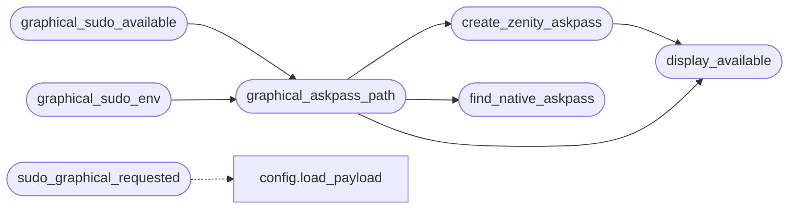

# `modules.askpass`

> Source: [modules/askpass.py:1](../../modules/askpass.py#L1) | language `py` | coverage 100.0% | [API index](../index.md)

Graphical sudo askpass helpers for desktop sudo prompts.

The LazyNmap scan verb needs root for SYN scans. On a desktop session a
terminal password prompt is hostile; this module resolves a graphical
askpass helper (an installed ksshaskpass/ssh-askpass build, or a generated
zenity/yad helper) so ``sudo -A`` shows a GUI password dialog instead.

The module never blocks: when no display server and no helper are
available every function degrades to an empty string and the caller keeps
its existing sudo flow.

## Contents

- **Functions:** [`display_available`](#display_available), [`find_native_askpass`](#find_native_askpass), [`create_zenity_askpass`](#create_zenity_askpass), [`graphical_askpass_path`](#graphical_askpass_path), [`graphical_sudo_available`](#graphical_sudo_available), [`graphical_sudo_env`](#graphical_sudo_env), [`sudo_graphical_requested`](#sudo_graphical_requested)

## Call Graph

Solid arrows stay in this module, dashed arrows leave it.



## Functions

<a id="display_available"></a>

### `display_available`

`function` | [modules/askpass.py:24](../../modules/askpass.py#L24)

```python
def display_available() -> bool
```

Return whether a graphical display server is reachable.

Checks ``DISPLAY`` and ``WAYLAND_DISPLAY`` so Wayland-only desktops
are recognised as well.

**Returns:** `bool` - True when a display server appears available.

*Called by:* [`create_zenity_askpass`](#create_zenity_askpass), [`graphical_askpass_path`](#graphical_askpass_path)

---

<a id="find_native_askpass"></a>

### `find_native_askpass`

`function` | [modules/askpass.py:36](../../modules/askpass.py#L36)

```python
def find_native_askpass() -> str
```

Return the first installed native askpass helper, empty when none.

Order honours KDE and LXQt branded helpers first, then the generic
OpenSSH X11 helper and macOS equivalent. Paths outside ``PATH`` are
probed explicitly because some distributions install the OpenSSH
helper outside the PATH.

**Returns:** `str` - Absolute path to a helper binary or an empty string.

*Called by:* [`graphical_askpass_path`](#graphical_askpass_path)

---

<a id="create_zenity_askpass"></a>

### `create_zenity_askpass`

`function` | [modules/askpass.py:65](../../modules/askpass.py#L65)

```python
def create_zenity_askpass() -> str
```

Write a temporary askpass helper backed by zenity or yad.

The helper prints a password-entry dialog to stdout, which is the
``SUDO_ASKPASS`` contract. The script is written to a per-user temp
directory with mode 0700 and no secrets embedded.

**Returns:** `str` - Path to the helper script, empty when neither zenity nor yad is
installed or the write fails.

*Calls:* [`display_available`](#display_available)

*Called by:* [`graphical_askpass_path`](#graphical_askpass_path)

---

<a id="graphical_askpass_path"></a>

### `graphical_askpass_path`

`function` | [modules/askpass.py:96](../../modules/askpass.py#L96)

```python
def graphical_askpass_path() -> str
```

Return the best graphical askpass helper path, empty when unusable.

Resolution order: explicit ``LAZYOWN_ASKPASS`` override, an installed
native helper, then a generated zenity/yad helper.

**Returns:** `str` - Helper path string, empty when no graphical prompt is possible.

*Calls:* [`create_zenity_askpass`](#create_zenity_askpass), [`display_available`](#display_available), [`find_native_askpass`](#find_native_askpass)

*Called by:* [`LazyOwnShell.run_lazynmap`](lazyown.py.md#lazyownshell-run_lazynmap), [`graphical_sudo_available`](#graphical_sudo_available), [`graphical_sudo_env`](#graphical_sudo_env)

---

<a id="graphical_sudo_available"></a>

### `graphical_sudo_available`

`function` | [modules/askpass.py:116](../../modules/askpass.py#L116)

```python
def graphical_sudo_available() -> bool
```

Return whether a graphical sudo prompt can be shown right now.

**Returns:** `bool` - True when a display server and an askpass helper both exist.

*Calls:* [`graphical_askpass_path`](#graphical_askpass_path)

---

<a id="graphical_sudo_env"></a>

### `graphical_sudo_env`

`function` | [modules/askpass.py:125](../../modules/askpass.py#L125)

```python
def graphical_sudo_env() -> dict[str, str]
```

Return the environment variables that route sudo through the GUI.

**Returns:** `dict[str, str]` - Mapping with ``SUDO_ASKPASS`` (and ``LAZYOWN_ASKPASS`` mirrored)
when a graphical helper is available, otherwise empty.

*Calls:* [`graphical_askpass_path`](#graphical_askpass_path)

---

<a id="sudo_graphical_requested"></a>

### `sudo_graphical_requested`

`function` | [modules/askpass.py:138](../../modules/askpass.py#L138)

```python
def sudo_graphical_requested(payload: dict | None = None) -> bool
```

Return whether the operator asked for graphical sudo prompts.

Reads the ``sudo_graphical`` payload flag; defaults to True on
desktop sessions so an interactive shell asks through the GUI and
the unattended loop never does.

**Parameters**

| Name | Type | Default | Description |
|---|---|---|---|
| `payload` | `dict \| None` | `None` | Loaded payload mapping; loaded lazily when omitted. |

**Returns:** `bool` - True when graphical sudo prompts are requested.

*Calls:* [`load_payload`](core.config.py.md#load_payload)

*Called by:* [`LazyOwnShell.run_lazynmap`](lazyown.py.md#lazyownshell-run_lazynmap)

---
