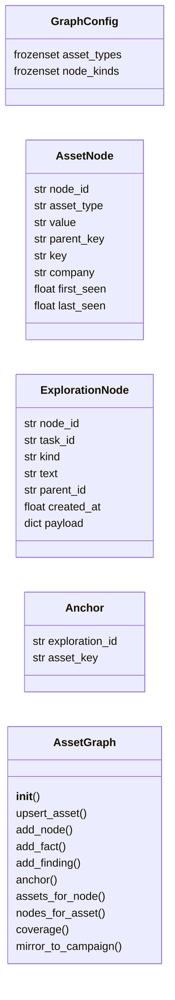
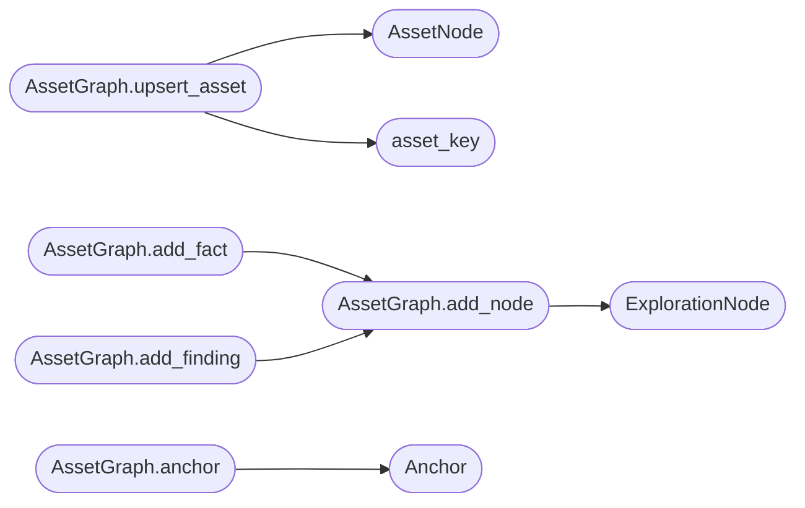

# `modules.asset_graph`

> Source: [modules/asset_graph.py:1](../../modules/asset_graph.py#L1) | language `py` | coverage 100.0% | [API index](../index.md)

Global asset truth store joined to per-task exploration chains.

Ports the LAZY dual-graph contract. Asset nodes deduplicate by a
computed key. Exploration nodes form intent, fact, and finding chains.
Anchors join the two graphs in both directions for coverage queries.

## Contents

- **Classes:** [`GraphConfig`](#graphconfig), [`AssetNode`](#assetnode), [`ExplorationNode`](#explorationnode), [`Anchor`](#anchor), [`AssetGraph`](#assetgraph)
- **Functions:** [`asset_key`](#asset_key), [`coverage_for`](#coverage_for)
- **Constants:** [`CONFIG`](#config)

## Type Diagram



## Call Graph

Solid arrows stay in this module, dashed arrows leave it.



## Classes

<a id="graphconfig"></a>

### `GraphConfig`

`class` `dataclass` | [modules/asset_graph.py:17](../../modules/asset_graph.py#L17)

Decorators: `@dataclass(frozen=True, slots=True)`

```python
class GraphConfig
```

Centralized constants for graph behavior.

**Attributes**

| Name | Type | Default | Description |
|---|---|---|---|
| [`asset_types`](#graphconfig-asset_types) | `frozenset` | `frozenset({'root_domain', 'subdomain', 'ip', 'service', 'app', 'endpoint'})` |  |
| [`node_kinds`](#graphconfig-node_kinds) | `frozenset` | `frozenset({'goal', 'intent', 'fact', 'finding', 'hint'})` |  |

---

<a id="assetnode"></a>

### `AssetNode`

`class` `dataclass` | [modules/asset_graph.py:36](../../modules/asset_graph.py#L36)

Decorators: `@dataclass`

```python
class AssetNode
```

Single truth asset in the global graph.

**Attributes**

| Name | Type | Default | Description |
|---|---|---|---|
| [`node_id`](#assetnode-node_id) | `str` |  |  |
| [`asset_type`](#assetnode-asset_type) | `str` |  |  |
| [`value`](#assetnode-value) | `str` |  |  |
| [`parent_key`](#assetnode-parent_key) | `str` | `''` |  |
| [`key`](#assetnode-key) | `str` | `''` |  |
| [`company`](#assetnode-company) | `str` | `''` |  |
| [`first_seen`](#assetnode-first_seen) | `float` | `0.0` |  |
| [`last_seen`](#assetnode-last_seen) | `float` | `0.0` |  |

---

<a id="explorationnode"></a>

### `ExplorationNode`

`class` `dataclass` | [modules/asset_graph.py:50](../../modules/asset_graph.py#L50)

Decorators: `@dataclass`

```python
class ExplorationNode
```

Single step in a task exploration chain.

**Attributes**

| Name | Type | Default | Description |
|---|---|---|---|
| [`node_id`](#explorationnode-node_id) | `str` |  |  |
| [`task_id`](#explorationnode-task_id) | `str` |  |  |
| [`kind`](#explorationnode-kind) | `str` |  |  |
| [`text`](#explorationnode-text) | `str` |  |  |
| [`parent_id`](#explorationnode-parent_id) | `str` | `''` |  |
| [`created_at`](#explorationnode-created_at) | `float` | `0.0` |  |
| [`payload`](#explorationnode-payload) | `dict` | `field(default_factory=dict)` |  |

---

<a id="anchor"></a>

### `Anchor`

`class` `dataclass` | [modules/asset_graph.py:63](../../modules/asset_graph.py#L63)

Decorators: `@dataclass`

```python
class Anchor
```

Join between an exploration node and an asset node.

**Attributes**

| Name | Type | Default | Description |
|---|---|---|---|
| [`exploration_id`](#anchor-exploration_id) | `str` |  |  |
| [`asset_key`](#anchor-asset_key) | `str` |  |  |

---

<a id="assetgraph"></a>

### `AssetGraph`

`class` | [modules/asset_graph.py:70](../../modules/asset_graph.py#L70)

```python
class AssetGraph
```

Thread-safe dual graph with bidirectional anchor lookup.

**Members**

| Member | Kind | Summary |
|---|---|---|
| [`__init__`](#assetgraph-__init__) | constructor | Initialize empty graphs and anchor indexes. |
| [`upsert_asset`](#assetgraph-upsert_asset) | method | Insert or refresh an asset and return the canonical node. |
| [`add_node`](#assetgraph-add_node) | method | Append an exploration node to a task chain. |
| [`add_fact`](#assetgraph-add_fact) | method | Append a fact node to a task chain. |
| [`add_finding`](#assetgraph-add_finding) | method | Append a finding node to a task chain. |
| [`anchor`](#assetgraph-anchor) | method | Link an exploration node to an asset key. |
| [`assets_for_node`](#assetgraph-assets_for_node) | method | List assets anchored to one exploration node. |
| [`nodes_for_asset`](#assetgraph-nodes_for_asset) | method | List exploration nodes anchored to one asset. |
| [`coverage`](#assetgraph-coverage) | method | Report tested versus total assets for a task. |
| [`mirror_to_campaign`](#assetgraph-mirror_to_campaign) | method | Mirror graph assets into the campaign database and world model. |

<a id="assetgraph-__init__"></a>

#### `AssetGraph.__init__`

`constructor` | [modules/asset_graph.py:73](../../modules/asset_graph.py#L73)

```python
def __init__(self, config: GraphConfig = CONFIG) -> None
```

Initialize empty graphs and anchor indexes.

**Parameters**

| Name | Type | Default | Description |
|---|---|---|---|
| `config` | `GraphConfig` | `CONFIG` |  |

<a id="assetgraph-upsert_asset"></a>

#### `AssetGraph.upsert_asset`

`method` | [modules/asset_graph.py:82](../../modules/asset_graph.py#L82)

```python
def upsert_asset(self, asset_type: str, value: str, parent_key: str = '', company: str = '') -> AssetNode
```

Insert or refresh an asset and return the canonical node.

**Parameters**

| Name | Type | Default | Description |
|---|---|---|---|
| `asset_type` | `str` |  |  |
| `value` | `str` |  |  |
| `parent_key` | `str` | `''` |  |
| `company` | `str` | `''` |  |

**Returns:** `AssetNode`

**Raises**

- `ValueError`: (raised in the body, not documented)

*Calls:* [`AssetNode`](#assetnode), [`asset_key`](#asset_key)

<a id="assetgraph-add_node"></a>

#### `AssetGraph.add_node`

`method` | [modules/asset_graph.py:108](../../modules/asset_graph.py#L108)

```python
def add_node(self, task_id: str, kind: str, text: str, parent_id: str = '', payload: dict | None = None) -> ExplorationNode
```

Append an exploration node to a task chain.

**Parameters**

| Name | Type | Default | Description |
|---|---|---|---|
| `task_id` | `str` |  |  |
| `kind` | `str` |  |  |
| `text` | `str` |  |  |
| `parent_id` | `str` | `''` |  |
| `payload` | `dict \| None` | `None` |  |

**Returns:** `ExplorationNode`

**Raises**

- `ValueError`: (raised in the body, not documented)

*Calls:* [`ExplorationNode`](#explorationnode)

*Called by:* [`AssetGraph.add_fact`](#assetgraph-add_fact), [`AssetGraph.add_finding`](#assetgraph-add_finding)

<a id="assetgraph-add_fact"></a>

#### `AssetGraph.add_fact`

`method` | [modules/asset_graph.py:123](../../modules/asset_graph.py#L123)

```python
def add_fact(self, task_id: str, text: str, parent_id: str = '', payload: dict | None = None) -> ExplorationNode
```

Append a fact node to a task chain.

**Parameters**

| Name | Type | Default | Description |
|---|---|---|---|
| `task_id` | `str` |  |  |
| `text` | `str` |  |  |
| `parent_id` | `str` | `''` |  |
| `payload` | `dict \| None` | `None` |  |

**Returns:** `ExplorationNode`

*Calls:* [`AssetGraph.add_node`](#assetgraph-add_node)

<a id="assetgraph-add_finding"></a>

#### `AssetGraph.add_finding`

`method` | [modules/asset_graph.py:128](../../modules/asset_graph.py#L128)

```python
def add_finding(self, task_id: str, text: str, parent_id: str = '', payload: dict | None = None) -> ExplorationNode
```

Append a finding node to a task chain.

**Parameters**

| Name | Type | Default | Description |
|---|---|---|---|
| `task_id` | `str` |  |  |
| `text` | `str` |  |  |
| `parent_id` | `str` | `''` |  |
| `payload` | `dict \| None` | `None` |  |

**Returns:** `ExplorationNode`

*Calls:* [`AssetGraph.add_node`](#assetgraph-add_node)

<a id="assetgraph-anchor"></a>

#### `AssetGraph.anchor`

`method` | [modules/asset_graph.py:133](../../modules/asset_graph.py#L133)

```python
def anchor(self, exploration_id: str, key: str) -> Anchor
```

Link an exploration node to an asset key.

**Parameters**

| Name | Type | Default | Description |
|---|---|---|---|
| `exploration_id` | `str` |  |  |
| `key` | `str` |  |  |

**Returns:** `Anchor`

**Raises**

- `KeyError`: (raised in the body, not documented)

*Calls:* [`Anchor`](#anchor)

<a id="assetgraph-assets_for_node"></a>

#### `AssetGraph.assets_for_node`

`method` | [modules/asset_graph.py:145](../../modules/asset_graph.py#L145)

```python
def assets_for_node(self, exploration_id: str) -> list[AssetNode]
```

List assets anchored to one exploration node.

**Parameters**

| Name | Type | Default | Description |
|---|---|---|---|
| `exploration_id` | `str` |  |  |

**Returns:** `list[AssetNode]`

<a id="assetgraph-nodes_for_asset"></a>

#### `AssetGraph.nodes_for_asset`

`method` | [modules/asset_graph.py:151](../../modules/asset_graph.py#L151)

```python
def nodes_for_asset(self, key: str) -> list[ExplorationNode]
```

List exploration nodes anchored to one asset.

**Parameters**

| Name | Type | Default | Description |
|---|---|---|---|
| `key` | `str` |  |  |

**Returns:** `list[ExplorationNode]`

<a id="assetgraph-coverage"></a>

#### `AssetGraph.coverage`

`method` | [modules/asset_graph.py:157](../../modules/asset_graph.py#L157)

```python
def coverage(self, task_id: str) -> dict
```

Report tested versus total assets for a task.

**Parameters**

| Name | Type | Default | Description |
|---|---|---|---|
| `task_id` | `str` |  |  |

**Returns:** `dict`

<a id="assetgraph-mirror_to_campaign"></a>

#### `AssetGraph.mirror_to_campaign`

`method` | [modules/asset_graph.py:170](../../modules/asset_graph.py#L170)

```python
def mirror_to_campaign(self, db: object, world_model: object, workspace_id: int) -> dict[str, int]
```

Mirror graph assets into the campaign database and world model.

Deduplicated graph nodes become db hosts/services and world model
hosts, so the existing db_hosts/vuln_list/sitrep surfaces show
them. Returns counts of mirrored hosts and services.

**Parameters**

| Name | Type | Default | Description |
|---|---|---|---|
| `db` | `object` |  |  |
| `world_model` | `object` |  |  |
| `workspace_id` | `int` |  |  |

**Returns:** `dict[str, int]`

---

## Functions

<a id="asset_key"></a>

### `asset_key`

`function` | [modules/asset_graph.py:28](../../modules/asset_graph.py#L28)

```python
def asset_key(asset_type: str, value: str, parent_key: str = '') -> str
```

Compute the stable deduplication key for an asset.

**Parameters**

| Name | Type | Default | Description |
|---|---|---|---|
| `asset_type` | `str` |  |  |
| `value` | `str` |  |  |
| `parent_key` | `str` | `''` |  |

**Returns:** `str`

*Called by:* [`AssetGraph.upsert_asset`](#assetgraph-upsert_asset)

---

<a id="coverage_for"></a>

### `coverage_for`

`function` | [modules/asset_graph.py:214](../../modules/asset_graph.py#L214)

```python
def coverage_for(db: object, workspace_id: int, scope: list[str]) -> dict
```

Report tested scope assets versus total scope from the campaign db.

The scope is the explicit target list (never inferred). An address
counts as tested when present in the workspace hosts.

**Parameters**

| Name | Type | Default | Description |
|---|---|---|---|
| `db` | `object` |  |  |
| `workspace_id` | `int` |  |  |
| `scope` | `list[str]` |  |  |

**Returns:** `dict`

---

## Constants

<a id="config"></a>

### `CONFIG`

`constant` | [modules/asset_graph.py:25](../../modules/asset_graph.py#L25)

```python
CONFIG = GraphConfig()
```

---
