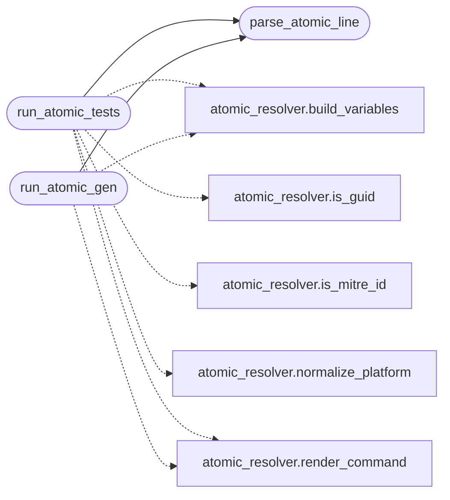

# `modules.atomic_cli`

> Source: [modules/atomic_cli.py:1](../../modules/atomic_cli.py#L1) | language `py` | coverage 100.0% | [API index](../index.md)

Non-interactive, agent-safe implementation for atomic_tests / atomic_gen.

Thin CLI wrappers in ``cli/commands/command_and_control_migrated.py``
delegate here. MCP tools and the autonomous loop may call
`[`run_atomic_tests`](#run_atomic_tests)` / `[`run_atomic_gen`](#run_atomic_gen)` directly with
``non_interactive=True`` so execution never blocks on `[`input`](core.llm_budget.py.md#modelprice-input)`.

Security invariants:
    1. No shell execution — git sync via safe_run_argv / safe_git_clone.
    2. Technique IDs and GUIDs validated by atomic_resolver.
    3. `[`input`](core.llm_budget.py.md#modelprice-input)` only when stdin is a TTY and non_interactive is False.
    4. Clipboard failures never abort execution.
    5. Generated filenames derived only from validated IDs.
    6. Credentials read from params or sessions/credentials*.txt without
       echoing secrets to stdout or logs.

## Contents

- **Functions:** [`parse_atomic_line`](#parse_atomic_line), [`run_atomic_tests`](#run_atomic_tests), [`run_atomic_gen`](#run_atomic_gen)

## Call Graph

Solid arrows stay in this module, dashed arrows leave it.



## Functions

<a id="parse_atomic_line"></a>

### `parse_atomic_line`

`function` | [modules/atomic_cli.py:37](../../modules/atomic_cli.py#L37)

```python
def parse_atomic_line(line: str) -> dict[str, Any]
```

Parse free-form CLI args into a structured request.

Supported forms (all optional, composable):
    ``T1078`` | ``<guid>`` | ``T1059 --platform linux``
    ``--platform windows --non-interactive --json --limit 3``

**Parameters**

| Name | Type | Default | Description |
|---|---|---|---|
| `line` | `str` |  |  |

**Returns:** `dict[str, Any]` - Dict with query, platform, non_interactive, as_json, limit.

*Called by:* [`run_atomic_gen`](#run_atomic_gen), [`run_atomic_tests`](#run_atomic_tests)

---

<a id="run_atomic_tests"></a>

### `run_atomic_tests`

`function` | [modules/atomic_cli.py:185](../../modules/atomic_cli.py#L185)

```python
def run_atomic_tests(params: dict[str, Any], line: str, shell: Any = None) -> int
```

Execute the atomic_tests workflow (secure + agent-safe).

**Parameters**

| Name | Type | Default | Description |
|---|---|---|---|
| `params` | `dict[str, Any]` |  | Live payload params (rhost, domain, rport, ...). |
| `line` | `str` |  | Raw CLI line (query + optional flags). |
| `shell` | `Any` | `None` | Optional parent shell for logcsv. |

**Returns:** `int` - 0 on success, 1 when no test matched, 2 on usage error.

*Calls:* [`parse_atomic_line`](#parse_atomic_line), [`build_variables`](modules.atomic_resolver.py.md#build_variables), [`is_guid`](modules.atomic_resolver.py.md#is_guid), [`is_mitre_id`](modules.atomic_resolver.py.md#is_mitre_id), [`normalize_platform`](modules.atomic_resolver.py.md#normalize_platform), [`render_command`](modules.atomic_resolver.py.md#render_command)

*Called by:* [`CommandAndControlMigratedCommandSet.do_atomic_tests`](cli.commands.command_and_control_migrated.py.md#commandandcontrolmigratedcommandset-do_atomic_tests)

---

<a id="run_atomic_gen"></a>

### `run_atomic_gen`

`function` | [modules/atomic_cli.py:325](../../modules/atomic_cli.py#L325)

```python
def run_atomic_gen(params: dict[str, Any], line: str, shell: Any = None) -> int
```

Generate test + cleanup scripts for one technique or GUID.

**Parameters**

| Name | Type | Default | Description |
|---|---|---|---|
| `params` | `dict[str, Any]` |  | Live payload params. |
| `line` | `str` |  | Technique ID or GUID plus optional flags. |
| `shell` | `Any` | `None` | Optional parent shell for logcsv. |

**Returns:** `int` - 0 on success, 1 when not found, 2 on usage error.

*Calls:* [`parse_atomic_line`](#parse_atomic_line), [`build_variables`](modules.atomic_resolver.py.md#build_variables), [`render_command`](modules.atomic_resolver.py.md#render_command)

*Called by:* [`CommandAndControlMigratedCommandSet.do_atomic_gen`](cli.commands.command_and_control_migrated.py.md#commandandcontrolmigratedcommandset-do_atomic_gen)

---
