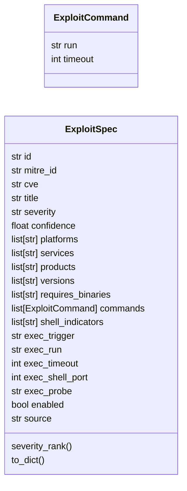
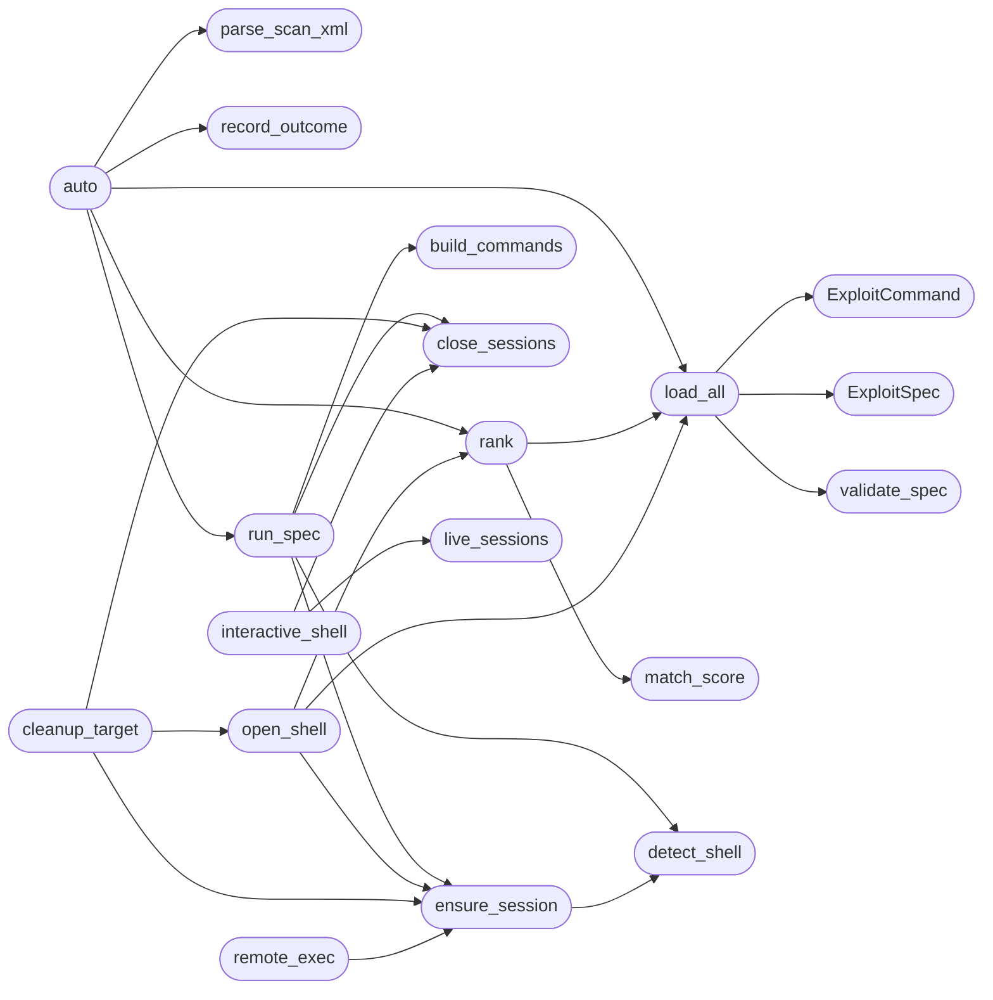

# `modules.atomic_exploit_bridge`

> Source: [modules/atomic_exploit_bridge.py:1](../../modules/atomic_exploit_bridge.py#L1) | language `py` | coverage 100.0% | [API index](../index.md)

Atomic exploit catalogue bridge — one YAML per exploit under ``exploits/``.

Same philosophy as ``lazyaddons/``: extending the autonomous loop's
arsenal means adding a file, never editing Python. Each technique maps
to a real test that fires against the target, and every outcome feeds
the shared surfaces: world model findings, kill-chain phase,
intel-fusion graph, and lazy_intel routing priors (which is what lets
the world model score each option better over time).

Security invariants:
    1. YAML parsed with ``yaml.safe_load`` under a per-file size cap.
    2. Filenames must equal the declared `[`id`](#exploitspec-id)` (no silent renames).
    3. IDs, MITRE codes, tokens validated before use; no null bytes.
    4. Commands execute only via `[`safe_run_shell`](core.safe_exec.py.md#safe_run_shell)` with explicit reason
       and per-command timeouts — never on import.
    5. All cross-surface feeds are best-effort and guarded: a missing
       world model or graph module never breaks execution.

## Contents

- **Classes:** [`ExploitCommand`](#exploitcommand), [`ExploitSpec`](#exploitspec)
- **Functions:** [`validate_spec`](#validate_spec), [`load_all`](#load_all), [`match_score`](#match_score), [`parse_scan_xml`](#parse_scan_xml), [`auto`](#auto), [`rank`](#rank), [`build_commands`](#build_commands), [`detect_shell`](#detect_shell), [`run_spec`](#run_spec), [`open_shell`](#open_shell), [`record_shell_outcome`](#record_shell_outcome), [`live_sessions`](#live_sessions), [`close_sessions`](#close_sessions), [`cleanup_target`](#cleanup_target), [`ensure_session`](#ensure_session), [`remote_exec`](#remote_exec), [`interactive_shell`](#interactive_shell), [`emulate`](#emulate), [`record_outcome`](#record_outcome), [`main`](#main)
- **Constants:** [`EXPLOITS_DIR`](#exploits_dir), [`ROOT_PRIVILEGE`](#root_privilege), [`LOW_PRIVILEGE`](#low_privilege), [`ROOT_SHELL_EXPLOITS`](#root_shell_exploits), [`DEFAULT_GYM_CONTAINER`](#default_gym_container)

## Type Diagram



## Call Graph

Solid arrows stay in this module, dashed arrows leave it.



## Classes

<a id="exploitcommand"></a>

### `ExploitCommand`

`class` `dataclass` | [modules/atomic_exploit_bridge.py:84](../../modules/atomic_exploit_bridge.py#L84)

Decorators: `@dataclass`

```python
class ExploitCommand
```

One ordered step of an exploit, with its own timeout.

**Attributes**

| Name | Type | Default | Description |
|---|---|---|---|
| [`run`](#exploitcommand-run) | `str` | `''` |  |
| [`timeout`](#exploitcommand-timeout) | `int` | `30` |  |

---

<a id="exploitspec"></a>

### `ExploitSpec`

`class` `dataclass` | [modules/atomic_exploit_bridge.py:92](../../modules/atomic_exploit_bridge.py#L92)

Decorators: `@dataclass`

```python
class ExploitSpec
```

Validated exploit loaded from ``exploits/<id>.yaml``.

**Attributes**

| Name | Type | Default | Description |
|---|---|---|---|
| [`id`](#exploitspec-id) | `str` | `''` |  |
| [`mitre_id`](#exploitspec-mitre_id) | `str` | `''` |  |
| [`cve`](#exploitspec-cve) | `str` | `''` |  |
| [`title`](#exploitspec-title) | `str` | `''` |  |
| [`severity`](#exploitspec-severity) | `str` | `'medium'` |  |
| [`confidence`](#exploitspec-confidence) | `float` | `0.0` |  |
| [`platforms`](#exploitspec-platforms) | `list[str]` | `field(default_factory=list)` |  |
| [`services`](#exploitspec-services) | `list[str]` | `field(default_factory=list)` |  |
| [`products`](#exploitspec-products) | `list[str]` | `field(default_factory=list)` |  |
| [`versions`](#exploitspec-versions) | `list[str]` | `field(default_factory=list)` |  |
| [`requires_binaries`](#exploitspec-requires_binaries) | `list[str]` | `field(default_factory=list)` |  |
| [`commands`](#exploitspec-commands) | `list[ExploitCommand]` | `field(default_factory=list)` |  |
| [`shell_indicators`](#exploitspec-shell_indicators) | `list[str]` | `field(default_factory=list)` |  |
| [`exec_trigger`](#exploitspec-exec_trigger) | `str` | `''` |  |
| [`exec_run`](#exploitspec-exec_run) | `str` | `''` |  |
| [`exec_timeout`](#exploitspec-exec_timeout) | `int` | `20` |  |
| [`exec_shell_port`](#exploitspec-exec_shell_port) | `int` | `0` |  |
| [`exec_probe`](#exploitspec-exec_probe) | `str` | `'id'` |  |
| [`enabled`](#exploitspec-enabled) | `bool` | `True` |  |
| [`source`](#exploitspec-source) | `str` | `''` |  |

**Members**

| Member | Kind | Summary |
|---|---|---|
| [`severity_rank`](#exploitspec-severity_rank) | property | Return numeric severity for ranking (mirrors the engine). |
| [`to_dict`](#exploitspec-to_dict) | method | Return a JSON-serializable view. |

<a id="exploitspec-severity_rank"></a>

#### `ExploitSpec.severity_rank`

`property` | [modules/atomic_exploit_bridge.py:117](../../modules/atomic_exploit_bridge.py#L117)

Decorators: `@property`

```python
def severity_rank(self) -> int
```

Return numeric severity for ranking (mirrors the engine).

**Returns:** `int`

<a id="exploitspec-to_dict"></a>

#### `ExploitSpec.to_dict`

`method` | [modules/atomic_exploit_bridge.py:121](../../modules/atomic_exploit_bridge.py#L121)

```python
def to_dict(self) -> dict[str, Any]
```

Return a JSON-serializable view.

**Returns:** `dict[str, Any]`

---

## Functions

<a id="validate_spec"></a>

### `validate_spec`

`function` | [modules/atomic_exploit_bridge.py:150](../../modules/atomic_exploit_bridge.py#L150)

```python
def validate_spec(data: Any, filename: str = '') -> list[str]
```

Validate raw YAML data against the exploit schema.

**Parameters**

| Name | Type | Default | Description |
|---|---|---|---|
| `data` | `Any` |  | Parsed YAML document. |
| `filename` | `str` | `''` | Source filename stem (must equal `[`id`](#exploitspec-id)`). |

**Returns:** `list[str]` - List of error strings (empty when valid).

*Called by:* [`load_all`](#load_all), [`main`](#main)

---

<a id="load_all"></a>

### `load_all`

`function` | [modules/atomic_exploit_bridge.py:226](../../modules/atomic_exploit_bridge.py#L226)

```python
def load_all(exploits_dir: Path | str = EXPLOITS_DIR) -> dict[str, ExploitSpec]
```

Load every enabled, valid exploit YAML (skips the rest loudly).

**Parameters**

| Name | Type | Default | Description |
|---|---|---|---|
| `exploits_dir` | `Path \| str` | `EXPLOITS_DIR` |  |

**Returns:** `dict[str, ExploitSpec]`

**Raises**

- `RuntimeError`: (raised in the body, not documented)

*Calls:* [`ExploitCommand`](#exploitcommand), [`ExploitSpec`](#exploitspec), [`validate_spec`](#validate_spec)

*Called by:* [`exploit_for`](modules.ad_gym.py.md#exploit_for), [`auto`](#auto), [`main`](#main), [`open_shell`](#open_shell), [`rank`](#rank), [`exploit_for`](modules.metasploitable_gym.py.md#exploit_for), [`exploit_for`](modules.winbox_gym.py.md#exploit_for)

---

<a id="match_score"></a>

### `match_score`

`function` | [modules/atomic_exploit_bridge.py:281](../../modules/atomic_exploit_bridge.py#L281)

```python
def match_score(spec: ExploitSpec, service: str, product: str, version: str, os_hint: str = '') -> float
```

Score a spec against one discovered service (0 when no match).

Service matching mirrors pwntomate: exact nmap service name or the
special ``all`` trigger. Product/version matching stays substring
(version banners need it, e.g. ``3.`` matches ``3.X``). When the
host OS is inferred and the spec declares platforms, a mismatch
(a Windows kernel exploit against a Linux host) scores 0.

**Parameters**

| Name | Type | Default | Description |
|---|---|---|---|
| `spec` | `ExploitSpec` |  | Loaded exploit spec. |
| `service` | `str` |  | nmap service name. |
| `product` | `str` |  | nmap product string. |
| `version` | `str` |  | nmap version string. |
| `os_hint` | `str` | `''` | Inferred host OS (``linux``/``windows``/``""`` unknown). |

**Returns:** `float` - Match confidence, 0.0 when no match.

*Called by:* [`rank`](#rank)

---

<a id="parse_scan_xml"></a>

### `parse_scan_xml`

`function` | [modules/atomic_exploit_bridge.py:314](../../modules/atomic_exploit_bridge.py#L314)

```python
def parse_scan_xml(xml_path: Path | str) -> list[dict[str, Any]]
```

Parse open TCP ports from a lazynmap XML file (stdlib only).

Returns [{address, port, service, product, version}...], mirroring
the fields pwntomate consumes from the same files.

**Parameters**

| Name | Type | Default | Description |
|---|---|---|---|
| `xml_path` | `Path \| str` |  |  |

**Returns:** `list[dict[str, Any]]`

*Called by:* [`auto`](#auto), [`EmulationRunner.run`](modules.emulation_runner.py.md#emulationrunner-run)

---

<a id="auto"></a>

### `auto`

`function` | [modules/atomic_exploit_bridge.py:351](../../modules/atomic_exploit_bridge.py#L351)

```python
def auto(target: str, lhost: str = '127.0.0.1', max_attempts: int = 8, stop_on_shell: bool = True, task_id: str = '', exploits_dir: Path | str | None = None, scan_dir: Path | str | None = None) -> dict[str, Any]
```

Pwntomate-style sweep: triggers from scan XML, ranked, stop on SHELL.

Reads ``sessions/scan_<target>.nmap.xml`` (the file lazynmap writes),
matches every open service against ``exploits/*.yaml`` triggers, and
executes matches in severity/confidence order. Every attempt feeds
the shared surfaces. Returns the full report (also staged as JSON).

**Parameters**

| Name | Type | Default | Description |
|---|---|---|---|
| `target` | `str` |  |  |
| `lhost` | `str` | `'127.0.0.1'` |  |
| `max_attempts` | `int` | `8` |  |
| `stop_on_shell` | `bool` | `True` |  |
| `task_id` | `str` | `''` |  |
| `exploits_dir` | `Path \| str \| None` | `None` |  |
| `scan_dir` | `Path \| str \| None` | `None` |  |

**Returns:** `dict[str, Any]`

*Calls:* [`load_all`](#load_all), [`parse_scan_xml`](#parse_scan_xml), [`rank`](#rank), [`record_outcome`](#record_outcome), [`run_spec`](#run_spec), [`host_os_for_target`](modules.lazy_osinfer.py.md#host_os_for_target)

*Called by:* [`main`](#main)

---

<a id="rank"></a>

### `rank`

`function` | [modules/atomic_exploit_bridge.py:456](../../modules/atomic_exploit_bridge.py#L456)

```python
def rank(services: list[dict[str, Any]], exploits_dir: Path | str | None = None, os_hint: str = '') -> list[dict[str, Any]]
```

Rank every spec against discovered services (severity, then confidence).

**Parameters**

| Name | Type | Default | Description |
|---|---|---|---|
| `services` | `list[dict[str, Any]]` |  | Service rows from the scan XML. |
| `exploits_dir` | `Path \| str \| None` | `None` | Alternative exploit YAML directory. |
| `os_hint` | `str` | `''` | Inferred host OS; filters platform-mismatched specs. |

**Returns:** `list[dict[str, Any]]`

*Calls:* [`load_all`](#load_all), [`match_score`](#match_score)

*Called by:* [`auto`](#auto), [`main`](#main), [`open_shell`](#open_shell)

---

<a id="build_commands"></a>

### `build_commands`

`function` | [modules/atomic_exploit_bridge.py:511](../../modules/atomic_exploit_bridge.py#L511)

```python
def build_commands(spec: ExploitSpec, rhost: str = '', lhost: str = '127.0.0.1', lport: str | int = 4444, port: str = '') -> list[tuple[str, int]]
```

Substitute ``{tokens}`` into a spec's commands (no shell involved).

**Parameters**

| Name | Type | Default | Description |
|---|---|---|---|
| `spec` | `ExploitSpec` |  |  |
| `rhost` | `str` | `''` |  |
| `lhost` | `str` | `'127.0.0.1'` |  |
| `lport` | `str \| int` | `4444` |  |
| `port` | `str` | `''` |  |

**Returns:** `list[tuple[str, int]]`

*Called by:* [`run_spec`](#run_spec)

---

<a id="detect_shell"></a>

### `detect_shell`

`function` | [modules/atomic_exploit_bridge.py:529](../../modules/atomic_exploit_bridge.py#L529)

```python
def detect_shell(spec: ExploitSpec, output: str) -> bool
```

Return True when output carries any shell indicator.

**Parameters**

| Name | Type | Default | Description |
|---|---|---|---|
| `spec` | `ExploitSpec` |  |  |
| `output` | `str` |  |  |

**Returns:** `bool`

*Called by:* [`ensure_session`](#ensure_session), [`run_spec`](#run_spec)

---

<a id="run_spec"></a>

### `run_spec`

`function` | [modules/atomic_exploit_bridge.py:571](../../modules/atomic_exploit_bridge.py#L571)

```python
def run_spec(spec: ExploitSpec, rhost: str, lhost: str = '127.0.0.1', lport: str | int = 4444, port: str = '') -> dict[str, Any]
```

Execute a spec's commands in order; stop at the first SHELL hit.

Exec-capable specs run their commands INSIDE one persistent target
session (single trigger, multiplexed). Specs without an exec block
keep the legacy operator-side one-shot path.

**Parameters**

| Name | Type | Default | Description |
|---|---|---|---|
| `spec` | `ExploitSpec` |  |  |
| `rhost` | `str` |  |  |
| `lhost` | `str` | `'127.0.0.1'` |  |
| `lport` | `str \| int` | `4444` |  |
| `port` | `str` | `''` |  |

**Returns:** `dict[str, Any]`

*Calls:* [`safe_run_shell`](core.safe_exec.py.md#safe_run_shell), [`build_commands`](#build_commands), [`close_sessions`](#close_sessions), [`detect_shell`](#detect_shell), [`ensure_session`](#ensure_session)

*Called by:* [`auto`](#auto), [`main`](#main)

---

<a id="open_shell"></a>

### `open_shell`

`function` | [modules/atomic_exploit_bridge.py:651](../../modules/atomic_exploit_bridge.py#L651)

```python
def open_shell(target: str, services: list[dict[str, Any]] | None = None, lhost: str = '127.0.0.1', exploits_dir: Path | str | None = None, attempts: int = 3, privilege: str = LOW_PRIVILEGE) -> ExploitSpec | None
```

Return the first exec-capable spec with a live multiplexed session.

Tries candidates in rank order; each gets *attempts* establish rounds
(trigger + connect + probe). One trigger, one connection, every later
command multiplexed — single-shot backdoors are never re-triggered
while their shell lives.

**Parameters**

| Name | Type | Default | Description |
|---|---|---|---|
| `target` | `str` |  | Victim address to exploit. |
| `services` | `list[dict[str, Any]] \| None` | `None` | Optional world-model services (re-rank candidates). |
| `lhost` | `str` | `'127.0.0.1'` | Attacker address for reverse triggers. |
| `exploits_dir` | `Path \| str \| None` | `None` | Alternate exploit YAML directory (tests). |
| `attempts` | `int` | `3` | Establish rounds per candidate. |
| `privilege` | `str` | `LOW_PRIVILEGE` | ROOT_PRIVILEGE limits candidates to root-capable IDs; LOW_PRIVILEGE accepts anything. |

**Returns:** `ExploitSpec | None` - The first living spec, or None when nothing answers.

**Raises**

- `ValueError`: Unknown privilege value.

*Calls:* [`ensure_session`](#ensure_session), [`load_all`](#load_all), [`rank`](#rank)

*Called by:* [`cleanup_target`](#cleanup_target), [`interactive_shell`](#interactive_shell), [`deploy`](modules.c2_agent.py.md#deploy)

---

<a id="record_shell_outcome"></a>

### `record_shell_outcome`

`function` | [modules/atomic_exploit_bridge.py:825](../../modules/atomic_exploit_bridge.py#L825)

```python
def record_shell_outcome(target: str, via: str = '') -> bool
```

Mark one target as compromised after an operator obtains a shell.

This is deliberately narrower than the outcome bus: it advances the
target host state and adds a note, but it does not replay the global
kill-chain over unrelated hosts that may live in the world model.

**Parameters**

| Name | Type | Default | Description |
|---|---|---|---|
| `target` | `str` |  | Host that yielded the shell. |
| `via` | `str` | `''` | Exploit primitive identifier. |

**Returns:** `bool` - True when the world model accepted the update.

*Calls:* [`get_world_model`](modules.world_model.py.md#get_world_model)

*Called by:* [`CommandAndControlMigratedCommandSet.do_atomic_shell`](cli.commands.command_and_control_migrated.py.md#commandandcontrolmigratedcommandset-do_atomic_shell)

---

<a id="live_sessions"></a>

### `live_sessions`

`function` | [modules/atomic_exploit_bridge.py:854](../../modules/atomic_exploit_bridge.py#L854)

```python
def live_sessions() -> list[dict[str, str]]
```

Return in-process shell sessions without probing the target.

**Returns:** `list[dict[str, str]]` - One row per cached session with ``target``, `[`via`](modules.emulation_runner.py.md#emulationreport-via)` (spec id that
owns the cache key) and ``owner`` (spec that created or adopted
the shell) fields. A cached session can be dead; callers that
need liveness use [`ensure_session`](#ensure_session).

*Called by:* [`interactive_shell`](#interactive_shell)

---

<a id="close_sessions"></a>

### `close_sessions`

`function` | [modules/atomic_exploit_bridge.py:873](../../modules/atomic_exploit_bridge.py#L873)

```python
def close_sessions(target: str = '') -> int
```

Close cached sessions (all, or one target).

Returns count closed.

**Parameters**

| Name | Type | Default | Description |
|---|---|---|---|
| `target` | `str` | `''` |  |

**Returns:** `int`

*Called by:* [`cleanup_target`](#cleanup_target), [`interactive_shell`](#interactive_shell), [`run_spec`](#run_spec), [`EmulationRunner.run`](modules.emulation_runner.py.md#emulationrunner-run)

---

<a id="cleanup_target"></a>

### `cleanup_target`

`function` | [modules/atomic_exploit_bridge.py:915](../../modules/atomic_exploit_bridge.py#L915)

```python
def cleanup_target(target: str, lhost: str = '127.0.0.1', hard: bool = False, gym_container: str = DEFAULT_GYM_CONTAINER, exploits_dir: Path | str | None = None, staging_dir: Path | str | None = None) -> dict[str, Any]
```

Clean up after an engagement (soft default, hard on request).

Soft mode removes attacker artefacts from the target through the
multiplexed session (agent process killed first so it stops
beaconing, then drop files, loot staging scraps and test outputs),
plus local staging doubles under sessions/temp_uploads. Loot,
reports and logs are evidence and are always kept.

Hard mode does everything soft does, then stops and removes the gym
container. Never raises: every step reports its own status.

**Parameters**

| Name | Type | Default | Description |
|---|---|---|---|
| `target` | `str` |  |  |
| `lhost` | `str` | `'127.0.0.1'` |  |
| `hard` | `bool` | `False` |  |
| `gym_container` | `str` | `DEFAULT_GYM_CONTAINER` |  |
| `exploits_dir` | `Path \| str \| None` | `None` |  |
| `staging_dir` | `Path \| str \| None` | `None` |  |

**Returns:** `dict[str, Any]`

*Calls:* [`close_sessions`](#close_sessions), [`ensure_session`](#ensure_session), [`open_shell`](#open_shell)

*Called by:* [`CommandAndControlMigratedCommandSet.do_atomic_clean`](cli.commands.command_and_control_migrated.py.md#commandandcontrolmigratedcommandset-do_atomic_clean)

---

<a id="ensure_session"></a>

### `ensure_session`

`function` | [modules/atomic_exploit_bridge.py:992](../../modules/atomic_exploit_bridge.py#L992)

```python
def ensure_session(spec: ExploitSpec, target: str, lhost: str = '127.0.0.1') -> _ShellSession
```

Return a live multiplexed session, establishing it when needed.

Reuses the cached connection while it answers; adopts a live
orphaned shell when present; otherwise waits out a dying listener,
fires the spec trigger, and connects fresh. Raises RuntimeError
when no shell can be established (caller decides retries).

**Parameters**

| Name | Type | Default | Description |
|---|---|---|---|
| `spec` | `ExploitSpec` |  |  |
| `target` | `str` |  |  |
| `lhost` | `str` | `'127.0.0.1'` |  |

**Returns:** `_ShellSession`

**Raises**

- `RuntimeError`: (raised in the body, not documented)

*Calls:* [`safe_run_shell`](core.safe_exec.py.md#safe_run_shell), [`detect_shell`](#detect_shell)

*Called by:* [`cleanup_target`](#cleanup_target), [`open_shell`](#open_shell), [`remote_exec`](#remote_exec), [`run_spec`](#run_spec)

---

<a id="remote_exec"></a>

### `remote_exec`

`function` | [modules/atomic_exploit_bridge.py:1088](../../modules/atomic_exploit_bridge.py#L1088)

```python
def remote_exec(spec: ExploitSpec, target: str, command: str, lhost: str = '127.0.0.1') -> str
```

Run one command through the persistent multiplexed session.

Same signature as before; the one-shot path is gone — one trigger,
one connection, everything multiplexed. Never raises.

**Parameters**

| Name | Type | Default | Description |
|---|---|---|---|
| `spec` | `ExploitSpec` |  |  |
| `target` | `str` |  |  |
| `command` | `str` |  |  |
| `lhost` | `str` | `'127.0.0.1'` |  |

**Returns:** `str`

*Calls:* [`ensure_session`](#ensure_session)

*Called by:* [`interactive_shell`](#interactive_shell), [`deploy`](modules.c2_agent.py.md#deploy)

---

<a id="interactive_shell"></a>

### `interactive_shell`

`function` | [modules/atomic_exploit_bridge.py:1106](../../modules/atomic_exploit_bridge.py#L1106)

```python
def interactive_shell(target: str, lhost: str = '127.0.0.1', interactive: bool = False, exploits_dir: Path | str | None = None) -> dict[str, Any]
```

Open a multiplexed session; drop into a REPL only when allowed.

The REPL runs exclusively when ``interactive`` is True AND this code
runs on the main thread with a real TTY on stdin. Loop workers run
off the main thread, so autonomous execution can never steal the
operator's terminal: there the function only verifies the session
and reports how to attach. Returns a status dict in both modes.

**Parameters**

| Name | Type | Default | Description |
|---|---|---|---|
| `target` | `str` |  |  |
| `lhost` | `str` | `'127.0.0.1'` |  |
| `interactive` | `bool` | `False` |  |
| `exploits_dir` | `Path \| str \| None` | `None` |  |

**Returns:** `dict[str, Any]`

*Calls:* [`close_sessions`](#close_sessions), [`live_sessions`](#live_sessions), [`open_shell`](#open_shell), [`remote_exec`](#remote_exec)

*Called by:* [`CommandAndControlMigratedCommandSet.do_atomic_shell`](cli.commands.command_and_control_migrated.py.md#commandandcontrolmigratedcommandset-do_atomic_shell)

---

<a id="emulate"></a>

### `emulate`

`function` | [modules/atomic_exploit_bridge.py:1161](../../modules/atomic_exploit_bridge.py#L1161)

```python
def emulate(target: str, techniques: list[str] | None = None, playbook: str = '', platform: str = 'linux', lhost: str = '127.0.0.1', per_technique: int = 1, exploits_dir: Path | str | None = None, scan_dir: Path | str | None = None, include_manual: bool = False, dry_run: bool = False) -> dict[str, Any]
```

Execute emulation tests on the target through one working shell.

Delegates resolution, execution, normalization and sink fan-out to
[`modules.emulation_runner.EmulationRunner`](modules.emulation_runner.py.md#emulationrunner). Kept as the stable
bridge entry point consumed by the CLI and MCP.

**Parameters**

| Name | Type | Default | Description |
|---|---|---|---|
| `target` | `str` |  |  |
| `techniques` | `list[str] \| None` | `None` |  |
| `playbook` | `str` | `''` |  |
| `platform` | `str` | `'linux'` |  |
| `lhost` | `str` | `'127.0.0.1'` |  |
| `per_technique` | `int` | `1` |  |
| `exploits_dir` | `Path \| str \| None` | `None` |  |
| `scan_dir` | `Path \| str \| None` | `None` |  |
| `include_manual` | `bool` | `False` |  |
| `dry_run` | `bool` | `False` |  |

**Returns:** `dict[str, Any]`

*Calls:* [`EmulationRunner.__init__`](modules.emulation_runner.py.md#emulationrunner-__init__), [`EmulationRunner.run`](modules.emulation_runner.py.md#emulationrunner-run)

*Called by:* [`main`](#main)

---

<a id="record_outcome"></a>

### `record_outcome`

`function` | [modules/atomic_exploit_bridge.py:1195](../../modules/atomic_exploit_bridge.py#L1195)

```python
def record_outcome(spec: ExploitSpec, target: str, shell: bool, output: str = '', task_id: str = '', intent_id: int = 0, surfaces_dir: Path | str | None = None, port: str = '', service: str = '', product: str = '', version: str = '', banner: str = '') -> dict[str, Any]
```

Feed one exploit outcome to every shared surface through the bus.

Updates the world model, kill-chain, intel-fusion graph, attack graph,
routing priors, C2 dashboard tables, objectives, event bus and the
session report. Never raises; a failing sink never blocks the rest.

**Parameters**

| Name | Type | Default | Description |
|---|---|---|---|
| `spec` | `ExploitSpec` |  | Executed exploit specification. |
| `target` | `str` |  | Victim address. |
| `shell` | `bool` |  | Whether a shell was obtained. |
| `output` | `str` | `''` | Captured command output. |
| `task_id` | `str` | `''` | Loop task owning the attempt. |
| `intent_id` | `int` | `0` | Intent that requested the attempt. |
| `surfaces_dir` | `Path \| str \| None` | `None` | Sessions directory override for tests. |
| `port` | `str` | `''` | Resolved service port. |
| `service` | `str` | `''` | Resolved service name. |
| `product` | `str` | `''` | Service product. |
| `version` | `str` | `''` | Service version. |
| `banner` | `str` | `''` | Service banner text. |

**Returns:** `dict[str, Any]` - Mapping of surface name to whether it accepted the outcome.

*Calls:* [`OutcomeBus.record`](modules.outcome_bus.py.md#outcomebus-record), [`OutcomeEvent`](modules.outcome_bus.py.md#outcomeevent)

*Called by:* [`auto`](#auto), [`main`](#main)

---

<a id="main"></a>

### `main`

`function` | [modules/atomic_exploit_bridge.py:1283](../../modules/atomic_exploit_bridge.py#L1283)

```python
def main() -> None
```

CLI: validate | list | rank | run (used by the addon and operators).

**Raises**

- `SystemExit`: (raised in the body, not documented)

*Calls:* [`auto`](#auto), [`emulate`](#emulate), [`load_all`](#load_all), [`rank`](#rank), [`record_outcome`](#record_outcome), [`run_spec`](#run_spec), [`validate_spec`](#validate_spec)

---

## Constants

<a id="exploits_dir"></a>

### `EXPLOITS_DIR`

`constant` | [modules/atomic_exploit_bridge.py:44](../../modules/atomic_exploit_bridge.py#L44)

```python
EXPLOITS_DIR = _BASE_DIR / 'exploits'
```

---

<a id="root_privilege"></a>

### `ROOT_PRIVILEGE`

`constant` | [modules/atomic_exploit_bridge.py:47](../../modules/atomic_exploit_bridge.py#L47)

```python
ROOT_PRIVILEGE = 'root'
```

---

<a id="low_privilege"></a>

### `LOW_PRIVILEGE`

`constant` | [modules/atomic_exploit_bridge.py:48](../../modules/atomic_exploit_bridge.py#L48)

```python
LOW_PRIVILEGE = 'lowpriv'
```

---

<a id="root_shell_exploits"></a>

### `ROOT_SHELL_EXPLOITS`

`constant` | [modules/atomic_exploit_bridge.py:59](../../modules/atomic_exploit_bridge.py#L59)

```python
ROOT_SHELL_EXPLOITS: frozenset[str] = frozenset(_ROOT_SHELL_IDS)
```

---

<a id="default_gym_container"></a>

### `DEFAULT_GYM_CONTAINER`

`constant` | [modules/atomic_exploit_bridge.py:911](../../modules/atomic_exploit_bridge.py#L911)

```python
DEFAULT_GYM_CONTAINER = 'lazyown-lab-metasploitable'
```

---
