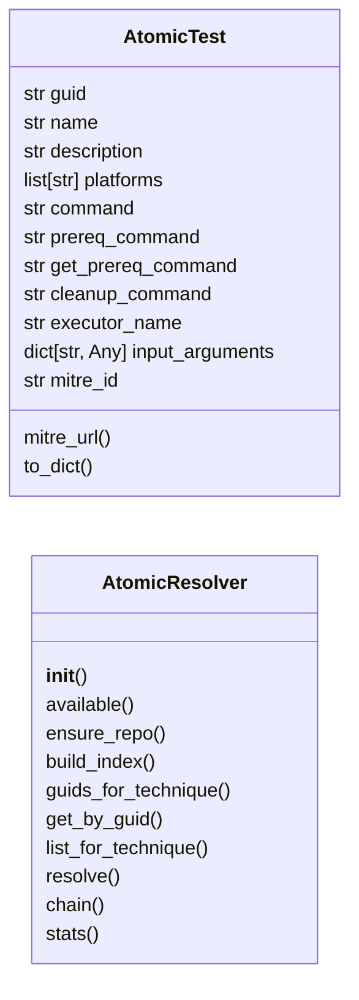
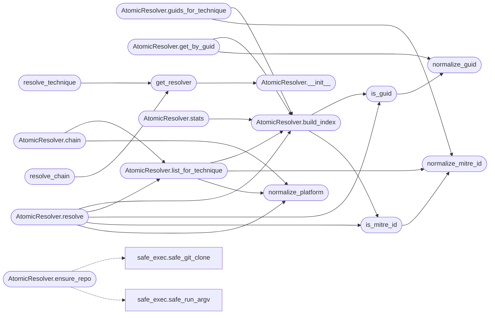

# `modules.atomic_resolver`

> Source: [modules/atomic_resolver.py:1](../../modules/atomic_resolver.py#L1) | language `py` | coverage 100.0% | [API index](../index.md)

Central MITRE ATT&CK <-> Atomic Red Team translator.

Single source of truth for resolving human-friendly technique IDs
(T1078, T1059.001) to concrete Atomic Red Team tests (GUID + command)
and vice versa. Consumed by CLI (atomic_tests / atomic_gen),
MCP (lazyown_atomic_resolve / lazyown_ttp_chain), playbook_engine,
and the autonomous loop.

Security invariants:
    1. No shell execution — repo sync uses safe_git_clone (argv list).
    2. All technique IDs validated against strict regex before use.
    3. All GUIDs validated as UUID before use.
    4. YAML parsed with yaml.safe_load, per-file size cap, symlink safe.
    5. Resolved paths confined under the atomics directory (no traversal).
    6. No credentials, no network except explicit ensure_repo().

## Contents

- **Classes:** [`AtomicTest`](#atomictest), [`AtomicResolver`](#atomicresolver)
- **Functions:** [`normalize_mitre_id`](#normalize_mitre_id), [`is_mitre_id`](#is_mitre_id), [`normalize_guid`](#normalize_guid), [`is_guid`](#is_guid), [`normalize_platform`](#normalize_platform), [`get_resolver`](#get_resolver), [`resolve_technique`](#resolve_technique), [`resolve_chain`](#resolve_chain), [`build_variables`](#build_variables), [`render_command`](#render_command), [`technique_env_override`](#technique_env_override)

## Type Diagram



## Call Graph

Solid arrows stay in this module, dashed arrows leave it.



## Classes

<a id="atomictest"></a>

### `AtomicTest`

`class` `dataclass` | [modules/atomic_resolver.py:131](../../modules/atomic_resolver.py#L131)

Decorators: `@dataclass`

```python
class AtomicTest
```

One concrete Atomic Red Team test.

**Attributes**

| Name | Type | Default | Description |
|---|---|---|---|
| [`guid`](#atomictest-guid) | `str` | `''` |  |
| [`name`](#atomictest-name) | `str` | `''` |  |
| [`description`](#atomictest-description) | `str` | `''` |  |
| [`platforms`](#atomictest-platforms) | `list[str]` | `field(default_factory=list)` |  |
| [`command`](#atomictest-command) | `str` | `''` |  |
| [`prereq_command`](#atomictest-prereq_command) | `str` | `''` |  |
| [`get_prereq_command`](#atomictest-get_prereq_command) | `str` | `''` |  |
| [`cleanup_command`](#atomictest-cleanup_command) | `str` | `''` |  |
| [`executor_name`](#atomictest-executor_name) | `str` | `''` |  |
| [`input_arguments`](#atomictest-input_arguments) | `dict[str, Any]` | `field(default_factory=dict)` |  |
| [`mitre_id`](#atomictest-mitre_id) | `str` | `''` |  |

**Members**

| Member | Kind | Summary |
|---|---|---|
| [`mitre_url`](#atomictest-mitre_url) | property | Return the ATT&CK URL for this test. |
| [`to_dict`](#atomictest-to_dict) | method | Return a JSON-serializable view. |

<a id="atomictest-mitre_url"></a>

#### `AtomicTest.mitre_url`

`property` | [modules/atomic_resolver.py:147](../../modules/atomic_resolver.py#L147)

Decorators: `@property`

```python
def mitre_url(self) -> str
```

Return the ATT&CK URL for this test.

**Returns:** `str`

<a id="atomictest-to_dict"></a>

#### `AtomicTest.to_dict`

`method` | [modules/atomic_resolver.py:151](../../modules/atomic_resolver.py#L151)

```python
def to_dict(self) -> dict[str, Any]
```

Return a JSON-serializable view.

**Returns:** `dict[str, Any]`

---

<a id="atomicresolver"></a>

### `AtomicResolver`

`class` | [modules/atomic_resolver.py:219](../../modules/atomic_resolver.py#L219)

```python
class AtomicResolver
```

Index and resolve Atomic Red Team tests by MITRE ID or GUID.

**Parameters**

| Name | Type | Default | Description |
|---|---|---|---|
| `atomics_dir` |  |  | Directory holding ``<TECHNIQUE>/<TECHNIQUE>.yaml`` files. |

**Members**

| Member | Kind | Summary |
|---|---|---|
| [`__init__`](#atomicresolver-__init__) | constructor |  |
| [`available`](#atomicresolver-available) | property | Return True when the atomics directory exists. |
| [`ensure_repo`](#atomicresolver-ensure_repo) | method | Clone or pull the Atomic Red Team repo without shell. |
| [`build_index`](#atomicresolver-build_index) | method | Build the MITRE -> [GUID] index (cached unless *force*). |
| [`guids_for_technique`](#atomicresolver-guids_for_technique) | method | Return GUIDs registered for a technique ID (empty when unknown). |
| [`get_by_guid`](#atomicresolver-get_by_guid) | method | Return the test for a GUID, or None when unknown. |
| [`list_for_technique`](#atomicresolver-list_for_technique) | method | List tests for a technique, optionally filtered by platform. |
| [`resolve`](#atomicresolver-resolve) | method | Resolve a MITRE ID, GUID, or prefix to matching tests. |
| [`chain`](#atomicresolver-chain) | method | Translate an ordered APT technique chain to concrete tests. |
| [`stats`](#atomicresolver-stats) | method | Return index counters. |

<a id="atomicresolver-__init__"></a>

#### `AtomicResolver.__init__`

`constructor` | [modules/atomic_resolver.py:226](../../modules/atomic_resolver.py#L226)

```python
def __init__(self, atomics_dir: Path | str = _DEFAULT_ATOMICS) -> None
```

**Parameters**

| Name | Type | Default | Description |
|---|---|---|---|
| `atomics_dir` | `Path \| str` | `_DEFAULT_ATOMICS` | Directory holding ``<TECHNIQUE>/<TECHNIQUE>.yaml`` files. |

*Called by:* [`get_resolver`](#get_resolver)

<a id="atomicresolver-available"></a>

#### `AtomicResolver.available`

`property` | [modules/atomic_resolver.py:233](../../modules/atomic_resolver.py#L233)

Decorators: `@property`

```python
def available(self) -> bool
```

Return True when the atomics directory exists.

**Returns:** `bool`

<a id="atomicresolver-ensure_repo"></a>

#### `AtomicResolver.ensure_repo`

`method` | [modules/atomic_resolver.py:237](../../modules/atomic_resolver.py#L237)

```python
def ensure_repo(self) -> bool
```

Clone or pull the Atomic Red Team repo without shell.

**Returns:** `bool` - True when the atomics directory exists afterwards.

*Calls:* [`safe_git_clone`](core.safe_exec.py.md#safe_git_clone), [`safe_run_argv`](core.safe_exec.py.md#safe_run_argv)

<a id="atomicresolver-build_index"></a>

#### `AtomicResolver.build_index`

`method` | [modules/atomic_resolver.py:265](../../modules/atomic_resolver.py#L265)

```python
def build_index(self, force: bool = False) -> dict[str, list[str]]
```

Build the MITRE -> [GUID] index (cached unless *force*).

**Parameters**

| Name | Type | Default | Description |
|---|---|---|---|
| `force` | `bool` | `False` |  |

**Returns:** `dict[str, list[str]]`

**Raises**

- `RuntimeError`: (raised in the body, not documented)

*Calls:* [`is_guid`](#is_guid), [`is_mitre_id`](#is_mitre_id)

*Called by:* [`check_command_index`](cli.doctor.py.md#check_command_index), [`AtomicResolver.get_by_guid`](#atomicresolver-get_by_guid), [`AtomicResolver.guids_for_technique`](#atomicresolver-guids_for_technique), [`AtomicResolver.list_for_technique`](#atomicresolver-list_for_technique), [`AtomicResolver.resolve`](#atomicresolver-resolve), [`AtomicResolver.stats`](#atomicresolver-stats)

<a id="atomicresolver-guids_for_technique"></a>

#### `AtomicResolver.guids_for_technique`

`method` | [modules/atomic_resolver.py:305](../../modules/atomic_resolver.py#L305)

```python
def guids_for_technique(self, mitre_id: str) -> list[str]
```

Return GUIDs registered for a technique ID (empty when unknown).

**Parameters**

| Name | Type | Default | Description |
|---|---|---|---|
| `mitre_id` | `str` |  |  |

**Returns:** `list[str]`

*Calls:* [`AtomicResolver.build_index`](#atomicresolver-build_index), [`normalize_mitre_id`](#normalize_mitre_id)

<a id="atomicresolver-get_by_guid"></a>

#### `AtomicResolver.get_by_guid`

`method` | [modules/atomic_resolver.py:311](../../modules/atomic_resolver.py#L311)

```python
def get_by_guid(self, guid: str) -> AtomicTest | None
```

Return the test for a GUID, or None when unknown.

**Parameters**

| Name | Type | Default | Description |
|---|---|---|---|
| `guid` | `str` |  |  |

**Returns:** `AtomicTest | None`

*Calls:* [`AtomicResolver.build_index`](#atomicresolver-build_index), [`normalize_guid`](#normalize_guid)

<a id="atomicresolver-list_for_technique"></a>

#### `AtomicResolver.list_for_technique`

`method` | [modules/atomic_resolver.py:317](../../modules/atomic_resolver.py#L317)

```python
def list_for_technique(self, mitre_id: str, platform: str = '') -> list[AtomicTest]
```

List tests for a technique, optionally filtered by platform.

**Parameters**

| Name | Type | Default | Description |
|---|---|---|---|
| `mitre_id` | `str` |  |  |
| `platform` | `str` | `''` |  |

**Returns:** `list[AtomicTest]`

*Calls:* [`AtomicResolver.build_index`](#atomicresolver-build_index), [`normalize_mitre_id`](#normalize_mitre_id), [`normalize_platform`](#normalize_platform)

*Called by:* [`AtomicResolver.chain`](#atomicresolver-chain), [`AtomicResolver.resolve`](#atomicresolver-resolve)

<a id="atomicresolver-resolve"></a>

#### `AtomicResolver.resolve`

`method` | [modules/atomic_resolver.py:334](../../modules/atomic_resolver.py#L334)

```python
def resolve(self, query: str, platform: str = '') -> list[AtomicTest]
```

Resolve a MITRE ID, GUID, or prefix to matching tests.

**Parameters**

| Name | Type | Default | Description |
|---|---|---|---|
| `query` | `str` |  | ``T1078``, ``T1059.001``, a GUID, or a prefix like ``T1059``. |
| `platform` | `str` | `''` | Optional platform filter. |

**Returns:** `list[AtomicTest]` - Matching tests (possibly empty). Never raises on unknown IDs;
raises ValueError only on malformed platform filters.

*Calls:* [`AtomicResolver.build_index`](#atomicresolver-build_index), [`AtomicResolver.list_for_technique`](#atomicresolver-list_for_technique), [`is_guid`](#is_guid), [`is_mitre_id`](#is_mitre_id), [`normalize_platform`](#normalize_platform)

<a id="atomicresolver-chain"></a>

#### `AtomicResolver.chain`

`method` | [modules/atomic_resolver.py:380](../../modules/atomic_resolver.py#L380)

```python
def chain(self, techniques: list[str], platform: str = 'linux', first_match_only: bool = True) -> list[AtomicTest]
```

Translate an ordered APT technique chain to concrete tests.

Skips unknown techniques (logged) so one bad ID never aborts
an autonomous emulation. Each known technique contributes its
first platform-compatible test, or all of them when
*first_match_only* is False.

**Parameters**

| Name | Type | Default | Description |
|---|---|---|---|
| `techniques` | `list[str]` |  | Ordered MITRE IDs such as ``["T1078", "T1059.001"]``. |
| `platform` | `str` | `'linux'` | Platform filter applied to every technique. |
| `first_match_only` | `bool` | `True` | Keep only the first test per technique. |

**Returns:** `list[AtomicTest]`

*Calls:* [`AtomicResolver.list_for_technique`](#atomicresolver-list_for_technique), [`normalize_platform`](#normalize_platform)

<a id="atomicresolver-stats"></a>

#### `AtomicResolver.stats`

`method` | [modules/atomic_resolver.py:415](../../modules/atomic_resolver.py#L415)

```python
def stats(self) -> dict[str, int]
```

Return index counters.

**Returns:** `dict[str, int]`

*Calls:* [`AtomicResolver.build_index`](#atomicresolver-build_index)

---

## Functions

<a id="normalize_mitre_id"></a>

### `normalize_mitre_id`

`function` | [modules/atomic_resolver.py:66](../../modules/atomic_resolver.py#L66)

```python
def normalize_mitre_id(raw: str) -> str
```

Normalize and validate a MITRE technique ID.

**Parameters**

| Name | Type | Default | Description |
|---|---|---|---|
| `raw` | `str` |  | Candidate ID such as ``t1078``, `` T1059.001 ``. |

**Returns:** `str` - Uppercased canonical ID (``T1078``, ``T1059.001``).

**Raises**

- `ValueError`: If the value is not a valid technique ID.

*Called by:* [`AtomicResolver.guids_for_technique`](#atomicresolver-guids_for_technique), [`AtomicResolver.list_for_technique`](#atomicresolver-list_for_technique), [`is_mitre_id`](#is_mitre_id)

---

<a id="is_mitre_id"></a>

### `is_mitre_id`

`function` | [modules/atomic_resolver.py:84](../../modules/atomic_resolver.py#L84)

```python
def is_mitre_id(raw: str) -> bool
```

Return True when *raw* looks like a MITRE technique ID.

**Parameters**

| Name | Type | Default | Description |
|---|---|---|---|
| `raw` | `str` |  |  |

**Returns:** `bool`

*Calls:* [`normalize_mitre_id`](#normalize_mitre_id)

*Called by:* [`AptPlaybookEngine.validate`](modules.apt_playbooks.py.md#aptplaybookengine-validate), [`run_atomic_tests`](modules.atomic_cli.py.md#run_atomic_tests), [`AtomicResolver.build_index`](#atomicresolver-build_index), [`AtomicResolver.resolve`](#atomicresolver-resolve)

---

<a id="normalize_guid"></a>

### `normalize_guid`

`function` | [modules/atomic_resolver.py:93](../../modules/atomic_resolver.py#L93)

```python
def normalize_guid(raw: str) -> str
```

Normalize and validate an Atomic test GUID.

**Parameters**

| Name | Type | Default | Description |
|---|---|---|---|
| `raw` | `str` |  |  |

**Returns:** `str`

**Raises**

- `ValueError`: If the value is not a UUID.

*Called by:* [`AtomicResolver.get_by_guid`](#atomicresolver-get_by_guid), [`is_guid`](#is_guid)

---

<a id="is_guid"></a>

### `is_guid`

`function` | [modules/atomic_resolver.py:109](../../modules/atomic_resolver.py#L109)

```python
def is_guid(raw: str) -> bool
```

Return True when *raw* looks like an Atomic test GUID.

**Parameters**

| Name | Type | Default | Description |
|---|---|---|---|
| `raw` | `str` |  |  |

**Returns:** `bool`

*Calls:* [`normalize_guid`](#normalize_guid)

*Called by:* [`AptPlaybookEngine.validate`](modules.apt_playbooks.py.md#aptplaybookengine-validate), [`run_atomic_tests`](modules.atomic_cli.py.md#run_atomic_tests), [`AtomicResolver.build_index`](#atomicresolver-build_index), [`AtomicResolver.resolve`](#atomicresolver-resolve)

---

<a id="normalize_platform"></a>

### `normalize_platform`

`function` | [modules/atomic_resolver.py:118](../../modules/atomic_resolver.py#L118)

```python
def normalize_platform(raw: str) -> str
```

Validate a platform against the allowlist.

**Parameters**

| Name | Type | Default | Description |
|---|---|---|---|
| `raw` | `str` |  |  |

**Returns:** `str`

**Raises**

- `ValueError`: On unknown platform.

*Called by:* [`CommandAndControlMigratedCommandSet.do_attack_plan`](cli.commands.command_and_control_migrated.py.md#commandandcontrolmigratedcommandset-do_attack_plan), [`run_atomic_tests`](modules.atomic_cli.py.md#run_atomic_tests), [`AtomicResolver.chain`](#atomicresolver-chain), [`AtomicResolver.list_for_technique`](#atomicresolver-list_for_technique), [`AtomicResolver.resolve`](#atomicresolver-resolve)

---

<a id="get_resolver"></a>

### `get_resolver`

`function` | [modules/atomic_resolver.py:424](../../modules/atomic_resolver.py#L424)

```python
def get_resolver(atomics_dir: Path | str = _DEFAULT_ATOMICS) -> AtomicResolver
```

Return the module-level resolver singleton.

**Parameters**

| Name | Type | Default | Description |
|---|---|---|---|
| `atomics_dir` | `Path \| str` | `_DEFAULT_ATOMICS` |  |

**Returns:** `AtomicResolver`

*Calls:* [`AtomicResolver.__init__`](#atomicresolver-__init__)

*Called by:* [`AptPlaybookEngine.validate`](modules.apt_playbooks.py.md#aptplaybookengine-validate), [`emulate`](modules.atomic_exploit_bridge.py.md#emulate), [`resolve_chain`](#resolve_chain), [`resolve_technique`](#resolve_technique), [`do_chain`](modules.ttpscope_bridge.py.md#do_chain)

---

<a id="resolve_technique"></a>

### `resolve_technique`

`function` | [modules/atomic_resolver.py:432](../../modules/atomic_resolver.py#L432)

```python
def resolve_technique(mitre_id: str, platform: str = '', atomics_dir: Path | str = _DEFAULT_ATOMICS) -> list[dict[str, Any]]
```

Resolve a technique to JSON-serializable test dicts.

**Parameters**

| Name | Type | Default | Description |
|---|---|---|---|
| `mitre_id` | `str` |  |  |
| `platform` | `str` | `''` |  |
| `atomics_dir` | `Path \| str` | `_DEFAULT_ATOMICS` |  |

**Returns:** `list[dict[str, Any]]`

*Calls:* [`get_resolver`](#get_resolver)

---

<a id="resolve_chain"></a>

### `resolve_chain`

`function` | [modules/atomic_resolver.py:442](../../modules/atomic_resolver.py#L442)

```python
def resolve_chain(techniques: list[str], platform: str = 'linux', atomics_dir: Path | str = _DEFAULT_ATOMICS) -> list[dict[str, Any]]
```

Translate a technique chain to JSON-serializable test dicts.

**Parameters**

| Name | Type | Default | Description |
|---|---|---|---|
| `techniques` | `list[str]` |  |  |
| `platform` | `str` | `'linux'` |  |
| `atomics_dir` | `Path \| str` | `_DEFAULT_ATOMICS` |  |

**Returns:** `list[dict[str, Any]]`

*Calls:* [`get_resolver`](#get_resolver)

---

<a id="build_variables"></a>

### `build_variables`

`function` | [modules/atomic_resolver.py:452](../../modules/atomic_resolver.py#L452)

```python
def build_variables(test: AtomicTest | dict[str, Any], rhost: str = '', domain: str = '', rport: str = '', username: str = '', password: str = '') -> dict[str, str]
```

Build #{variable} substitution map for a test.

Unknown input_arguments fall back to their declared defaults so
autonomous execution never blocks on interactive input.

**Parameters**

| Name | Type | Default | Description |
|---|---|---|---|
| `test` | `AtomicTest \| dict[str, Any]` |  |  |
| `rhost` | `str` | `''` |  |
| `domain` | `str` | `''` |  |
| `rport` | `str` | `''` |  |
| `username` | `str` | `''` |  |
| `password` | `str` | `''` |  |

**Returns:** `dict[str, str]`

*Called by:* [`run_atomic_gen`](modules.atomic_cli.py.md#run_atomic_gen), [`run_atomic_tests`](modules.atomic_cli.py.md#run_atomic_tests), [`emulate`](modules.atomic_exploit_bridge.py.md#emulate)

---

<a id="render_command"></a>

### `render_command`

`function` | [modules/atomic_resolver.py:488](../../modules/atomic_resolver.py#L488)

```python
def render_command(template: str, variables: dict[str, str]) -> str
```

Substitute #{variables} without shell interpretation.

**Parameters**

| Name | Type | Default | Description |
|---|---|---|---|
| `template` | `str` |  |  |
| `variables` | `dict[str, str]` |  |  |

**Returns:** `str`

*Called by:* [`run_atomic_gen`](modules.atomic_cli.py.md#run_atomic_gen), [`run_atomic_tests`](modules.atomic_cli.py.md#run_atomic_tests), [`emulate`](modules.atomic_exploit_bridge.py.md#emulate)

---

<a id="technique_env_override"></a>

### `technique_env_override`

`function` | [modules/atomic_resolver.py:496](../../modules/atomic_resolver.py#L496)

```python
def technique_env_override() -> str
```

Return atomics dir override from env (empty when unset).

**Returns:** `str`

---
