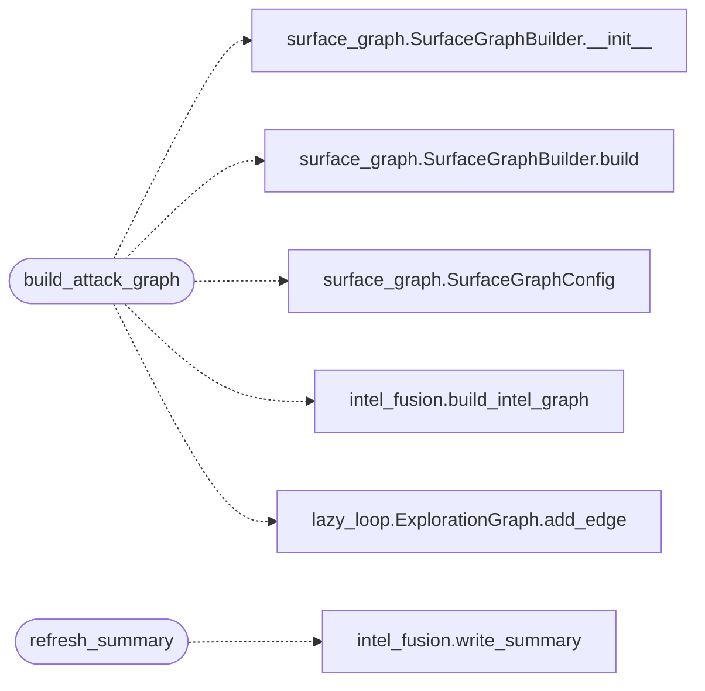

# `modules.attack_surface3d`

> Source: [modules/attack_surface3d.py:1](../../modules/attack_surface3d.py#L1) | language `py` | coverage 100.0% | [API index](../index.md)

Attack-surface 3D intel module: C2-centred campaign graph.

Fuses the live attack surface (`[`cli.surface_graph`](cli.surface_graph.py.md)`: C2 root, implants,
discovered hosts, open ports, services) with the campaign intel fusion
(`[`modules.intel_fusion`](modules.intel_fusion.py.md)`: objectives, findings, loop tasks, session-log
mentions) into ONE heterogeneous graph rendered with the ReadMenator
node engine (force 2D/3D, circular bundles, spherical view).

Inspiration mapping (kept, not copied):
- estorides entity resolution -> hosts merged by IP across surface scans,
  world model and logs; corroborating artefacts tagged per node.
- CAIRN explorer (Cisco-Talos) toggles/hulls/analytics -> type pills,
  community halos, top-exposed ranking feeding ``intel_summary.json``.
- ReadMenator force/bundle explorers -> verbatim node engine, physics
  sizes, glyphs, legend and inspector; only the data adapters differ.

The reverse leg closes the loop: [`refresh_summary`](#refresh_summary) scores host
exposure into ``sessions/intel_summary.json``, which the autonomous
planner consumes, turning session data into information and information
into intelligence on every request.

## Contents

- **Functions:** [`build_attack_graph`](#build_attack_graph), [`refresh_summary`](#refresh_summary)
- **Constants:** [`KIND_TO_LAYER`](#kind_to_layer), [`EDGE_COLORS`](#edge_colors)

## Call Graph

Solid arrows stay in this module, dashed arrows leave it.



## Functions

<a id="build_attack_graph"></a>

### `build_attack_graph`

`function` | [modules/attack_surface3d.py:148](../../modules/attack_surface3d.py#L148)

```python
def build_attack_graph(sessions_dir: str | Path = SESSIONS_DIR, payload_path: str = 'payload.json', est_cap: int = 300) -> dict
```

Fuse surface scans with campaign intel into one C2-centred graph.

**Parameters**

| Name | Type | Default | Description |
|---|---|---|---|
| `sessions_dir` | `str \| Path` | `SESSIONS_DIR` |  |
| `payload_path` | `str` | `'payload.json'` |  |
| `est_cap` | `int` | `300` |  |

**Returns:** `dict`

*Calls:* [`SurfaceGraphBuilder.__init__`](cli.surface_graph.py.md#surfacegraphbuilder-__init__), [`SurfaceGraphBuilder.build`](cli.surface_graph.py.md#surfacegraphbuilder-build), [`SurfaceGraphConfig`](cli.surface_graph.py.md#surfacegraphconfig), [`build_intel_graph`](modules.intel_fusion.py.md#build_intel_graph), [`ExplorationGraph.add_edge`](modules.lazy_loop.py.md#explorationgraph-add_edge)

*Called by:* [`SurfaceCommandSet.do_estorides_intel`](cli.commands.surface.py.md#surfacecommandset-do_estorides_intel), [`apply`](modules.sinks.attack_graph.py.md#apply)

---

<a id="refresh_summary"></a>

### `refresh_summary`

`function` | [modules/attack_surface3d.py:480](../../modules/attack_surface3d.py#L480)

```python
def refresh_summary(graph: dict, sessions_dir: str | Path = SESSIONS_DIR) -> dict
```

Score exposure into intel_summary.json for the autonomous loop.

**Parameters**

| Name | Type | Default | Description |
|---|---|---|---|
| `graph` | `dict` |  |  |
| `sessions_dir` | `str \| Path` | `SESSIONS_DIR` |  |

**Returns:** `dict`

*Calls:* [`write_summary`](modules.intel_fusion.py.md#write_summary)

*Called by:* [`SurfaceCommandSet.do_estorides_intel`](cli.commands.surface.py.md#surfacecommandset-do_estorides_intel), [`apply`](modules.sinks.attack_graph.py.md#apply)

---

## Constants

<a id="kind_to_layer"></a>

### `KIND_TO_LAYER`

`constant` | [modules/attack_surface3d.py:57](../../modules/attack_surface3d.py#L57)

```python
KIND_TO_LAYER
```

---

<a id="edge_colors"></a>

### `EDGE_COLORS`

`constant` | [modules/attack_surface3d.py:87](../../modules/attack_surface3d.py#L87)

```python
EDGE_COLORS
```

---
