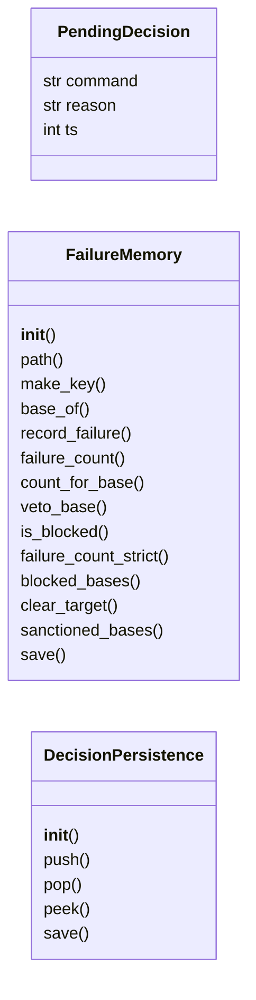
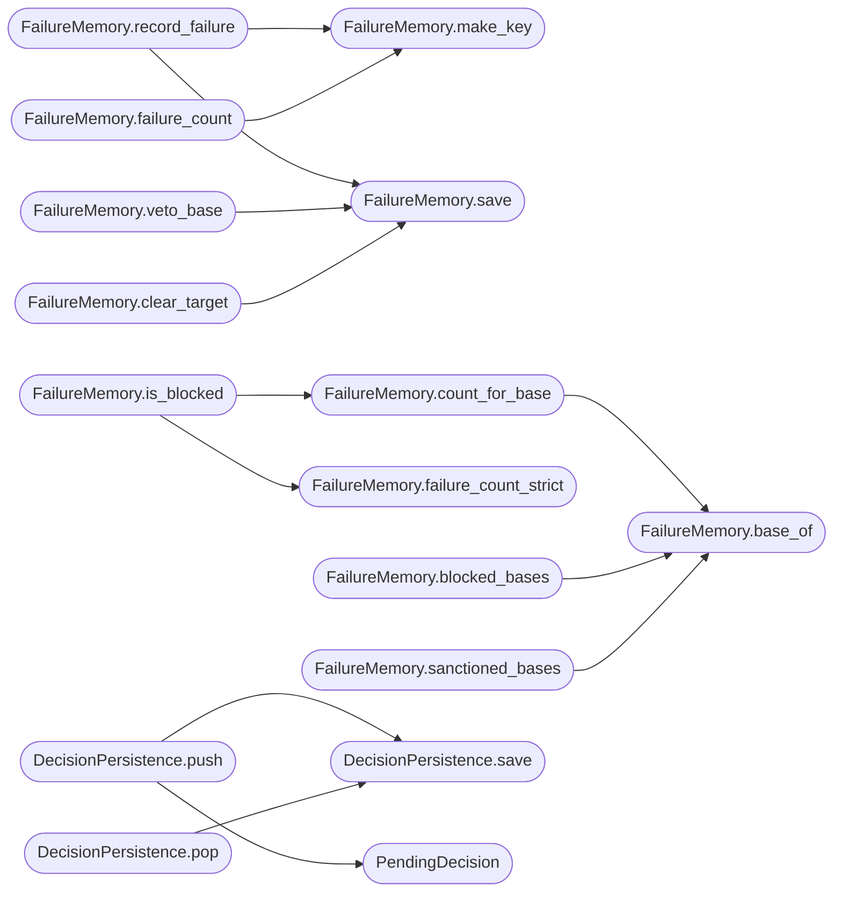

# `modules.auto_loop_memory`

> Source: [modules/auto_loop_memory.py:1](../../modules/auto_loop_memory.py#L1) | language `py` | coverage 82.6% | [API index](../index.md)

Persistent memory for the auto loop.

Two stores backed by atomic JSON files under ``sessions/auto_loop``:

- `[`FailureMemory`](#failurememory)`: how many times each (target, category, command)
  combination failed, plus the set of base commands considered blocked
  either because they failed past ``BLOCK_THRESHOLD`` or because the
  stuck-loop detector vetoed them. Survives loop restarts so a command
  that already burned two attempts is not burned again next session.
- `[`DecisionPersistence`](#decisionpersistence)`: reactive-engine decisions that could not be
  consumed in the step that produced them. Written as a backlog and
  drained at the top of the next cascade so expensive findings (e.g. a
  privesc hint) are never dropped when the loop exits mid-step.

Keys are pipe-separated segments (``target|category|command``) because
command strings may contain colons. The command segment stores the exact
string the selector attempted; base-command blocking derives the first
whitespace token from recorded entries.

## Contents

- **Classes:** [`PendingDecision`](#pendingdecision), [`FailureMemory`](#failurememory), [`DecisionPersistence`](#decisionpersistence)

## Type Diagram



## Call Graph

Solid arrows stay in this module, dashed arrows leave it.



## Classes

<a id="pendingdecision"></a>

### `PendingDecision`

`class` `dataclass` | [modules/auto_loop_memory.py:45](../../modules/auto_loop_memory.py#L45)

Decorators: `@dataclass`

```python
class PendingDecision
```

A reactive-engine decision parked for the next selection cycle.

**Attributes**

| Name | Type | Default | Description |
|---|---|---|---|
| [`command`](#pendingdecision-command) | `str` |  |  |
| [`reason`](#pendingdecision-reason) | `str` | `''` |  |
| [`ts`](#pendingdecision-ts) | `int` | `0` |  |

---

<a id="failurememory"></a>

### `FailureMemory`

`class` | [modules/auto_loop_memory.py:53](../../modules/auto_loop_memory.py#L53)

```python
class FailureMemory
```

Durable per-target failure counters and blocked base commands.

**Members**

| Member | Kind | Summary |
|---|---|---|
| [`__init__`](#failurememory-__init__) | constructor |  |
| [`path`](#failurememory-path) | property | Backing file path for administrative inspection. |
| [`make_key`](#failurememory-make_key) | staticmethod | Build the storage key; raises on empty target or command. |
| [`base_of`](#failurememory-base_of) | staticmethod | Extract the base command from a full command string. |
| [`record_failure`](#failurememory-record_failure) | method | Increment and persist the failure count; returns the new count. |
| [`failure_count`](#failurememory-failure_count) | method | Current persisted failure count for the combination. |
| [`count_for_base`](#failurememory-count_for_base) | method | Failure hits aggregated across exact keys whose base matches. |
| [`veto_base`](#failurememory-veto_base) | method | Mark a base command as blocked by the stuck-loop detector. |
| [`is_blocked`](#failurememory-is_blocked) | method | True when the base is vetoed or its failure count hit the threshold. |
| [`failure_count_strict`](#failurememory-failure_count_strict) | method | Failure count for a raw storage key already containing separators. |
| [`blocked_bases`](#failurememory-blocked_bases) | method | All blocked base commands for the target (vetoed plus past threshold). |
| [`clear_target`](#failurememory-clear_target) | method | Forget every record for a target (manual reset path). |
| [`sanctioned_bases`](#failurememory-sanctioned_bases) | method | Administrative view: counts above threshold with their last timestamp. |
| [`save`](#failurememory-save) | method |  |

<a id="failurememory-__init__"></a>

#### `FailureMemory.__init__`

`constructor` | [modules/auto_loop_memory.py:56](../../modules/auto_loop_memory.py#L56)

```python
def __init__(self, filepath: str | Path) -> None
```

**Parameters**

| Name | Type | Default | Description |
|---|---|---|---|
| `filepath` | `str \| Path` |  |  |

<a id="failurememory-path"></a>

#### `FailureMemory.path`

`property` | [modules/auto_loop_memory.py:63](../../modules/auto_loop_memory.py#L63)

Decorators: `@property`

```python
def path(self) -> Path
```

Backing file path for administrative inspection.

**Returns:** `Path`

<a id="failurememory-make_key"></a>

#### `FailureMemory.make_key`

`staticmethod` | [modules/auto_loop_memory.py:68](../../modules/auto_loop_memory.py#L68)

Decorators: `@staticmethod`

```python
def make_key(target: str, category: str, command: str) -> str
```

Build the storage key; raises on empty target or command.

**Parameters**

| Name | Type | Default | Description |
|---|---|---|---|
| `target` | `str` |  |  |
| `category` | `str` |  |  |
| `command` | `str` |  |  |

**Returns:** `str`

**Raises**

- `ValueError`: (raised in the body, not documented)

*Called by:* [`FailureMemory.failure_count`](#failurememory-failure_count), [`FailureMemory.record_failure`](#failurememory-record_failure)

<a id="failurememory-base_of"></a>

#### `FailureMemory.base_of`

`staticmethod` | [modules/auto_loop_memory.py:75](../../modules/auto_loop_memory.py#L75)

Decorators: `@staticmethod`

```python
def base_of(command: str) -> str
```

Extract the base command from a full command string.

**Parameters**

| Name | Type | Default | Description |
|---|---|---|---|
| `command` | `str` |  |  |

**Returns:** `str`

*Called by:* [`FailureMemory.blocked_bases`](#failurememory-blocked_bases), [`FailureMemory.count_for_base`](#failurememory-count_for_base), [`FailureMemory.sanctioned_bases`](#failurememory-sanctioned_bases)

<a id="failurememory-record_failure"></a>

#### `FailureMemory.record_failure`

`method` | [modules/auto_loop_memory.py:79](../../modules/auto_loop_memory.py#L79)

```python
def record_failure(self, target: str, category: str, command: str) -> int
```

Increment and persist the failure count; returns the new count.

**Parameters**

| Name | Type | Default | Description |
|---|---|---|---|
| `target` | `str` |  |  |
| `category` | `str` |  |  |
| `command` | `str` |  |  |

**Returns:** `int`

*Calls:* [`FailureMemory.make_key`](#failurememory-make_key), [`FailureMemory.save`](#failurememory-save)

<a id="failurememory-failure_count"></a>

#### `FailureMemory.failure_count`

`method` | [modules/auto_loop_memory.py:89](../../modules/auto_loop_memory.py#L89)

```python
def failure_count(self, target: str, category: str, command: str) -> int
```

Current persisted failure count for the combination.

**Parameters**

| Name | Type | Default | Description |
|---|---|---|---|
| `target` | `str` |  |  |
| `category` | `str` |  |  |
| `command` | `str` |  |  |

**Returns:** `int`

*Calls:* [`FailureMemory.make_key`](#failurememory-make_key)

<a id="failurememory-count_for_base"></a>

#### `FailureMemory.count_for_base`

`method` | [modules/auto_loop_memory.py:94](../../modules/auto_loop_memory.py#L94)

```python
def count_for_base(self, target: str, base_command: str) -> int
```

Failure hits aggregated across exact keys whose base matches.

**Parameters**

| Name | Type | Default | Description |
|---|---|---|---|
| `target` | `str` |  |  |
| `base_command` | `str` |  |  |

**Returns:** `int`

*Calls:* [`FailureMemory.base_of`](#failurememory-base_of)

*Called by:* [`FailureMemory.is_blocked`](#failurememory-is_blocked)

<a id="failurememory-veto_base"></a>

#### `FailureMemory.veto_base`

`method` | [modules/auto_loop_memory.py:105](../../modules/auto_loop_memory.py#L105)

```python
def veto_base(self, target: str, base_command: str) -> None
```

Mark a base command as blocked by the stuck-loop detector.

**Parameters**

| Name | Type | Default | Description |
|---|---|---|---|
| `target` | `str` |  |  |
| `base_command` | `str` |  |  |

*Calls:* [`FailureMemory.save`](#failurememory-save)

<a id="failurememory-is_blocked"></a>

#### `FailureMemory.is_blocked`

`method` | [modules/auto_loop_memory.py:115](../../modules/auto_loop_memory.py#L115)

```python
def is_blocked(self, target: str, base_command: str, bonus_key: str = '') -> bool
```

True when the base is vetoed or its failure count hit the threshold.

**Parameters**

| Name | Type | Default | Description |
|---|---|---|---|
| `target` | `str` |  |  |
| `base_command` | `str` |  |  |
| `bonus_key` | `str` | `''` |  |

**Returns:** `bool`

*Calls:* [`FailureMemory.count_for_base`](#failurememory-count_for_base), [`FailureMemory.failure_count_strict`](#failurememory-failure_count_strict)

*Called by:* [`select`](modules.selector_manager.py.md#select)

<a id="failurememory-failure_count_strict"></a>

#### `FailureMemory.failure_count_strict`

`method` | [modules/auto_loop_memory.py:123](../../modules/auto_loop_memory.py#L123)

```python
def failure_count_strict(self, target: str, key: str) -> int
```

Failure count for a raw storage key already containing separators.

**Parameters**

| Name | Type | Default | Description |
|---|---|---|---|
| `target` | `str` |  |  |
| `key` | `str` |  |  |

**Returns:** `int`

*Called by:* [`FailureMemory.is_blocked`](#failurememory-is_blocked)

<a id="failurememory-blocked_bases"></a>

#### `FailureMemory.blocked_bases`

`method` | [modules/auto_loop_memory.py:128](../../modules/auto_loop_memory.py#L128)

```python
def blocked_bases(self, target: str) -> set[str]
```

All blocked base commands for the target (vetoed plus past threshold).

**Parameters**

| Name | Type | Default | Description |
|---|---|---|---|
| `target` | `str` |  |  |

**Returns:** `set[str]`

*Calls:* [`FailureMemory.base_of`](#failurememory-base_of)

<a id="failurememory-clear_target"></a>

#### `FailureMemory.clear_target`

`method` | [modules/auto_loop_memory.py:140](../../modules/auto_loop_memory.py#L140)

```python
def clear_target(self, target: str) -> None
```

Forget every record for a target (manual reset path).

**Parameters**

| Name | Type | Default | Description |
|---|---|---|---|
| `target` | `str` |  |  |

*Calls:* [`FailureMemory.save`](#failurememory-save)

<a id="failurememory-sanctioned_bases"></a>

#### `FailureMemory.sanctioned_bases`

`method` | [modules/auto_loop_memory.py:146](../../modules/auto_loop_memory.py#L146)

```python
def sanctioned_bases(self, target: str) -> list[dict[str, object]]
```

Administrative view: counts above threshold with their last timestamp.

**Parameters**

| Name | Type | Default | Description |
|---|---|---|---|
| `target` | `str` |  |  |

**Returns:** `list[dict[str, object]]`

*Calls:* [`FailureMemory.base_of`](#failurememory-base_of)

<a id="failurememory-save"></a>

#### `FailureMemory.save`

`method` | [modules/auto_loop_memory.py:166](../../modules/auto_loop_memory.py#L166)

```python
def save(self) -> None
```

*Called by:* [`FailureMemory.clear_target`](#failurememory-clear_target), [`FailureMemory.record_failure`](#failurememory-record_failure), [`FailureMemory.veto_base`](#failurememory-veto_base)

---

<a id="decisionpersistence"></a>

### `DecisionPersistence`

`class` | [modules/auto_loop_memory.py:212](../../modules/auto_loop_memory.py#L212)

```python
class DecisionPersistence
```

Backlog of reactive decisions that outlives a single loop process.

**Members**

| Member | Kind | Summary |
|---|---|---|
| [`__init__`](#decisionpersistence-__init__) | constructor |  |
| [`push`](#decisionpersistence-push) | method | Park one decision for later consumption (newest first). |
| [`pop`](#decisionpersistence-pop) | method | Consume and persist-removal of the newest parked decision. |
| [`peek`](#decisionpersistence-peek) | method | Newest parked decision without consuming it. |
| [`save`](#decisionpersistence-save) | method |  |

<a id="decisionpersistence-__init__"></a>

#### `DecisionPersistence.__init__`

`constructor` | [modules/auto_loop_memory.py:215](../../modules/auto_loop_memory.py#L215)

```python
def __init__(self, filepath: str | Path) -> None
```

**Parameters**

| Name | Type | Default | Description |
|---|---|---|---|
| `filepath` | `str \| Path` |  |  |

<a id="decisionpersistence-push"></a>

#### `DecisionPersistence.push`

`method` | [modules/auto_loop_memory.py:220](../../modules/auto_loop_memory.py#L220)

```python
def push(self, command: str, reason: str = '') -> None
```

Park one decision for later consumption (newest first).

**Parameters**

| Name | Type | Default | Description |
|---|---|---|---|
| `command` | `str` |  |  |
| `reason` | `str` | `''` |  |

*Calls:* [`DecisionPersistence.save`](#decisionpersistence-save), [`PendingDecision`](#pendingdecision)

<a id="decisionpersistence-pop"></a>

#### `DecisionPersistence.pop`

`method` | [modules/auto_loop_memory.py:229](../../modules/auto_loop_memory.py#L229)

```python
def pop(self) -> PendingDecision | None
```

Consume and persist-removal of the newest parked decision.

**Returns:** `PendingDecision | None`

*Calls:* [`DecisionPersistence.save`](#decisionpersistence-save)

<a id="decisionpersistence-peek"></a>

#### `DecisionPersistence.peek`

`method` | [modules/auto_loop_memory.py:237](../../modules/auto_loop_memory.py#L237)

```python
def peek(self) -> PendingDecision | None
```

Newest parked decision without consuming it.

**Returns:** `PendingDecision | None`

<a id="decisionpersistence-save"></a>

#### `DecisionPersistence.save`

`method` | [modules/auto_loop_memory.py:244](../../modules/auto_loop_memory.py#L244)

```python
def save(self) -> None
```

*Called by:* [`DecisionPersistence.pop`](#decisionpersistence-pop), [`DecisionPersistence.push`](#decisionpersistence-push)

---
