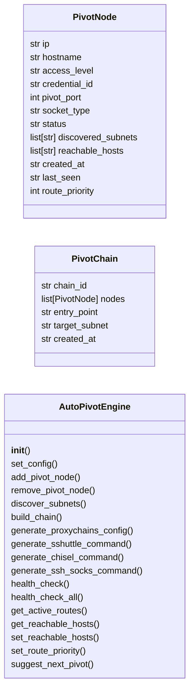
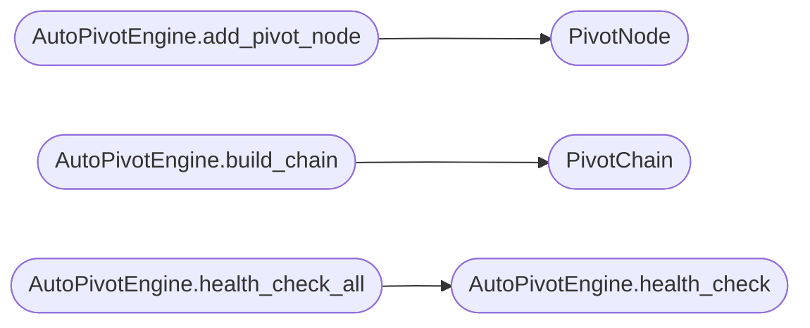

# `modules.auto_pivot`

> Source: [modules/auto_pivot.py:1](../../modules/auto_pivot.py#L1) | language `py` | coverage 9.5% | [API index](../index.md)

Auto-Pivoting Engine for LazyOwn.

Automated lateral movement through compromised hosts:
- Multi-hop SOCKS proxy chaining
- Subnet discovery via compromised host perspective
- Route maintenance with health checks
- Automatic credential re-use across hops

## Contents

- **Classes:** [`PivotNode`](#pivotnode), [`PivotChain`](#pivotchain), [`AutoPivotEngine`](#autopivotengine)
- **Constants:** [`SESSIONS_DIR`](#sessions_dir)

## Type Diagram



## Call Graph

Solid arrows stay in this module, dashed arrows leave it.



## Classes

<a id="pivotnode"></a>

### `PivotNode`

`class` `dataclass` | [modules/auto_pivot.py:23](../../modules/auto_pivot.py#L23)

Decorators: `@dataclass`

```python
class PivotNode
```

**Attributes**

| Name | Type | Default | Description |
|---|---|---|---|
| [`ip`](#pivotnode-ip) | `str` |  |  |
| [`hostname`](#pivotnode-hostname) | `str` |  |  |
| [`access_level`](#pivotnode-access_level) | `str` |  |  |
| [`credential_id`](#pivotnode-credential_id) | `str` |  |  |
| [`pivot_port`](#pivotnode-pivot_port) | `int` |  |  |
| [`socket_type`](#pivotnode-socket_type) | `str` |  |  |
| [`status`](#pivotnode-status) | `str` |  |  |
| [`discovered_subnets`](#pivotnode-discovered_subnets) | `list[str]` | `field(default_factory=list)` |  |
| [`reachable_hosts`](#pivotnode-reachable_hosts) | `list[str]` | `field(default_factory=list)` |  |
| [`created_at`](#pivotnode-created_at) | `str` | `field(default_factory=lambda: datetime.now(UTC).isoformat())` |  |
| [`last_seen`](#pivotnode-last_seen) | `str` | `field(default_factory=lambda: datetime.now(UTC).isoformat())` |  |
| [`route_priority`](#pivotnode-route_priority) | `int` | `50` |  |

---

<a id="pivotchain"></a>

### `PivotChain`

`class` `dataclass` | [modules/auto_pivot.py:39](../../modules/auto_pivot.py#L39)

Decorators: `@dataclass`

```python
class PivotChain
```

**Attributes**

| Name | Type | Default | Description |
|---|---|---|---|
| [`chain_id`](#pivotchain-chain_id) | `str` |  |  |
| [`nodes`](#pivotchain-nodes) | `list[PivotNode]` | `field(default_factory=list)` |  |
| [`entry_point`](#pivotchain-entry_point) | `str` | `''` |  |
| [`target_subnet`](#pivotchain-target_subnet) | `str` | `''` |  |
| [`created_at`](#pivotchain-created_at) | `str` | `field(default_factory=lambda: datetime.now(UTC).isoformat())` |  |

---

<a id="autopivotengine"></a>

### `AutoPivotEngine`

`class` | [modules/auto_pivot.py:47](../../modules/auto_pivot.py#L47)

```python
class AutoPivotEngine
```

Manages automated pivoting through compromised hosts.

**Members**

| Member | Kind | Summary |
|---|---|---|
| [`__init__`](#autopivotengine-__init__) | constructor |  |
| [`set_config`](#autopivotengine-set_config) | method |  |
| [`add_pivot_node`](#autopivotengine-add_pivot_node) | method |  |
| [`remove_pivot_node`](#autopivotengine-remove_pivot_node) | method |  |
| [`discover_subnets`](#autopivotengine-discover_subnets) | method |  |
| [`build_chain`](#autopivotengine-build_chain) | method |  |
| [`generate_proxychains_config`](#autopivotengine-generate_proxychains_config) | method |  |
| [`generate_sshuttle_command`](#autopivotengine-generate_sshuttle_command) | method |  |
| [`generate_chisel_command`](#autopivotengine-generate_chisel_command) | method |  |
| [`generate_ssh_socks_command`](#autopivotengine-generate_ssh_socks_command) | method |  |
| [`health_check`](#autopivotengine-health_check) | method |  |
| [`health_check_all`](#autopivotengine-health_check_all) | method |  |
| [`get_active_routes`](#autopivotengine-get_active_routes) | method |  |
| [`get_reachable_hosts`](#autopivotengine-get_reachable_hosts) | method |  |
| [`set_reachable_hosts`](#autopivotengine-set_reachable_hosts) | method |  |
| [`set_route_priority`](#autopivotengine-set_route_priority) | method |  |
| [`suggest_next_pivot`](#autopivotengine-suggest_next_pivot) | method |  |

<a id="autopivotengine-__init__"></a>

#### `AutoPivotEngine.__init__`

`constructor` | [modules/auto_pivot.py:73](../../modules/auto_pivot.py#L73)

```python
def __init__(self, config: Any = None) -> None
```

**Parameters**

| Name | Type | Default | Description |
|---|---|---|---|
| `config` | `Any` | `None` |  |

<a id="autopivotengine-set_config"></a>

#### `AutoPivotEngine.set_config`

`method` | [modules/auto_pivot.py:82](../../modules/auto_pivot.py#L82)

```python
def set_config(self, config: Any) -> None
```

**Parameters**

| Name | Type | Default | Description |
|---|---|---|---|
| `config` | `Any` |  |  |

<a id="autopivotengine-add_pivot_node"></a>

#### `AutoPivotEngine.add_pivot_node`

`method` | [modules/auto_pivot.py:90](../../modules/auto_pivot.py#L90)

```python
def add_pivot_node(self, ip: str, access_type: str = 'ssh', credential_id: str = '', hostname: str = '') -> PivotNode
```

**Parameters**

| Name | Type | Default | Description |
|---|---|---|---|
| `ip` | `str` |  |  |
| `access_type` | `str` | `'ssh'` |  |
| `credential_id` | `str` | `''` |  |
| `hostname` | `str` | `''` |  |

**Returns:** `PivotNode`

*Calls:* [`PivotNode`](#pivotnode)

<a id="autopivotengine-remove_pivot_node"></a>

#### `AutoPivotEngine.remove_pivot_node`

`method` | [modules/auto_pivot.py:120](../../modules/auto_pivot.py#L120)

```python
def remove_pivot_node(self, ip: str) -> None
```

**Parameters**

| Name | Type | Default | Description |
|---|---|---|---|
| `ip` | `str` |  |  |

<a id="autopivotengine-discover_subnets"></a>

#### `AutoPivotEngine.discover_subnets`

`method` | [modules/auto_pivot.py:128](../../modules/auto_pivot.py#L128)

```python
def discover_subnets(self, node_ip: str, command_output: str) -> list[str]
```

**Parameters**

| Name | Type | Default | Description |
|---|---|---|---|
| `node_ip` | `str` |  |  |
| `command_output` | `str` |  |  |

**Returns:** `list[str]`

<a id="autopivotengine-build_chain"></a>

#### `AutoPivotEngine.build_chain`

`method` | [modules/auto_pivot.py:146](../../modules/auto_pivot.py#L146)

```python
def build_chain(self, target_ip: str, via_nodes: list[str] | None = None, subnet: str = '') -> PivotChain | None
```

**Parameters**

| Name | Type | Default | Description |
|---|---|---|---|
| `target_ip` | `str` |  |  |
| `via_nodes` | `list[str] \| None` | `None` |  |
| `subnet` | `str` | `''` |  |

**Returns:** `PivotChain | None`

*Calls:* [`PivotChain`](#pivotchain)

<a id="autopivotengine-generate_proxychains_config"></a>

#### `AutoPivotEngine.generate_proxychains_config`

`method` | [modules/auto_pivot.py:177](../../modules/auto_pivot.py#L177)

```python
def generate_proxychains_config(self, chain_id: str | None = None) -> str
```

**Parameters**

| Name | Type | Default | Description |
|---|---|---|---|
| `chain_id` | `str \| None` | `None` |  |

**Returns:** `str`

<a id="autopivotengine-generate_sshuttle_command"></a>

#### `AutoPivotEngine.generate_sshuttle_command`

`method` | [modules/auto_pivot.py:203](../../modules/auto_pivot.py#L203)

```python
def generate_sshuttle_command(self, node_ip: str, subnet: str) -> str
```

**Parameters**

| Name | Type | Default | Description |
|---|---|---|---|
| `node_ip` | `str` |  |  |
| `subnet` | `str` |  |  |

**Returns:** `str`

<a id="autopivotengine-generate_chisel_command"></a>

#### `AutoPivotEngine.generate_chisel_command`

`method` | [modules/auto_pivot.py:206](../../modules/auto_pivot.py#L206)

```python
def generate_chisel_command(self, target_ip: str, local_port: int | None = None) -> tuple[str, str]
```

**Parameters**

| Name | Type | Default | Description |
|---|---|---|---|
| `target_ip` | `str` |  |  |
| `local_port` | `int \| None` | `None` |  |

**Returns:** `tuple[str, str]`

<a id="autopivotengine-generate_ssh_socks_command"></a>

#### `AutoPivotEngine.generate_ssh_socks_command`

`method` | [modules/auto_pivot.py:212](../../modules/auto_pivot.py#L212)

```python
def generate_ssh_socks_command(self, node_ip: str, local_port: int | None = None) -> str
```

**Parameters**

| Name | Type | Default | Description |
|---|---|---|---|
| `node_ip` | `str` |  |  |
| `local_port` | `int \| None` | `None` |  |

**Returns:** `str`

<a id="autopivotengine-health_check"></a>

#### `AutoPivotEngine.health_check`

`method` | [modules/auto_pivot.py:216](../../modules/auto_pivot.py#L216)

```python
def health_check(self, node_ip: str) -> str
```

**Parameters**

| Name | Type | Default | Description |
|---|---|---|---|
| `node_ip` | `str` |  |  |

**Returns:** `str`

*Called by:* [`AutoPivotEngine.health_check_all`](#autopivotengine-health_check_all)

<a id="autopivotengine-health_check_all"></a>

#### `AutoPivotEngine.health_check_all`

`method` | [modules/auto_pivot.py:237](../../modules/auto_pivot.py#L237)

```python
def health_check_all(self) -> dict[str, str]
```

**Returns:** `dict[str, str]`

*Calls:* [`AutoPivotEngine.health_check`](#autopivotengine-health_check)

<a id="autopivotengine-get_active_routes"></a>

#### `AutoPivotEngine.get_active_routes`

`method` | [modules/auto_pivot.py:243](../../modules/auto_pivot.py#L243)

```python
def get_active_routes(self) -> list[dict[str, Any]]
```

**Returns:** `list[dict[str, Any]]`

<a id="autopivotengine-get_reachable_hosts"></a>

#### `AutoPivotEngine.get_reachable_hosts`

`method` | [modules/auto_pivot.py:259](../../modules/auto_pivot.py#L259)

```python
def get_reachable_hosts(self, node_ip: str | None = None) -> list[str]
```

**Parameters**

| Name | Type | Default | Description |
|---|---|---|---|
| `node_ip` | `str \| None` | `None` |  |

**Returns:** `list[str]`

<a id="autopivotengine-set_reachable_hosts"></a>

#### `AutoPivotEngine.set_reachable_hosts`

`method` | [modules/auto_pivot.py:267](../../modules/auto_pivot.py#L267)

```python
def set_reachable_hosts(self, node_ip: str, hosts: list[str]) -> None
```

**Parameters**

| Name | Type | Default | Description |
|---|---|---|---|
| `node_ip` | `str` |  |  |
| `hosts` | `list[str]` |  |  |

<a id="autopivotengine-set_route_priority"></a>

#### `AutoPivotEngine.set_route_priority`

`method` | [modules/auto_pivot.py:272](../../modules/auto_pivot.py#L272)

```python
def set_route_priority(self, node_ip: str, priority: int) -> None
```

**Parameters**

| Name | Type | Default | Description |
|---|---|---|---|
| `node_ip` | `str` |  |  |
| `priority` | `int` |  |  |

<a id="autopivotengine-suggest_next_pivot"></a>

#### `AutoPivotEngine.suggest_next_pivot`

`method` | [modules/auto_pivot.py:352](../../modules/auto_pivot.py#L352)

```python
def suggest_next_pivot(self) -> dict[str, Any] | None
```

**Returns:** `dict[str, Any] | None`

---

## Constants

<a id="sessions_dir"></a>

### `SESSIONS_DIR`

`constant` | [modules/auto_pivot.py:19](../../modules/auto_pivot.py#L19)

```python
SESSIONS_DIR = Path(__file__).resolve().parent.parent / 'sessions'
```

---
