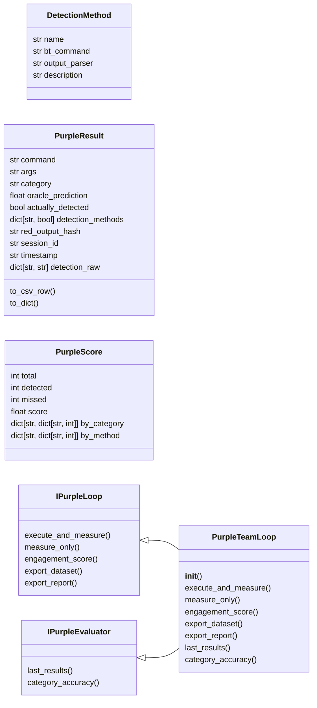
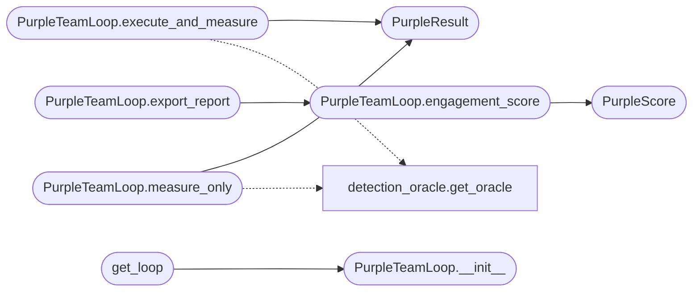

# `modules.auto_purple`

> Source: [modules/auto_purple.py:1](../../modules/auto_purple.py#L1) | language `py` | coverage 57.7% | [API index](../index.md)

Purple Team Closed-Loop — honest measurement of offensive detection.

Orchestrates the cycle: execute red action -> measure with LazyOwnBT (blue)
-> record real results -> generate ML training datasets -> calibrate oracle.

Every engagement produces a CSV dataset that LazyOwnBT can ingest to improve
its RandomForest detection model. This is a genuine feedback loop, not static
probability guessing.

Design principles
-----------------
- Single Responsibility : purple loop orchestration only
- Open/Closed           : new detection methods added via _DETECTION_METHODS
- Dependency Inversion  : callers depend on IPurpleLoop, not PurpleTeamLoop
- Interface Segregation : read-only IPurpleEvaluator vs read-write IPurpleLoop
- No secrets            : config from payload.json, paths from sessions/

Usage
-----
    from modules.auto_purple import get_loop

    loop = get_loop()
    result = loop.execute_and_measure("mimikatz", "sekurlsa::logonpasswords", "credential")
    print(f"Detected: {result.actually_detected}  Oracle predicted: {result.oracle_prediction:.0%}")

## Contents

- **Classes:** [`DetectionMethod`](#detectionmethod), [`PurpleResult`](#purpleresult), [`PurpleScore`](#purplescore), [`IPurpleLoop`](#ipurpleloop), [`IPurpleEvaluator`](#ipurpleevaluator), [`PurpleTeamLoop`](#purpleteamloop)
- **Functions:** [`get_loop`](#get_loop), [`load_config_from_payload`](#load_config_from_payload)

## Type Diagram



## Call Graph

Solid arrows stay in this module, dashed arrows leave it.



## Classes

<a id="detectionmethod"></a>

### `DetectionMethod`

`class` `dataclass` | [modules/auto_purple.py:72](../../modules/auto_purple.py#L72)

Decorators: `@dataclass(frozen=True)`

```python
class DetectionMethod
```

Describes one LazyOwnBT detection surface.

**Attributes**

| Name | Type | Default | Description |
|---|---|---|---|
| [`name`](#detectionmethod-name) | `str` |  |  |
| [`bt_command`](#detectionmethod-bt_command) | `str` |  |  |
| [`output_parser`](#detectionmethod-output_parser) | `str` |  |  |
| [`description`](#detectionmethod-description) | `str` |  |  |

---

<a id="purpleresult"></a>

### `PurpleResult`

`class` `dataclass` | [modules/auto_purple.py:132](../../modules/auto_purple.py#L132)

Decorators: `@dataclass`

```python
class PurpleResult
```

Result of a single red action measurement.

**Attributes**

| Name | Type | Default | Description |
|---|---|---|---|
| [`command`](#purpleresult-command) | `str` |  |  |
| [`args`](#purpleresult-args) | `str` |  |  |
| [`category`](#purpleresult-category) | `str` |  |  |
| [`oracle_prediction`](#purpleresult-oracle_prediction) | `float` |  |  |
| [`actually_detected`](#purpleresult-actually_detected) | `bool` |  |  |
| [`detection_methods`](#purpleresult-detection_methods) | `dict[str, bool]` |  |  |
| [`red_output_hash`](#purpleresult-red_output_hash) | `str` |  |  |
| [`session_id`](#purpleresult-session_id) | `str` |  |  |
| [`timestamp`](#purpleresult-timestamp) | `str` | `field(default_factory=lambda: datetime.now().isoformat())` |  |
| [`detection_raw`](#purpleresult-detection_raw) | `dict[str, str]` | `field(default_factory=dict)` |  |

**Members**

| Member | Kind | Summary |
|---|---|---|
| [`to_csv_row`](#purpleresult-to_csv_row) | method | Serialize to a flat dict suitable for CSV writer. |
| [`to_dict`](#purpleresult-to_dict) | method |  |

<a id="purpleresult-to_csv_row"></a>

#### `PurpleResult.to_csv_row`

`method` | [modules/auto_purple.py:146](../../modules/auto_purple.py#L146)

```python
def to_csv_row(self) -> dict[str, str]
```

Serialize to a flat dict suitable for CSV writer.

**Returns:** `dict[str, str]`

<a id="purpleresult-to_dict"></a>

#### `PurpleResult.to_dict`

`method` | [modules/auto_purple.py:160](../../modules/auto_purple.py#L160)

```python
def to_dict(self) -> dict[str, Any]
```

**Returns:** `dict[str, Any]`

---

<a id="purplescore"></a>

### `PurpleScore`

`class` `dataclass` | [modules/auto_purple.py:165](../../modules/auto_purple.py#L165)

Decorators: `@dataclass(frozen=True)`

```python
class PurpleScore
```

Aggregated detection score for an engagement.

**Attributes**

| Name | Type | Default | Description |
|---|---|---|---|
| [`total`](#purplescore-total) | `int` |  |  |
| [`detected`](#purplescore-detected) | `int` |  |  |
| [`missed`](#purplescore-missed) | `int` |  |  |
| [`score`](#purplescore-score) | `float` |  |  |
| [`by_category`](#purplescore-by_category) | `dict[str, dict[str, int]]` |  |  |
| [`by_method`](#purplescore-by_method) | `dict[str, dict[str, int]]` |  |  |

---

<a id="ipurpleloop"></a>

### `IPurpleLoop`

`class` `abstract` | [modules/auto_purple.py:181](../../modules/auto_purple.py#L181)

```python
class IPurpleLoop(ABC)
```

Bases: `ABC`

Subclasses: [`PurpleTeamLoop`](#purpleteamloop)

Read-write contract for purple team orchestration.

**Members**

| Member | Kind | Summary |
|---|---|---|
| [`execute_and_measure`](#ipurpleloop-execute_and_measure) | method |  |
| [`measure_only`](#ipurpleloop-measure_only) | method |  |
| [`engagement_score`](#ipurpleloop-engagement_score) | method |  |
| [`export_dataset`](#ipurpleloop-export_dataset) | method |  |
| [`export_report`](#ipurpleloop-export_report) | method |  |

<a id="ipurpleloop-execute_and_measure"></a>

#### `IPurpleLoop.execute_and_measure`

`method` `abstract` | [modules/auto_purple.py:185](../../modules/auto_purple.py#L185)

Decorators: `@abstractmethod`

```python
def execute_and_measure(self, command: str, args: str, category: str) -> PurpleResult
```

**Parameters**

| Name | Type | Default | Description |
|---|---|---|---|
| `command` | `str` |  |  |
| `args` | `str` |  |  |
| `category` | `str` |  |  |

**Returns:** `PurpleResult`

<a id="ipurpleloop-measure_only"></a>

#### `IPurpleLoop.measure_only`

`method` `abstract` | [modules/auto_purple.py:193](../../modules/auto_purple.py#L193)

Decorators: `@abstractmethod`

```python
def measure_only(self, command: str, args: str, category: str) -> PurpleResult
```

**Parameters**

| Name | Type | Default | Description |
|---|---|---|---|
| `command` | `str` |  |  |
| `args` | `str` |  |  |
| `category` | `str` |  |  |

**Returns:** `PurpleResult`

<a id="ipurpleloop-engagement_score"></a>

#### `IPurpleLoop.engagement_score`

`method` `abstract` | [modules/auto_purple.py:201](../../modules/auto_purple.py#L201)

Decorators: `@abstractmethod`

```python
def engagement_score(self) -> PurpleScore
```

**Returns:** `PurpleScore`

<a id="ipurpleloop-export_dataset"></a>

#### `IPurpleLoop.export_dataset`

`method` `abstract` | [modules/auto_purple.py:204](../../modules/auto_purple.py#L204)

Decorators: `@abstractmethod`

```python
def export_dataset(self) -> Path
```

**Returns:** `Path`

<a id="ipurpleloop-export_report"></a>

#### `IPurpleLoop.export_report`

`method` `abstract` | [modules/auto_purple.py:207](../../modules/auto_purple.py#L207)

Decorators: `@abstractmethod`

```python
def export_report(self) -> Path
```

**Returns:** `Path`

---

<a id="ipurpleevaluator"></a>

### `IPurpleEvaluator`

`class` `abstract` | [modules/auto_purple.py:210](../../modules/auto_purple.py#L210)

```python
class IPurpleEvaluator(ABC)
```

Bases: `ABC`

Subclasses: [`PurpleTeamLoop`](#purpleteamloop)

Read-only contract for evaluation queries.

**Members**

| Member | Kind | Summary |
|---|---|---|
| [`last_results`](#ipurpleevaluator-last_results) | method |  |
| [`category_accuracy`](#ipurpleevaluator-category_accuracy) | method |  |

<a id="ipurpleevaluator-last_results"></a>

#### `IPurpleEvaluator.last_results`

`method` `abstract` | [modules/auto_purple.py:214](../../modules/auto_purple.py#L214)

Decorators: `@abstractmethod`

```python
def last_results(self, n: int = 10) -> list[PurpleResult]
```

**Parameters**

| Name | Type | Default | Description |
|---|---|---|---|
| `n` | `int` | `10` |  |

**Returns:** `list[PurpleResult]`

<a id="ipurpleevaluator-category_accuracy"></a>

#### `IPurpleEvaluator.category_accuracy`

`method` `abstract` | [modules/auto_purple.py:217](../../modules/auto_purple.py#L217)

Decorators: `@abstractmethod`

```python
def category_accuracy(self, category: str) -> dict[str, Any]
```

**Parameters**

| Name | Type | Default | Description |
|---|---|---|---|
| `category` | `str` |  |  |

**Returns:** `dict[str, Any]`

---

<a id="purpleteamloop"></a>

### `PurpleTeamLoop`

`class` | [modules/auto_purple.py:407](../../modules/auto_purple.py#L407)

```python
class PurpleTeamLoop(IPurpleLoop, IPurpleEvaluator)
```

Bases: [`IPurpleLoop`](#ipurpleloop), [`IPurpleEvaluator`](#ipurpleevaluator)

Closed-loop purple team orchestrator.

Executes red team actions, measures real detection via LazyOwnBT,
generates CSV datasets for ML training, and calibrates the DetectionOracle.

**Members**

| Member | Kind | Summary |
|---|---|---|
| [`__init__`](#purpleteamloop-__init__) | constructor |  |
| [`execute_and_measure`](#purpleteamloop-execute_and_measure) | method | Execute a red action and measure if LazyOwnBT detects it. |
| [`measure_only`](#purpleteamloop-measure_only) | method | Measure without executing — test if BT would detect the command. |
| [`engagement_score`](#purpleteamloop-engagement_score) | method | Aggregate detection score from all results in this session. |
| [`export_dataset`](#purpleteamloop-export_dataset) | method | Return the path to the CSV dataset file. |
| [`export_report`](#purpleteamloop-export_report) | method | Generate a full engagement report. |
| [`last_results`](#purpleteamloop-last_results) | method |  |
| [`category_accuracy`](#purpleteamloop-category_accuracy) | method |  |

<a id="purpleteamloop-__init__"></a>

#### `PurpleTeamLoop.__init__`

`constructor` | [modules/auto_purple.py:414](../../modules/auto_purple.py#L414)

```python
def __init__(self, bt_path: str | None = None, detection_delay: int = 5, methods: list[str] | None = None, auto_feedback: bool = True, session_id: str | None = None) -> None
```

**Parameters**

| Name | Type | Default | Description |
|---|---|---|---|
| `bt_path` | `str \| None` | `None` |  |
| `detection_delay` | `int` | `5` |  |
| `methods` | `list[str] \| None` | `None` |  |
| `auto_feedback` | `bool` | `True` |  |
| `session_id` | `str \| None` | `None` |  |

*Called by:* [`get_loop`](#get_loop)

<a id="purpleteamloop-execute_and_measure"></a>

#### `PurpleTeamLoop.execute_and_measure`

`method` | [modules/auto_purple.py:443](../../modules/auto_purple.py#L443)

```python
def execute_and_measure(self, command: str, args: str, category: str) -> PurpleResult
```

Execute a red action and measure if LazyOwnBT detects it.

**Parameters**

| Name | Type | Default | Description |
|---|---|---|---|
| `command` | `str` |  |  |
| `args` | `str` |  |  |
| `category` | `str` |  |  |

**Returns:** `PurpleResult`

*Calls:* [`PurpleResult`](#purpleresult), [`get_oracle`](modules.detection_oracle.py.md#get_oracle)

<a id="purpleteamloop-measure_only"></a>

#### `PurpleTeamLoop.measure_only`

`method` | [modules/auto_purple.py:493](../../modules/auto_purple.py#L493)

```python
def measure_only(self, command: str, args: str, category: str) -> PurpleResult
```

Measure without executing — test if BT would detect the command.

**Parameters**

| Name | Type | Default | Description |
|---|---|---|---|
| `command` | `str` |  |  |
| `args` | `str` |  |  |
| `category` | `str` |  |  |

**Returns:** `PurpleResult`

*Calls:* [`PurpleResult`](#purpleresult), [`get_oracle`](modules.detection_oracle.py.md#get_oracle)

<a id="purpleteamloop-engagement_score"></a>

#### `PurpleTeamLoop.engagement_score`

`method` | [modules/auto_purple.py:529](../../modules/auto_purple.py#L529)

```python
def engagement_score(self) -> PurpleScore
```

Aggregate detection score from all results in this session.

**Returns:** `PurpleScore`

*Calls:* [`PurpleScore`](#purplescore)

*Called by:* [`PurpleTeamLoop.export_report`](#purpleteamloop-export_report)

<a id="purpleteamloop-export_dataset"></a>

#### `PurpleTeamLoop.export_dataset`

`method` | [modules/auto_purple.py:567](../../modules/auto_purple.py#L567)

```python
def export_dataset(self) -> Path
```

Return the path to the CSV dataset file.

**Returns:** `Path`

<a id="purpleteamloop-export_report"></a>

#### `PurpleTeamLoop.export_report`

`method` | [modules/auto_purple.py:571](../../modules/auto_purple.py#L571)

```python
def export_report(self) -> Path
```

Generate a full engagement report.

**Returns:** `Path`

*Calls:* [`PurpleTeamLoop.engagement_score`](#purpleteamloop-engagement_score)

<a id="purpleteamloop-last_results"></a>

#### `PurpleTeamLoop.last_results`

`method` | [modules/auto_purple.py:596](../../modules/auto_purple.py#L596)

```python
def last_results(self, n: int = 10) -> list[PurpleResult]
```

**Parameters**

| Name | Type | Default | Description |
|---|---|---|---|
| `n` | `int` | `10` |  |

**Returns:** `list[PurpleResult]`

<a id="purpleteamloop-category_accuracy"></a>

#### `PurpleTeamLoop.category_accuracy`

`method` | [modules/auto_purple.py:599](../../modules/auto_purple.py#L599)

```python
def category_accuracy(self, category: str) -> dict[str, Any]
```

**Parameters**

| Name | Type | Default | Description |
|---|---|---|---|
| `category` | `str` |  |  |

**Returns:** `dict[str, Any]`

---

## Functions

<a id="get_loop"></a>

### `get_loop`

`function` | [modules/auto_purple.py:772](../../modules/auto_purple.py#L772)

```python
def get_loop(bt_path: str | None = None, detection_delay: int = 5, methods: list[str] | None = None, auto_feedback: bool = True) -> PurpleTeamLoop
```

Return (or create) the module-level PurpleTeamLoop singleton.

**Parameters**

| Name | Type | Default | Description |
|---|---|---|---|
| `bt_path` | `str \| None` | `None` |  |
| `detection_delay` | `int` | `5` |  |
| `methods` | `list[str] \| None` | `None` |  |
| `auto_feedback` | `bool` | `True` |  |

**Returns:** `PurpleTeamLoop`

*Calls:* [`PurpleTeamLoop.__init__`](#purpleteamloop-__init__)

---

<a id="load_config_from_payload"></a>

### `load_config_from_payload`

`function` | [modules/auto_purple.py:790](../../modules/auto_purple.py#L790)

```python
def load_config_from_payload(params: dict[str, Any]) -> dict[str, Any]
```

Extract purple_team config from payload.json params dict.

Returns a dict with keys: enabled, bt_path, detection_delay,
methods, auto_feedback, score_threshold.

**Parameters**

| Name | Type | Default | Description |
|---|---|---|---|
| `params` | `dict[str, Any]` |  |  |

**Returns:** `dict[str, Any]`

*Called by:* [`PurpleTeamCommandSet.do_purple_config`](cli.commands.purple_team.py.md#purpleteamcommandset-do_purple_config)

---
