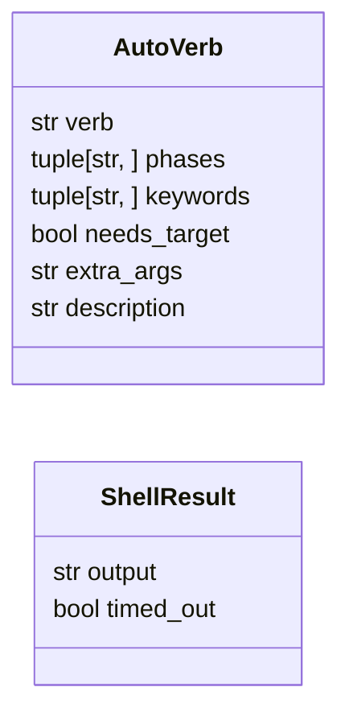
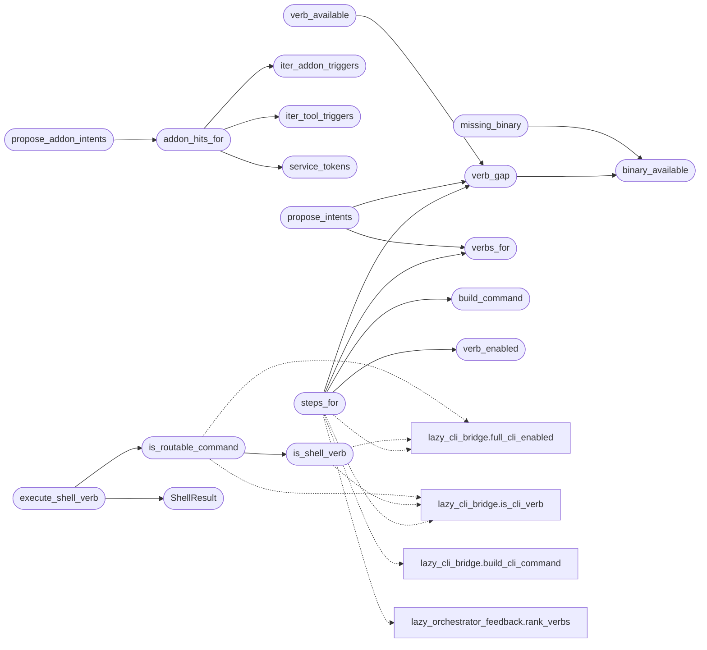

# `modules.auto_registry`

> Source: [modules/auto_registry.py:1](../../modules/auto_registry.py#L1) | language `py` | coverage 100.0% | [API index](../index.md)

Registry of loop-ready automation verbs (the ``auto_*`` family plus read-only staging verbs such as ``atomic_tests`` / ``atomic_gen``).

Every entry is a LazyOwn shell command that is already fully automated
(``auto_pwn``, ``autopivot``, ``automsf``, ``autoblody``,
``auto_populate``, ``pyautomate`` — the `[`pwntomate`](pwntomate.py.md)` engine underneath).
The autonomous loop consults this registry in two places:

- planning: [`propose_intents`](#propose_intents) turns scope + goal keywords into
  ``auto <verb>`` intents the planner can claim like any other intent;
- execution: [`steps_for`](#steps_for) translates those intents back into the
  concrete shell command line, and [`execute_shell_verb`](#execute_shell_verb) runs shell
  verbs with captured output inside the loop executor.

Stdlib only: ``lazy_loop`` may import this without dependency cycles.

## Contents

- **Classes:** [`AutoVerb`](#autoverb), [`ShellResult`](#shellresult)
- **Functions:** [`verb_enabled`](#verb_enabled), [`binary_available`](#binary_available), [`missing_binary`](#missing_binary), [`verb_gap`](#verb_gap), [`verb_available`](#verb_available), [`service_tokens`](#service_tokens), [`iter_addon_triggers`](#iter_addon_triggers), [`iter_tool_triggers`](#iter_tool_triggers), [`addon_hits_for`](#addon_hits_for), [`propose_addon_intents`](#propose_addon_intents), [`is_routable_command`](#is_routable_command), [`verbs`](#verbs), [`is_shell_verb`](#is_shell_verb), [`build_command`](#build_command), [`verbs_for`](#verbs_for), [`propose_intents`](#propose_intents), [`steps_for`](#steps_for), [`execute_shell_verb`](#execute_shell_verb), [`track_process`](#track_process), [`untrack_process`](#untrack_process), [`cancel_running_commands`](#cancel_running_commands), [`execute_streaming`](#execute_streaming)
- **Constants:** [`DEFAULT_SHELL_TIMEOUT_SEC`](#default_shell_timeout_sec), [`AUTO_VERBS`](#auto_verbs), [`REQUIRED_BINARIES`](#required_binaries), [`ALTERNATIVE_BINARIES`](#alternative_binaries), [`ROUTABLE_PREFIXES`](#routable_prefixes), [`ROUTABLE_VERBS`](#routable_verbs), [`ADDON_TRIGGER_CAP`](#addon_trigger_cap)

## Type Diagram



## Call Graph

Solid arrows stay in this module, dashed arrows leave it.



## Classes

<a id="autoverb"></a>

### `AutoVerb`

`class` `dataclass` | [modules/auto_registry.py:102](../../modules/auto_registry.py#L102)

Decorators: `@dataclass(frozen=True)`

```python
class AutoVerb
```

One automation verb the loop may invoke autonomously.

**Parameters**

| Name | Type | Default | Description |
|---|---|---|---|
| `verb` | `str` |  | Canonical shell verb (``do_<verb>`` must exist). |
| `phases` | `tuple[str, ...]` | `()` | Kill-chain phases this verb serves. |
| `keywords` | `tuple[str, ...]` | `()` | Intent/goal signals that select this verb. |
| `needs_target` | `bool` | `True` | When True the built line carries the loop target. |
| `extra_args` | `str` | `''` | Fixed tail args appended after the target. |
| `description` | `str` | `''` | Human/operators note shown in intent text. |

**Attributes**

| Name | Type | Default | Description |
|---|---|---|---|
| [`verb`](#autoverb-verb) | `str` |  |  |
| [`phases`](#autoverb-phases) | `tuple[str, ...]` | `()` |  |
| [`keywords`](#autoverb-keywords) | `tuple[str, ...]` | `()` |  |
| [`needs_target`](#autoverb-needs_target) | `bool` | `True` |  |
| [`extra_args`](#autoverb-extra_args) | `str` | `''` |  |
| [`description`](#autoverb-description) | `str` | `''` |  |

---

<a id="shellresult"></a>

### `ShellResult`

`class` `dataclass` | [modules/auto_registry.py:856](../../modules/auto_registry.py#L856)

Decorators: `@dataclass`

```python
class ShellResult
```

Captured outcome of one shell-verb execution.

**Attributes**

| Name | Type | Default | Description |
|---|---|---|---|
| [`output`](#shellresult-output) | `str` | `''` |  |
| [`timed_out`](#shellresult-timed_out) | `bool` | `False` |  |

---

## Functions

<a id="verb_enabled"></a>

### `verb_enabled`

`function` | [modules/auto_registry.py:296](../../modules/auto_registry.py#L296)

```python
def verb_enabled(name: str) -> bool
```

Return whether one auto verb may be proposed or executed.

**Parameters**

| Name | Type | Default | Description |
|---|---|---|---|
| `name` | `str` |  |  |

**Returns:** `bool`

*Called by:* [`steps_for`](#steps_for)

---

<a id="binary_available"></a>

### `binary_available`

`function` | [modules/auto_registry.py:405](../../modules/auto_registry.py#L405)

```python
def binary_available(name: str) -> bool
```

Return True when a command token can actually execute here.

Shell builtins, repo-local scripts and explicit paths pass so the
check only flags standalone offensive tools missing from ``PATH``.

**Parameters**

| Name | Type | Default | Description |
|---|---|---|---|
| `name` | `str` |  |  |

**Returns:** `bool`

*Called by:* [`missing_binary`](#missing_binary), [`verb_gap`](#verb_gap), [`steps_for_install`](modules.lazy_installer.py.md#steps_for_install)

---

<a id="missing_binary"></a>

### `missing_binary`

`function` | [modules/auto_registry.py:421](../../modules/auto_registry.py#L421)

```python
def missing_binary(command: str) -> str
```

Return the first binary a shell command needs but PATH lacks.

**Parameters**

| Name | Type | Default | Description |
|---|---|---|---|
| `command` | `str` |  |  |

**Returns:** `str`

*Calls:* [`binary_available`](#binary_available)

---

<a id="verb_gap"></a>

### `verb_gap`

`function` | [modules/auto_registry.py:433](../../modules/auto_registry.py#L433)

```python
def verb_gap(verb: str) -> str
```

Return a human reason when an automation verb cannot run, else ''.

**Parameters**

| Name | Type | Default | Description |
|---|---|---|---|
| `verb` | `str` |  |  |

**Returns:** `str`

*Calls:* [`binary_available`](#binary_available)

*Called by:* [`propose_intents`](#propose_intents), [`steps_for`](#steps_for), [`verb_available`](#verb_available)

---

<a id="verb_available"></a>

### `verb_available`

`function` | [modules/auto_registry.py:445](../../modules/auto_registry.py#L445)

```python
def verb_available(verb: str) -> bool
```

Return True when every binary an automation verb needs is installed.

**Parameters**

| Name | Type | Default | Description |
|---|---|---|---|
| `verb` | `str` |  |  |

**Returns:** `bool`

*Calls:* [`verb_gap`](#verb_gap)

---

<a id="service_tokens"></a>

### `service_tokens`

`function` | [modules/auto_registry.py:450](../../modules/auto_registry.py#L450)

```python
def service_tokens(service_text: str) -> set[str]
```

Normalize a service asset value into matchable tokens.

**Parameters**

| Name | Type | Default | Description |
|---|---|---|---|
| `service_text` | `str` |  |  |

**Returns:** `set[str]`

*Called by:* [`addon_hits_for`](#addon_hits_for)

---

<a id="iter_addon_triggers"></a>

### `iter_addon_triggers`

`function` | [modules/auto_registry.py:492](../../modules/auto_registry.py#L492)

```python
def iter_addon_triggers() -> list[tuple[str, list[str]]]
```

Scan enabled lazyaddons for (name, trigger tokens) pairs.

**Returns:** `list[tuple[str, list[str]]]`

*Called by:* [`LazyCommandSet.do_lazy_addon`](cli.commands.lazyops.py.md#lazycommandset-do_lazy_addon), [`addon_hits_for`](#addon_hits_for)

---

<a id="iter_tool_triggers"></a>

### `iter_tool_triggers`

`function` | [modules/auto_registry.py:528](../../modules/auto_registry.py#L528)

```python
def iter_tool_triggers() -> list[tuple[str, list[str]]]
```

Scan active pwntomate tools for (toolname, trigger tokens) pairs.

**Returns:** `list[tuple[str, list[str]]]`

*Called by:* [`addon_hits_for`](#addon_hits_for)

---

<a id="addon_hits_for"></a>

### `addon_hits_for`

`function` | [modules/auto_registry.py:551](../../modules/auto_registry.py#L551)

```python
def addon_hits_for(service_text: str, limit: int = 50) -> list[tuple[str, str]]
```

Rank addon/tool names matching one service value.

Specific trigger matches rank before ``all`` wildcards so generic
packs never crowd out service-tailored modules.

**Parameters**

| Name | Type | Default | Description |
|---|---|---|---|
| `service_text` | `str` |  |  |
| `limit` | `int` | `50` |  |

**Returns:** `list[tuple[str, str]]`

*Calls:* [`iter_addon_triggers`](#iter_addon_triggers), [`iter_tool_triggers`](#iter_tool_triggers), [`service_tokens`](#service_tokens)

*Called by:* [`LazyCommandSet.do_lazy_addon`](cli.commands.lazyops.py.md#lazycommandset-do_lazy_addon), [`LazyCommandSet.do_lazy_trigger`](cli.commands.lazyops.py.md#lazycommandset-do_lazy_trigger), [`propose_addon_intents`](#propose_addon_intents), [`TriggerStore.due`](modules.loop_triggers.py.md#triggerstore-due)

---

<a id="propose_addon_intents"></a>

### `propose_addon_intents`

`function` | [modules/auto_registry.py:577](../../modules/auto_registry.py#L577)

```python
def propose_addon_intents(service_texts: list[str], target: str = '', limit: int = ADDON_TRIGGER_CAP) -> list[str]
```

Propose addon intents for discovered services.

Lazyaddons run one-to-one via ``lazy addon <name>``; pwntomate tool
hits collapse into a single ``auto pyautomate`` intent since tools
only execute as a batch over nmap XML.

**Parameters**

| Name | Type | Default | Description |
|---|---|---|---|
| `service_texts` | `list[str]` |  |  |
| `target` | `str` | `''` |  |
| `limit` | `int` | `ADDON_TRIGGER_CAP` |  |

**Returns:** `list[str]`

*Calls:* [`addon_hits_for`](#addon_hits_for)

---

<a id="is_routable_command"></a>

### `is_routable_command`

`function` | [modules/auto_registry.py:603](../../modules/auto_registry.py#L603)

```python
def is_routable_command(line: str) -> bool
```

Return True when the loop executor must route via the shell.

**Parameters**

| Name | Type | Default | Description |
|---|---|---|---|
| `line` | `str` |  |  |

**Returns:** `bool`

*Calls:* [`is_shell_verb`](#is_shell_verb), [`full_cli_enabled`](modules.lazy_cli_bridge.py.md#full_cli_enabled), [`is_cli_verb`](modules.lazy_cli_bridge.py.md#is_cli_verb)

*Called by:* [`execute_shell_verb`](#execute_shell_verb), [`build_executor`](modules.lazy_runner.py.md#build_executor)

---

<a id="verbs"></a>

### `verbs`

`function` | [modules/auto_registry.py:621](../../modules/auto_registry.py#L621)

```python
def verbs() -> tuple[str, ...]
```

Return every canonical automation verb name.

**Returns:** `tuple[str, ...]`

---

<a id="is_shell_verb"></a>

### `is_shell_verb`

`function` | [modules/auto_registry.py:626](../../modules/auto_registry.py#L626)

```python
def is_shell_verb(token: str) -> bool
```

Return True when `[`token`](modules.k8s_attacks.py.md#k8sconfig-token)` names a loop-routable shell verb.

Built-in auto verbs always route. When full-CLI mode is enabled any
real ``do_<verb>`` shell command routes as well, but only when the
operator's catalog enables it, so the loop reaches exactly the
command surface the operator chose through the same Guard and scope
path.

**Parameters**

| Name | Type | Default | Description |
|---|---|---|---|
| `token` | `str` |  |  |

**Returns:** `bool`

*Calls:* [`full_cli_enabled`](modules.lazy_cli_bridge.py.md#full_cli_enabled), [`is_cli_verb`](modules.lazy_cli_bridge.py.md#is_cli_verb)

*Called by:* [`is_routable_command`](#is_routable_command)

---

<a id="build_command"></a>

### `build_command`

`function` | [modules/auto_registry.py:650](../../modules/auto_registry.py#L650)

```python
def build_command(verb: str, target: str = '') -> str
```

Build the shell command line for `[`verb`](#autoverb-verb)` bound to ``target``.

**Parameters**

| Name | Type | Default | Description |
|---|---|---|---|
| `verb` | `str` |  |  |
| `target` | `str` | `''` |  |

**Returns:** `str`

**Raises**

- `KeyError`: (raised in the body, not documented)

*Called by:* [`steps_for`](#steps_for)

---

<a id="verbs_for"></a>

### `verbs_for`

`function` | [modules/auto_registry.py:661](../../modules/auto_registry.py#L661)

```python
def verbs_for(text: str) -> list
```

Return enabled verbs whose keywords appear in the text.

**Parameters**

| Name | Type | Default | Description |
|---|---|---|---|
| `text` | `str` |  |  |

**Returns:** `list`

*Called by:* [`propose_intents`](#propose_intents), [`steps_for`](#steps_for)

---

<a id="propose_intents"></a>

### `propose_intents`

`function` | [modules/auto_registry.py:667](../../modules/auto_registry.py#L667)

```python
def propose_intents(goal: str, target: str = '', finding_texts: tuple[str, ...] = ()) -> list[str]
```

Propose ``auto <verb>`` intent summaries for planner candidates.

Verbs whose required binaries are not installed are skipped so the
planner never dispatches work this host cannot execute.

**Parameters**

| Name | Type | Default | Description |
|---|---|---|---|
| `goal` | `str` |  |  |
| `target` | `str` | `''` |  |
| `finding_texts` | `tuple[str, ...]` | `()` |  |

**Returns:** `list[str]`

*Calls:* [`verb_gap`](#verb_gap), [`verbs_for`](#verbs_for)

---

<a id="steps_for"></a>

### `steps_for`

`function` | [modules/auto_registry.py:752](../../modules/auto_registry.py#L752)

```python
def steps_for(text: str, target: str = '') -> list[str] | None
```

Translate an intent summary into shell command lines, or None.

Handles the explicit ``auto <verb>`` form, the ``lazy addon <name>``
form from service-trigger matching, plus the implicit keyword
signals for exploit/pivot/privesc/msf/populate work. Returns None
when the intent carries no automation signal (caller keeps its
default bash probes) or when the verb's tooling is unavailable.

**Parameters**

| Name | Type | Default | Description |
|---|---|---|---|
| `text` | `str` |  |  |
| `target` | `str` | `''` |  |

**Returns:** `list[str] | None`

*Calls:* [`build_command`](#build_command), [`verb_enabled`](#verb_enabled), [`verb_gap`](#verb_gap), [`verbs_for`](#verbs_for), [`build_cli_command`](modules.lazy_cli_bridge.py.md#build_cli_command), [`full_cli_enabled`](modules.lazy_cli_bridge.py.md#full_cli_enabled), [`is_cli_verb`](modules.lazy_cli_bridge.py.md#is_cli_verb), [`rank_verbs`](modules.lazy_orchestrator_feedback.py.md#rank_verbs)

---

<a id="execute_shell_verb"></a>

### `execute_shell_verb`

`function` | [modules/auto_registry.py:891](../../modules/auto_registry.py#L891)

```python
def execute_shell_verb(shell: object, command: str, timeout_sec: float = DEFAULT_SHELL_TIMEOUT_SEC, on_output=None) -> str
```

Run a LazyOwn shell verb capturing stdout, with a hard timeout.

Uses the same redirect+thread pattern as the agent runner: the verb
runs off-thread so a hanging automation (listener, prompt) cannot
wedge the loop. Never raises; timeouts report as text the loop can
record as a fact like any other transcript.

**Parameters**

| Name | Type | Default | Description |
|---|---|---|---|
| `shell` | `object` |  | Live LazyOwn shell. |
| `command` | `str` |  | Routable shell verb line. |
| `timeout_sec` | `float` | `DEFAULT_SHELL_TIMEOUT_SEC` | Hard timeout for the background verb. |
| `on_output` |  | `None` | Optional callback receiving output chunks live so the operator watches colored tool output while it runs. |

**Returns:** `str`

*Calls:* [`ShellResult`](#shellresult), [`is_routable_command`](#is_routable_command), [`clear_thread_stdin_devnull`](modules.command_executor.py.md#clear_thread_stdin_devnull), [`clear_thread_timeout`](modules.command_executor.py.md#clear_thread_timeout), [`set_thread_stdin_devnull`](modules.command_executor.py.md#set_thread_stdin_devnull), [`set_thread_timeout`](modules.command_executor.py.md#set_thread_timeout)

*Called by:* [`build_executor`](modules.lazy_runner.py.md#build_executor)

---

<a id="track_process"></a>

### `track_process`

`function` | [modules/auto_registry.py:1001](../../modules/auto_registry.py#L1001)

```python
def track_process(process) -> None
```

Register a live child process for global cancellation.

**Parameters**

| Name | Type | Default | Description |
|---|---|---|---|
| `process` |  |  |  |

*Called by:* [`CommandExecutor.run_tee`](modules.command_executor.py.md#commandexecutor-run_tee), [`run_external_opencode`](modules.lazy_agent.py.md#run_external_opencode)

---

<a id="untrack_process"></a>

### `untrack_process`

`function` | [modules/auto_registry.py:1006](../../modules/auto_registry.py#L1006)

```python
def untrack_process(process) -> None
```

Drop a finished child process from the cancellation registry.

**Parameters**

| Name | Type | Default | Description |
|---|---|---|---|
| `process` |  |  |  |

*Called by:* [`CommandExecutor.run_tee`](modules.command_executor.py.md#commandexecutor-run_tee), [`run_external_opencode`](modules.lazy_agent.py.md#run_external_opencode)

---

<a id="cancel_running_commands"></a>

### `cancel_running_commands`

`function` | [modules/auto_registry.py:1011](../../modules/auto_registry.py#L1011)

```python
def cancel_running_commands() -> int
```

Kill every live streaming process group (operator Ctrl+C).

**Returns:** `int` - Number of process groups signalled.

---

<a id="execute_streaming"></a>

### `execute_streaming`

`function` | [modules/auto_registry.py:1034](../../modules/auto_registry.py#L1034)

```python
def execute_streaming(command: str, on_output=None, timeout_sec: float = DEFAULT_SHELL_TIMEOUT_SEC) -> str
```

Run a bash command streaming lines while capturing the output.

**Parameters**

| Name | Type | Default | Description |
|---|---|---|---|
| `command` | `str` |  | Shell command line (pipes/redirects allowed, gated by the guard, scope and constraint layers before it gets here). |
| `on_output` |  | `None` | Optional callback receiving each output line live. |
| `timeout_sec` | `float` | `DEFAULT_SHELL_TIMEOUT_SEC` | Hard timeout; the process is killed on expiry. |

**Returns:** `str` - Full captured output, or a TIMEOUT/error transcript line.

*Called by:* [`run_tool`](modules.custom_tools.py.md#run_tool), [`build_executor`](modules.lazy_runner.py.md#build_executor)

---

## Constants

<a id="default_shell_timeout_sec"></a>

### `DEFAULT_SHELL_TIMEOUT_SEC`

`constant` | [modules/auto_registry.py:32](../../modules/auto_registry.py#L32)

```python
DEFAULT_SHELL_TIMEOUT_SEC = 600.0
```

---

<a id="auto_verbs"></a>

### `AUTO_VERBS`

`constant` | [modules/auto_registry.py:122](../../modules/auto_registry.py#L122)

```python
AUTO_VERBS: tuple[AutoVerb, ...]
```

---

<a id="required_binaries"></a>

### `REQUIRED_BINARIES`

`constant` | [modules/auto_registry.py:302](../../modules/auto_registry.py#L302)

```python
REQUIRED_BINARIES: dict[str, tuple[str, ...]] = {'automsf': ('msfconsole',)}
```

---

<a id="alternative_binaries"></a>

### `ALTERNATIVE_BINARIES`

`constant` | [modules/auto_registry.py:306](../../modules/auto_registry.py#L306)

```python
ALTERNATIVE_BINARIES: dict[str, tuple[str, ...]] = {'autopivot': ('chisel', 'ssh', 'socat')}
```

---

<a id="routable_prefixes"></a>

### `ROUTABLE_PREFIXES`

`constant` | [modules/auto_registry.py:366](../../modules/auto_registry.py#L366)

```python
ROUTABLE_PREFIXES = ('lazy_addon ', 'custom tool ', 'lazy_workspace ')
```

---

<a id="routable_verbs"></a>

### `ROUTABLE_VERBS`

`constant` | [modules/auto_registry.py:368](../../modules/auto_registry.py#L368)

```python
ROUTABLE_VERBS = frozenset({'lazynmap'})
```

---

<a id="addon_trigger_cap"></a>

### `ADDON_TRIGGER_CAP`

`constant` | [modules/auto_registry.py:387](../../modules/auto_registry.py#L387)

```python
ADDON_TRIGGER_CAP = 4
```

---
