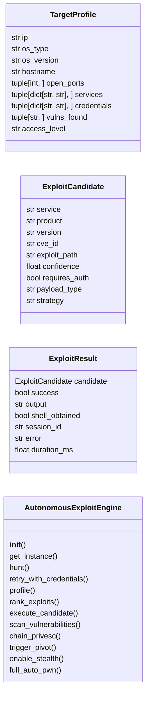
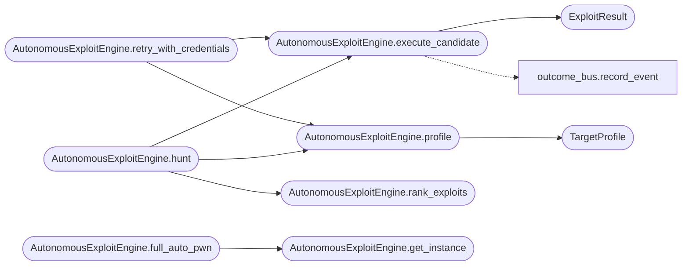

# `modules.autonomous_exploit_engine`

> Source: [modules/autonomous_exploit_engine.py:1](../../modules/autonomous_exploit_engine.py#L1) | language `py` | coverage 88.2% | [API index](../index.md)

Autonomous Exploitation Engine — AI-powered self-adapting exploit chainer.

Provides an `[`AutonomousExploitEngine`](#autonomousexploitengine)` that reads the current world model,
ranks exploit candidates by service version, generates custom payloads on the
fly, executes them through the framework, and adapts its strategy based on
results. Designed to work with or without an external LLM — falls back to
heuristic matching when no API key is configured.

Architecture:
    ReconFeeder -> TargetProfiler -> ExploitRanker -> PayloadFactory -> Executor
        ^                                                                    |
        |________________________ Feedback Loop ____________________________|

Security:
    No exec/eval of untrusted input. All payloads go through the existing
    ``modules/payload_factory.py`` which validates templates. Shell commands
    are templated from ``payload.json`` only — no raw user input accepted.

Usage:
    from modules.autonomous_exploit_engine import AutonomousExploitEngine
    engine = AutonomousExploitEngine()
    results = engine.hunt(target="10.10.11.5")

## Contents

- **Classes:** [`TargetProfile`](#targetprofile), [`ExploitCandidate`](#exploitcandidate), [`ExploitResult`](#exploitresult), [`AutonomousExploitEngine`](#autonomousexploitengine)

## Type Diagram



## Call Graph

Solid arrows stay in this module, dashed arrows leave it.



## Classes

<a id="targetprofile"></a>

### `TargetProfile`

`class` `dataclass` | [modules/autonomous_exploit_engine.py:59](../../modules/autonomous_exploit_engine.py#L59)

Decorators: `@dataclass(frozen=True)`

```python
class TargetProfile
```

Immutable snapshot of a target's attack surface.

**Attributes**

| Name | Type | Default | Description |
|---|---|---|---|
| [`ip`](#targetprofile-ip) | `str` |  |  |
| [`os_type`](#targetprofile-os_type) | `str` | `'unknown'` |  |
| [`os_version`](#targetprofile-os_version) | `str` | `''` |  |
| [`hostname`](#targetprofile-hostname) | `str` | `''` |  |
| [`open_ports`](#targetprofile-open_ports) | `tuple[int, ...]` | `()` |  |
| [`services`](#targetprofile-services) | `tuple[dict[str, str], ...]` | `()` |  |
| [`credentials`](#targetprofile-credentials) | `tuple[dict[str, str], ...]` | `()` |  |
| [`vulns_found`](#targetprofile-vulns_found) | `tuple[str, ...]` | `()` |  |
| [`access_level`](#targetprofile-access_level) | `str` | `'none'` |  |

---

<a id="exploitcandidate"></a>

### `ExploitCandidate`

`class` `dataclass` | [modules/autonomous_exploit_engine.py:74](../../modules/autonomous_exploit_engine.py#L74)

Decorators: `@dataclass`

```python
class ExploitCandidate
```

A ranked exploit ready for execution.

**Attributes**

| Name | Type | Default | Description |
|---|---|---|---|
| [`service`](#exploitcandidate-service) | `str` |  |  |
| [`product`](#exploitcandidate-product) | `str` |  |  |
| [`version`](#exploitcandidate-version) | `str` |  |  |
| [`cve_id`](#exploitcandidate-cve_id) | `str` | `''` |  |
| [`exploit_path`](#exploitcandidate-exploit_path) | `str` | `''` |  |
| [`confidence`](#exploitcandidate-confidence) | `float` | `0.0` |  |
| [`requires_auth`](#exploitcandidate-requires_auth) | `bool` | `False` |  |
| [`payload_type`](#exploitcandidate-payload_type) | `str` | `'reverse_shell'` |  |
| [`strategy`](#exploitcandidate-strategy) | `str` | `'direct'` |  |

---

<a id="exploitresult"></a>

### `ExploitResult`

`class` `dataclass` | [modules/autonomous_exploit_engine.py:89](../../modules/autonomous_exploit_engine.py#L89)

Decorators: `@dataclass`

```python
class ExploitResult
```

Outcome of a single exploit attempt.

**Attributes**

| Name | Type | Default | Description |
|---|---|---|---|
| [`candidate`](#exploitresult-candidate) | `ExploitCandidate` |  |  |
| [`success`](#exploitresult-success) | `bool` | `False` |  |
| [`output`](#exploitresult-output) | `str` | `''` |  |
| [`shell_obtained`](#exploitresult-shell_obtained) | `bool` | `False` |  |
| [`session_id`](#exploitresult-session_id) | `str` | `''` |  |
| [`error`](#exploitresult-error) | `str` | `''` |  |
| [`duration_ms`](#exploitresult-duration_ms) | `float` | `0.0` |  |

---

<a id="autonomousexploitengine"></a>

### `AutonomousExploitEngine`

`class` | [modules/autonomous_exploit_engine.py:101](../../modules/autonomous_exploit_engine.py#L101)

```python
class AutonomousExploitEngine
```

Self-adapting exploit engine that chains through a target's attack surface.

Public methods:
    hunt(target) -> list[ExploitResult]
    profile(target) -> TargetProfile
    rank_exploits(profile) -> list[ExploitCandidate]
    execute_candidate(candidate, profile) -> ExploitResult

**Members**

| Member | Kind | Summary |
|---|---|---|
| [`__init__`](#autonomousexploitengine-__init__) | constructor |  |
| [`get_instance`](#autonomousexploitengine-get_instance) | classmethod |  |
| [`hunt`](#autonomousexploitengine-hunt) | method | Execute a full autonomous exploitation chain against a target. |
| [`retry_with_credentials`](#autonomousexploitengine-retry_with_credentials) | method | Re-execute exploit chain using captured credentials. |
| [`profile`](#autonomousexploitengine-profile) | method | Build a TargetProfile from existing recon data. |
| [`rank_exploits`](#autonomousexploitengine-rank_exploits) | method | Rank exploit candidates by confidence for a given profile. |
| [`execute_candidate`](#autonomousexploitengine-execute_candidate) | method | Execute a single exploit candidate and return the result. |
| [`scan_vulnerabilities`](#autonomousexploitengine-scan_vulnerabilities) | method | Scan for vulnerabilities using NSE output and heuristic version matching. |
| [`chain_privesc`](#autonomousexploitengine-chain_privesc) | method | Run privilege escalation checks and attempt escalation techniques. |
| [`trigger_pivot`](#autonomousexploitengine-trigger_pivot) | method | Discover internal interfaces and trigger auto-pivoting through a compromised host. |
| [`enable_stealth`](#autonomousexploitengine-enable_stealth) | method | Configure the engine's stealth level for evasion. |
| [`full_auto_pwn`](#autonomousexploitengine-full_auto_pwn) | classmethod | Execute the full autonomous exploit chain against a target. |

<a id="autonomousexploitengine-__init__"></a>

#### `AutonomousExploitEngine.__init__`

`constructor` | [modules/autonomous_exploit_engine.py:114](../../modules/autonomous_exploit_engine.py#L114)

```python
def __init__(self) -> None
```

*Called by:* [`PwnCommandSet.do_auto_pwn`](cli.commands.pwn.py.md#pwncommandset-do_auto_pwn), [`PwnCommandSet.do_exploit_chain`](cli.commands.pwn.py.md#pwncommandset-do_exploit_chain), [`SessionOpsCommandSet.do_hunt`](cli.commands.session_ops.py.md#sessionopscommandset-do_hunt)

<a id="autonomousexploitengine-get_instance"></a>

#### `AutonomousExploitEngine.get_instance`

`classmethod` | [modules/autonomous_exploit_engine.py:134](../../modules/autonomous_exploit_engine.py#L134)

Decorators: `@classmethod`

```python
def get_instance(cls) -> AutonomousExploitEngine
```

**Returns:** `AutonomousExploitEngine`

*Called by:* [`PwnCommandSet.do_stealth_off`](cli.commands.pwn.py.md#pwncommandset-do_stealth_off), [`PwnCommandSet.do_stealth_on`](cli.commands.pwn.py.md#pwncommandset-do_stealth_on), [`AutonomousExploitEngine.full_auto_pwn`](#autonomousexploitengine-full_auto_pwn)

<a id="autonomousexploitengine-hunt"></a>

#### `AutonomousExploitEngine.hunt`

`method` | [modules/autonomous_exploit_engine.py:145](../../modules/autonomous_exploit_engine.py#L145)

```python
def hunt(self, target: str, max_exploits: int = 5, profile: TargetProfile | None = None) -> list[ExploitResult]
```

Execute a full autonomous exploitation chain against a target.

**Parameters**

| Name | Type | Default | Description |
|---|---|---|---|
| `target` | `str` |  | IP address or hostname of the target. |
| `max_exploits` | `int` | `5` | Maximum exploit attempts before stopping. |
| `profile` | `TargetProfile \| None` | `None` | Optional cached TargetProfile (avoids re-profiling). |

**Returns:** `list[ExploitResult]` - List of ExploitResult objects, one per attempt.

*Calls:* [`AutonomousExploitEngine.execute_candidate`](#autonomousexploitengine-execute_candidate), [`AutonomousExploitEngine.profile`](#autonomousexploitengine-profile), [`AutonomousExploitEngine.rank_exploits`](#autonomousexploitengine-rank_exploits)

*Called by:* [`SessionOpsCommandSet.do_hunt`](cli.commands.session_ops.py.md#sessionopscommandset-do_hunt)

<a id="autonomousexploitengine-retry_with_credentials"></a>

#### `AutonomousExploitEngine.retry_with_credentials`

`method` | [modules/autonomous_exploit_engine.py:184](../../modules/autonomous_exploit_engine.py#L184)

```python
def retry_with_credentials(self, target: str, credentials: list[dict[str, str]] | None = None) -> list[ExploitResult]
```

Re-execute exploit chain using captured credentials.

When the world model receives new credentials this method re-ranks
exploit candidates with credential awareness, injecting discovered
usernames and passwords into authenticated strategies. Returns only
the new results from this retry.

**Parameters**

| Name | Type | Default | Description |
|---|---|---|---|
| `target` | `str` |  | IP address of the target. |
| `credentials` | `list[dict[str, str]] \| None` | `None` | Optional list of credential dicts with ``username``, ``password``, ``hash`` keys. When omitted, reads from world model. |

**Returns:** `list[ExploitResult]` - Newly executed ExploitResult objects.

*Calls:* [`AutonomousExploitEngine.execute_candidate`](#autonomousexploitengine-execute_candidate), [`AutonomousExploitEngine.profile`](#autonomousexploitengine-profile)

<a id="autonomousexploitengine-profile"></a>

#### `AutonomousExploitEngine.profile`

`method` | [modules/autonomous_exploit_engine.py:328](../../modules/autonomous_exploit_engine.py#L328)

```python
def profile(self, target: str) -> TargetProfile
```

Build a TargetProfile from existing recon data.

**Parameters**

| Name | Type | Default | Description |
|---|---|---|---|
| `target` | `str` |  | IP address to profile. |

**Returns:** `TargetProfile` - Immutable TargetProfile.

*Calls:* [`TargetProfile`](#targetprofile)

*Called by:* [`PwnCommandSet.do_auto_pwn`](cli.commands.pwn.py.md#pwncommandset-do_auto_pwn), [`PwnCommandSet.do_exploit_chain`](cli.commands.pwn.py.md#pwncommandset-do_exploit_chain), [`SessionOpsCommandSet.do_hunt`](cli.commands.session_ops.py.md#sessionopscommandset-do_hunt), [`AutonomousExploitEngine.hunt`](#autonomousexploitengine-hunt), [`AutonomousExploitEngine.retry_with_credentials`](#autonomousexploitengine-retry_with_credentials)

<a id="autonomousexploitengine-rank_exploits"></a>

#### `AutonomousExploitEngine.rank_exploits`

`method` | [modules/autonomous_exploit_engine.py:389](../../modules/autonomous_exploit_engine.py#L389)

```python
def rank_exploits(self, profile: TargetProfile) -> list[ExploitCandidate]
```

Rank exploit candidates by confidence for a given profile.

**Parameters**

| Name | Type | Default | Description |
|---|---|---|---|
| `profile` | `TargetProfile` |  | TargetProfile built from recon. |

**Returns:** `list[ExploitCandidate]` - Ranked list of ExploitCandidate objects.

*Called by:* [`SessionOpsCommandSet.do_hunt`](cli.commands.session_ops.py.md#sessionopscommandset-do_hunt), [`AutonomousExploitEngine.hunt`](#autonomousexploitengine-hunt)

<a id="autonomousexploitengine-execute_candidate"></a>

#### `AutonomousExploitEngine.execute_candidate`

`method` | [modules/autonomous_exploit_engine.py:412](../../modules/autonomous_exploit_engine.py#L412)

```python
def execute_candidate(self, candidate: ExploitCandidate, profile: TargetProfile) -> ExploitResult
```

Execute a single exploit candidate and return the result.

**Parameters**

| Name | Type | Default | Description |
|---|---|---|---|
| `candidate` | `ExploitCandidate` |  | The ExploitCandidate to attempt. |
| `profile` | `TargetProfile` |  | The current TargetProfile. |

**Returns:** `ExploitResult` - ExploitResult with outcome.

*Calls:* [`ExploitResult`](#exploitresult), [`record_event`](modules.outcome_bus.py.md#record_event)

*Called by:* [`PwnCommandSet.do_exploit_chain`](cli.commands.pwn.py.md#pwncommandset-do_exploit_chain), [`AutonomousExploitEngine.hunt`](#autonomousexploitengine-hunt), [`AutonomousExploitEngine.retry_with_credentials`](#autonomousexploitengine-retry_with_credentials)

<a id="autonomousexploitengine-scan_vulnerabilities"></a>

#### `AutonomousExploitEngine.scan_vulnerabilities`

`method` | [modules/autonomous_exploit_engine.py:1741](../../modules/autonomous_exploit_engine.py#L1741)

```python
def scan_vulnerabilities(self, profile: TargetProfile) -> list[dict[str, Any]]
```

Scan for vulnerabilities using NSE output and heuristic version matching.

**Parameters**

| Name | Type | Default | Description |
|---|---|---|---|
| `profile` | `TargetProfile` |  | TargetProfile to scan. |

**Returns:** `list[dict[str, Any]]` - List of vuln dicts with keys: cve, severity, description, affected_service, fix_version.

<a id="autonomousexploitengine-chain_privesc"></a>

#### `AutonomousExploitEngine.chain_privesc`

`method` | [modules/autonomous_exploit_engine.py:2056](../../modules/autonomous_exploit_engine.py#L2056)

```python
def chain_privesc(self, profile: TargetProfile, session_id: str) -> list[ExploitResult]
```

Run privilege escalation checks and attempt escalation techniques.

**Parameters**

| Name | Type | Default | Description |
|---|---|---|---|
| `profile` | `TargetProfile` |  | TargetProfile of the compromised host. |
| `session_id` | `str` |  | Session ID of the active shell. |

**Returns:** `list[ExploitResult]` - List of ExploitResult for each privesc attempt.

<a id="autonomousexploitengine-trigger_pivot"></a>

#### `AutonomousExploitEngine.trigger_pivot`

`method` | [modules/autonomous_exploit_engine.py:2486](../../modules/autonomous_exploit_engine.py#L2486)

```python
def trigger_pivot(self, profile: TargetProfile, session_id: str) -> dict[str, Any]
```

Discover internal interfaces and trigger auto-pivoting through a compromised host.

**Parameters**

| Name | Type | Default | Description |
|---|---|---|---|
| `profile` | `TargetProfile` |  | TargetProfile of the compromised host. |
| `session_id` | `str` |  | Session ID of the active shell. |

**Returns:** `dict[str, Any]` - Dict with pivot chain info: subnets, routes, proxychains_config.

<a id="autonomousexploitengine-enable_stealth"></a>

#### `AutonomousExploitEngine.enable_stealth`

`method` | [modules/autonomous_exploit_engine.py:2612](../../modules/autonomous_exploit_engine.py#L2612)

```python
def enable_stealth(self, stealth_level: str = 'medium') -> dict[str, Any]
```

Configure the engine's stealth level for evasion.

**Parameters**

| Name | Type | Default | Description |
|---|---|---|---|
| `stealth_level` | `str` | `'medium'` | One of "low", "medium", "high", "paranoid". |

**Returns:** `dict[str, Any]` - Dict with the active stealth configuration.

*Called by:* [`PwnCommandSet.do_auto_pwn`](cli.commands.pwn.py.md#pwncommandset-do_auto_pwn)

<a id="autonomousexploitengine-full_auto_pwn"></a>

#### `AutonomousExploitEngine.full_auto_pwn`

`classmethod` | [modules/autonomous_exploit_engine.py:2676](../../modules/autonomous_exploit_engine.py#L2676)

Decorators: `@classmethod`

```python
def full_auto_pwn(cls, target: str, enable_pivot: bool = False, enable_privesc: bool = False, stealth: str = 'low') -> dict[str, Any]
```

Execute the full autonomous exploit chain against a target.

Runs scan -> profile -> rank -> exploit with optional privesc and pivot.

**Parameters**

| Name | Type | Default | Description |
|---|---|---|---|
| `target` | `str` |  | IP address or hostname. |
| `enable_pivot` | `bool` | `False` | Trigger auto-pivot after successful exploitation. |
| `enable_privesc` | `bool` | `False` | Attempt privilege escalation after getting a shell. |
| `stealth` | `str` | `'low'` | Stealth level: "low", "medium", "high", "paranoid". |

**Returns:** `dict[str, Any]` - Comprehensive results dict with summary.

*Calls:* [`AutonomousExploitEngine.get_instance`](#autonomousexploitengine-get_instance)

*Called by:* [`PwnCommandSet.do_auto_pwn`](cli.commands.pwn.py.md#pwncommandset-do_auto_pwn)

---
