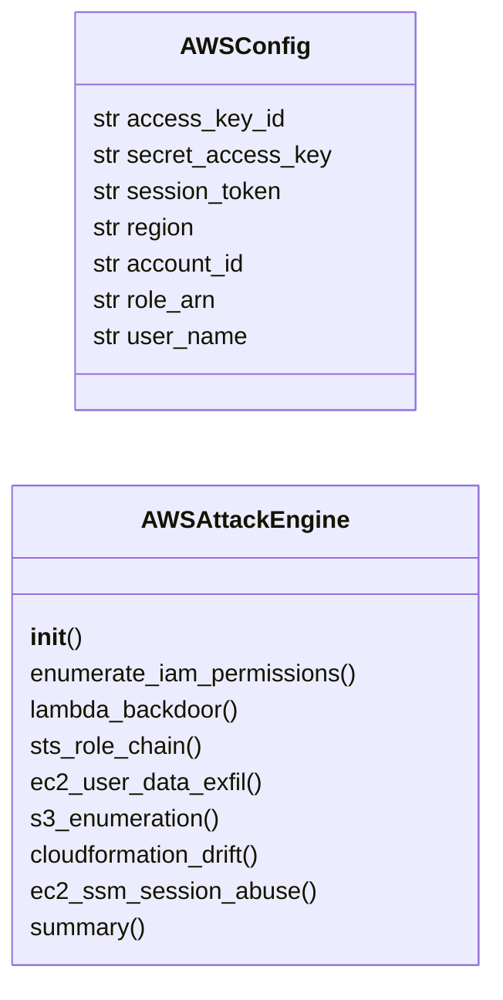
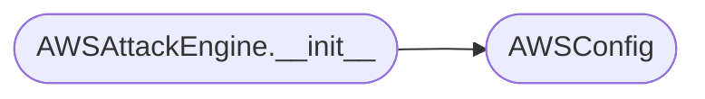

# `modules.aws_attacks`

> Source: [modules/aws_attacks.py:1](../../modules/aws_attacks.py#L1) | language `py` | coverage 83.3% | [API index](../index.md)

AWS privilege escalation — IAM enumeration, Lambda backdoors, STS role chaining.

Provides attack primitives for Amazon Web Services: IAM privilege escalation
paths, EC2 instance metadata abuse, Lambda function backdooring, STS assume
role chaining, CloudFormation drift exploitation, and S3 bucket enumeration.

Uses boto3 for API operations when available; falls back to curl/HTTP commands.

## Contents

- **Classes:** [`AWSConfig`](#awsconfig), [`AWSAttackEngine`](#awsattackengine)
- **Constants:** [`AWS_PRIVESC_METHODS`](#aws_privesc_methods), [`AWS_MANAGED_ADMIN_POLICIES`](#aws_managed_admin_policies)

## Type Diagram



## Call Graph

Solid arrows stay in this module, dashed arrows leave it.



## Classes

<a id="awsconfig"></a>

### `AWSConfig`

`class` `dataclass` | [modules/aws_attacks.py:58](../../modules/aws_attacks.py#L58)

Decorators: `@dataclass`

```python
class AWSConfig
```

Configuration for AWS attack operations.

**Attributes**

| Name | Type | Default | Description |
|---|---|---|---|
| [`access_key_id`](#awsconfig-access_key_id) | `str` | `''` | AWS access key. |
| [`secret_access_key`](#awsconfig-secret_access_key) | `str` | `''` | AWS secret key. |
| [`session_token`](#awsconfig-session_token) | `str` | `''` | STS session token (for temporary credentials). |
| [`region`](#awsconfig-region) | `str` | `'us-east-1'` | AWS region. |
| [`account_id`](#awsconfig-account_id) | `str` | `''` | AWS account ID. |
| [`role_arn`](#awsconfig-role_arn) | `str` | `''` | IAM role ARN to target. |
| [`user_name`](#awsconfig-user_name) | `str` | `''` | IAM user to enumerate. |

---

<a id="awsattackengine"></a>

### `AWSAttackEngine`

`class` | [modules/aws_attacks.py:80](../../modules/aws_attacks.py#L80)

```python
class AWSAttackEngine
```

Execute AWS privilege escalation and enumeration attacks.

Provides IAM permission enumeration, Lambda backdoor insertion,
STS role chaining, EC2 user data exfiltration, and S3 data access.

**Members**

| Member | Kind | Summary |
|---|---|---|
| [`__init__`](#awsattackengine-__init__) | constructor |  |
| [`enumerate_iam_permissions`](#awsattackengine-enumerate_iam_permissions) | method | Enumerate IAM permissions for the current user/role. |
| [`lambda_backdoor`](#awsattackengine-lambda_backdoor) | method | Plan a Lambda backdoor for privilege escalation. |
| [`sts_role_chain`](#awsattackengine-sts_role_chain) | method | Enumerate and exploit STS AssumeRole privilege escalation chains. |
| [`ec2_user_data_exfil`](#awsattackengine-ec2_user_data_exfil) | method | Extract sensitive data from EC2 instance user data and metadata. |
| [`s3_enumeration`](#awsattackengine-s3_enumeration) | method | Enumerate S3 buckets and their permissions. |
| [`cloudformation_drift`](#awsattackengine-cloudformation_drift) | method | Exploit CloudFormation for privilege escalation. |
| [`ec2_ssm_session_abuse`](#awsattackengine-ec2_ssm_session_abuse) | method | Abuse SSM to gain shell access to EC2 instances. |
| [`summary`](#awsattackengine-summary) | method |  |

<a id="awsattackengine-__init__"></a>

#### `AWSAttackEngine.__init__`

`constructor` | [modules/aws_attacks.py:91](../../modules/aws_attacks.py#L91)

```python
def __init__(self, config: AWSConfig | None = None)
```

**Parameters**

| Name | Type | Default | Description |
|---|---|---|---|
| `config` | `AWSConfig \| None` | `None` |  |

*Calls:* [`AWSConfig`](#awsconfig)

*Called by:* [`CloudAttackCommandSet.do_aws_privesc`](cli.commands.cloud_attacks.py.md#cloudattackcommandset-do_aws_privesc)

<a id="awsattackengine-enumerate_iam_permissions"></a>

#### `AWSAttackEngine.enumerate_iam_permissions`

`method` | [modules/aws_attacks.py:95](../../modules/aws_attacks.py#L95)

```python
def enumerate_iam_permissions(self) -> dict[str, Any]
```

Enumerate IAM permissions for the current user/role.

Simulates permission boundary testing to identify privilege
escalation paths. Returns structured data for analysis.

**Returns:** `dict[str, Any]` - Dict with user info, policies, groups, and potential privesc paths.

*Called by:* [`CloudAttackCommandSet.do_aws_privesc`](cli.commands.cloud_attacks.py.md#cloudattackcommandset-do_aws_privesc)

<a id="awsattackengine-lambda_backdoor"></a>

#### `AWSAttackEngine.lambda_backdoor`

`method` | [modules/aws_attacks.py:127](../../modules/aws_attacks.py#L127)

```python
def lambda_backdoor(self, function_name: str = '') -> dict[str, Any]
```

Plan a Lambda backdoor for privilege escalation.

If the attacker can iam:PassRole and lambda:UpdateFunctionCode,
they can modify an existing Lambda to exfiltrate its role credentials.

**Parameters**

| Name | Type | Default | Description |
|---|---|---|---|
| `function_name` | `str` | `''` | Target Lambda function name. |

**Returns:** `dict[str, Any]` - Dict with Lambda backdooring commands.

*Called by:* [`CloudAttackCommandSet.do_aws_privesc`](cli.commands.cloud_attacks.py.md#cloudattackcommandset-do_aws_privesc)

<a id="awsattackengine-sts_role_chain"></a>

#### `AWSAttackEngine.sts_role_chain`

`method` | [modules/aws_attacks.py:155](../../modules/aws_attacks.py#L155)

```python
def sts_role_chain(self, target_role_arn: str = '') -> dict[str, Any]
```

Enumerate and exploit STS AssumeRole privilege escalation chains.

Discovers all roles the current user can assume and provides
lateral movement via role chaining to elevated access.

**Parameters**

| Name | Type | Default | Description |
|---|---|---|---|
| `target_role_arn` | `str` | `''` | Specific role ARN to target. |

**Returns:** `dict[str, Any]` - Dict with role enumeration and chaining commands.

*Called by:* [`CloudAttackCommandSet.do_aws_privesc`](cli.commands.cloud_attacks.py.md#cloudattackcommandset-do_aws_privesc)

<a id="awsattackengine-ec2_user_data_exfil"></a>

#### `AWSAttackEngine.ec2_user_data_exfil`

`method` | [modules/aws_attacks.py:181](../../modules/aws_attacks.py#L181)

```python
def ec2_user_data_exfil(self) -> dict[str, Any]
```

Extract sensitive data from EC2 instance user data and metadata.

EC2 user data often contains deployment scripts with hardcoded
credentials, API keys, and configuration secrets.

**Returns:** `dict[str, Any]` - Dict with IMDSv1/v2 commands and user data extraction.

*Called by:* [`CloudAttackCommandSet.do_aws_privesc`](cli.commands.cloud_attacks.py.md#cloudattackcommandset-do_aws_privesc)

<a id="awsattackengine-s3_enumeration"></a>

#### `AWSAttackEngine.s3_enumeration`

`method` | [modules/aws_attacks.py:206](../../modules/aws_attacks.py#L206)

```python
def s3_enumeration(self) -> dict[str, Any]
```

Enumerate S3 buckets and their permissions.

Maps public/private buckets, checks for write access, and identifies
buckets with sensitive naming patterns.

**Returns:** `dict[str, Any]` - Dict with S3 enumeration commands and bucket patterns.

*Called by:* [`CloudAttackCommandSet.do_aws_privesc`](cli.commands.cloud_attacks.py.md#cloudattackcommandset-do_aws_privesc)

<a id="awsattackengine-cloudformation_drift"></a>

#### `AWSAttackEngine.cloudformation_drift`

`method` | [modules/aws_attacks.py:242](../../modules/aws_attacks.py#L242)

```python
def cloudformation_drift(self) -> dict[str, Any]
```

Exploit CloudFormation for privilege escalation.

CloudFormation executes with the privileges of the user who created
the stack or the stack's service role. Modifying CF templates can
create IAM resources with elevated permissions.

**Returns:** `dict[str, Any]` - Dict with CF drift exploitation commands.

*Called by:* [`CloudAttackCommandSet.do_aws_privesc`](cli.commands.cloud_attacks.py.md#cloudattackcommandset-do_aws_privesc)

<a id="awsattackengine-ec2_ssm_session_abuse"></a>

#### `AWSAttackEngine.ec2_ssm_session_abuse`

`method` | [modules/aws_attacks.py:274](../../modules/aws_attacks.py#L274)

```python
def ec2_ssm_session_abuse(self) -> dict[str, Any]
```

Abuse SSM to gain shell access to EC2 instances.

If a user has ssm:StartSession, they can open interactive shells
to managed instances.

**Returns:** `dict[str, Any]` - Dict with SSM abuse commands.

*Called by:* [`CloudAttackCommandSet.do_aws_privesc`](cli.commands.cloud_attacks.py.md#cloudattackcommandset-do_aws_privesc)

<a id="awsattackengine-summary"></a>

#### `AWSAttackEngine.summary`

`method` | [modules/aws_attacks.py:293](../../modules/aws_attacks.py#L293)

```python
def summary(self) -> dict[str, Any]
```

**Returns:** `dict[str, Any]`

---

## Constants

<a id="aws_privesc_methods"></a>

### `AWS_PRIVESC_METHODS`

`constant` | [modules/aws_attacks.py:22](../../modules/aws_attacks.py#L22)

```python
AWS_PRIVESC_METHODS
```

---

<a id="aws_managed_admin_policies"></a>

### `AWS_MANAGED_ADMIN_POLICIES`

`constant` | [modules/aws_attacks.py:50](../../modules/aws_attacks.py#L50)

```python
AWS_MANAGED_ADMIN_POLICIES
```

---
