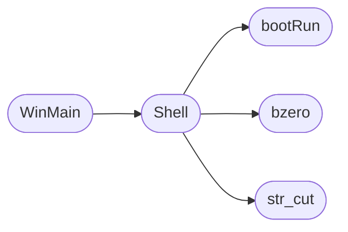

# `modules/backdoor/backdoor.c`

> Source: [modules/backdoor/backdoor.c:1](../../modules/backdoor/backdoor.c#L1) | language `c` | coverage 0.0% | [API index](../index.md)

## Contents

- **Functions:** [`bootRun`](#bootrun), [`str_cut`](#str_cut), [`Shell`](#shell), [`WinMain`](#winmain)
- **Macros:** [`bzero`](#bzero)

## Call Graph

Solid arrows stay in this module, dashed arrows leave it.



## Functions

<a id="bootrun"></a>

### `bootRun`

`function` | [modules/backdoor/backdoor.c:18](../../modules/backdoor/backdoor.c#L18)

```c
int bootRun()
```

**Returns:** `int`

*Called by:* [`Shell`](#shell)

---

<a id="str_cut"></a>

### `str_cut`

`function` | [modules/backdoor/backdoor.c:49](../../modules/backdoor/backdoor.c#L49)

```c
char * str_cut(char str[], int slice_from, int slice_to)
```

**Parameters**

| Name | Type | Default | Description |
|---|---|---|---|
| `str` | `char []` |  |  |
| `slice_from` | `int` |  |  |
| `slice_to` | `int` |  |  |

**Returns:** `char *`

*Called by:* [`Shell`](#shell)

---

<a id="shell"></a>

### `Shell`

`function` | [modules/backdoor/backdoor.c:84](../../modules/backdoor/backdoor.c#L84)

```c
void Shell()
```

*Calls:* [`bootRun`](#bootrun), [`bzero`](#bzero), [`str_cut`](#str_cut)

*Called by:* [`WinMain`](#winmain)

---

<a id="winmain"></a>

### `WinMain`

`function` | [modules/backdoor/backdoor.c:125](../../modules/backdoor/backdoor.c#L125)

```c
int APIENTRY WinMain(HINSTANCE hInstance, HINSTANCE hPrev, LPSTR lpCmdLine, int nCmdShow)
```

**Parameters**

| Name | Type | Default | Description |
|---|---|---|---|
| `hInstance` | `HINSTANCE` |  |  |
| `hPrev` | `HINSTANCE` |  |  |
| `lpCmdLine` | `LPSTR` |  |  |
| `nCmdShow` | `int` |  |  |

**Returns:** `int APIENTRY`

*Calls:* [`Shell`](#shell)

---

## Macros

<a id="bzero"></a>

### `bzero`

`macro` | [modules/backdoor/backdoor.c:14](../../modules/backdoor/backdoor.c#L14)

```c
#define bzero(p, size)
```

*Called by:* [`Shell`](#shell), [`main`](modules.backdoor.server.c.md#main)

---
