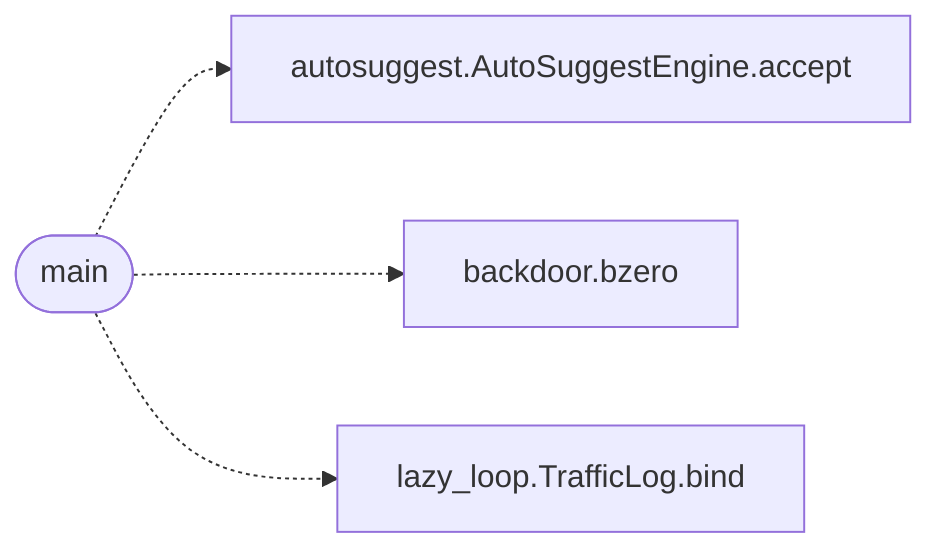

# `modules/backdoor/server.c`

> Source: [modules/backdoor/server.c:1](../../modules/backdoor/server.c#L1) | language `c` | coverage 0.0% | [API index](../index.md)

## Contents

- **Functions:** [`main`](#main)

## Call Graph

Solid arrows stay in this module, dashed arrows leave it.



## Functions

<a id="main"></a>

### `main`

`function` | [modules/backdoor/server.c:10](../../modules/backdoor/server.c#L10)

```c
int main()
```

**Returns:** `int`

*Calls:* [`AutoSuggestEngine.accept`](cli.autosuggest.py.md#autosuggestengine-accept), [`bzero`](modules.backdoor.backdoor.c.md#bzero), [`TrafficLog.bind`](modules.lazy_loop.py.md#trafficlog-bind)

---
