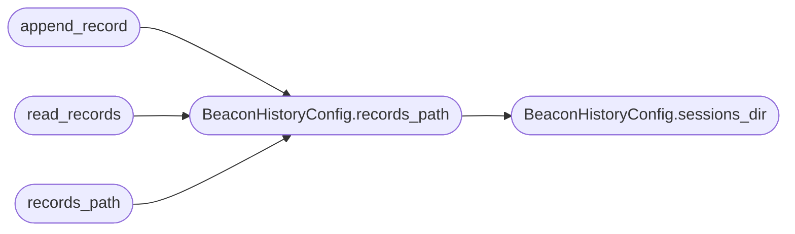

# `modules.beacon_history`

> Source: [modules/beacon_history.py:1](../../modules/beacon_history.py#L1) | language `py` | coverage 100.0% | [API index](../index.md)

Persistent beacon command/result history storage.

Owns the on-disk JSONL history for beacon results so the C2, the Flask GUI
and GUI2 all replay the same ordered timeline. Kept module-scoped (no Flask
dependency) so it is unit-testable without booting the C2 application.

Contract:
    - `[`BeaconHistoryConfig`](#beaconhistoryconfig)` holds the storage root and the history suffix.
    - `[`append_record`](#append_record)` appends one record (atomic, safe for concurrent implant polls).
    - `[`read_records`](#read_records)` returns the ordered records for a beacon.
    - `[`records_path`](#records_path)` resolves the history file for a sanitised beacon id.

## Contents

- **Classes:** [`BeaconHistoryConfig`](#beaconhistoryconfig)
- **Functions:** [`sanitize_client_id`](#sanitize_client_id), [`append_record`](#append_record), [`read_records`](#read_records), [`records_path`](#records_path)

## Call Graph

Solid arrows stay in this module, dashed arrows leave it.



## Classes

<a id="beaconhistoryconfig"></a>

### `BeaconHistoryConfig`

`class` `dataclass` | [modules/beacon_history.py:28](../../modules/beacon_history.py#L28)

Decorators: `@dataclass(frozen=True, slots=True)`

```python
class BeaconHistoryConfig
```

Centralised configuration for beacon history storage.

**Attributes**

| Name | Type | Default | Description |
|---|---|---|---|
| [`base_dir`](#beaconhistoryconfig-base_dir) | `Path` | `field(default_factory=lambda: Path(__file__).resolve().parent.parent)` | Root directory that contains the ``sessions`` folder. |
| [`history_suffix`](#beaconhistoryconfig-history_suffix) | `str` | `DEFAULT_HISTORY_SUFFIX` | File suffix appended to a beacon id for its history. |

**Members**

| Member | Kind | Summary |
|---|---|---|
| [`sessions_dir`](#beaconhistoryconfig-sessions_dir) | method | Return the resolved sessions directory under the base dir. |
| [`records_path`](#beaconhistoryconfig-records_path) | method | Resolve the history file path for a sanitised beacon client id. |

<a id="beaconhistoryconfig-sessions_dir"></a>

#### `BeaconHistoryConfig.sessions_dir`

`method` | [modules/beacon_history.py:39](../../modules/beacon_history.py#L39)

```python
def sessions_dir(self) -> Path
```

Return the resolved sessions directory under the base dir.

**Returns:** `Path`

*Called by:* [`BeaconHistoryConfig.records_path`](#beaconhistoryconfig-records_path)

<a id="beaconhistoryconfig-records_path"></a>

#### `BeaconHistoryConfig.records_path`

`method` | [modules/beacon_history.py:43](../../modules/beacon_history.py#L43)

```python
def records_path(self, client_id: str) -> Path
```

Resolve the history file path for a sanitised beacon client id.

The resolved path is verified to stay inside the sessions directory
so a bypassed or weakened sanitisation can never write outside the
storage root.

**Parameters**

| Name | Type | Default | Description |
|---|---|---|---|
| `client_id` | `str` |  | Raw beacon id; it is sanitised against path traversal. |

**Returns:** `Path` - A `pathlib.Path` inside the sessions directory.

**Raises**

- `ValueError`: When the resulting path would escape the sessions dir.

*Calls:* [`BeaconHistoryConfig.sessions_dir`](#beaconhistoryconfig-sessions_dir)

*Called by:* [`append_record`](#append_record), [`read_records`](#read_records), [`records_path`](#records_path)

---

## Functions

<a id="sanitize_client_id"></a>

### `sanitize_client_id`

`function` | [modules/beacon_history.py:70](../../modules/beacon_history.py#L70)

```python
def sanitize_client_id(client_id: str) -> str
```

Sanitise a beacon id to only URL/file-safe characters.

**Parameters**

| Name | Type | Default | Description |
|---|---|---|---|
| `client_id` | `str` |  | Raw beacon id. |

**Returns:** `str` - The sanitised id containing only alphanumerics, dashes and underscores.

---

<a id="append_record"></a>

### `append_record`

`function` | [modules/beacon_history.py:82](../../modules/beacon_history.py#L82)

```python
def append_record(record: dict[str, Any], config: BeaconHistoryConfig = _DEFAULT_CONFIG) -> bool
```

Append one beacon result record to the persistent JSONL history.

The write is atomic (append to a temp file then replace) so concurrent
beacon polls never interleave partial lines.

**Parameters**

| Name | Type | Default | Description |
|---|---|---|---|
| `record` | `dict[str, Any]` |  | The normalised beacon record dict. |
| `config` | `BeaconHistoryConfig` | `_DEFAULT_CONFIG` | Storage configuration (defaults to the standard sessions layout). |

**Returns:** `bool` - True when the append succeeded, False otherwise.

*Calls:* [`BeaconHistoryConfig.records_path`](#beaconhistoryconfig-records_path)

---

<a id="read_records"></a>

### `read_records`

`function` | [modules/beacon_history.py:116](../../modules/beacon_history.py#L116)

```python
def read_records(client_id: str, config: BeaconHistoryConfig = _DEFAULT_CONFIG) -> list[dict[str, Any]]
```

Read the ordered JSONL history for a beacon client id (oldest first).

**Parameters**

| Name | Type | Default | Description |
|---|---|---|---|
| `client_id` | `str` |  | The beacon id whose history is requested. |
| `config` | `BeaconHistoryConfig` | `_DEFAULT_CONFIG` | Storage configuration. |

**Returns:** `list[dict[str, Any]]` - A list of record dicts in chronological order.

*Calls:* [`BeaconHistoryConfig.records_path`](#beaconhistoryconfig-records_path)

*Called by:* [`results`](lazyc2.blueprints.api_v1.py.md#results)

---

<a id="records_path"></a>

### `records_path`

`function` | [modules/beacon_history.py:145](../../modules/beacon_history.py#L145)

```python
def records_path(client_id: str, config: BeaconHistoryConfig = _DEFAULT_CONFIG) -> Path
```

Resolve the history file path for a beacon client id.

**Parameters**

| Name | Type | Default | Description |
|---|---|---|---|
| `client_id` | `str` |  | The beacon id whose history path is requested. |
| `config` | `BeaconHistoryConfig` | `_DEFAULT_CONFIG` | Storage configuration. |

**Returns:** `Path` - The resolved history file path.

*Calls:* [`BeaconHistoryConfig.records_path`](#beaconhistoryconfig-records_path)

---
