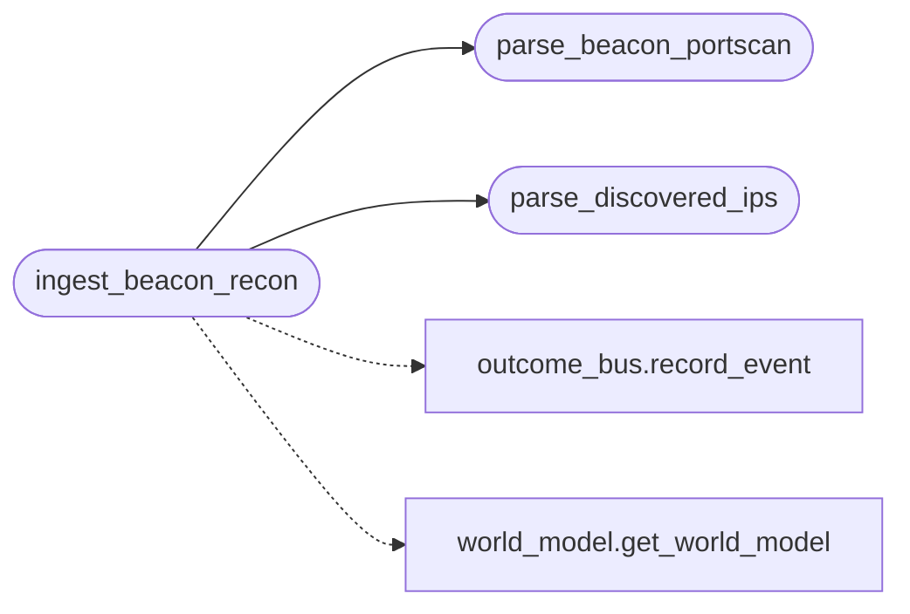

# `modules.beacon_recon`

> Source: [modules/beacon_recon.py:1](../../modules/beacon_recon.py#L1) | language `py` | coverage 100.0% | [API index](../index.md)

Beacon recon ingest — post-foothold discovery feeds the world model.

The Go implant reports two recon payloads on every beacon result:

- ``discovered_ips`` — output of the ``discover:`` command (live hosts
  found from the compromised host).
- ``result_portscan`` — output of the ``portscan:`` command. The implant
  sends either the legacy flat string (``"22,80"``) or a JSON map of
  ``{"<ip>": [22, 80]}``.

Both transit through [`lazyc2`](lazyc2.__init__.py.md) ``receive_result``. This module
turns them into world-model hosts/services (feeding the intel and
attack graphs through the outcome bus) instead of leaving them
display-only.

## Contents

- **Functions:** [`parse_discovered_ips`](#parse_discovered_ips), [`parse_beacon_portscan`](#parse_beacon_portscan), [`ingest_beacon_recon`](#ingest_beacon_recon)
- **Constants:** [`DISCOVERY_LEDGER`](#discovery_ledger), [`DISCOVERY_SINKS`](#discovery_sinks)

## Call Graph

Solid arrows stay in this module, dashed arrows leave it.



## Functions

<a id="parse_discovered_ips"></a>

### `parse_discovered_ips`

`function` | [modules/beacon_recon.py:50](../../modules/beacon_recon.py#L50)

```python
def parse_discovered_ips(raw: Any) -> list[str]
```

Extract clean IP strings from a beacon discovery payload.

**Parameters**

| Name | Type | Default | Description |
|---|---|---|---|
| `raw` | `Any` |  | Beacon ``discovered_ips`` payload. Accepts a flat string (``"10.0.0.2 10.0.0.5, subnet"``), a list, or a dict whose values may be lists of IPs. |

**Returns:** `list[str]` - Deduplicated valid IP addresses in first-seen order, capped at
``_MAX_ITEMS_PER_BEACON`` entries per beacon.

*Called by:* [`ingest_beacon_recon`](#ingest_beacon_recon)

---

<a id="parse_beacon_portscan"></a>

### `parse_beacon_portscan`

`function` | [modules/beacon_recon.py:94](../../modules/beacon_recon.py#L94)

```python
def parse_beacon_portscan(raw: Any, default_host: str = '') -> list[tuple[str, int]]
```

Normalise any known port-scan payload into ``(host, port)`` pairs.

**Parameters**

| Name | Type | Default | Description |
|---|---|---|---|
| `raw` | `Any` |  | The beacon ``result_portscan`` value. Supported shapes: the Go implant JSON map string (``'{"10.0.0.2":[22,80]}'``), a dict of ``{ip: [ports]}``, a flat string (``"22,80"``), and a ``host:port``-ish string list. |
| `default_host` | `str` | `''` | Host credited for entries carrying no IP (e.g. the ``"22,80"`` flat string) — usually the beacon primary IP. |

**Returns:** `list[tuple[str, int]]` - Deduplicated ``(host, port)`` tuples in first-seen order, capped
at ``_MAX_ITEMS_PER_BEACON`` entries per beacon.

*Called by:* [`ingest_beacon_recon`](#ingest_beacon_recon)

---

<a id="ingest_beacon_recon"></a>

### `ingest_beacon_recon`

`function` | [modules/beacon_recon.py:169](../../modules/beacon_recon.py#L169)

```python
def ingest_beacon_recon(primary_ip: str, discovered_ips: Any = None, portscan: Any = None, hostname: str = '', user: str = '', client_id: str = '', sessions_dir: Path | None = None) -> dict[str, int]
```

Fold beacon discovery and port-scan payloads into the state layer.

Adds discovered hosts and scanned services to the world model, appends
the beacon-reported live hosts to ``sessions/hostsdiscovery.txt`` (the
existing discovery consumer), and publishes one ``discovery`` outcome
so intel/attack graph summaries refresh automatically.

**Parameters**

| Name | Type | Default | Description |
|---|---|---|---|
| `primary_ip` | `str` |  | IP of the beacon (foothold) that produced the data. |
| `discovered_ips` | `Any` | `None` | Payload from the ``discover:`` command. |
| `portscan` | `Any` | `None` | Payload from the ``portscan:`` command. |
| `hostname` | `str` | `''` | Beacon hostname label. |
| `user` | `str` | `''` | Beacon user label. |
| `client_id` | `str` | `''` | Sanitised beacon identifier. |
| `sessions_dir` | `Path \| None` | `None` | Sessions directory override (tests). |

**Returns:** `dict[str, int]` - ``{"hosts": <new hosts added>, "services": <new service pairs>,
"outcomes": <1 when the discovery outcome published>}``.

*Calls:* [`parse_beacon_portscan`](#parse_beacon_portscan), [`parse_discovered_ips`](#parse_discovered_ips), [`record_event`](modules.outcome_bus.py.md#record_event), [`get_world_model`](modules.world_model.py.md#get_world_model)

---

## Constants

<a id="discovery_ledger"></a>

### `DISCOVERY_LEDGER`

`constant` | [modules/beacon_recon.py:29](../../modules/beacon_recon.py#L29)

```python
DISCOVERY_LEDGER = 'hostsdiscovery.txt'
```

---

<a id="discovery_sinks"></a>

### `DISCOVERY_SINKS`

`constant` | [modules/beacon_recon.py:30](../../modules/beacon_recon.py#L30)

```python
DISCOVERY_SINKS
```

---
