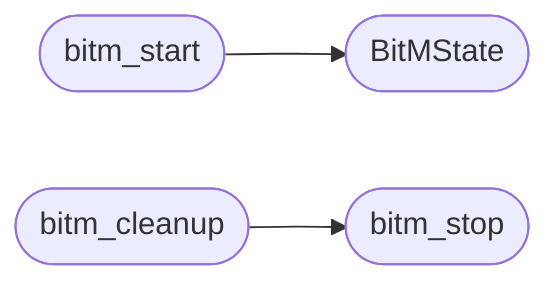

# `modules.bitm_engine`

> Source: [modules/bitm_engine.py:1](../../modules/bitm_engine.py#L1) | language `py` | coverage 100.0% | [API index](../index.md)

Browser-in-the-Middle (BitM) attack engine.

Automates ARP spoofing, transparent HTTP proxy injection, and
credential harvesting. Coordinates bettercap/arpspoof with custom
JavaScript payload injection to capture browser sessions, cookies,
OAuth tokens, and form submissions from target browsers.

## Contents

- **Classes:** [`BitMState`](#bitmstate)
- **Functions:** [`bitm_start`](#bitm_start), [`bitm_stop`](#bitm_stop), [`bitm_status`](#bitm_status), [`bitm_inject`](#bitm_inject), [`bitm_harvest_stats`](#bitm_harvest_stats), [`bitm_cleanup`](#bitm_cleanup)
- **Constants:** [`JS_INJECT_PAYLOADS`](#js_inject_payloads)

## Call Graph

Solid arrows stay in this module, dashed arrows leave it.



## Classes

<a id="bitmstate"></a>

### `BitMState`

`class` `dataclass` | [modules/bitm_engine.py:85](../../modules/bitm_engine.py#L85)

Decorators: `@dataclass`

```python
class BitMState
```

Current state of a BitM campaign.

**Attributes**

| Name | Type | Default | Description |
|---|---|---|---|
| [`active`](#bitmstate-active) | `bool` | `False` |  |
| [`interface`](#bitmstate-interface) | `str` | `''` |  |
| [`target_ip`](#bitmstate-target_ip) | `str` | `''` |  |
| [`gateway_ip`](#bitmstate-gateway_ip) | `str` | `''` |  |
| [`lhost`](#bitmstate-lhost) | `str` | `''` |  |
| [`lport`](#bitmstate-lport) | `int` | `8080` |  |
| [`method`](#bitmstate-method) | `str` | `'bettercap'` |  |
| [`started_at`](#bitmstate-started_at) | `float` | `0.0` |  |
| [`pid`](#bitmstate-pid) | `int` | `0` |  |
| [`captives_file`](#bitmstate-captives_file) | `str` | `''` |  |
| [`harvest_file`](#bitmstate-harvest_file) | `str` | `''` |  |
| [`active_payloads`](#bitmstate-active_payloads) | `list[str]` | `field(default_factory=list)` |  |
| [`stats`](#bitmstate-stats) | `dict[str, int]` | `field(default_factory=lambda: {'cookies': 0, 'forms': 0, 'keystrokes': 0, 'tokens': 0})` |  |

---

## Functions

<a id="bitm_start"></a>

### `bitm_start`

`function` | [modules/bitm_engine.py:257](../../modules/bitm_engine.py#L257)

```python
def bitm_start(target_ip: str, gateway_ip: str = '', interface: str = '', lhost: str = '', lport: int = 8080, method: str = 'auto', payloads: list[str] | None = None) -> dict[str, Any]
```

Start a Browser-in-the-Middle attack.

**Parameters**

| Name | Type | Default | Description |
|---|---|---|---|
| `target_ip` | `str` |  | IP address of the victim machine. |
| `gateway_ip` | `str` | `''` | Gateway IP (auto-detected if empty). |
| `interface` | `str` | `''` | Network interface (auto-detected if empty). |
| `lhost` | `str` | `''` | Attacker's IP for callbacks. |
| `lport` | `int` | `8080` | Attacker's HTTP listener port. |
| `method` | `str` | `'auto'` | ARP spoofing method ('bettercap', 'arpspoof', or 'auto'). |
| `payloads` | `list[str] \| None` | `None` | List of JS payload names to inject. |

**Returns:** `dict[str, Any]` - Dict with 'success' bool and 'state' or 'error' string.

*Calls:* [`BitMState`](#bitmstate)

---

<a id="bitm_stop"></a>

### `bitm_stop`

`function` | [modules/bitm_engine.py:481](../../modules/bitm_engine.py#L481)

```python
def bitm_stop() -> dict[str, Any]
```

Stop a running BitM attack and clean up iptables.

**Returns:** `dict[str, Any]` - Dict with status and harvested data summary.

*Called by:* [`bitm_cleanup`](#bitm_cleanup)

---

<a id="bitm_status"></a>

### `bitm_status`

`function` | [modules/bitm_engine.py:539](../../modules/bitm_engine.py#L539)

```python
def bitm_status() -> dict[str, Any]
```

Return the current BitM attack status.

**Returns:** `dict[str, Any]` - Dict with active state and campaign details.

---

<a id="bitm_inject"></a>

### `bitm_inject`

`function` | [modules/bitm_engine.py:572](../../modules/bitm_engine.py#L572)

```python
def bitm_inject(payload_name: str) -> dict[str, Any]
```

Inject an additional JS payload into an active BitM session.

**Parameters**

| Name | Type | Default | Description |
|---|---|---|---|
| `payload_name` | `str` |  | Key from JS_INJECT_PAYLOADS to inject. |

**Returns:** `dict[str, Any]` - Dict with success status.

---

<a id="bitm_harvest_stats"></a>

### `bitm_harvest_stats`

`function` | [modules/bitm_engine.py:607](../../modules/bitm_engine.py#L607)

```python
def bitm_harvest_stats() -> dict[str, Any]
```

Return statistics on harvested credentials from the active/past campaign.

**Returns:** `dict[str, Any]` - Dict with counts of cookies, form submissions, tokens, keystrokes.

---

<a id="bitm_cleanup"></a>

### `bitm_cleanup`

`function` | [modules/bitm_engine.py:642](../../modules/bitm_engine.py#L642)

```python
def bitm_cleanup() -> dict[str, Any]
```

Force-kill all BitM processes and remove the state file.

**Returns:** `dict[str, Any]` - Dict with cleanup status.

*Calls:* [`bitm_stop`](#bitm_stop)

---

## Constants

<a id="js_inject_payloads"></a>

### `JS_INJECT_PAYLOADS`

`constant` | [modules/bitm_engine.py:26](../../modules/bitm_engine.py#L26)

```python
JS_INJECT_PAYLOADS: dict[str, str]
```

---
