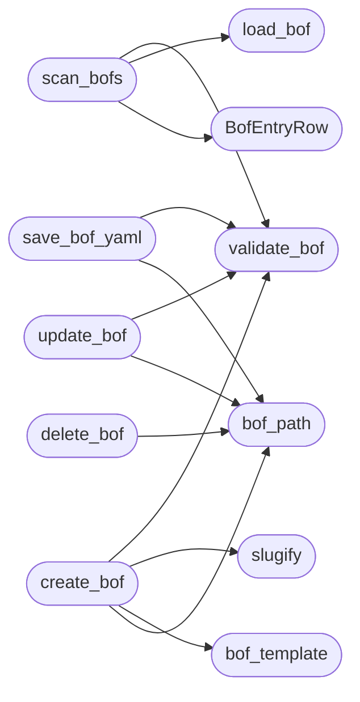

# `modules.bof_admin`

> Source: [modules/bof_admin.py:1](../../modules/bof_admin.py#L1) | language `py` | coverage 100.0% | [API index](../index.md)

Safe CRUD for the BOF YAML configurations under ``bofs/``.

Every BOF is one YAML file declaring its capability and the lazyaddon
beacon client that delivers it (``beacon`` for Windows COFF BOFs,
``blacksandbeacon`` for Linux ELF BOFs). This module is the single
writer for BOF configuration files: every mutation is validated,
confined to the BOF directory and written atomically.

The TUI (`[`cli.lazy_orchestrator`](cli.lazy_orchestrator.py.md)`) BOFs tab and the catalog loaders
([`modules.bof_registry`](modules.bof_registry.py.md)) import only this module for file access;
delivery logic lives separately in [`modules.bof_delivery`](modules.bof_delivery.py.md).

## Contents

- **Classes:** [`BofEntryRow`](#bofentryrow)
- **Functions:** [`slugify`](#slugify), [`bof_path`](#bof_path), [`load_bof`](#load_bof), [`validate_bof`](#validate_bof), [`scan_bofs`](#scan_bofs), [`bof_template`](#bof_template), [`create_bof`](#create_bof), [`update_bof`](#update_bof), [`save_bof_yaml`](#save_bof_yaml), [`preview_bof`](#preview_bof), [`delete_bof`](#delete_bof)
- **Constants:** [`BOFS_DIR`](#bofs_dir), [`BOF_CLIENTS`](#bof_clients), [`BOF_PLATFORMS`](#bof_platforms), [`BOF_CATEGORIES`](#bof_categories)

## Call Graph

Solid arrows stay in this module, dashed arrows leave it.



## Classes

<a id="bofentryrow"></a>

### `BofEntryRow`

`class` `dataclass` | [modules/bof_admin.py:50](../../modules/bof_admin.py#L50)

Decorators: `@dataclass(frozen=True)`

```python
class BofEntryRow
```

One BOF YAML file rendered for the admin table.

**Attributes**

| Name | Type | Default | Description |
|---|---|---|---|
| [`file`](#bofentryrow-file) | `str` |  |  |
| [`path`](#bofentryrow-path) | `str` |  |  |
| [`name`](#bofentryrow-name) | `str` |  |  |
| [`client`](#bofentryrow-client) | `str` |  |  |
| [`platform`](#bofentryrow-platform) | `str` |  |  |
| [`category`](#bofentryrow-category) | `str` |  |  |
| [`artifact`](#bofentryrow-artifact) | `str` |  |  |
| [`staged`](#bofentryrow-staged) | `bool` |  |  |
| [`valid`](#bofentryrow-valid) | `bool` |  |  |
| [`error`](#bofentryrow-error) | `str` |  |  |

---

## Functions

<a id="slugify"></a>

### `slugify`

`function` | [modules/bof_admin.py:72](../../modules/bof_admin.py#L72)

```python
def slugify(value: str) -> str
```

Return a safe BOF filename stem.

**Parameters**

| Name | Type | Default | Description |
|---|---|---|---|
| `value` | `str` |  | Operator-supplied name. |

**Returns:** `str` - Lowercase ``[a-z0-9_-]`` slug with a 64-character cap.

*Called by:* [`create_bof`](#create_bof)

---

<a id="bof_path"></a>

### `bof_path`

`function` | [modules/bof_admin.py:85](../../modules/bof_admin.py#L85)

```python
def bof_path(filename: str, directory: Path | str | None = None) -> Path
```

Resolve one BOF file inside the bofs root.

**Parameters**

| Name | Type | Default | Description |
|---|---|---|---|
| `filename` | `str` |  | File name, with or without the ``.yaml`` suffix. |
| `directory` | `Path \| str \| None` | `None` | Override for tests; defaults to [`BOFS_DIR`](#bofs_dir). |

**Returns:** `Path` - The confined path.

**Raises**

- `ValueError`: Empty name, path traversal or unsupported suffix.

*Called by:* [`create_bof`](#create_bof), [`delete_bof`](#delete_bof), [`save_bof_yaml`](#save_bof_yaml), [`update_bof`](#update_bof)

---

<a id="load_bof"></a>

### `load_bof`

`function` | [modules/bof_admin.py:110](../../modules/bof_admin.py#L110)

```python
def load_bof(path: Path | str) -> dict[str, Any]
```

Read one BOF YAML mapping.

**Parameters**

| Name | Type | Default | Description |
|---|---|---|---|
| `path` | `Path \| str` |  | File to read. |

**Returns:** `dict[str, Any]` - The parsed mapping; empty when unreadable, oversized or not a
mapping.

**Raises**

- `OSError`: File unreadable past the safety checks.
- `RuntimeError`: PyYAML unavailable.

*Called by:* [`scan_bofs`](#scan_bofs), [`BofYamlStore.load_entries`](modules.bof_registry.py.md#bofyamlstore-load_entries)

---

<a id="validate_bof"></a>

### `validate_bof`

`function` | [modules/bof_admin.py:132](../../modules/bof_admin.py#L132)

```python
def validate_bof(data: Any) -> list[str]
```

Validate one BOF mapping against the delivery contract.

**Parameters**

| Name | Type | Default | Description |
|---|---|---|---|
| `data` | `Any` |  | Parsed YAML document. |

**Returns:** `list[str]` - A list of human-readable errors (empty when valid).

*Called by:* [`create_bof`](#create_bof), [`save_bof_yaml`](#save_bof_yaml), [`scan_bofs`](#scan_bofs), [`update_bof`](#update_bof), [`BofYamlStore.load_entries`](modules.bof_registry.py.md#bofyamlstore-load_entries)

---

<a id="scan_bofs"></a>

### `scan_bofs`

`function` | [modules/bof_admin.py:179](../../modules/bof_admin.py#L179)

```python
def scan_bofs(directory: Path | str | None = None, sessions_dir: str = 'sessions') -> list[BofEntryRow]
```

Scan the bofs directory, returning admin rows for every file.

**Parameters**

| Name | Type | Default | Description |
|---|---|---|---|
| `directory` | `Path \| str \| None` | `None` | Override for tests; defaults to [`BOFS_DIR`](#bofs_dir). |
| `sessions_dir` | `str` | `'sessions'` | Staging root used to report the staged flag. |

**Returns:** `list[BofEntryRow]` - One [`BofEntryRow`](#bofentryrow) per ``.yaml`` file, invalid ones included.

*Calls:* [`BofEntryRow`](#bofentryrow), [`load_bof`](#load_bof), [`validate_bof`](#validate_bof)

*Called by:* [`OrchestratorAssetsMixin.bof_rows`](cli.orchestrator_assets_tabs.py.md#orchestratorassetsmixin-bof_rows)

---

<a id="bof_template"></a>

### `bof_template`

`function` | [modules/bof_admin.py:224](../../modules/bof_admin.py#L224)

```python
def bof_template(name: str = '', description: str = '', client: str = 'blacksandbeacon') -> dict[str, Any]
```

Return a minimal BOF mapping ready for ``yaml.safe_dump``.

**Parameters**

| Name | Type | Default | Description |
|---|---|---|---|
| `name` | `str` | `''` |  |
| `description` | `str` | `''` |  |
| `client` | `str` | `'blacksandbeacon'` |  |

**Returns:** `dict[str, Any]`

*Called by:* [`create_bof`](#create_bof)

---

<a id="create_bof"></a>

### `create_bof`

`function` | [modules/bof_admin.py:257](../../modules/bof_admin.py#L257)

```python
def create_bof(filename: str, *, name: str = '', description: str = '', client: str = 'blacksandbeacon', directory: Path | str | None = None, overwrite: bool = False) -> Path
```

Create one BOF configuration file.

**Parameters**

| Name | Type | Default | Description |
|---|---|---|---|
| `filename` | `str` |  | Desired file name (slug); ``.yaml`` is appended when absent. |
| `name` | `str` | `''` | `[`name`](#bofentryrow-name)` value; defaults to the slug. |
| `description` | `str` | `''` | Free-form capability description. |
| `client` | `str` | `'blacksandbeacon'` | Delivering lazyaddon client. |
| `directory` | `Path \| str \| None` | `None` | Override for tests. |
| `overwrite` | `bool` | `False` | Replace an existing file instead of failing. |

**Returns:** `Path` - The created path.

**Raises**

- `FileExistsError`: The file exists and ``overwrite`` is False.
- `ValueError`: Invalid slug, path or document.

*Calls:* [`bof_path`](#bof_path), [`bof_template`](#bof_template), [`slugify`](#slugify), [`validate_bof`](#validate_bof)

*Called by:* [`OrchestratorAssetsMixin.create_bof_file`](cli.orchestrator_assets_tabs.py.md#orchestratorassetsmixin-create_bof_file)

---

<a id="update_bof"></a>

### `update_bof`

`function` | [modules/bof_admin.py:300](../../modules/bof_admin.py#L300)

```python
def update_bof(path: Path | str, data: dict[str, Any], directory: Path | str | None = None) -> Path
```

Validate and atomically rewrite one BOF configuration.

**Parameters**

| Name | Type | Default | Description |
|---|---|---|---|
| `path` | `Path \| str` |  | Existing file path or file name inside ``directory``. |
| `data` | `dict[str, Any]` |  | New mapping. |
| `directory` | `Path \| str \| None` | `None` | Override for tests. |

**Returns:** `Path` - The written path.

**Raises**

- `ValueError`: Invalid document.
- `FileNotFoundError`: The target does not exist.

*Calls:* [`bof_path`](#bof_path), [`validate_bof`](#validate_bof)

---

<a id="save_bof_yaml"></a>

### `save_bof_yaml`

`function` | [modules/bof_admin.py:332](../../modules/bof_admin.py#L332)

```python
def save_bof_yaml(path: Path | str, text: str, directory: Path | str | None = None) -> Path
```

Validate raw YAML text and atomically write it to the bofs root.

**Parameters**

| Name | Type | Default | Description |
|---|---|---|---|
| `path` | `Path \| str` |  | File name (slug accepted) inside ``directory``, or absolute path inside it. |
| `text` | `str` |  | Raw YAML text. |
| `directory` | `Path \| str \| None` | `None` | Override for tests; defaults to [`BOFS_DIR`](#bofs_dir). |

**Returns:** `Path` - The written path.

**Raises**

- `ValueError`: Invalid YAML text or invalid document.
- `FileNotFoundError`: (raised in the body, not documented)

*Calls:* [`bof_path`](#bof_path), [`validate_bof`](#validate_bof)

*Called by:* [`OrchestratorAssetsMixin.save_bof_text`](cli.orchestrator_assets_tabs.py.md#orchestratorassetsmixin-save_bof_text)

---

<a id="preview_bof"></a>

### `preview_bof`

`function` | [modules/bof_admin.py:370](../../modules/bof_admin.py#L370)

```python
def preview_bof(path: Path | str, limit: int = _PREVIEW_LINES) -> str
```

Return a bounded YAML preview for one BOF file.

**Parameters**

| Name | Type | Default | Description |
|---|---|---|---|
| `path` | `Path \| str` |  | File path. |
| `limit` | `int` | `_PREVIEW_LINES` | Maximum lines to render. |

**Returns:** `str` - A preview string prefixed with the first description lines.

*Called by:* [`OrchestratorAssetsMixin.bof_preview`](cli.orchestrator_assets_tabs.py.md#orchestratorassetsmixin-bof_preview)

---

<a id="delete_bof"></a>

### `delete_bof`

`function` | [modules/bof_admin.py:391](../../modules/bof_admin.py#L391)

```python
def delete_bof(path: Path | str, directory: Path | str | None = None) -> bool
```

Delete one BOF configuration file after validation.

**Parameters**

| Name | Type | Default | Description |
|---|---|---|---|
| `path` | `Path \| str` |  | Existing file name or path inside ``directory``. |
| `directory` | `Path \| str \| None` | `None` | Override for tests; defaults to [`BOFS_DIR`](#bofs_dir). |

**Returns:** `bool` - True when the file was removed.

**Raises**

- `ValueError`: When the resolved path escapes the bofs root.

*Calls:* [`bof_path`](#bof_path)

*Called by:* [`OrchestratorAssetsMixin.delete_bof_file`](cli.orchestrator_assets_tabs.py.md#orchestratorassetsmixin-delete_bof_file)

---

## Constants

<a id="bofs_dir"></a>

### `BOFS_DIR`

`constant` | [modules/bof_admin.py:28](../../modules/bof_admin.py#L28)

```python
BOFS_DIR = BASE_DIR / 'bofs'
```

---

<a id="bof_clients"></a>

### `BOF_CLIENTS`

`constant` | [modules/bof_admin.py:34](../../modules/bof_admin.py#L34)

```python
BOF_CLIENTS: tuple[str, ...] = ('beacon', 'blacksandbeacon')
```

---

<a id="bof_platforms"></a>

### `BOF_PLATFORMS`

`constant` | [modules/bof_admin.py:35](../../modules/bof_admin.py#L35)

```python
BOF_PLATFORMS: tuple[str, ...] = ('windows', 'linux')
```

---

<a id="bof_categories"></a>

### `BOF_CATEGORIES`

`constant` | [modules/bof_admin.py:36](../../modules/bof_admin.py#L36)

```python
BOF_CATEGORIES: tuple[str, ...]
```

---
