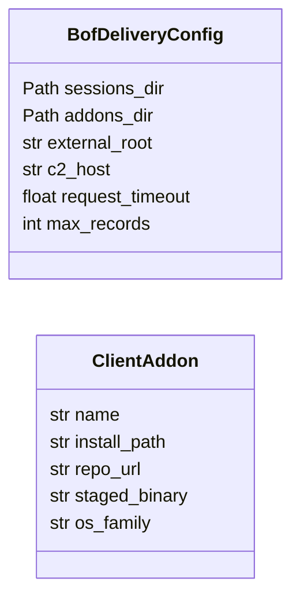
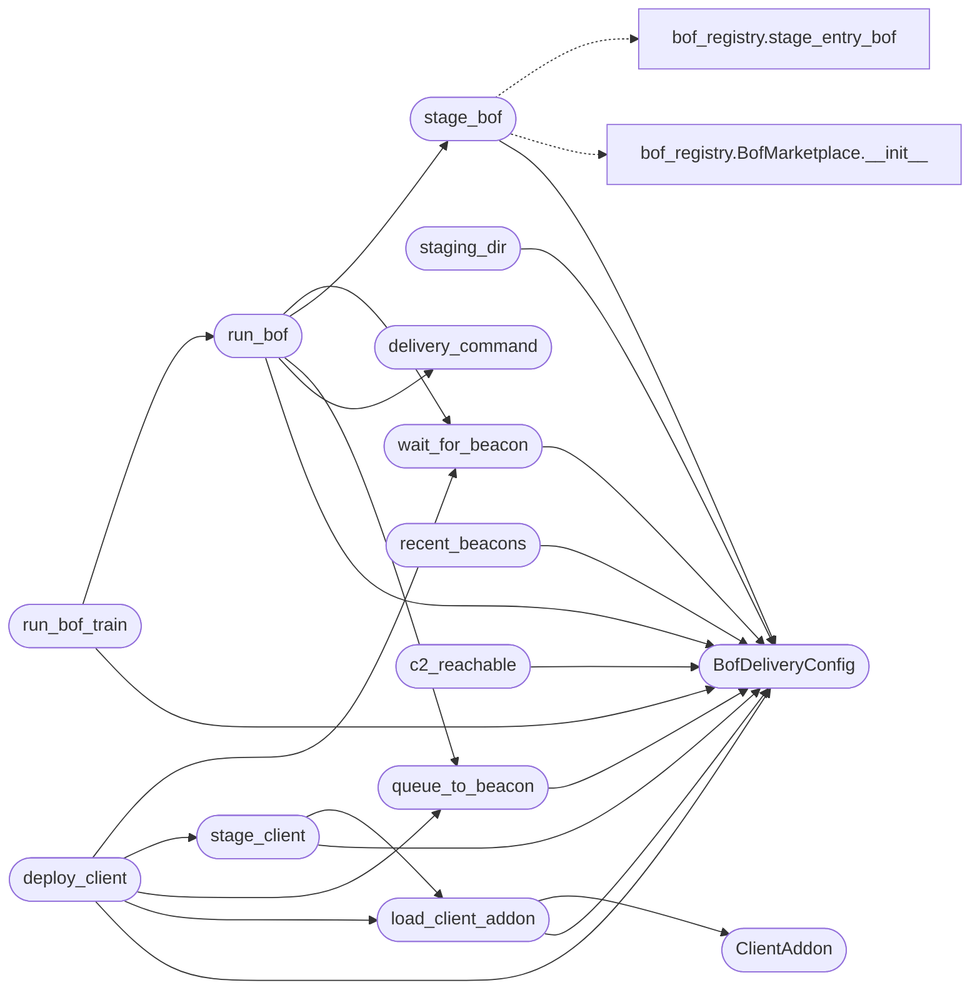

# `modules.bof_delivery`

> Source: [modules/bof_delivery.py:1](../../modules/bof_delivery.py#L1) | language `py` | coverage 100.0% | [API index](../index.md)

BOF delivery through the lazyaddon beacon clients.

Beacon Object Files discovered in ``bofs/*.yaml`` travel to the target
exactly as their declaring lazyaddon client describes:

- ``beacon`` (Windows COFF BOFs): the ``bof:url`` command is queued for a
  connected Windows beacon; it downloads the object from the C2
  ``/bof/<name>`` endpoint (raw base64 object, the upstream wire format)
  and runs it through COFFLoader.
- ``blacksandbeacon`` (Linux ELF BOFs): the ``bof:url`` command is queued
  identically; the beacon downloads the position-independent ELF object
  and runs it through its ``RunELF`` loader with the datap argument API.

This module owns the client articulation: it reads the lazyaddon manifests
to compute install paths and staged binaries, stages BOF objects, builds
the delivery command, pushes it to the C2, deploys the client beacon on a
target reached through the atomic exploit bridge, and collects results
from the beacon history. CLI, loop and chains all call these functions.

Contracts:
    - `[`BofDeliveryConfig`](#bofdeliveryconfig)`: paths, timeouts and HTTP knobs.
    - `[`queue_to_beacon`](#queue_to_beacon)`: authenticated C2 push (single shared helper).
    - `[`stage_bof`](#stage_bof)` / `[`stage_client`](#stage_client)`: staging of BOF objects and the
      client beacon binary.
    - `[`deploy_client`](#deploy_client)`: deliver the beacon binary onto a target with a
      live atomic session and wait for the first check-in.
    - `[`run_bof`](#run_bof)`: queue one BOF command and optionally wait for output.
    - `[`recent_beacons`](#recent_beacons)`: snapshot of beacons seen by the C2.

## Contents

- **Classes:** [`BofDeliveryConfig`](#bofdeliveryconfig), [`ClientAddon`](#clientaddon)
- **Functions:** [`load_client_addon`](#load_client_addon), [`staging_dir`](#staging_dir), [`stage_bof`](#stage_bof), [`stage_client`](#stage_client), [`delivery_command`](#delivery_command), [`queue_to_beacon`](#queue_to_beacon), [`recent_beacons`](#recent_beacons), [`wait_for_beacon`](#wait_for_beacon), [`c2_reachable`](#c2_reachable), [`run_bof`](#run_bof), [`run_bof_train`](#run_bof_train), [`deploy_client`](#deploy_client), [`bof_results`](#bof_results)

## Type Diagram



## Call Graph

Solid arrows stay in this module, dashed arrows leave it.



## Classes

<a id="bofdeliveryconfig"></a>

### `BofDeliveryConfig`

`class` `dataclass` | [modules/bof_delivery.py:141](../../modules/bof_delivery.py#L141)

Decorators: `@dataclass`

```python
class BofDeliveryConfig
```

Centralised knobs for the delivery service.

**Attributes**

| Name | Type | Default | Description |
|---|---|---|---|
| [`sessions_dir`](#bofdeliveryconfig-sessions_dir) | `Path` | `field(default_factory=lambda: DEFAULT_SESSIONS_DIR)` | Root of the default payload state. |
| [`addons_dir`](#bofdeliveryconfig-addons_dir) | `Path` | `field(default_factory=lambda: ADDONS_DIR)` | Lazyaddon manifest directory. |
| [`external_root`](#bofdeliveryconfig-external_root) | `str` | `'external/.exploit'` | Checked-out beacon repositories root. |
| [`c2_host`](#bofdeliveryconfig-c2_host) | `str` | `'127.0.0.1'` | Local C2 bind host for authenticated API calls. |
| [`request_timeout`](#bofdeliveryconfig-request_timeout) | `float` | `HTTP_TIMEOUT_S` | Wall-clock limit for one HTTP call. |
| [`max_records`](#bofdeliveryconfig-max_records) | `int` | `50` | Cap for one result read. |

---

<a id="clientaddon"></a>

### `ClientAddon`

`class` `dataclass` | [modules/bof_delivery.py:162](../../modules/bof_delivery.py#L162)

Decorators: `@dataclass(frozen=True)`

```python
class ClientAddon
```

One lazyaddon beacon client resolved from its YAML manifest.

**Attributes**

| Name | Type | Default | Description |
|---|---|---|---|
| [`name`](#clientaddon-name) | `str` |  | addon name (``beacon`` or ``blacksandbeacon``). |
| [`install_path`](#clientaddon-install_path) | `str` |  | relative checkout path under ``external/.exploit``. |
| [`repo_url`](#clientaddon-repo_url) | `str` |  | git repository. |
| [`staged_binary`](#clientaddon-staged_binary) | `str` |  | sessions-relative staged client binary path. |
| [`os_family`](#clientaddon-os_family) | `str` |  | target platform of the client. |

---

## Functions

<a id="load_client_addon"></a>

### `load_client_addon`

`function` | [modules/bof_delivery.py:180](../../modules/bof_delivery.py#L180)

```python
def load_client_addon(client: str, config: BofDeliveryConfig | None = None) -> ClientAddon
```

Resolve one beacon client lazyaddon manifest.

**Parameters**

| Name | Type | Default | Description |
|---|---|---|---|
| `client` | `str` |  | Lazyaddon name (``beacon`` or ``blacksandbeacon``). |
| `config` | `BofDeliveryConfig \| None` | `None` | Optional delivery configuration override. |

**Returns:** `ClientAddon` - The resolved [`ClientAddon`](#clientaddon).

**Raises**

- `ValueError`: Unknown client name or malformed manifest.

*Calls:* [`BofDeliveryConfig`](#bofdeliveryconfig), [`ClientAddon`](#clientaddon)

*Called by:* [`deploy_client`](#deploy_client), [`stage_client`](#stage_client)

---

<a id="staging_dir"></a>

### `staging_dir`

`function` | [modules/bof_delivery.py:221](../../modules/bof_delivery.py#L221)

```python
def staging_dir(config: BofDeliveryConfig | None = None) -> Path
```

Return (and create) the BOF staging directory.

**Parameters**

| Name | Type | Default | Description |
|---|---|---|---|
| `config` | `BofDeliveryConfig \| None` | `None` | Optional delivery configuration override. |

**Returns:** `Path` - The ``sessions/temp_uploads/bofs`` directory path.

*Calls:* [`BofDeliveryConfig`](#bofdeliveryconfig)

---

<a id="stage_bof"></a>

### `stage_bof`

`function` | [modules/bof_delivery.py:236](../../modules/bof_delivery.py#L236)

```python
def stage_bof(name: str, config: BofDeliveryConfig | None = None) -> str | None
```

Stage one catalog BOF for delivery through its client.

**Parameters**

| Name | Type | Default | Description |
|---|---|---|---|
| `name` | `str` |  | Catalog BOF name (matches a ``bofs/*.yaml`` name). |
| `config` | `BofDeliveryConfig \| None` | `None` | Optional delivery configuration override. |

**Returns:** `str | None` - The staged path, or None when nothing compiled is available.

**Raises**

- `KeyError`: (raised in the body, not documented)

*Calls:* [`BofDeliveryConfig`](#bofdeliveryconfig), [`BofMarketplace.__init__`](modules.bof_registry.py.md#bofmarketplace-__init__), [`stage_entry_bof`](modules.bof_registry.py.md#stage_entry_bof)

*Called by:* [`OrchestratorAssetsMixin.stage_bof_file`](cli.orchestrator_assets_tabs.py.md#orchestratorassetsmixin-stage_bof_file), [`run_bof`](#run_bof)

---

<a id="stage_client"></a>

### `stage_client`

`function` | [modules/bof_delivery.py:374](../../modules/bof_delivery.py#L374)

```python
def stage_client(client: str, config: BofDeliveryConfig | None = None, payload: dict[str, Any] | None = None) -> str
```

Compile and stage a beacon client through its lazyaddon tool.

Runs the addon ``tool.execute_command`` from the addon install path
with the shared safe shell primitive, then rewrites the checkout
runtime config to the LazyOwn C2 contract so the staged binary checks
in with the operator's endpoints and key on first run.

**Parameters**

| Name | Type | Default | Description |
|---|---|---|---|
| `client` | `str` |  | Lazyaddon client name. |
| `config` | `BofDeliveryConfig \| None` | `None` | Optional delivery configuration override. |
| `payload` | `dict[str, Any] \| None` | `None` | Optional payload.json mapping override (tests). |

**Returns:** `str` - The staged binary path (sessions-relative).

**Raises**

- `ValueError`: Unknown client or missing staged binary after the run.

*Calls:* [`load_payload`](core.config.py.md#load_payload), [`safe_run_shell`](core.safe_exec.py.md#safe_run_shell), [`BofDeliveryConfig`](#bofdeliveryconfig), [`load_client_addon`](#load_client_addon)

*Called by:* [`deploy_client`](#deploy_client)

---

<a id="delivery_command"></a>

### `delivery_command`

`function` | [modules/bof_delivery.py:640](../../modules/bof_delivery.py#L640)

```python
def delivery_command(bof_name: str, c2_url: str, args: list[str] | None = None, bofs_dir: str = BOF_URL_SEGMENT) -> str
```

Build the ``bof:`` delivery command for one BOF.

**Parameters**

| Name | Type | Default | Description |
|---|---|---|---|
| `bof_name` | `str` |  | Catalog BOF name. |
| `c2_url` | `str` |  | C2 base URL (``https://<lhost>:<c2_port>``). |
| `args` | `list[str] \| None` | `None` | Optional argument list joined with commas. |
| `bofs_dir` | `str` | `BOF_URL_SEGMENT` | URL segment serving the staged BOFs. |

**Returns:** `str` - The command string.

**Raises**

- `ValueError`: Invalid tokens (see beacon_config_builder).
- `ValueError`: When any token breaks the ``bof:`` contract.

*Calls:* [`generate_bof_execution_command`](modules.beacon_config_builder.py.md#generate_bof_execution_command)

*Called by:* [`run_bof`](#run_bof)

---

<a id="queue_to_beacon"></a>

### `queue_to_beacon`

`function` | [modules/bof_delivery.py:688](../../modules/bof_delivery.py#L688)

```python
def queue_to_beacon(client_id: str, command: str, config: BofDeliveryConfig | None = None, payload: dict[str, Any] | None = None) -> bool
```

Queue one command for a connected beacon through the C2 API.

Posts the form to ``https://<lhost>:<c2_port>/issue_command`` with
Basic auth taken from the payload configuration. Self-signed
certificates are accepted because the C2 channel is already
end-to-end encrypted by the beacon protocol itself.

**Parameters**

| Name | Type | Default | Description |
|---|---|---|---|
| `client_id` | `str` |  | Beacon client id (validated). |
| `command` | `str` |  | Full command string (e.g. ``bof:https://...``). |
| `config` | `BofDeliveryConfig \| None` | `None` | Optional delivery configuration override. |
| `payload` | `dict[str, Any] \| None` | `None` | Optional payload.json mapping override (tests). |

**Returns:** `bool` - True when the C2 accepted the command.

**Raises**

- `ValueError`: Malformed client id.

*Calls:* [`load_payload`](core.config.py.md#load_payload), [`sanitize_client_id`](modules.beacon_config_builder.py.md#sanitize_client_id), [`BofDeliveryConfig`](#bofdeliveryconfig)

*Called by:* [`deploy_client`](#deploy_client), [`run_bof`](#run_bof)

---

<a id="recent_beacons"></a>

### `recent_beacons`

`function` | [modules/bof_delivery.py:751](../../modules/bof_delivery.py#L751)

```python
def recent_beacons(config: BofDeliveryConfig | None = None, payload: dict[str, Any] | None = None) -> list[dict[str, Any]]
```

Return the beacons currently seen by the C2.

Queries the authenticated ``/api/dashboard`` endpoint; falls back to
the on-disk beacon history files when the C2 is not reachable.

**Parameters**

| Name | Type | Default | Description |
|---|---|---|---|
| `config` | `BofDeliveryConfig \| None` | `None` | Optional delivery configuration override. |
| `payload` | `dict[str, Any] \| None` | `None` | Optional payload.json mapping override (tests). |

**Returns:** `list[dict[str, Any]]` - A list of ``{client_id, hostname, user, last_seen}`` dicts.

*Calls:* [`load_payload`](core.config.py.md#load_payload), [`BofDeliveryConfig`](#bofdeliveryconfig)

*Called by:* [`BofMarketplaceCommandSet.do_bof_beacons`](cli.commands.bof_registry.py.md#bofmarketplacecommandset-do_bof_beacons)

---

<a id="wait_for_beacon"></a>

### `wait_for_beacon`

`function` | [modules/bof_delivery.py:817](../../modules/bof_delivery.py#L817)

```python
def wait_for_beacon(client_id: str | None = None, since: float | None = None, timeout: float = DEPLOY_WAIT_DEFAULT_S, config: BofDeliveryConfig | None = None, payload: dict[str, Any] | None = None) -> dict[str, Any] | None
```

Wait until a beacon answers, then return its latest record.

**Parameters**

| Name | Type | Default | Description |
|---|---|---|---|
| `client_id` | `str \| None` | `None` | Expected beacon id; None accepts any new beacon. |
| `since` | `float \| None` | `None` | Epoch timestamp; only records newer than it count. |
| `timeout` | `float` | `DEPLOY_WAIT_DEFAULT_S` | Wall-clock limit. |
| `config` | `BofDeliveryConfig \| None` | `None` | Optional delivery configuration override. |
| `payload` | `dict[str, Any] \| None` | `None` | Optional payload.json mapping override (tests). |

**Returns:** `dict[str, Any] | None` - The latest beacon record, or None after the timeout.

*Calls:* [`read_records`](modules.beacon_history.py.md#read_records), [`BofDeliveryConfig`](#bofdeliveryconfig)

*Called by:* [`deploy_client`](#deploy_client), [`run_bof`](#run_bof)

---

<a id="c2_reachable"></a>

### `c2_reachable`

`function` | [modules/bof_delivery.py:895](../../modules/bof_delivery.py#L895)

```python
def c2_reachable(config: BofDeliveryConfig | None = None, payload: dict[str, Any] | None = None) -> bool
```

Return True when the C2 answers an authenticated API query.

The check performs a live ``/api/dashboard`` GET with the payload
credentials; raw history fallbacks are explicitly not counted, so a
stale sessions directory never fakes a running server.

**Parameters**

| Name | Type | Default | Description |
|---|---|---|---|
| `config` | `BofDeliveryConfig \| None` | `None` | Optional delivery configuration override. |
| `payload` | `dict[str, Any] \| None` | `None` | Optional payload.json mapping override (tests). |

**Returns:** `bool` - True when the C2 responds over HTTPS.

*Calls:* [`load_payload`](core.config.py.md#load_payload), [`BofDeliveryConfig`](#bofdeliveryconfig)

*Called by:* [`BofMarketplaceCommandSet.do_bof_deploy`](cli.commands.bof_registry.py.md#bofmarketplacecommandset-do_bof_deploy)

---

<a id="run_bof"></a>

### `run_bof`

`function` | [modules/bof_delivery.py:930](../../modules/bof_delivery.py#L930)

```python
def run_bof(bof_name: str, client_id: str, args: list[str] | None = None, *, wait: float = 0.0, config: BofDeliveryConfig | None = None, payload: dict[str, Any] | None = None) -> dict[str, Any]
```

Queue one BOF execution on a live beacon and optionally await output.

**Parameters**

| Name | Type | Default | Description |
|---|---|---|---|
| `bof_name` | `str` |  | Catalog BOF name. |
| `client_id` | `str` |  | Target beacon client id. |
| `args` | `list[str] \| None` | `None` | Argument list joined with commas for the BOF contract. |
| `wait` | `float` | `0.0` | Seconds to wait for a result record (0 = fire and forget). |
| `config` | `BofDeliveryConfig \| None` | `None` | Optional delivery configuration override. |
| `payload` | `dict[str, Any] \| None` | `None` | Optional payload.json mapping override (tests). |

**Returns:** `dict[str, Any]` - ``{delivered, client_id, command, result}``.

*Calls:* [`load_payload`](core.config.py.md#load_payload), [`BofDeliveryConfig`](#bofdeliveryconfig), [`delivery_command`](#delivery_command), [`queue_to_beacon`](#queue_to_beacon), [`stage_bof`](#stage_bof), [`wait_for_beacon`](#wait_for_beacon)

*Called by:* [`BofMarketplaceCommandSet.do_bof_run`](cli.commands.bof_registry.py.md#bofmarketplacecommandset-do_bof_run), [`run_bof_train`](#run_bof_train)

---

<a id="run_bof_train"></a>

### `run_bof_train`

`function` | [modules/bof_delivery.py:969](../../modules/bof_delivery.py#L969)

```python
def run_bof_train(client_id: str, names: list[str], args: list[str] | None = None, *, wait: float = 20.0, config: BofDeliveryConfig | None = None) -> dict[str, Any]
```

Run a sequence of BOFs over one beacon, waiting for each in turn.

**Parameters**

| Name | Type | Default | Description |
|---|---|---|---|
| `client_id` | `str` |  | Target beacon client id. |
| `names` | `list[str]` |  | Ordered BOF catalog names. |
| `args` | `list[str] \| None` | `None` | Arguments passed to every BOF in the train. |
| `wait` | `float` | `20.0` | Per-BOF wait limit for the result record. |
| `config` | `BofDeliveryConfig \| None` | `None` | Optional delivery configuration override. |

**Returns:** `dict[str, Any]` - ``{client_id, ran, delivered, results}`` where ``results`` keeps
one entry per BOF name.

*Calls:* [`sanitize_client_id`](modules.beacon_config_builder.py.md#sanitize_client_id), [`BofDeliveryConfig`](#bofdeliveryconfig), [`run_bof`](#run_bof)

*Called by:* [`BofMarketplaceCommandSet.do_bof_train`](cli.commands.bof_registry.py.md#bofmarketplacecommandset-do_bof_train)

---

<a id="deploy_client"></a>

### `deploy_client`

`function` | [modules/bof_delivery.py:1035](../../modules/bof_delivery.py#L1035)

```python
def deploy_client(client: str, target: str, *, wait: float = DEPLOY_WAIT_DEFAULT_S, config: BofDeliveryConfig | None = None, payload: dict[str, Any] | None = None) -> dict[str, Any]
```

Deliver a staged beacon client onto a target and await check-in.

The target must already expose an exec-capable shell session from the
atomic exploit bridge (see ``atomic_exploit run`` / ``atomic_shell``).
Delivery walks a fallback chain and stops on the first check-in:

1. Upstream diskless stager — token-gated ``/stage/`` endpoints, the
   beacon ELF + config are AES-CFB + HMAC protected under HKDF keys
   derived from the staging token and executed from an anonymous
   memfd (nothing touches the target disk).
2. Raw ``/s/`` channel stager — same memfd execution without the
   token gate (works when the operator has not assigned one).
3. Disk bootstrap — ``curl`` the ELF + config to ``/tmp`` and run
   detached (last resort, leaves files behind).

**Parameters**

| Name | Type | Default | Description |
|---|---|---|---|
| `client` | `str` |  | Lazyaddon client (``blacksandbeacon`` for Linux targets). |
| `target` | `str` |  | Target IP the session already lives on. |
| `wait` | `float` | `DEPLOY_WAIT_DEFAULT_S` | Seconds to wait for the first beacon check-in. |
| `config` | `BofDeliveryConfig \| None` | `None` | Optional delivery configuration override. |
| `payload` | `dict[str, Any] \| None` | `None` | Optional payload.json mapping override (tests). |

**Returns:** `dict[str, Any]` - ``{success, client_id, reason, deployed, attempts}`` where
``attempts`` keeps one entry per fallback that was tried.

**Raises**

- `ValueError`: Unsupported client or missing staged binary.

*Calls:* [`load_payload`](core.config.py.md#load_payload), [`BofDeliveryConfig`](#bofdeliveryconfig), [`load_client_addon`](#load_client_addon), [`queue_to_beacon`](#queue_to_beacon), [`stage_client`](#stage_client), [`wait_for_beacon`](#wait_for_beacon)

*Called by:* [`BofMarketplaceCommandSet.do_bof_deploy`](cli.commands.bof_registry.py.md#bofmarketplacecommandset-do_bof_deploy)

---

<a id="bof_results"></a>

### `bof_results`

`function` | [modules/bof_delivery.py:1356](../../modules/bof_delivery.py#L1356)

```python
def bof_results(client_id: str, limit: int = 20, config: BofDeliveryConfig | None = None) -> list[dict[str, Any]]
```

Read the last beacon history records for one client.

**Parameters**

| Name | Type | Default | Description |
|---|---|---|---|
| `client_id` | `str` |  | Beacon client id (validated). |
| `limit` | `int` | `20` | Maximum records. |
| `config` | `BofDeliveryConfig \| None` | `None` | Optional delivery configuration override. |

**Returns:** `list[dict[str, Any]]` - Newest-first history records mentioning the ``bof:`` command.

**Raises**

- `ValueError`: Malformed client id.

*Calls:* [`sanitize_client_id`](modules.beacon_config_builder.py.md#sanitize_client_id), [`read_records`](modules.beacon_history.py.md#read_records)

*Called by:* [`BofMarketplaceCommandSet.do_bof_results`](cli.commands.bof_registry.py.md#bofmarketplacecommandset-do_bof_results)

---
