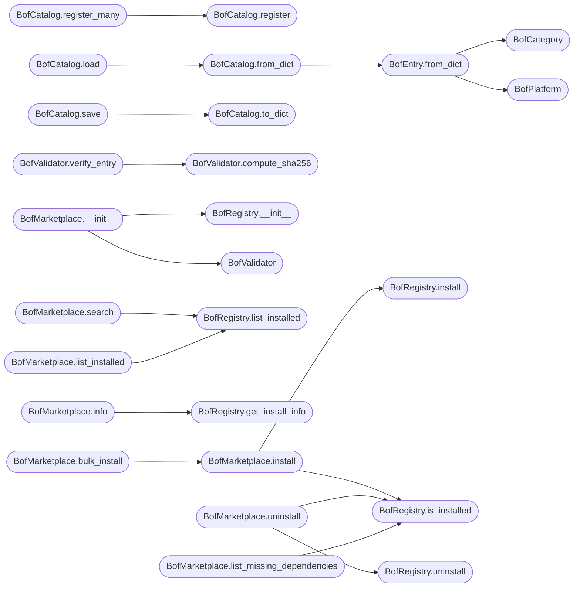

# `modules.bof_registry`

> Source: [modules/bof_registry.py:1](../../modules/bof_registry.py#L1) | language `py` | coverage 95.1% | [API index](../index.md)

Beacon Object File (BOF) registry and marketplace for LazyOwn.

Catalogs, indexes, and manages BOFs compatible with the TrustedSec
SA BOF API. Supports both Windows COFF BOFs (Cobalt Strike compatible)
and Linux ELF BOFs (BlacksandBeacon). Provides search, install, info,
and update operations against a curated catalog.

The catalog is a static index of known BOFs with metadata: name,
description, author, repository URL, compatible platforms, required
arguments, MITRE ATT&CK technique references, and SHA-256 hashes.

Contracts:
    - BofEntry: immutable dataclass representing one BOF
    - BofCatalog: curated catalog of known BOFs
    - BofRegistry: manages installed BOFs on disk with version tracking
    - BofMarketplace: search/install/uninstall/info operations
    - BofValidator: validates BOF integrity (hash check, platform compatibility)

Design (SOLID):
    - Single Responsibility: catalog, registry, marketplace, and validation
      are separate classes with distinct concerns.
    - Open/Closed: new BOFs added via BofCatalog.register() without modifying
      the marketplace class.
    - Liskov: disk registry and in-memory catalog share no interface contract.
    - Interface Segregation: search, install, and validate are separate concerns.
    - Dependency Inversion: marketplace depends on catalog + registry abstractions.

Usage:
    from modules.bof_registry import BofMarketplace

    mp = BofMarketplace(sessions_dir="sessions")
    results = mp.search("ldap")
    for entry in results:
        print(entry.name, entry.description)
    mp.install("ldap_enum")
    mp.info("ldap_enum")
    mp.uninstall("ldap_enum")

## Contents

- **Classes:** [`BofEntry`](#bofentry), [`BofCatalog`](#bofcatalog), [`BofValidator`](#bofvalidator), [`BofRegistry`](#bofregistry), [`BofMarketplace`](#bofmarketplace)
- **Enums:** [`BofPlatform`](#bofplatform), [`BofCategory`](#bofcategory)

## Type Diagram

```mermaid
classDiagram
    direction LR
    class BofPlatform
    <<enum>> BofPlatform
    BofPlatform : WINDOWS
    BofPlatform : LINUX
    class BofCategory
    <<enum>> BofCategory
    BofCategory : RECON
    BofCategory : ENUM
    BofCategory : CRED
    BofCategory : PERSIST
    BofCategory : PRIVESC
    BofCategory : LAT
    BofCategory : EVASION
    BofCategory : EXEC
    BofCategory : COLLECTION
    BofCategory : EXFIL
    BofCategory : GENERAL
    class BofEntry
    BofEntry : str name
    BofEntry : str description
    BofEntry : str author
    BofEntry : str url
    BofEntry : str source_file
    BofEntry : BofPlatform platform
    BofEntry : BofCategory category
    BofEntry : list[str] required_args
    BofEntry : list[str] optional_args
    BofEntry : str mitre_technique
    BofEntry : str sha256
    BofEntry : str min_beacon_version
    BofEntry : list[str] dependencies
    BofEntry : to_dict()
    BofEntry : from_dict()
    class BofCatalog
    BofCatalog : dict[str, BofEntry] entries
    BofCatalog : register()
    BofCatalog : register_many()
    BofCatalog : get()
    BofCatalog : search()
    BofCatalog : list_by_category()
    BofCatalog : list_by_platform()
    BofCatalog : list_all()
    BofCatalog : to_dict()
    BofCatalog : from_dict()
    BofCatalog : load()
    BofCatalog : save()
    class BofValidator
    BofValidator : compute_sha256()
    BofValidator : verify_entry()
    BofValidator : validate_args()
    class BofRegistry
    BofRegistry : __init__()
    BofRegistry : install_dir()
    BofRegistry : is_installed()
    BofRegistry : install()
    BofRegistry : uninstall()
    BofRegistry : list_installed()
    BofRegistry : get_install_info()
    class BofMarketplace
    BofMarketplace : __init__()
    BofMarketplace : catalog()
    BofMarketplace : registry()
    BofMarketplace : search()
    BofMarketplace : info()
    BofMarketplace : install()
    BofMarketplace : uninstall()
    BofMarketplace : list_installed()
    BofMarketplace : list_missing_dependencies()
    BofMarketplace : bulk_install()
```



## Call Graph

Solid arrows stay in this module, dashed arrows leave it.



## Classes

<a id="bofentry"></a>

### `BofEntry`

`class` `dataclass` | [modules/bof_registry.py:85](../../modules/bof_registry.py#L85)

Decorators: `@dataclass(frozen=True)`

```python
class BofEntry
```

Immutable catalog entry for a single Beacon Object File.

**Attributes**

| Name | Type | Default | Description |
|---|---|---|---|
| [`name`](#bofentry-name) | `str` |  | Unique identifier (e.g., 'ldap_enum'). |
| [`description`](#bofentry-description) | `str` |  | Human-readable description. |
| [`author`](#bofentry-author) | `str` |  | Author or organization. |
| [`url`](#bofentry-url) | `str` |  | Repository URL. |
| [`source_file`](#bofentry-source_file) | `str` |  | Relative path to the C source file in the repo. |
| [`platform`](#bofentry-platform) | `BofPlatform` | `BofPlatform.WINDOWS` | Target platform for the compiled BOF. |
| [`category`](#bofentry-category) | `BofCategory` | `BofCategory.GENERAL` | Functional category. |
| [`required_args`](#bofentry-required_args) | `list[str]` | `field(default_factory=list)` | List of required argument names. |
| [`optional_args`](#bofentry-optional_args) | `list[str]` | `field(default_factory=list)` | List of optional argument names. |
| [`mitre_technique`](#bofentry-mitre_technique) | `str` | `''` | MITRE ATT&CK technique ID (e.g., 'T1018'). |
| [`sha256`](#bofentry-sha256) | `str` | `''` | SHA-256 hash of the canonical source file (empty until audited). |
| [`min_beacon_version`](#bofentry-min_beacon_version) | `str` | `'1.0'` | Minimum beacon version required. |
| [`dependencies`](#bofentry-dependencies) | `list[str]` | `field(default_factory=list)` | List of dependency BOF names. |

**Members**

| Member | Kind | Summary |
|---|---|---|
| [`to_dict`](#bofentry-to_dict) | method | Serialize to dictionary. |
| [`from_dict`](#bofentry-from_dict) | classmethod | Build from a dictionary. |

<a id="bofentry-to_dict"></a>

#### `BofEntry.to_dict`

`method` | [modules/bof_registry.py:118](../../modules/bof_registry.py#L118)

```python
def to_dict(self) -> dict[str, Any]
```

Serialize to dictionary.

**Returns:** `dict[str, Any]`

<a id="bofentry-from_dict"></a>

#### `BofEntry.from_dict`

`classmethod` | [modules/bof_registry.py:137](../../modules/bof_registry.py#L137)

Decorators: `@classmethod`

```python
def from_dict(cls, raw: dict[str, Any]) -> BofEntry
```

Build from a dictionary.

**Parameters**

| Name | Type | Default | Description |
|---|---|---|---|
| `raw` | `dict[str, Any]` |  |  |

**Returns:** `BofEntry`

*Calls:* [`BofCategory`](#bofcategory), [`BofPlatform`](#bofplatform)

*Called by:* [`BofCatalog.from_dict`](#bofcatalog-from_dict)

---

<a id="bofcatalog"></a>

### `BofCatalog`

`class` `dataclass` | [modules/bof_registry.py:157](../../modules/bof_registry.py#L157)

Decorators: `@dataclass`

```python
class BofCatalog
```

Curated catalog of known Beacon Object Files.

The catalog is a static index maintained by the LazyOwn team. Entries
are added via ``register()`` and persisted to disk as JSON for sharing
between operator sessions.

**Attributes**

| Name | Type | Default | Description |
|---|---|---|---|
| [`entries`](#bofcatalog-entries) | `dict[str, BofEntry]` | `field(default_factory=dict)` |  |

**Members**

| Member | Kind | Summary |
|---|---|---|
| [`register`](#bofcatalog-register) | method | Register a BOF entry in the catalog. |
| [`register_many`](#bofcatalog-register_many) | method | Register multiple BOF entries at once. |
| [`get`](#bofcatalog-get) | method | Retrieve a BOF entry by name. |
| [`search`](#bofcatalog-search) | method | Search catalog by keyword across name, description, and technique. |
| [`list_by_category`](#bofcatalog-list_by_category) | method | Return all BOFs in a specific category. |
| [`list_by_platform`](#bofcatalog-list_by_platform) | method | Return all BOFs for a specific platform. |
| [`list_all`](#bofcatalog-list_all) | method | Return all catalog entries sorted by name. |
| [`to_dict`](#bofcatalog-to_dict) | method | Serialize the entire catalog to a dictionary. |
| [`from_dict`](#bofcatalog-from_dict) | classmethod | Build a catalog from a dictionary. |
| [`load`](#bofcatalog-load) | classmethod | Load a catalog from a JSON file. |
| [`save`](#bofcatalog-save) | method | Save the catalog to a JSON file. |

<a id="bofcatalog-register"></a>

#### `BofCatalog.register`

`method` | [modules/bof_registry.py:167](../../modules/bof_registry.py#L167)

```python
def register(self, entry: BofEntry) -> None
```

Register a BOF entry in the catalog.

**Parameters**

| Name | Type | Default | Description |
|---|---|---|---|
| `entry` | `BofEntry` |  |  |

*Called by:* [`BofCatalog.register_many`](#bofcatalog-register_many)

<a id="bofcatalog-register_many"></a>

#### `BofCatalog.register_many`

`method` | [modules/bof_registry.py:172](../../modules/bof_registry.py#L172)

```python
def register_many(self, entries: list[BofEntry]) -> None
```

Register multiple BOF entries at once.

**Parameters**

| Name | Type | Default | Description |
|---|---|---|---|
| `entries` | `list[BofEntry]` |  |  |

*Calls:* [`BofCatalog.register`](#bofcatalog-register)

<a id="bofcatalog-get"></a>

#### `BofCatalog.get`

`method` | [modules/bof_registry.py:177](../../modules/bof_registry.py#L177)

```python
def get(self, name: str) -> BofEntry
```

Retrieve a BOF entry by name.

Raises KeyError if not found.

**Parameters**

| Name | Type | Default | Description |
|---|---|---|---|
| `name` | `str` |  |  |

**Returns:** `BofEntry`

**Raises**

- `KeyError`: (raised in the body, not documented)

<a id="bofcatalog-search"></a>

#### `BofCatalog.search`

`method` | [modules/bof_registry.py:188](../../modules/bof_registry.py#L188)

```python
def search(self, query: str) -> list[BofEntry]
```

Search catalog by keyword across name, description, and technique.

**Parameters**

| Name | Type | Default | Description |
|---|---|---|---|
| `query` | `str` |  | Case-insensitive search keyword. |

**Returns:** `list[BofEntry]` - List of matching BofEntry objects, sorted by relevance.

<a id="bofcatalog-list_by_category"></a>

#### `BofCatalog.list_by_category`

`method` | [modules/bof_registry.py:221](../../modules/bof_registry.py#L221)

```python
def list_by_category(self, category: BofCategory) -> list[BofEntry]
```

Return all BOFs in a specific category.

**Parameters**

| Name | Type | Default | Description |
|---|---|---|---|
| `category` | `BofCategory` |  |  |

**Returns:** `list[BofEntry]`

<a id="bofcatalog-list_by_platform"></a>

#### `BofCatalog.list_by_platform`

`method` | [modules/bof_registry.py:225](../../modules/bof_registry.py#L225)

```python
def list_by_platform(self, platform: BofPlatform) -> list[BofEntry]
```

Return all BOFs for a specific platform.

**Parameters**

| Name | Type | Default | Description |
|---|---|---|---|
| `platform` | `BofPlatform` |  |  |

**Returns:** `list[BofEntry]`

<a id="bofcatalog-list_all"></a>

#### `BofCatalog.list_all`

`method` | [modules/bof_registry.py:229](../../modules/bof_registry.py#L229)

```python
def list_all(self) -> list[BofEntry]
```

Return all catalog entries sorted by name.

**Returns:** `list[BofEntry]`

<a id="bofcatalog-to_dict"></a>

#### `BofCatalog.to_dict`

`method` | [modules/bof_registry.py:233](../../modules/bof_registry.py#L233)

```python
def to_dict(self) -> dict[str, Any]
```

Serialize the entire catalog to a dictionary.

**Returns:** `dict[str, Any]`

*Called by:* [`BofCatalog.save`](#bofcatalog-save)

<a id="bofcatalog-from_dict"></a>

#### `BofCatalog.from_dict`

`classmethod` | [modules/bof_registry.py:241](../../modules/bof_registry.py#L241)

Decorators: `@classmethod`

```python
def from_dict(cls, raw: dict[str, Any]) -> BofCatalog
```

Build a catalog from a dictionary.

**Parameters**

| Name | Type | Default | Description |
|---|---|---|---|
| `raw` | `dict[str, Any]` |  |  |

**Returns:** `BofCatalog`

*Calls:* [`BofEntry.from_dict`](#bofentry-from_dict)

*Called by:* [`BofCatalog.load`](#bofcatalog-load)

<a id="bofcatalog-load"></a>

#### `BofCatalog.load`

`classmethod` | [modules/bof_registry.py:249](../../modules/bof_registry.py#L249)

Decorators: `@classmethod`

```python
def load(cls, path: str | Path) -> BofCatalog
```

Load a catalog from a JSON file.

**Parameters**

| Name | Type | Default | Description |
|---|---|---|---|
| `path` | `str \| Path` |  |  |

**Returns:** `BofCatalog`

*Calls:* [`BofCatalog.from_dict`](#bofcatalog-from_dict)

<a id="bofcatalog-save"></a>

#### `BofCatalog.save`

`method` | [modules/bof_registry.py:257](../../modules/bof_registry.py#L257)

```python
def save(self, path: str | Path) -> None
```

Save the catalog to a JSON file.

**Parameters**

| Name | Type | Default | Description |
|---|---|---|---|
| `path` | `str \| Path` |  |  |

*Calls:* [`BofCatalog.to_dict`](#bofcatalog-to_dict)

---

<a id="bofvalidator"></a>

### `BofValidator`

`class` | [modules/bof_registry.py:506](../../modules/bof_registry.py#L506)

```python
class BofValidator
```

Validates BOF integrity and compatibility.

Checks SHA-256 hashes of downloaded source files against the
catalog, verifies platform compatibility, and validates that
required arguments are supplied.

**Members**

| Member | Kind | Summary |
|---|---|---|
| [`compute_sha256`](#bofvalidator-compute_sha256) | staticmethod | Compute the SHA-256 hash of a file. |
| [`verify_entry`](#bofvalidator-verify_entry) | staticmethod | Verify the SHA-256 of a downloaded BOF source matches the catalog. |
| [`validate_args`](#bofvalidator-validate_args) | staticmethod | Validate that all required arguments are supplied. |

<a id="bofvalidator-compute_sha256"></a>

#### `BofValidator.compute_sha256`

`staticmethod` | [modules/bof_registry.py:515](../../modules/bof_registry.py#L515)

Decorators: `@staticmethod`

```python
def compute_sha256(filepath: str | Path) -> str
```

Compute the SHA-256 hash of a file.

**Parameters**

| Name | Type | Default | Description |
|---|---|---|---|
| `filepath` | `str \| Path` |  |  |

**Returns:** `str`

*Called by:* [`BofValidator.verify_entry`](#bofvalidator-verify_entry)

<a id="bofvalidator-verify_entry"></a>

#### `BofValidator.verify_entry`

`staticmethod` | [modules/bof_registry.py:524](../../modules/bof_registry.py#L524)

Decorators: `@staticmethod`

```python
def verify_entry(entry: BofEntry, filepath: str | Path) -> tuple[bool, str]
```

Verify the SHA-256 of a downloaded BOF source matches the catalog.

Returns (ok, reason). If entry.sha256 is empty, verification is
skipped with an informational message.

**Parameters**

| Name | Type | Default | Description |
|---|---|---|---|
| `entry` | `BofEntry` |  |  |
| `filepath` | `str \| Path` |  |  |

**Returns:** `tuple[bool, str]`

*Calls:* [`BofValidator.compute_sha256`](#bofvalidator-compute_sha256)

<a id="bofvalidator-validate_args"></a>

#### `BofValidator.validate_args`

`staticmethod` | [modules/bof_registry.py:540](../../modules/bof_registry.py#L540)

Decorators: `@staticmethod`

```python
def validate_args(entry: BofEntry, args: dict[str, str]) -> list[str]
```

Validate that all required arguments are supplied.

Returns a list of missing argument names (empty = valid).

**Parameters**

| Name | Type | Default | Description |
|---|---|---|---|
| `entry` | `BofEntry` |  |  |
| `args` | `dict[str, str]` |  |  |

**Returns:** `list[str]`

---

<a id="bofregistry"></a>

### `BofRegistry`

`class` | [modules/bof_registry.py:552](../../modules/bof_registry.py#L552)

```python
class BofRegistry
```

Manages BOF installations on disk with version tracking.

Each installed BOF is tracked in a manifest JSON file with the
installation timestamp, BOF version, and source URL.

**Members**

| Member | Kind | Summary |
|---|---|---|
| [`__init__`](#bofregistry-__init__) | constructor |  |
| [`install_dir`](#bofregistry-install_dir) | property | Return the BOF installation directory. |
| [`is_installed`](#bofregistry-is_installed) | method | Return True if a BOF is installed. |
| [`install`](#bofregistry-install) | method | Register a BOF as installed with current timestamp. |
| [`uninstall`](#bofregistry-uninstall) | method | Unregister a BOF from the manifest and optionally remove its files. |
| [`list_installed`](#bofregistry-list_installed) | method | Return a list of all installed BOFs with metadata. |
| [`get_install_info`](#bofregistry-get_install_info) | method | Return installation metadata for a BOF, or None if not installed. |

<a id="bofregistry-__init__"></a>

#### `BofRegistry.__init__`

`constructor` | [modules/bof_registry.py:559](../../modules/bof_registry.py#L559)

```python
def __init__(self, sessions_dir: str | Path) -> None
```

**Parameters**

| Name | Type | Default | Description |
|---|---|---|---|
| `sessions_dir` | `str \| Path` |  |  |

*Called by:* [`BofMarketplace.__init__`](#bofmarketplace-__init__)

<a id="bofregistry-install_dir"></a>

#### `BofRegistry.install_dir`

`property` | [modules/bof_registry.py:565](../../modules/bof_registry.py#L565)

Decorators: `@property`

```python
def install_dir(self) -> Path
```

Return the BOF installation directory.

**Returns:** `Path`

<a id="bofregistry-is_installed"></a>

#### `BofRegistry.is_installed`

`method` | [modules/bof_registry.py:585](../../modules/bof_registry.py#L585)

```python
def is_installed(self, name: str) -> bool
```

Return True if a BOF is installed.

**Parameters**

| Name | Type | Default | Description |
|---|---|---|---|
| `name` | `str` |  |  |

**Returns:** `bool`

*Called by:* [`BofMarketplace.install`](#bofmarketplace-install), [`BofMarketplace.list_missing_dependencies`](#bofmarketplace-list_missing_dependencies), [`BofMarketplace.uninstall`](#bofmarketplace-uninstall)

<a id="bofregistry-install"></a>

#### `BofRegistry.install`

`method` | [modules/bof_registry.py:590](../../modules/bof_registry.py#L590)

```python
def install(self, entry: BofEntry) -> Path
```

Register a BOF as installed with current timestamp.

Returns the install directory for this BOF.

**Parameters**

| Name | Type | Default | Description |
|---|---|---|---|
| `entry` | `BofEntry` |  |  |

**Returns:** `Path`

*Called by:* [`BofMarketplace.install`](#bofmarketplace-install)

<a id="bofregistry-uninstall"></a>

#### `BofRegistry.uninstall`

`method` | [modules/bof_registry.py:611](../../modules/bof_registry.py#L611)

```python
def uninstall(self, name: str, remove_files: bool = True) -> bool
```

Unregister a BOF from the manifest and optionally remove its files.

Returns True if the BOF was installed and successfully removed.

**Parameters**

| Name | Type | Default | Description |
|---|---|---|---|
| `name` | `str` |  |  |
| `remove_files` | `bool` | `True` |  |

**Returns:** `bool`

*Called by:* [`BofMarketplace.uninstall`](#bofmarketplace-uninstall)

<a id="bofregistry-list_installed"></a>

#### `BofRegistry.list_installed`

`method` | [modules/bof_registry.py:628](../../modules/bof_registry.py#L628)

```python
def list_installed(self) -> list[dict[str, Any]]
```

Return a list of all installed BOFs with metadata.

**Returns:** `list[dict[str, Any]]`

*Called by:* [`BofMarketplace.list_installed`](#bofmarketplace-list_installed), [`BofMarketplace.search`](#bofmarketplace-search)

<a id="bofregistry-get_install_info"></a>

#### `BofRegistry.get_install_info`

`method` | [modules/bof_registry.py:633](../../modules/bof_registry.py#L633)

```python
def get_install_info(self, name: str) -> dict[str, Any] | None
```

Return installation metadata for a BOF, or None if not installed.

**Parameters**

| Name | Type | Default | Description |
|---|---|---|---|
| `name` | `str` |  |  |

**Returns:** `dict[str, Any] | None`

*Called by:* [`BofMarketplace.info`](#bofmarketplace-info)

---

<a id="bofmarketplace"></a>

### `BofMarketplace`

`class` | [modules/bof_registry.py:639](../../modules/bof_registry.py#L639)

```python
class BofMarketplace
```

BOF discovery, installation, and management interface.

Composes a BofCatalog (curated index) and a BofRegistry (disk
state) to provide search/install/uninstall/info operations.

**Members**

| Member | Kind | Summary |
|---|---|---|
| [`__init__`](#bofmarketplace-__init__) | constructor |  |
| [`catalog`](#bofmarketplace-catalog) | property | Return the catalog. |
| [`registry`](#bofmarketplace-registry) | property | Return the registry. |
| [`search`](#bofmarketplace-search) | method | Search the catalog and return enriched results with install status. |
| [`info`](#bofmarketplace-info) | method | Get detailed information about a BOF by name. |
| [`install`](#bofmarketplace-install) | method | Install a BOF from the catalog by name. |
| [`uninstall`](#bofmarketplace-uninstall) | method | Uninstall a BOF by name. |
| [`list_installed`](#bofmarketplace-list_installed) | method | List all installed BOFs with catalog enrichment. |
| [`list_missing_dependencies`](#bofmarketplace-list_missing_dependencies) | method | Return a list of dependencies for a BOF that are not installed. |
| [`bulk_install`](#bofmarketplace-bulk_install) | method | Install multiple BOFs at once. |

<a id="bofmarketplace-__init__"></a>

#### `BofMarketplace.__init__`

`constructor` | [modules/bof_registry.py:651](../../modules/bof_registry.py#L651)

```python
def __init__(self, sessions_dir: str | Path = 'sessions', catalog: BofCatalog | None = None) -> None
```

**Parameters**

| Name | Type | Default | Description |
|---|---|---|---|
| `sessions_dir` | `str \| Path` | `'sessions'` |  |
| `catalog` | `BofCatalog \| None` | `None` |  |

*Calls:* [`BofRegistry.__init__`](#bofregistry-__init__), [`BofValidator`](#bofvalidator)

*Called by:* [`BofMarketplaceCommandSet.do_bof_catalog`](cli.commands.bof_registry.py.md#bofmarketplacecommandset-do_bof_catalog), [`BofMarketplaceCommandSet.do_bof_info`](cli.commands.bof_registry.py.md#bofmarketplacecommandset-do_bof_info), [`BofMarketplaceCommandSet.do_bof_install`](cli.commands.bof_registry.py.md#bofmarketplacecommandset-do_bof_install), [`BofMarketplaceCommandSet.do_bof_list`](cli.commands.bof_registry.py.md#bofmarketplacecommandset-do_bof_list), [`BofMarketplaceCommandSet.do_bof_run`](cli.commands.bof_registry.py.md#bofmarketplacecommandset-do_bof_run), [`BofMarketplaceCommandSet.do_bof_search`](cli.commands.bof_registry.py.md#bofmarketplacecommandset-do_bof_search), [`BofMarketplaceCommandSet.do_bof_uninstall`](cli.commands.bof_registry.py.md#bofmarketplacecommandset-do_bof_uninstall)

<a id="bofmarketplace-catalog"></a>

#### `BofMarketplace.catalog`

`property` | [modules/bof_registry.py:662](../../modules/bof_registry.py#L662)

Decorators: `@property`

```python
def catalog(self) -> BofCatalog
```

Return the catalog.

**Returns:** `BofCatalog`

<a id="bofmarketplace-registry"></a>

#### `BofMarketplace.registry`

`property` | [modules/bof_registry.py:667](../../modules/bof_registry.py#L667)

Decorators: `@property`

```python
def registry(self) -> BofRegistry
```

Return the registry.

**Returns:** `BofRegistry`

<a id="bofmarketplace-search"></a>

#### `BofMarketplace.search`

`method` | [modules/bof_registry.py:671](../../modules/bof_registry.py#L671)

```python
def search(self, query: str) -> list[dict[str, Any]]
```

Search the catalog and return enriched results with install status.

**Parameters**

| Name | Type | Default | Description |
|---|---|---|---|
| `query` | `str` |  | Search keyword (name, description, technique, category). |

**Returns:** `list[dict[str, Any]]` - List of dicts with BOF metadata plus `installed` flag.

*Calls:* [`BofRegistry.list_installed`](#bofregistry-list_installed)

*Called by:* [`BofMarketplaceCommandSet.do_bof_search`](cli.commands.bof_registry.py.md#bofmarketplacecommandset-do_bof_search)

<a id="bofmarketplace-info"></a>

#### `BofMarketplace.info`

`method` | [modules/bof_registry.py:690](../../modules/bof_registry.py#L690)

```python
def info(self, name: str) -> dict[str, Any]
```

Get detailed information about a BOF by name.

Includes catalog metadata plus install state.
Returns a dict with 'error' key if not found.

**Parameters**

| Name | Type | Default | Description |
|---|---|---|---|
| `name` | `str` |  |  |

**Returns:** `dict[str, Any]`

*Calls:* [`BofRegistry.get_install_info`](#bofregistry-get_install_info)

*Called by:* [`BofMarketplaceCommandSet.do_bof_info`](cli.commands.bof_registry.py.md#bofmarketplacecommandset-do_bof_info)

<a id="bofmarketplace-install"></a>

#### `BofMarketplace.install`

`method` | [modules/bof_registry.py:707](../../modules/bof_registry.py#L707)

```python
def install(self, name: str) -> dict[str, Any]
```

Install a BOF from the catalog by name.

Registers the BOF in the disk manifest. Does NOT clone
the source repository; the operator is expected to have
the catalog repository already cloned, or use a separate
install step for source retrieval.

Returns a dict with status information.

**Parameters**

| Name | Type | Default | Description |
|---|---|---|---|
| `name` | `str` |  |  |

**Returns:** `dict[str, Any]`

*Calls:* [`BofRegistry.install`](#bofregistry-install), [`BofRegistry.is_installed`](#bofregistry-is_installed)

*Called by:* [`BofMarketplaceCommandSet.do_bof_install`](cli.commands.bof_registry.py.md#bofmarketplacecommandset-do_bof_install), [`BofMarketplace.bulk_install`](#bofmarketplace-bulk_install)

<a id="bofmarketplace-uninstall"></a>

#### `BofMarketplace.uninstall`

`method` | [modules/bof_registry.py:736](../../modules/bof_registry.py#L736)

```python
def uninstall(self, name: str) -> dict[str, Any]
```

Uninstall a BOF by name.

Returns a dict with uninstall status.

**Parameters**

| Name | Type | Default | Description |
|---|---|---|---|
| `name` | `str` |  |  |

**Returns:** `dict[str, Any]`

*Calls:* [`BofRegistry.is_installed`](#bofregistry-is_installed), [`BofRegistry.uninstall`](#bofregistry-uninstall)

*Called by:* [`BofMarketplaceCommandSet.do_bof_uninstall`](cli.commands.bof_registry.py.md#bofmarketplacecommandset-do_bof_uninstall)

<a id="bofmarketplace-list_installed"></a>

#### `BofMarketplace.list_installed`

`method` | [modules/bof_registry.py:749](../../modules/bof_registry.py#L749)

```python
def list_installed(self) -> list[dict[str, Any]]
```

List all installed BOFs with catalog enrichment.

**Returns:** `list[dict[str, Any]]`

*Calls:* [`BofRegistry.list_installed`](#bofregistry-list_installed)

*Called by:* [`BofMarketplaceCommandSet.do_bof_list`](cli.commands.bof_registry.py.md#bofmarketplacecommandset-do_bof_list)

<a id="bofmarketplace-list_missing_dependencies"></a>

#### `BofMarketplace.list_missing_dependencies`

`method` | [modules/bof_registry.py:761](../../modules/bof_registry.py#L761)

```python
def list_missing_dependencies(self, name: str) -> list[str]
```

Return a list of dependencies for a BOF that are not installed.

**Parameters**

| Name | Type | Default | Description |
|---|---|---|---|
| `name` | `str` |  |  |

**Returns:** `list[str]`

*Calls:* [`BofRegistry.is_installed`](#bofregistry-is_installed)

<a id="bofmarketplace-bulk_install"></a>

#### `BofMarketplace.bulk_install`

`method` | [modules/bof_registry.py:769](../../modules/bof_registry.py#L769)

```python
def bulk_install(self, names: list[str]) -> dict[str, dict[str, Any]]
```

Install multiple BOFs at once.

Returns a dict mapping BOF name to result dict.

**Parameters**

| Name | Type | Default | Description |
|---|---|---|---|
| `names` | `list[str]` |  |  |

**Returns:** `dict[str, dict[str, Any]]`

*Calls:* [`BofMarketplace.install`](#bofmarketplace-install)

---

## Enums

<a id="bofplatform"></a>

### `BofPlatform`

`enum` | [modules/bof_registry.py:61](../../modules/bof_registry.py#L61)

```python
class BofPlatform(str, Enum)
```

Bases: `str`, `Enum`

Target platform for a Beacon Object File.

**Attributes**

| Name | Type | Default | Description |
|---|---|---|---|
| [`WINDOWS`](#bofplatform-windows) |  | `'windows'` |  |
| [`LINUX`](#bofplatform-linux) |  | `'linux'` |  |

---

<a id="bofcategory"></a>

### `BofCategory`

`enum` | [modules/bof_registry.py:68](../../modules/bof_registry.py#L68)

```python
class BofCategory(str, Enum)
```

Bases: `str`, `Enum`

Functional category of a BOF.

**Attributes**

| Name | Type | Default | Description |
|---|---|---|---|
| [`RECON`](#bofcategory-recon) |  | `'reconnaissance'` |  |
| [`ENUM`](#bofcategory-enum) |  | `'enumeration'` |  |
| [`CRED`](#bofcategory-cred) |  | `'credential_access'` |  |
| [`PERSIST`](#bofcategory-persist) |  | `'persistence'` |  |
| [`PRIVESC`](#bofcategory-privesc) |  | `'privilege_escalation'` |  |
| [`LAT`](#bofcategory-lat) |  | `'lateral_movement'` |  |
| [`EVASION`](#bofcategory-evasion) |  | `'evasion'` |  |
| [`EXEC`](#bofcategory-exec) |  | `'execution'` |  |
| [`COLLECTION`](#bofcategory-collection) |  | `'collection'` |  |
| [`EXFIL`](#bofcategory-exfil) |  | `'exfiltration'` |  |
| [`GENERAL`](#bofcategory-general) |  | `'general'` |  |

---
