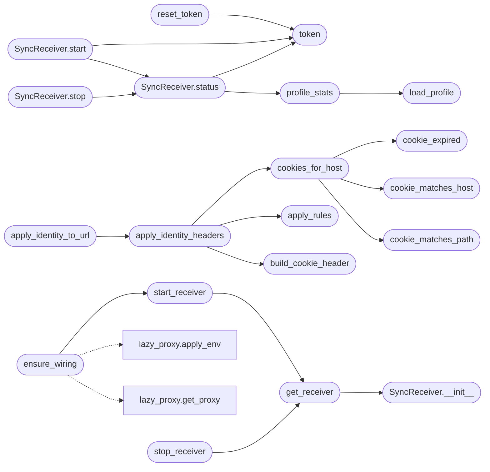

# `modules.browser_sync`

> Source: [modules/browser_sync.py:1](../../modules/browser_sync.py#L1) | language `py` | coverage 100.0% | [API index](../index.md)

Browser identity sync between the operator browser and the recorder proxy.

A Chrome/Brave extension (``browser_sync_extension/``) pushes the real
cookie store plus fingerprint headers (user agent, languages, client
hints) to a local, token-authenticated receiver exposed by this module.
The recorder proxy ([`modules.lazy_proxy`](modules.lazy_proxy.py.md)) then calls
[`apply_identity_headers`](#apply_identity_headers) on every forwarded exchange so the
autonomous loop, ``apt_chain`` and ``auto_pwn`` reuse the genuine browser
session instead of fingerprint-breaking anonymous requests.

Burp-style "Match and Replace" rules live in ``sessions/browser_sync/rules.json``
and are applied after the identity headers, letting the operator rewrite
any header or body region of the proxied traffic.

Security contract: the receiver binds loopback only, requires a runtime
generated token, caps request size, sanitises every stored header value
and never raises on I/O; a broken sync degrades to anonymous traffic.

## Contents

- **Classes:** [`SyncReceiver`](#syncreceiver)
- **Functions:** [`token`](#token), [`reset_token`](#reset_token), [`load_profile`](#load_profile), [`profile_stats`](#profile_stats), [`cookie_matches_host`](#cookie_matches_host), [`cookie_matches_path`](#cookie_matches_path), [`cookie_expired`](#cookie_expired), [`cookies_for_host`](#cookies_for_host), [`build_cookie_header`](#build_cookie_header), [`write_netscape_jar`](#write_netscape_jar), [`jar_path`](#jar_path), [`apply_rules`](#apply_rules), [`apply_identity_headers`](#apply_identity_headers), [`get_receiver`](#get_receiver), [`start_receiver`](#start_receiver), [`stop_receiver`](#stop_receiver), [`clear_profile`](#clear_profile), [`apply_identity_to_url`](#apply_identity_to_url), [`ensure_wiring`](#ensure_wiring), [`masked_rows`](#masked_rows)
- **Constants:** [`DEFAULT_SYNC_HOST`](#default_sync_host), [`DEFAULT_SYNC_PORT`](#default_sync_port), [`SYNC_DIR_NAME`](#sync_dir_name), [`ENDPOINT_PATH`](#endpoint_path), [`HEALTH_PATH`](#health_path), [`TOKEN_HEADER`](#token_header), [`TOKEN_BYTES`](#token_bytes), [`MAX_SYNC_BODY`](#max_sync_body), [`MAX_SYNC_DRAIN`](#max_sync_drain), [`MAX_COOKIES`](#max_cookies), [`MAX_COOKIE_VALUE`](#max_cookie_value), [`MAX_HEADER_VALUE`](#max_header_value), [`MAX_RULES`](#max_rules), [`PROFILE_TTL_SEC`](#profile_ttl_sec), [`DEFAULT_INJECT`](#default_inject), [`INJECTABLE_HEADER_PREFIXES`](#injectable_header_prefixes), [`WIRING_ENABLED`](#wiring_enabled)

## Call Graph

Solid arrows stay in this module, dashed arrows leave it.



## Classes

<a id="syncreceiver"></a>

### `SyncReceiver`

`class` | [modules/browser_sync.py:592](../../modules/browser_sync.py#L592)

```python
class SyncReceiver
```

Token-authenticated loopback receiver for the browser extension.

**Members**

| Member | Kind | Summary |
|---|---|---|
| [`__init__`](#syncreceiver-__init__) | constructor | Prepare state; nothing binds until `start`. |
| [`start`](#syncreceiver-start) | method | Bind the receiver; idempotent while already running. |
| [`stop`](#syncreceiver-stop) | method | Shut the receiver down; safe when it was never started. |
| [`status`](#syncreceiver-status) | method | Report running state, address, token and profile stats. |

<a id="syncreceiver-__init__"></a>

#### `SyncReceiver.__init__`

`constructor` | [modules/browser_sync.py:595](../../modules/browser_sync.py#L595)

```python
def __init__(self, host: str = DEFAULT_SYNC_HOST, port: int = DEFAULT_SYNC_PORT) -> None
```

Prepare state; nothing binds until `start`.

**Parameters**

| Name | Type | Default | Description |
|---|---|---|---|
| `host` | `str` | `DEFAULT_SYNC_HOST` | Bind address. |
| `port` | `int` | `DEFAULT_SYNC_PORT` | Bind port (0 picks a free one). |

*Called by:* [`get_receiver`](#get_receiver)

<a id="syncreceiver-start"></a>

#### `SyncReceiver.start`

`method` | [modules/browser_sync.py:610](../../modules/browser_sync.py#L610)

```python
def start(self, host: str | None = None, port: int | None = None) -> dict[str, Any]
```

Bind the receiver; idempotent while already running.

**Parameters**

| Name | Type | Default | Description |
|---|---|---|---|
| `host` | `str \| None` | `None` | Bind address override (None keeps the current one). |
| `port` | `int \| None` | `None` | Bind port override (None or 0 keeps the current one when already running, otherwise picks a free one). |

**Returns:** `dict[str, Any]` - Status dict with running state, address and profile stats.

*Calls:* [`SyncReceiver.status`](#syncreceiver-status), [`token`](#token)

<a id="syncreceiver-stop"></a>

#### `SyncReceiver.stop`

`method` | [modules/browser_sync.py:755](../../modules/browser_sync.py#L755)

```python
def stop(self) -> dict[str, Any]
```

Shut the receiver down; safe when it was never started.

**Returns:** `dict[str, Any]`

*Calls:* [`SyncReceiver.status`](#syncreceiver-status)

<a id="syncreceiver-status"></a>

#### `SyncReceiver.status`

`method` | [modules/browser_sync.py:771](../../modules/browser_sync.py#L771)

```python
def status(self) -> dict[str, Any]
```

Report running state, address, token and profile stats.

**Returns:** `dict[str, Any]`

*Calls:* [`profile_stats`](#profile_stats), [`token`](#token)

*Called by:* [`SyncReceiver.start`](#syncreceiver-start), [`SyncReceiver.stop`](#syncreceiver-stop)

---

## Functions

<a id="token"></a>

### `token`

`function` | [modules/browser_sync.py:112](../../modules/browser_sync.py#L112)

```python
def token(create: bool = True) -> str
```

Return the receiver auth token, generating it on first use.

**Parameters**

| Name | Type | Default | Description |
|---|---|---|---|
| `create` | `bool` | `True` | When False, return an empty string instead of creating. |

**Returns:** `str` - The hex token, or an empty string when absent and ``create`` is False.

*Called by:* [`BrowserSyncCommandSet.do_browsersync`](cli.commands.browser_sync.py.md#browsersynccommandset-do_browsersync), [`SyncReceiver.start`](#syncreceiver-start), [`SyncReceiver.status`](#syncreceiver-status), [`reset_token`](#reset_token)

---

<a id="reset_token"></a>

### `reset_token`

`function` | [modules/browser_sync.py:138](../../modules/browser_sync.py#L138)

```python
def reset_token() -> str
```

Regenerate the receiver token.

**Returns:** `str` - The new hex token.

*Calls:* [`token`](#token)

*Called by:* [`BrowserSyncCommandSet.do_browsersync`](cli.commands.browser_sync.py.md#browsersynccommandset-do_browsersync)

---

<a id="load_profile"></a>

### `load_profile`

`function` | [modules/browser_sync.py:151](../../modules/browser_sync.py#L151)

```python
def load_profile() -> dict[str, Any]
```

Load the last synced browser identity profile.

**Returns:** `dict[str, Any]` - The profile dict, or an empty dict when absent or corrupt.

*Called by:* [`profile_stats`](#profile_stats)

---

<a id="profile_stats"></a>

### `profile_stats`

`function` | [modules/browser_sync.py:164](../../modules/browser_sync.py#L164)

```python
def profile_stats() -> dict[str, Any]
```

Summarise the synced profile.

**Returns:** `dict[str, Any]` - Dict with cookie count, distinct domains, age seconds and sync time.

*Calls:* [`load_profile`](#load_profile)

*Called by:* [`SyncReceiver.status`](#syncreceiver-status)

---

<a id="cookie_matches_host"></a>

### `cookie_matches_host`

`function` | [modules/browser_sync.py:183](../../modules/browser_sync.py#L183)

```python
def cookie_matches_host(cookie: dict[str, Any], host: str) -> bool
```

Return True when a synced cookie applies to a request host.

**Parameters**

| Name | Type | Default | Description |
|---|---|---|---|
| `cookie` | `dict[str, Any]` |  | Synced cookie dict with ``domain`` and optional ``hostOnly``. |
| `host` | `str` |  | Request host (no port, no brackets). |

**Returns:** `bool` - True on exact host match (hostOnly) or domain suffix match.

*Called by:* [`cookies_for_host`](#cookies_for_host)

---

<a id="cookie_matches_path"></a>

### `cookie_matches_path`

`function` | [modules/browser_sync.py:202](../../modules/browser_sync.py#L202)

```python
def cookie_matches_path(cookie: dict[str, Any], request_path: str) -> bool
```

Return True when a synced cookie applies to one request path.

RFC 6265 path-match: equal path, or the cookie path is a prefix of the
request path and either ends with a slash or is followed by a slash.

**Parameters**

| Name | Type | Default | Description |
|---|---|---|---|
| `cookie` | `dict[str, Any]` |  | Synced cookie dict with ``path`` (default ``/``). |
| `request_path` | `str` |  | Request path including the query-stripped location. |

**Returns:** `bool` - True when the browser would send this cookie for the path.

*Called by:* [`cookies_for_host`](#cookies_for_host)

---

<a id="cookie_expired"></a>

### `cookie_expired`

`function` | [modules/browser_sync.py:226](../../modules/browser_sync.py#L226)

```python
def cookie_expired(cookie: dict[str, Any], now: float | None = None) -> bool
```

Return True when a persistent cookie is already expired.

Session cookies (no ``expirationDate``) never expire here; the next
sync replaces the whole store anyway.

**Parameters**

| Name | Type | Default | Description |
|---|---|---|---|
| `cookie` | `dict[str, Any]` |  | Synced cookie dict. |
| `now` | `float \| None` | `None` | Reference timestamp, defaults to current time. |

**Returns:** `bool` - True when the cookie must not be sent.

*Called by:* [`cookies_for_host`](#cookies_for_host)

---

<a id="cookies_for_host"></a>

### `cookies_for_host`

`function` | [modules/browser_sync.py:248](../../modules/browser_sync.py#L248)

```python
def cookies_for_host(profile: dict[str, Any], host: str, path: str = '/', scheme: str = 'https') -> list[dict[str, Any]]
```

Return synced cookies a browser would send for one request.

Filters by host match, RFC path match, ``Secure`` only over https and
expiry, exactly like a browser would.

**Parameters**

| Name | Type | Default | Description |
|---|---|---|---|
| `profile` | `dict[str, Any]` |  | Synced profile dict. |
| `host` | `str` |  | Request host. |
| `path` | `str` | `'/'` | Request path (query included or not). |
| `scheme` | `str` | `'https'` | Request scheme; ``Secure`` cookies only apply to https. |

**Returns:** `list[dict[str, Any]]` - List of cookie dicts ordered per RFC 6265: longest path first,
longer domain first as tiebreak.

*Calls:* [`cookie_expired`](#cookie_expired), [`cookie_matches_host`](#cookie_matches_host), [`cookie_matches_path`](#cookie_matches_path)

*Called by:* [`apply_identity_headers`](#apply_identity_headers)

---

<a id="build_cookie_header"></a>

### `build_cookie_header`

`function` | [modules/browser_sync.py:285](../../modules/browser_sync.py#L285)

```python
def build_cookie_header(existing: str, cookies: list[dict[str, Any]]) -> str
```

Merge synced cookies into an existing Cookie header.

Synced names win over names already present; unrelated existing
cookies are preserved.

**Parameters**

| Name | Type | Default | Description |
|---|---|---|---|
| `existing` | `str` |  | Current Cookie header value (may be empty). |
| `cookies` | `list[dict[str, Any]]` |  | Synced cookies for this host. |

**Returns:** `str` - The merged Cookie header value.

*Called by:* [`apply_identity_headers`](#apply_identity_headers)

---

<a id="write_netscape_jar"></a>

### `write_netscape_jar`

`function` | [modules/browser_sync.py:340](../../modules/browser_sync.py#L340)

```python
def write_netscape_jar(profile: dict[str, Any], path: str | Path | None = None) -> int
```

Write the synced cookie store as a Netscape cookie jar.

**Parameters**

| Name | Type | Default | Description |
|---|---|---|---|
| `profile` | `dict[str, Any]` |  | Synced profile dict. |
| `path` | `str \| Path \| None` | `None` | Destination override; defaults to ``sessions/browser_sync/cookies.jar``. |

**Returns:** `int` - Number of jar lines written, or 0 on I/O failure.

---

<a id="jar_path"></a>

### `jar_path`

`function` | [modules/browser_sync.py:362](../../modules/browser_sync.py#L362)

```python
def jar_path() -> str
```

Return the cookie jar path as a string.

**Returns:** `str`

*Called by:* [`BrowserSyncCommandSet.do_browsersync`](cli.commands.browser_sync.py.md#browsersynccommandset-do_browsersync)

---

<a id="apply_rules"></a>

### `apply_rules`

`function` | [modules/browser_sync.py:418](../../modules/browser_sync.py#L418)

```python
def apply_rules(headers: dict[str, str], body: bytes) -> tuple[dict[str, str], bytes, int]
```

Apply Burp-style Match and Replace rules to request headers and body.

Rule types: ``header_replace`` (regex over the header value of a
matching header name), ``header_add`` (only when the name is absent),
``header_set`` (add or overwrite), ``header_remove`` and
``body_replace`` (regex over bytes). The `[`Host`](modules.nmap2csv.py.md#host)` header is never
rewritten; values are sanitised and capped.

**Parameters**

| Name | Type | Default | Description |
|---|---|---|---|
| `headers` | `dict[str, str]` |  | Mutable request header dict. |
| `body` | `bytes` |  | Raw request body bytes. |

**Returns:** `tuple[dict[str, str], bytes, int]` - Tuple of (headers, body, applied rule count).

*Called by:* [`apply_identity_headers`](#apply_identity_headers)

---

<a id="apply_identity_headers"></a>

### `apply_identity_headers`

`function` | [modules/browser_sync.py:475](../../modules/browser_sync.py#L475)

```python
def apply_identity_headers(host: str, headers: dict[str, str], body: bytes = b'', path: str = '/', scheme: str = 'https') -> tuple[dict[str, str], bytes]
```

Inject the synced browser identity into one proxied request.

Order: synced cookies and fingerprint headers for ``host``, then
Burp-style rules. Cookie selection honours the RFC path match, the
``Secure`` flag against ``scheme`` and expiry, like a browser would.
Disabled (``browser_sync_inject`` false) or empty profiles leave the
request untouched; the function never raises.

**Parameters**

| Name | Type | Default | Description |
|---|---|---|---|
| `host` | `str` |  | Upstream request host. |
| `headers` | `dict[str, str]` |  | Mutable request header dict. |
| `body` | `bytes` | `b''` | Raw request body bytes. |
| `path` | `str` | `'/'` | Request path. |
| `scheme` | `str` | `'https'` | Request scheme. |

**Returns:** `tuple[dict[str, str], bytes]` - Tuple of (headers, body) after identity and rule application.

*Calls:* [`apply_rules`](#apply_rules), [`build_cookie_header`](#build_cookie_header), [`cookies_for_host`](#cookies_for_host)

*Called by:* [`BrowserSyncCommandSet.do_browsersync`](cli.commands.browser_sync.py.md#browsersynccommandset-do_browsersync), [`apply_identity_to_url`](#apply_identity_to_url)

---

<a id="get_receiver"></a>

### `get_receiver`

`function` | [modules/browser_sync.py:791](../../modules/browser_sync.py#L791)

```python
def get_receiver() -> SyncReceiver
```

Return the process-wide shared receiver instance.

**Returns:** `SyncReceiver`

*Calls:* [`SyncReceiver.__init__`](#syncreceiver-__init__)

*Called by:* [`BrowserSyncCommandSet.do_browsersync`](cli.commands.browser_sync.py.md#browsersynccommandset-do_browsersync), [`start_receiver`](#start_receiver), [`stop_receiver`](#stop_receiver)

---

<a id="start_receiver"></a>

### `start_receiver`

`function` | [modules/browser_sync.py:800](../../modules/browser_sync.py#L800)

```python
def start_receiver(port: int = DEFAULT_SYNC_PORT, host: str = DEFAULT_SYNC_HOST) -> dict[str, Any]
```

Start the shared receiver.

**Parameters**

| Name | Type | Default | Description |
|---|---|---|---|
| `port` | `int` | `DEFAULT_SYNC_PORT` | Bind port (None/0 keeps the running port or picks a free one). |
| `host` | `str` | `DEFAULT_SYNC_HOST` | Bind address. |

**Returns:** `dict[str, Any]` - Receiver status dict.

*Calls:* [`get_receiver`](#get_receiver)

*Called by:* [`BrowserSyncCommandSet.do_browsersync`](cli.commands.browser_sync.py.md#browsersynccommandset-do_browsersync), [`ensure_wiring`](#ensure_wiring)

---

<a id="stop_receiver"></a>

### `stop_receiver`

`function` | [modules/browser_sync.py:813](../../modules/browser_sync.py#L813)

```python
def stop_receiver() -> dict[str, Any]
```

Stop the shared receiver.

**Returns:** `dict[str, Any]` - Receiver status dict.

*Calls:* [`get_receiver`](#get_receiver)

*Called by:* [`BrowserSyncCommandSet.do_browsersync`](cli.commands.browser_sync.py.md#browsersynccommandset-do_browsersync)

---

<a id="clear_profile"></a>

### `clear_profile`

`function` | [modules/browser_sync.py:822](../../modules/browser_sync.py#L822)

```python
def clear_profile() -> dict[str, Any]
```

Delete the synced profile and cookie jar.

**Returns:** `dict[str, Any]` - Dict with the removed artefact names.

*Called by:* [`BrowserSyncCommandSet.do_browsersync`](cli.commands.browser_sync.py.md#browsersynccommandset-do_browsersync)

---

<a id="apply_identity_to_url"></a>

### `apply_identity_to_url`

`function` | [modules/browser_sync.py:839](../../modules/browser_sync.py#L839)

```python
def apply_identity_to_url(url: str, headers: dict[str, str], body: bytes | None = None) -> tuple[dict[str, str], bytes]
```

Apply the synced browser identity to one URL-scoped request.

URL variant of [`apply_identity_headers`](#apply_identity_headers) for modules that speak
HTTP with a full URL (requests-based tools such as the lazy burp
fuzzer). Same merge rules, same fail-soft contract; rules may rewrite
the body.

**Parameters**

| Name | Type | Default | Description |
|---|---|---|---|
| `url` | `str` |  | Absolute target URL. |
| `headers` | `dict[str, str]` |  | Mutable request header dict. |
| `body` | `bytes \| None` | `None` | Raw request body bytes (None means empty). |

**Returns:** `tuple[dict[str, str], bytes]` - Tuple of (headers, body) after identity and rule application.

*Calls:* [`apply_identity_headers`](#apply_identity_headers)

*Called by:* [`send_request`](modules.lazyown_bprfuzzer.py.md#send_request)

---

<a id="ensure_wiring"></a>

### `ensure_wiring`

`function` | [modules/browser_sync.py:864](../../modules/browser_sync.py#L864)

```python
def ensure_wiring() -> dict[str, Any]
```

Start the receiver and route framework traffic through the recorder proxy.

Payload-driven (``proxy_autostart``, ``proxy_port``, ``proxy_upstream``,
``browser_sync_enabled``, ``browser_sync_port``), idempotent and
fail-soft. Once the proxy env is applied, every ``run_command``
subprocess (curl in the loop, apt_chain steps, the burp fuzzer) and
every in-process ``requests`` call inherit the routing and receive the
synced browser identity.

**Returns:** `dict[str, Any]` - Dict with ``receiver`` and ``proxy`` status sub-dicts.

*Calls:* [`start_receiver`](#start_receiver), [`apply_env`](modules.lazy_proxy.py.md#apply_env), [`get_proxy`](modules.lazy_proxy.py.md#get_proxy)

*Called by:* [`ChainRunner.run`](modules.chain_runner.py.md#chainrunner-run)

---

<a id="masked_rows"></a>

### `masked_rows`

`function` | [modules/browser_sync.py:906](../../modules/browser_sync.py#L906)

```python
def masked_rows(profile: dict[str, Any], domain_filter: str = '', full: bool = False) -> list[str]
```

Render synced cookies as display rows with masked values.

**Parameters**

| Name | Type | Default | Description |
|---|---|---|---|
| `profile` | `dict[str, Any]` |  | Synced profile dict. |
| `domain_filter` | `str` | `''` | Optional substring filter on the cookie domain. |
| `full` | `bool` | `False` | When True, show raw values (operator explicitly requested). |

**Returns:** `list[str]` - One ``domain name value`` row per matching cookie.

*Called by:* [`BrowserSyncCommandSet.do_browsersync`](cli.commands.browser_sync.py.md#browsersynccommandset-do_browsersync)

---

## Constants

<a id="default_sync_host"></a>

### `DEFAULT_SYNC_HOST`

`constant` | [modules/browser_sync.py:34](../../modules/browser_sync.py#L34)

```python
DEFAULT_SYNC_HOST = '127.0.0.1'
```

---

<a id="default_sync_port"></a>

### `DEFAULT_SYNC_PORT`

`constant` | [modules/browser_sync.py:35](../../modules/browser_sync.py#L35)

```python
DEFAULT_SYNC_PORT = 8898
```

---

<a id="sync_dir_name"></a>

### `SYNC_DIR_NAME`

`constant` | [modules/browser_sync.py:36](../../modules/browser_sync.py#L36)

```python
SYNC_DIR_NAME = 'browser_sync'
```

---

<a id="endpoint_path"></a>

### `ENDPOINT_PATH`

`constant` | [modules/browser_sync.py:37](../../modules/browser_sync.py#L37)

```python
ENDPOINT_PATH = '/__lazyown/sync'
```

---

<a id="health_path"></a>

### `HEALTH_PATH`

`constant` | [modules/browser_sync.py:38](../../modules/browser_sync.py#L38)

```python
HEALTH_PATH = '/__lazyown/health'
```

---

<a id="token_header"></a>

### `TOKEN_HEADER`

`constant` | [modules/browser_sync.py:39](../../modules/browser_sync.py#L39)

```python
TOKEN_HEADER = 'X-LazyOwn-Token'
```

---

<a id="token_bytes"></a>

### `TOKEN_BYTES`

`constant` | [modules/browser_sync.py:40](../../modules/browser_sync.py#L40)

```python
TOKEN_BYTES = 24
```

---

<a id="max_sync_body"></a>

### `MAX_SYNC_BODY`

`constant` | [modules/browser_sync.py:41](../../modules/browser_sync.py#L41)

```python
MAX_SYNC_BODY = 8000000
```

---

<a id="max_sync_drain"></a>

### `MAX_SYNC_DRAIN`

`constant` | [modules/browser_sync.py:42](../../modules/browser_sync.py#L42)

```python
MAX_SYNC_DRAIN = 32000000
```

---

<a id="max_cookies"></a>

### `MAX_COOKIES`

`constant` | [modules/browser_sync.py:43](../../modules/browser_sync.py#L43)

```python
MAX_COOKIES = 8000
```

---

<a id="max_cookie_value"></a>

### `MAX_COOKIE_VALUE`

`constant` | [modules/browser_sync.py:44](../../modules/browser_sync.py#L44)

```python
MAX_COOKIE_VALUE = 8192
```

---

<a id="max_header_value"></a>

### `MAX_HEADER_VALUE`

`constant` | [modules/browser_sync.py:45](../../modules/browser_sync.py#L45)

```python
MAX_HEADER_VALUE = 8192
```

---

<a id="max_rules"></a>

### `MAX_RULES`

`constant` | [modules/browser_sync.py:46](../../modules/browser_sync.py#L46)

```python
MAX_RULES = 200
```

---

<a id="profile_ttl_sec"></a>

### `PROFILE_TTL_SEC`

`constant` | [modules/browser_sync.py:47](../../modules/browser_sync.py#L47)

```python
PROFILE_TTL_SEC = 0.0
```

---

<a id="default_inject"></a>

### `DEFAULT_INJECT`

`constant` | [modules/browser_sync.py:48](../../modules/browser_sync.py#L48)

```python
DEFAULT_INJECT = True
```

---

<a id="injectable_header_prefixes"></a>

### `INJECTABLE_HEADER_PREFIXES`

`constant` | [modules/browser_sync.py:49](../../modules/browser_sync.py#L49)

```python
INJECTABLE_HEADER_PREFIXES = ('sec-ch-ua', 'accept-language', 'user-agent', 'cookie')
```

---

<a id="wiring_enabled"></a>

### `WIRING_ENABLED`

`constant` | [modules/browser_sync.py:410](../../modules/browser_sync.py#L410)

```python
WIRING_ENABLED = True
```

---
