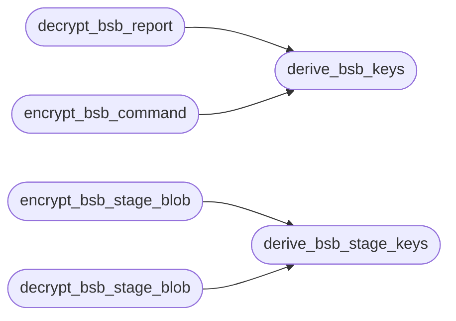

# `modules.bsb_compat`

> Source: [modules/bsb_compat.py:1](../../modules/bsb_compat.py#L1) | language `py` | coverage 100.0% | [API index](../index.md)

BlackSandBeacon wire-protocol compatibility helpers.

BlackSandBeacon beacons derive their working AES key from the raw C2 key
material with HKDF-SHA256 (salt ``blacksandbeacon-v2``, info ``enc`` /
``hmac``), so their traffic never uses the on-disk key directly. Every
beacon report also carries a replay-protection envelope: the plaintext is
``counter (8 bytes LE) || timestamp (8 bytes LE) || payload``.

The C2 speaks the legacy protocol (raw key, no envelope) for its own
beacons, so these helpers derive the matching BSB keys from the same
on-disk key file and decode the envelope. Result handling tries the
legacy format first and falls back to BSB, so both client families check
in against the same C2.

Contracts:
    - `[`derive_bsb_keys`](#derive_bsb_keys)`: HKDF-SHA256 key separation matching BSB's C code.
    - `[`decrypt_bsb_report`](#decrypt_bsb_report)`: decode one BSB report (b64 IV + ciphertext).
    - `[`encrypt_bsb_command`](#encrypt_bsb_command)`: legacy wire format under the BSB-derived key.

## Contents

- **Functions:** [`derive_bsb_keys`](#derive_bsb_keys), [`decrypt_bsb_report`](#decrypt_bsb_report), [`encrypt_bsb_command`](#encrypt_bsb_command), [`derive_bsb_stage_keys`](#derive_bsb_stage_keys), [`encrypt_bsb_stage_blob`](#encrypt_bsb_stage_blob), [`decrypt_bsb_stage_blob`](#decrypt_bsb_stage_blob)
- **Constants:** [`HKDF_SALT`](#hkdf_salt), [`STAGE_HKDF_SALT`](#stage_hkdf_salt), [`REPLAY_HEADER_BYTES`](#replay_header_bytes)

## Call Graph

Solid arrows stay in this module, dashed arrows leave it.



## Functions

<a id="derive_bsb_keys"></a>

### `derive_bsb_keys`

`function` | [modules/bsb_compat.py:52](../../modules/bsb_compat.py#L52)

```python
def derive_bsb_keys(master_key: bytes) -> tuple[bytes, bytes]
```

Derive the BSB encryption and HMAC keys from the raw C2 key.

**Parameters**

| Name | Type | Default | Description |
|---|---|---|---|
| `master_key` | `bytes` |  | Raw 32-byte key material (the ``sessions/key.aes`` contents beacons were configured with). |

**Returns:** `tuple[bytes, bytes]` - ``(encryption_key, hmac_key)``, both 32 bytes. Derived values are
cached and recomputed only when the source key rotates.

**Raises**

- `ValueError`: Key material is not exactly 32 bytes.

*Called by:* [`decrypt_bsb_report`](#decrypt_bsb_report), [`encrypt_bsb_command`](#encrypt_bsb_command)

---

<a id="decrypt_bsb_report"></a>

### `decrypt_bsb_report`

`function` | [modules/bsb_compat.py:90](../../modules/bsb_compat.py#L90)

```python
def decrypt_bsb_report(encrypted_data: bytes | str, master_key: bytes, replay_window_seconds: int = DEFAULT_REPLAY_WINDOW_S) -> tuple[dict, int, int]
```

Decrypt and decode one BSB report.

**Parameters**

| Name | Type | Default | Description |
|---|---|---|---|
| `encrypted_data` | `bytes \| str` |  | Base64 text (or bytes of it) as sent by the beacon: ``b64(IV \|\| AES-256-CFB ciphertext)``. |
| `master_key` | `bytes` |  | Raw 32-byte C2 key material. |
| `replay_window_seconds` | `int` | `DEFAULT_REPLAY_WINDOW_S` | Accepted past timestamp window. |

**Returns:** `tuple[dict, int, int]` - ``(payload_dict, counter, timestamp)`` on success.

**Raises**

- `ValueError`: Malformed base64, decryption failure, replay envelope out of bounds, or the payload is not valid JSON.

*Calls:* [`derive_bsb_keys`](#derive_bsb_keys)

*Called by:* [`receive_report_bsb`](lazyc2.py.md#receive_report_bsb), [`receive_result`](lazyc2.py.md#receive_result)

---

<a id="encrypt_bsb_command"></a>

### `encrypt_bsb_command`

`function` | [modules/bsb_compat.py:139](../../modules/bsb_compat.py#L139)

```python
def encrypt_bsb_command(data: bytes, master_key: bytes) -> str
```

Encrypt one command for a BSB beacon in the legacy wire format.

BSB beacons poll with ``GET /command/<id>`` and decrypt the response
body as ``b64(IV || ciphertext)`` under their HKDF-derived encryption
key, so the C2 must produce exactly that under the same key.

**Parameters**

| Name | Type | Default | Description |
|---|---|---|---|
| `data` | `bytes` |  | Command text (empty bytes allowed). |
| `master_key` | `bytes` |  | Raw 32-byte C2 key material. |

**Returns:** `str` - Base64 string of ``IV || ciphertext`` ready as the response body.

*Calls:* [`derive_bsb_keys`](#derive_bsb_keys)

---

<a id="derive_bsb_stage_keys"></a>

### `derive_bsb_stage_keys`

`function` | [modules/bsb_compat.py:162](../../modules/bsb_compat.py#L162)

```python
def derive_bsb_stage_keys(token: str) -> tuple[bytes, bytes]
```

Derive the staging encryption and HMAC keys from a staging token.

Mirrors the diskless stager contract (``c2/stage_payload.py`` and
``c2/server.py``): HKDF-SHA256 over the UTF-8 token with salt
``blacksandbeacon-stage-v2`` and info ``stage-enc`` / ``stage-hmac``.

**Parameters**

| Name | Type | Default | Description |
|---|---|---|---|
| `token` | `str` |  | Staging token shared between the C2 and the stager. |

**Returns:** `tuple[bytes, bytes]` - ``(encryption_key, hmac_key)``, both 32 bytes. Derived values are
cached and recomputed only when the token rotates.

**Raises**

- `ValueError`: Token is empty.

*Called by:* [`decrypt_bsb_stage_blob`](#decrypt_bsb_stage_blob), [`encrypt_bsb_stage_blob`](#encrypt_bsb_stage_blob)

---

<a id="encrypt_bsb_stage_blob"></a>

### `encrypt_bsb_stage_blob`

`function` | [modules/bsb_compat.py:208](../../modules/bsb_compat.py#L208)

```python
def encrypt_bsb_stage_blob(data: bytes, token: str) -> str
```

Encrypt one staging payload in the diskless-stager wire format.

The stager decodes ``b64(IV || AES-256-CFB ciphertext || HMAC-SHA256
tag)`` where the tag covers ``IV || ciphertext`` and both keys are
HKDF-derived from the staging token, so the C2 must produce exactly
that layout.

**Parameters**

| Name | Type | Default | Description |
|---|---|---|---|
| `data` | `bytes` |  | Payload bytes (ELF image or config JSON). |
| `token` | `str` |  | Staging token shared with the beacon stager. |

**Returns:** `str` - Base64 string ready as the response body.

*Calls:* [`derive_bsb_stage_keys`](#derive_bsb_stage_keys)

*Called by:* [`stage_beacon_fileless`](lazyc2.py.md#stage_beacon_fileless), [`stage_config_fileless`](lazyc2.py.md#stage_config_fileless)

---

<a id="decrypt_bsb_stage_blob"></a>

### `decrypt_bsb_stage_blob`

`function` | [modules/bsb_compat.py:232](../../modules/bsb_compat.py#L232)

```python
def decrypt_bsb_stage_blob(encrypted_data: bytes | str, token: str) -> bytes
```

Decode one staging payload exactly the way the upstream stager does.

**Parameters**

| Name | Type | Default | Description |
|---|---|---|---|
| `encrypted_data` | `bytes \| str` |  | ``b64(IV \|\| ciphertext \|\| tag)`` as produced by [`encrypt_bsb_stage_blob`](#encrypt_bsb_stage_blob). |
| `token` | `str` |  | Staging token shared with the C2. |

**Returns:** `bytes` - The plaintext payload bytes.

**Raises**

- `ValueError`: Malformed base64, bad tag, or decryption failure.

*Calls:* [`derive_bsb_stage_keys`](#derive_bsb_stage_keys)

---

## Constants

<a id="hkdf_salt"></a>

### `HKDF_SALT`

`constant` | [modules/bsb_compat.py:38](../../modules/bsb_compat.py#L38)

```python
HKDF_SALT = b'blacksandbeacon-v2'
```

---

<a id="stage_hkdf_salt"></a>

### `STAGE_HKDF_SALT`

`constant` | [modules/bsb_compat.py:41](../../modules/bsb_compat.py#L41)

```python
STAGE_HKDF_SALT = b'blacksandbeacon-stage-v2'
```

---

<a id="replay_header_bytes"></a>

### `REPLAY_HEADER_BYTES`

`constant` | [modules/bsb_compat.py:44](../../modules/bsb_compat.py#L44)

```python
REPLAY_HEADER_BYTES = 16
```

---
