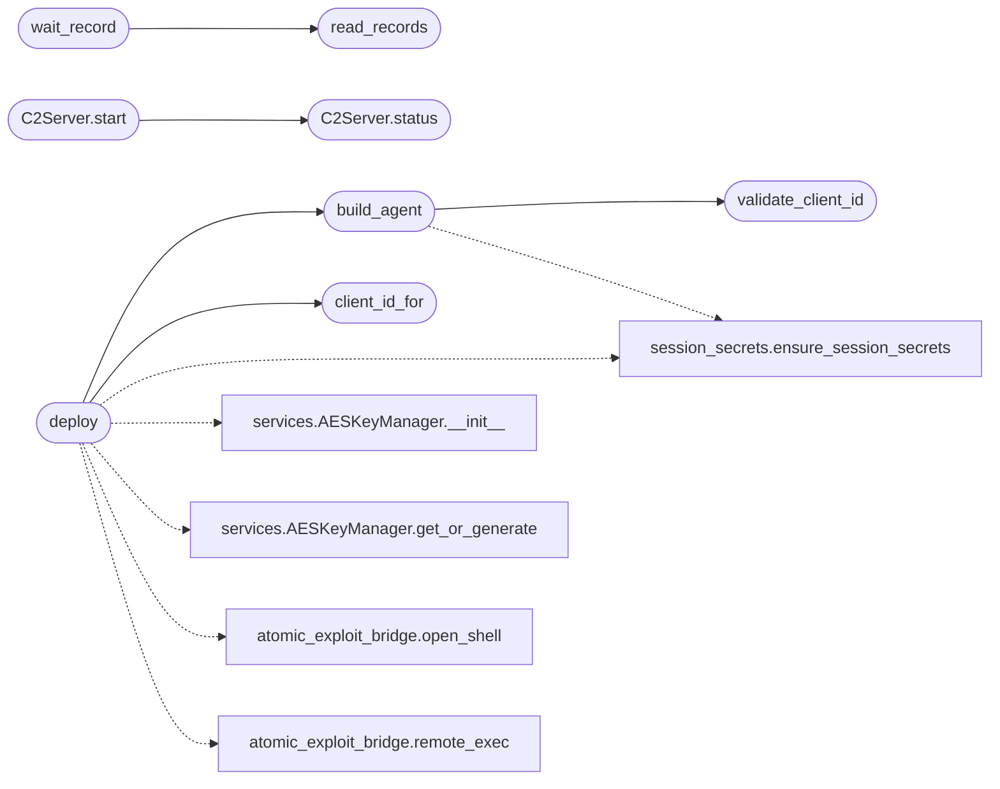

# `modules.c2_agent`

> Source: [modules/c2_agent.py:1](../../modules/c2_agent.py#L1) | language `py` | coverage 92.9% | [API index](../index.md)

Malleable C2 client lifecycle for lab targets.

Builds a minimal stdlib-only polling agent (python2.5-era compatible:
urllib2 + openssl CLI, no third-party deps) that speaks the lazyc2
beacon protocol, manages a headless lazyc2 server process, and reads
per-client answers from ``sessions/<client_id>.records.jsonl``.

Protocol (lazyc2 classic, AES-256-CFB + base64 framing):
    poll    GET  {url}{route}{client_id}          -> enc("") when idle
    result  POST {url}{route}{client_id}          -> enc(result JSON)
    pull    GET  {url}/download/{file}            -> enc(file bytes)
    push    POST {url}/upload (multipart, "file") -> loot lands in uploads/

Agent special commands (issued like any other command):
    download:<path>  pull a C2-staged file down to the implant
    upload:<path>    push an implant file up to C2 (the loot primitive)

Security invariants:
    1. Lab and in-scope targets only; the manager binds loopback + lab
       HTTP listeners, never 0.0.0.0 without operator intent.
    2. No shell execution on import; execution happens only through
       explicit start()/deploy() calls with timeouts.
    3. All C2 API calls use operator basic-auth; the agent channel
       itself is AES-encrypted like every other beacon.

## Contents

- **Classes:** [`C2Server`](#c2server)
- **Functions:** [`client_id_for`](#client_id_for), [`validate_client_id`](#validate_client_id), [`build_agent`](#build_agent), [`read_aes_hex`](#read_aes_hex), [`deploy`](#deploy), [`read_records`](#read_records), [`wait_record`](#wait_record)
- **Constants:** [`ROOT_PRIVILEGE`](#root_privilege), [`LOW_PRIVILEGE`](#low_privilege), [`AGENT_TEMPLATE`](#agent_template)

## Call Graph

Solid arrows stay in this module, dashed arrows leave it.



## Classes

<a id="c2server"></a>

### `C2Server`

`class` | [modules/c2_agent.py:673](../../modules/c2_agent.py#L673)

```python
class C2Server
```

Headless lazyc2 lifecycle (start in background, status, stop).

**Members**

| Member | Kind | Summary |
|---|---|---|
| [`__init__`](#c2server-__init__) | constructor |  |
| [`status`](#c2server-status) | method | Report server liveness and listener reachability. |
| [`start`](#c2server-start) | method | Start lazyc2 headless (no-op when already running). |
| [`stop`](#c2server-stop) | method | Stop the headless server (SIGTERM, best-effort). |
| [`ensure_http_listener`](#c2server-ensure_http_listener) | method | Add + start a plaintext lab listener via the C2 API (py2 agents lack TLS). |

<a id="c2server-__init__"></a>

#### `C2Server.__init__`

`constructor` | [modules/c2_agent.py:676](../../modules/c2_agent.py#L676)

```python
def __init__(self, port: int = 4444, user: str = '', password: str = '') -> None
```

**Parameters**

| Name | Type | Default | Description |
|---|---|---|---|
| `port` | `int` | `4444` |  |
| `user` | `str` | `''` |  |
| `password` | `str` | `''` |  |

*Called by:* [`C2SessionCommandSet.do_c2_reboot`](cli.commands.c2_session.py.md#c2sessioncommandset-do_c2_reboot)

<a id="c2server-status"></a>

#### `C2Server.status`

`method` | [modules/c2_agent.py:693](../../modules/c2_agent.py#L693)

```python
def status(self) -> dict[str, Any]
```

Report server liveness and listener reachability.

**Returns:** `dict[str, Any]`

*Called by:* [`C2SessionCommandSet.do_c2_reboot`](cli.commands.c2_session.py.md#c2sessioncommandset-do_c2_reboot), [`C2Server.start`](#c2server-start)

<a id="c2server-start"></a>

#### `C2Server.start`

`method` | [modules/c2_agent.py:725](../../modules/c2_agent.py#L725)

```python
def start(self) -> dict[str, Any]
```

Start lazyc2 headless (no-op when already running).

**Returns:** `dict[str, Any]`

*Calls:* [`C2Server.status`](#c2server-status)

*Called by:* [`C2SessionCommandSet.do_c2_reboot`](cli.commands.c2_session.py.md#c2sessioncommandset-do_c2_reboot)

<a id="c2server-stop"></a>

#### `C2Server.stop`

`method` | [modules/c2_agent.py:756](../../modules/c2_agent.py#L756)

```python
def stop(self) -> dict[str, Any]
```

Stop the headless server (SIGTERM, best-effort).

**Returns:** `dict[str, Any]`

*Called by:* [`C2SessionCommandSet.do_c2_reboot`](cli.commands.c2_session.py.md#c2sessioncommandset-do_c2_reboot)

<a id="c2server-ensure_http_listener"></a>

#### `C2Server.ensure_http_listener`

`method` | [modules/c2_agent.py:779](../../modules/c2_agent.py#L779)

```python
def ensure_http_listener(self, http_port: int, auth: tuple[str, str]) -> dict[str, Any]
```

Add + start a plaintext lab listener via the C2 API (py2 agents lack TLS).

Idempotent: returns the existing listener when the port is taken.

**Parameters**

| Name | Type | Default | Description |
|---|---|---|---|
| `http_port` | `int` |  |  |
| `auth` | `tuple[str, str]` |  |  |

**Returns:** `dict[str, Any]`

*Called by:* [`C2SessionCommandSet.do_c2_reboot`](cli.commands.c2_session.py.md#c2sessioncommandset-do_c2_reboot)

---

## Functions

<a id="client_id_for"></a>

### `client_id_for`

`function` | [modules/c2_agent.py:88](../../modules/c2_agent.py#L88)

```python
def client_id_for(target: str, privilege: str = LOW_PRIVILEGE) -> str
```

Derive a stable, file-safe client id from a target IP.

Root-profile deployments get a ``-root`` suffix so one box can hold
two parallel C2 clients (a low-priv foothold and an elevated one)
without sharing command queues or beacon logs.

**Parameters**

| Name | Type | Default | Description |
|---|---|---|---|
| `target` | `str` |  | Victim address. |
| `privilege` | `str` | `LOW_PRIVILEGE` | ``lowpriv`` (default) or `[`root`](modules.workspace.py.md#root)`. |

**Returns:** `str` - Deterministic client id like ``msf-10-0-0-5-root``.

**Raises**

- `ValueError`: Unknown privilege value.

*Called by:* [`C2SessionCommandSet.do_c2_loot`](cli.commands.c2_session.py.md#c2sessioncommandset-do_c2_loot), [`deploy`](#deploy)

---

<a id="validate_client_id"></a>

### `validate_client_id`

`function` | [modules/c2_agent.py:113](../../modules/c2_agent.py#L113)

```python
def validate_client_id(raw: str) -> str
```

Validate a client id (alphanumerics, dash, underscore).

**Parameters**

| Name | Type | Default | Description |
|---|---|---|---|
| `raw` | `str` |  |  |

**Returns:** `str`

**Raises**

- `ValueError`: (raised in the body, not documented)

*Called by:* [`C2SessionCommandSet.do_c2_exec`](cli.commands.c2_session.py.md#c2sessioncommandset-do_c2_exec), [`C2SessionCommandSet.do_c2_loot`](cli.commands.c2_session.py.md#c2sessioncommandset-do_c2_loot), [`build_agent`](#build_agent)

---

<a id="build_agent"></a>

### `build_agent`

`function` | [modules/c2_agent.py:388](../../modules/c2_agent.py#L388)

```python
def build_agent(c2_url: str, client_id: str, aes_hex: str, rat_key: str = '', route: str = '', sleep: int = 10, privilege: str = LOW_PRIVILEGE) -> str
```

Render the agent script for a target (pure function, no I/O).

**Parameters**

| Name | Type | Default | Description |
|---|---|---|---|
| `c2_url` | `str` |  | Base C2 URL (http or https). |
| `client_id` | `str` |  | Stable target-id handle for command pairing. |
| `aes_hex` | `str` |  | Shared 64-hex AES-256 key. |
| `rat_key` | `str` | `''` | Session HMAC signing key (64-hex) for X-Signature headers. |
| `route` | `str` | `''` | Malleable listener route (default ``/``). |
| `sleep` | `int` | `10` | Beacon sleep seconds, clamped 2..300. |
| `privilege` | `str` | `LOW_PRIVILEGE` | ``lowpriv`` (default) or `[`root`](modules.workspace.py.md#root)` profile — only the client id embedding differs. |

**Returns:** `str` - The full python2-compatible agent source.

**Raises**

- `ValueError`: Bad key format, URL scheme or privilege value.

*Calls:* [`ensure_session_secrets`](core.session_secrets.py.md#ensure_session_secrets), [`validate_client_id`](#validate_client_id)

*Called by:* [`deploy`](#deploy)

---

<a id="read_aes_hex"></a>

### `read_aes_hex`

`function` | [modules/c2_agent.py:517](../../modules/c2_agent.py#L517)

```python
def read_aes_hex() -> str
```

Read the live C2 AES key hex (snapshotted, never generated).

**Returns:** `str`

---

<a id="deploy"></a>

### `deploy`

`function` | [modules/c2_agent.py:522](../../modules/c2_agent.py#L522)

```python
def deploy(target: str, c2_base: str, route: str = '', lhost: str = '127.0.0.1', sleep: int = 10, privilege: str = LOW_PRIVILEGE) -> dict[str, Any]
```

Deliver + launch the agent on *target* via a working shell primitive.

Uses the highest-ranked exec-capable exploit to drop the rendered
agent, chmod +x, and launch it detached. Returns the client id and
a callback-wait summary. ``privilege="root"`` restricts the shell
primitive to root-capable exploits and stages the binary under a
different name so a low-priv agent on the same box keeps running.

**Parameters**

| Name | Type | Default | Description |
|---|---|---|---|
| `target` | `str` |  | Victim address. |
| `c2_base` | `str` |  | Listener base URL (e.g. ``http://172.17.0.1:8080``). |
| `route` | `str` | `''` | Malleable route (default ``/``). |
| `lhost` | `str` | `'127.0.0.1'` | Attacker address for shell triggers. |
| `sleep` | `int` | `10` | Beacon sleep seconds (clamped 2..300). |
| `privilege` | `str` | `LOW_PRIVILEGE` | ``lowpriv`` (default) or `[`root`](modules.workspace.py.md#root)` profile. |

**Returns:** `dict[str, Any]` - Deployment dict: ``deployed``, ``client_id``, `[`via`](modules.emulation_runner.py.md#emulationreport-via)`, `[`staged`](modules.emulation_runner.py.md#emulationreport-staged)`,
``size_ok``, ``agent_running`` and snippets.

**Raises**

- `ValueError`: Unknown privilege value.
- `RuntimeError`: (raised in the body, not documented)

*Calls:* [`ensure_session_secrets`](core.session_secrets.py.md#ensure_session_secrets), [`AESKeyManager.__init__`](lazyc2.security.services.py.md#aeskeymanager-__init__), [`AESKeyManager.get_or_generate`](lazyc2.security.services.py.md#aeskeymanager-get_or_generate), [`open_shell`](modules.atomic_exploit_bridge.py.md#open_shell), [`remote_exec`](modules.atomic_exploit_bridge.py.md#remote_exec), [`build_agent`](#build_agent), [`client_id_for`](#client_id_for)

*Called by:* [`C2SessionCommandSet.do_c2_deploy`](cli.commands.c2_session.py.md#c2sessioncommandset-do_c2_deploy)

---

<a id="read_records"></a>

### `read_records`

`function` | [modules/c2_agent.py:642](../../modules/c2_agent.py#L642)

```python
def read_records(client_id: str, limit: int = 20) -> list[dict[str, Any]]
```

Read the latest beacon records for a client (newest last).

**Parameters**

| Name | Type | Default | Description |
|---|---|---|---|
| `client_id` | `str` |  |  |
| `limit` | `int` | `20` |  |

**Returns:** `list[dict[str, Any]]`

*Called by:* [`wait_record`](#wait_record)

---

<a id="wait_record"></a>

### `wait_record`

`function` | [modules/c2_agent.py:659](../../modules/c2_agent.py#L659)

```python
def wait_record(client_id: str, command: str, since: int = 0, timeout: int = 60) -> dict[str, Any] | None
```

Wait for a fresh record matching *command* (polls the JSONL log).

**Parameters**

| Name | Type | Default | Description |
|---|---|---|---|
| `client_id` | `str` |  |  |
| `command` | `str` |  |  |
| `since` | `int` | `0` |  |
| `timeout` | `int` | `60` |  |

**Returns:** `dict[str, Any] | None`

*Calls:* [`read_records`](#read_records)

*Called by:* [`C2SessionCommandSet.do_c2_exec`](cli.commands.c2_session.py.md#c2sessioncommandset-do_c2_exec), [`C2SessionCommandSet.do_c2_loot`](cli.commands.c2_session.py.md#c2sessioncommandset-do_c2_loot)

---

## Constants

<a id="root_privilege"></a>

### `ROOT_PRIVILEGE`

`constant` | [modules/c2_agent.py:47](../../modules/c2_agent.py#L47)

```python
ROOT_PRIVILEGE = 'root'
```

---

<a id="low_privilege"></a>

### `LOW_PRIVILEGE`

`constant` | [modules/c2_agent.py:48](../../modules/c2_agent.py#L48)

```python
LOW_PRIVILEGE = 'lowpriv'
```

---

<a id="agent_template"></a>

### `AGENT_TEMPLATE`

`constant` | [modules/c2_agent.py:121](../../modules/c2_agent.py#L121)

```python
AGENT_TEMPLATE
```

---
