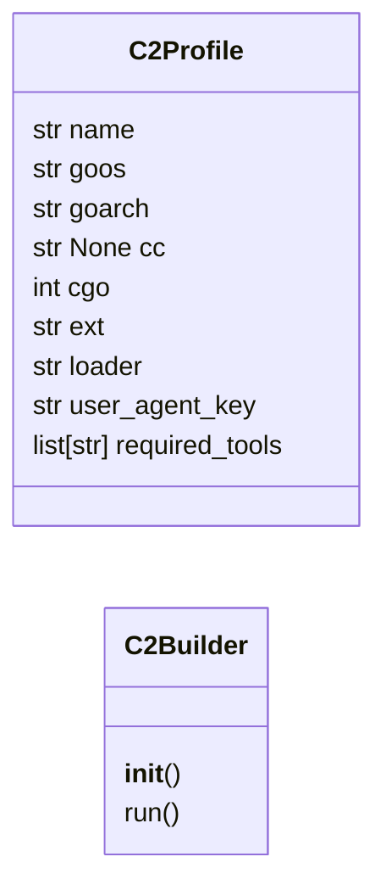
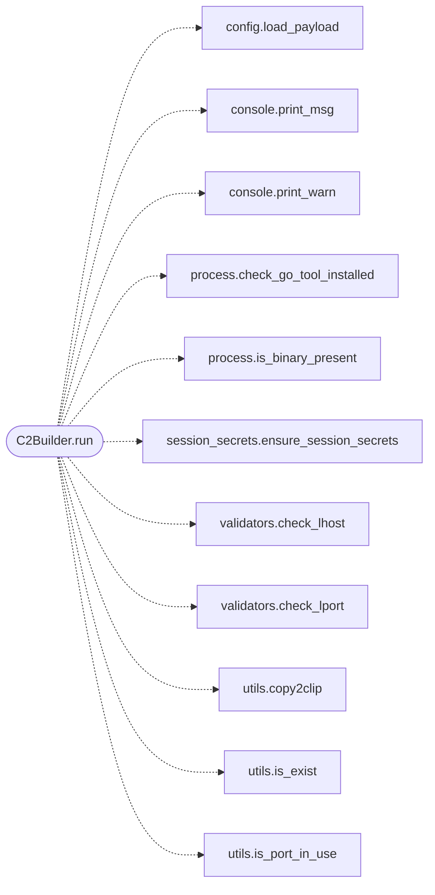

# `modules.c2_builder`

> Source: [modules/c2_builder.py:1](../../modules/c2_builder.py#L1) | language `py` | coverage 80.0% | [API index](../index.md)

C2 agent builder with profile-driven compilation and safe templating.

Extracted from ``LazyOwnShell.do_c2`` to reduce the 520-line god-method
into a testable, profile-driven builder.

## Contents

- **Classes:** [`C2Profile`](#c2profile), [`C2Builder`](#c2builder)
- **Constants:** [`C2_PROFILES`](#c2_profiles)

## Type Diagram



## Call Graph

Solid arrows stay in this module, dashed arrows leave it.



## Classes

<a id="c2profile"></a>

### `C2Profile`

`class` `dataclass` | [modules/c2_builder.py:77](../../modules/c2_builder.py#L77)

Decorators: `@dataclass(frozen=True)`

```python
class C2Profile
```

Compilation profile for a target platform.

**Attributes**

| Name | Type | Default | Description |
|---|---|---|---|
| [`name`](#c2profile-name) | `str` |  |  |
| [`goos`](#c2profile-goos) | `str` |  |  |
| [`goarch`](#c2profile-goarch) | `str` |  |  |
| [`cc`](#c2profile-cc) | `str \| None` |  |  |
| [`cgo`](#c2profile-cgo) | `int` |  |  |
| [`ext`](#c2profile-ext) | `str` |  |  |
| [`loader`](#c2profile-loader) | `str` |  |  |
| [`user_agent_key`](#c2profile-user_agent_key) | `str` |  |  |
| [`required_tools`](#c2profile-required_tools) | `list[str]` | `field(default_factory=list)` |  |

---

<a id="c2builder"></a>

### `C2Builder`

`class` | [modules/c2_builder.py:449](../../modules/c2_builder.py#L449)

```python
class C2Builder
```

Build C2 agents for multiple platforms.

**Members**

| Member | Kind | Summary |
|---|---|---|
| [`__init__`](#c2builder-__init__) | constructor |  |
| [`run`](#c2builder-run) | method | Execute the full C2 build pipeline. |

<a id="c2builder-__init__"></a>

#### `C2Builder.__init__`

`constructor` | [modules/c2_builder.py:452](../../modules/c2_builder.py#L452)

```python
def __init__(self, params: dict[str, Any], sessions_dir: str, cmd_fn: Callable[[str], Any], onecmd_fn: Callable[[str], Any], toastr_fn: Callable[[str, str], Any], c2_user: str, c2_pass: str)
```

**Parameters**

| Name | Type | Default | Description |
|---|---|---|---|
| `params` | `dict[str, Any]` |  |  |
| `sessions_dir` | `str` |  |  |
| `cmd_fn` | `Callable[[str], Any]` |  |  |
| `onecmd_fn` | `Callable[[str], Any]` |  |  |
| `toastr_fn` | `Callable[[str, str], Any]` |  |  |
| `c2_user` | `str` |  |  |
| `c2_pass` | `str` |  |  |

*Called by:* [`CommandAndControlMigratedCommandSet.do_c2`](cli.commands.command_and_control_migrated.py.md#commandandcontrolmigratedcommandset-do_c2)

<a id="c2builder-run"></a>

#### `C2Builder.run`

`method` | [modules/c2_builder.py:510](../../modules/c2_builder.py#L510)

```python
def run(self, line: str, choice: str | None, use_tunnel: bool) -> dict[str, Any]
```

Execute the full C2 build pipeline.

Returns a dict with build artefacts and metadata so the caller can
update shell state (`[`c2_url`](modules.beacon_config_builder.py.md#beaconconfig-c2_url)`, ``c2_clientid``, ``c2_auth``).

**Parameters**

| Name | Type | Default | Description |
|---|---|---|---|
| `line` | `str` |  |  |
| `choice` | `str \| None` |  |  |
| `use_tunnel` | `bool` |  |  |

**Returns:** `dict[str, Any]`

*Calls:* [`load_payload`](core.config.py.md#load_payload), [`print_msg`](core.console.py.md#print_msg), [`print_warn`](core.console.py.md#print_warn), [`check_go_tool_installed`](core.process.py.md#check_go_tool_installed), [`is_binary_present`](core.process.py.md#is_binary_present), [`ensure_session_secrets`](core.session_secrets.py.md#ensure_session_secrets), [`check_lhost`](core.validators.py.md#check_lhost), [`check_lport`](core.validators.py.md#check_lport), [`copy2clip`](utils.py.md#copy2clip), [`is_exist`](utils.py.md#is_exist), [`is_port_in_use`](utils.py.md#is_port_in_use)

*Called by:* [`CommandAndControlMigratedCommandSet.do_c2`](cli.commands.command_and_control_migrated.py.md#commandandcontrolmigratedcommandset-do_c2)

---

## Constants

<a id="c2_profiles"></a>

### `C2_PROFILES`

`constant` | [modules/c2_builder.py:91](../../modules/c2_builder.py#L91)

```python
C2_PROFILES: dict[str, C2Profile]
```

---
