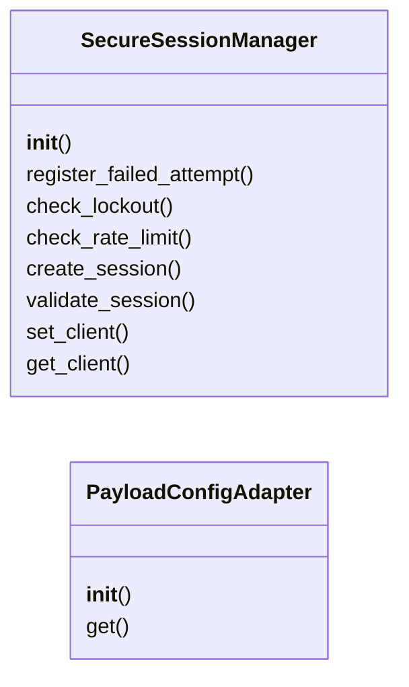

# `modules.c2_messaging_base`

> Source: [modules/c2_messaging_base.py:1](../../modules/c2_messaging_base.py#L1) | language `py` | coverage 84.6% | [API index](../index.md)

## Contents

- **Classes:** [`SecureSessionManager`](#securesessionmanager), [`PayloadConfigAdapter`](#payloadconfigadapter)
- **Constants:** [`MAX_FAILED_ATTEMPTS`](#max_failed_attempts), [`RATE_LIMIT`](#rate_limit), [`SESSION_TIMEOUT`](#session_timeout)

## Type Diagram



## Classes

<a id="securesessionmanager"></a>

### `SecureSessionManager`

`class` | [modules/c2_messaging_base.py:9](../../modules/c2_messaging_base.py#L9)

```python
class SecureSessionManager
```

Unified session manager for C2 messaging bots.

Provides login, rate limiting, lockout, and session validation
shared across Discord, Telegram, and Slack C2 bots.

**Parameters**

| Name | Type | Default | Description |
|---|---|---|---|
| `max_failed_attempts` |  |  | Maximum failed login attempts before lockout. |
| `lockout_duration` |  |  | Lockout duration in seconds. |
| `rate_limit` |  |  | Maximum commands per 60-second window. |
| `session_timeout` |  |  | Session inactivity timeout in seconds. |

**Members**

| Member | Kind | Summary |
|---|---|---|
| [`__init__`](#securesessionmanager-__init__) | constructor |  |
| [`register_failed_attempt`](#securesessionmanager-register_failed_attempt) | method | Record a failed authentication attempt for a user. |
| [`check_lockout`](#securesessionmanager-check_lockout) | method | Check if a user is currently locked out due to failed attempts. |
| [`check_rate_limit`](#securesessionmanager-check_rate_limit) | method | Check if a user has exceeded the command rate limit. |
| [`create_session`](#securesessionmanager-create_session) | method | Create a new authenticated session for a user. |
| [`validate_session`](#securesessionmanager-validate_session) | method | Check if a user session is still valid and refresh activity timestamp. |
| [`set_client`](#securesessionmanager-set_client) | method | Assign a target C2 client to a user session. |
| [`get_client`](#securesessionmanager-get_client) | method | Get the target C2 client assigned to a user session. |

<a id="securesessionmanager-__init__"></a>

#### `SecureSessionManager.__init__`

`constructor` | [modules/c2_messaging_base.py:22](../../modules/c2_messaging_base.py#L22)

```python
def __init__(self, max_failed_attempts: int = MAX_FAILED_ATTEMPTS, lockout_duration: int = 3600, rate_limit: int = RATE_LIMIT, session_timeout: int = SESSION_TIMEOUT)
```

**Parameters**

| Name | Type | Default | Description |
|---|---|---|---|
| `max_failed_attempts` | `int` | `MAX_FAILED_ATTEMPTS` | Maximum failed login attempts before lockout. |
| `lockout_duration` | `int` | `3600` | Lockout duration in seconds. |
| `rate_limit` | `int` | `RATE_LIMIT` | Maximum commands per 60-second window. |
| `session_timeout` | `int` | `SESSION_TIMEOUT` | Session inactivity timeout in seconds. |

<a id="securesessionmanager-register_failed_attempt"></a>

#### `SecureSessionManager.register_failed_attempt`

`method` | [modules/c2_messaging_base.py:37](../../modules/c2_messaging_base.py#L37)

```python
def register_failed_attempt(self, user_id: int) -> None
```

Record a failed authentication attempt for a user.

**Parameters**

| Name | Type | Default | Description |
|---|---|---|---|
| `user_id` | `int` |  |  |

<a id="securesessionmanager-check_lockout"></a>

#### `SecureSessionManager.check_lockout`

`method` | [modules/c2_messaging_base.py:46](../../modules/c2_messaging_base.py#L46)

```python
def check_lockout(self, user_id: int) -> bool
```

Check if a user is currently locked out due to failed attempts.

**Parameters**

| Name | Type | Default | Description |
|---|---|---|---|
| `user_id` | `int` |  |  |

**Returns:** `bool` - True if locked out, False otherwise.

<a id="securesessionmanager-check_rate_limit"></a>

#### `SecureSessionManager.check_rate_limit`

`method` | [modules/c2_messaging_base.py:61](../../modules/c2_messaging_base.py#L61)

```python
def check_rate_limit(self, user_id: int) -> bool
```

Check if a user has exceeded the command rate limit.

**Parameters**

| Name | Type | Default | Description |
|---|---|---|---|
| `user_id` | `int` |  |  |

**Returns:** `bool` - True if allowed, False if rate-limited.

<a id="securesessionmanager-create_session"></a>

#### `SecureSessionManager.create_session`

`method` | [modules/c2_messaging_base.py:79](../../modules/c2_messaging_base.py#L79)

```python
def create_session(self, user_id: int, client_id: str | None = None) -> None
```

Create a new authenticated session for a user.

**Parameters**

| Name | Type | Default | Description |
|---|---|---|---|
| `user_id` | `int` |  |  |
| `client_id` | `str \| None` | `None` |  |

<a id="securesessionmanager-validate_session"></a>

#### `SecureSessionManager.validate_session`

`method` | [modules/c2_messaging_base.py:89](../../modules/c2_messaging_base.py#L89)

```python
def validate_session(self, user_id: int) -> bool
```

Check if a user session is still valid and refresh activity timestamp.

**Parameters**

| Name | Type | Default | Description |
|---|---|---|---|
| `user_id` | `int` |  |  |

**Returns:** `bool` - True if session is valid, False otherwise.

<a id="securesessionmanager-set_client"></a>

#### `SecureSessionManager.set_client`

`method` | [modules/c2_messaging_base.py:106](../../modules/c2_messaging_base.py#L106)

```python
def set_client(self, user_id: int, client_id: str) -> None
```

Assign a target C2 client to a user session.

**Parameters**

| Name | Type | Default | Description |
|---|---|---|---|
| `user_id` | `int` |  |  |
| `client_id` | `str` |  |  |

<a id="securesessionmanager-get_client"></a>

#### `SecureSessionManager.get_client`

`method` | [modules/c2_messaging_base.py:111](../../modules/c2_messaging_base.py#L111)

```python
def get_client(self, user_id: int) -> str | None
```

Get the target C2 client assigned to a user session.

**Parameters**

| Name | Type | Default | Description |
|---|---|---|---|
| `user_id` | `int` |  |  |

**Returns:** `str | None`

---

<a id="payloadconfigadapter"></a>

### `PayloadConfigAdapter`

`class` | [modules/c2_messaging_base.py:117](../../modules/c2_messaging_base.py#L117)

```python
class PayloadConfigAdapter
```

Adapter that wraps payload.json dict with attribute access.

**Parameters**

| Name | Type | Default | Description |
|---|---|---|---|
| `config_dict` |  |  | The loaded payload.json dictionary. |

**Members**

| Member | Kind | Summary |
|---|---|---|
| [`__init__`](#payloadconfigadapter-__init__) | constructor |  |
| [`get`](#payloadconfigadapter-get) | method |  |

<a id="payloadconfigadapter-__init__"></a>

#### `PayloadConfigAdapter.__init__`

`constructor` | [modules/c2_messaging_base.py:124](../../modules/c2_messaging_base.py#L124)

```python
def __init__(self, config_dict: dict[str, Any])
```

**Parameters**

| Name | Type | Default | Description |
|---|---|---|---|
| `config_dict` | `dict[str, Any]` |  | The loaded payload.json dictionary. |

<a id="payloadconfigadapter-get"></a>

#### `PayloadConfigAdapter.get`

`method` | [modules/c2_messaging_base.py:132](../../modules/c2_messaging_base.py#L132)

```python
def get(self, key: str, default: Any = None) -> Any
```

**Parameters**

| Name | Type | Default | Description |
|---|---|---|---|
| `key` | `str` |  |  |
| `default` | `Any` | `None` |  |

**Returns:** `Any`

---

## Constants

<a id="max_failed_attempts"></a>

### `MAX_FAILED_ATTEMPTS`

`constant` | [modules/c2_messaging_base.py:4](../../modules/c2_messaging_base.py#L4)

```python
MAX_FAILED_ATTEMPTS = 3
```

---

<a id="rate_limit"></a>

### `RATE_LIMIT`

`constant` | [modules/c2_messaging_base.py:5](../../modules/c2_messaging_base.py#L5)

```python
RATE_LIMIT = 5
```

---

<a id="session_timeout"></a>

### `SESSION_TIMEOUT`

`constant` | [modules/c2_messaging_base.py:6](../../modules/c2_messaging_base.py#L6)

```python
SESSION_TIMEOUT = 1800
```

---
