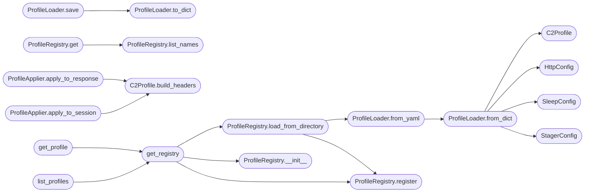

# `modules.c2_profile`

> Source: [modules/c2_profile.py:1](../../modules/c2_profile.py#L1) | language `py` | coverage 92.9% | [API index](../index.md)

modules/c2_profile.py ====================== Malleable C2 profile system for LazyOwn.

Controls beacon HTTP behavior: headers, URIs, sleep timing, jitter,
user-agent, and staging configuration.

Architecture follows SOLID principles:
  - Single Responsibility: each class handles one concern
  - Open/Closed: new profiles registered without modifying existing code
  - Liskov: dataclasses are safely substitutable
  - Interface Segregation: ProfileApplier separates Flask/requests concerns
  - Dependency Inversion: loaders/validators depend on abstractions (dicts/paths)

Usage:
    from modules.c2_profile import get_profile, list_profiles, get_registry

    profile = get_profile("stealth")
    delay   = profile.jitter_delay()
    headers = profile.build_headers("GET")
    uri     = profile.get_uri("POST")

CLI:
    python3 modules/c2_profile.py --list
    python3 modules/c2_profile.py --show stealth

## Contents

- **Classes:** [`SleepConfig`](#sleepconfig), [`HttpConfig`](#httpconfig), [`StagerConfig`](#stagerconfig), [`C2Profile`](#c2profile), [`ProfileValidator`](#profilevalidator), [`ProfileLoader`](#profileloader), [`ProfileRegistry`](#profileregistry), [`ProfileApplier`](#profileapplier)
- **Functions:** [`get_registry`](#get_registry), [`get_profile`](#get_profile), [`list_profiles`](#list_profiles)

## Type Diagram

```mermaid
classDiagram
    direction LR
    class SleepConfig
    SleepConfig : int interval_ms
    SleepConfig : int jitter_pct
    class HttpConfig
    HttpConfig : str method
    HttpConfig : list[str] uri_paths
    HttpConfig : dict[str, str] headers
    HttpConfig : str user_agent
    class StagerConfig
    StagerConfig : bool enabled
    StagerConfig : str stage_uri
    StagerConfig : int max_size_kb
    class C2Profile
    C2Profile : str name
    C2Profile : str description
    C2Profile : SleepConfig sleep
    C2Profile : HttpConfig http_get
    C2Profile : HttpConfig http_post
    C2Profile : StagerConfig stager
    C2Profile : dict[str, str] metadata
    C2Profile : jitter_delay()
    C2Profile : get_uri()
    C2Profile : build_headers()
    class ProfileValidator
    ProfileValidator : validate()
    class ProfileLoader
    ProfileLoader : from_yaml()
    ProfileLoader : from_dict()
    ProfileLoader : to_dict()
    ProfileLoader : save()
    class ProfileRegistry
    ProfileRegistry : __init__()
    ProfileRegistry : register()
    ProfileRegistry : get()
    ProfileRegistry : list_names()
    ProfileRegistry : load_from_directory()
    class ProfileApplier
    ProfileApplier : apply_to_response()
    ProfileApplier : apply_to_session()
    ProfileApplier : get_beacon_config()
```



## Call Graph

Solid arrows stay in this module, dashed arrows leave it.



## Classes

<a id="sleepconfig"></a>

### `SleepConfig`

`class` `dataclass` | [modules/c2_profile.py:54](../../modules/c2_profile.py#L54)

Decorators: `@dataclass`

```python
class SleepConfig
```

Sleep and jitter configuration for a beacon.

**Attributes**

| Name | Type | Default | Description |
|---|---|---|---|
| [`interval_ms`](#sleepconfig-interval_ms) | `int` |  |  |
| [`jitter_pct`](#sleepconfig-jitter_pct) | `int` |  |  |

---

<a id="httpconfig"></a>

### `HttpConfig`

`class` `dataclass` | [modules/c2_profile.py:62](../../modules/c2_profile.py#L62)

Decorators: `@dataclass`

```python
class HttpConfig
```

HTTP request configuration for one direction (GET or POST).

**Attributes**

| Name | Type | Default | Description |
|---|---|---|---|
| [`method`](#httpconfig-method) | `str` |  |  |
| [`uri_paths`](#httpconfig-uri_paths) | `list[str]` |  |  |
| [`headers`](#httpconfig-headers) | `dict[str, str]` |  |  |
| [`user_agent`](#httpconfig-user_agent) | `str` |  |  |

---

<a id="stagerconfig"></a>

### `StagerConfig`

`class` `dataclass` | [modules/c2_profile.py:72](../../modules/c2_profile.py#L72)

Decorators: `@dataclass`

```python
class StagerConfig
```

Staging payload configuration.

**Attributes**

| Name | Type | Default | Description |
|---|---|---|---|
| [`enabled`](#stagerconfig-enabled) | `bool` |  |  |
| [`stage_uri`](#stagerconfig-stage_uri) | `str` |  |  |
| [`max_size_kb`](#stagerconfig-max_size_kb) | `int` |  |  |

---

<a id="c2profile"></a>

### `C2Profile`

`class` `dataclass` | [modules/c2_profile.py:81](../../modules/c2_profile.py#L81)

Decorators: `@dataclass`

```python
class C2Profile
```

Complete malleable C2 profile.

Encapsulates all behavioral parameters that govern how a beacon
communicates over HTTP.

**Attributes**

| Name | Type | Default | Description |
|---|---|---|---|
| [`name`](#c2profile-name) | `str` |  |  |
| [`description`](#c2profile-description) | `str` |  |  |
| [`sleep`](#c2profile-sleep) | `SleepConfig` |  |  |
| [`http_get`](#c2profile-http_get) | `HttpConfig` |  |  |
| [`http_post`](#c2profile-http_post) | `HttpConfig` |  |  |
| [`stager`](#c2profile-stager) | `StagerConfig` |  |  |
| [`metadata`](#c2profile-metadata) | `dict[str, str]` | `field(default_factory=dict)` |  |

**Members**

| Member | Kind | Summary |
|---|---|---|
| [`jitter_delay`](#c2profile-jitter_delay) | method | Return the next sleep delay as a float in seconds. |
| [`get_uri`](#c2profile-get_uri) | method | Pick a random URI path from the appropriate HttpConfig. |
| [`build_headers`](#c2profile-build_headers) | method | Return the headers dict for the given HTTP method. |

<a id="c2profile-jitter_delay"></a>

#### `C2Profile.jitter_delay`

`method` | [modules/c2_profile.py:101](../../modules/c2_profile.py#L101)

```python
def jitter_delay(self) -> float
```

Return the next sleep delay as a float in seconds.

The delay is interval_ms/1000 scaled by a random multiplier in
[1 - jitter_pct/100 , 1 + jitter_pct/100].

**Returns:** `float`

<a id="c2profile-get_uri"></a>

#### `C2Profile.get_uri`

`method` | [modules/c2_profile.py:117](../../modules/c2_profile.py#L117)

```python
def get_uri(self, method: str = 'GET') -> str
```

Pick a random URI path from the appropriate HttpConfig.

**Parameters**

| Name | Type | Default | Description |
|---|---|---|---|
| `method` | `str` | `'GET'` |  |

**Returns:** `str`

<a id="c2profile-build_headers"></a>

#### `C2Profile.build_headers`

`method` | [modules/c2_profile.py:128](../../modules/c2_profile.py#L128)

```python
def build_headers(self, method: str = 'GET') -> dict[str, str]
```

Return the headers dict for the given HTTP method.

The returned dict is a shallow copy; callers may mutate it freely.

**Parameters**

| Name | Type | Default | Description |
|---|---|---|---|
| `method` | `str` | `'GET'` |  |

**Returns:** `dict[str, str]`

*Called by:* [`ProfileApplier.apply_to_response`](#profileapplier-apply_to_response), [`ProfileApplier.apply_to_session`](#profileapplier-apply_to_session)

---

<a id="profilevalidator"></a>

### `ProfileValidator`

`class` | [modules/c2_profile.py:155](../../modules/c2_profile.py#L155)

```python
class ProfileValidator
```

Validates a C2Profile instance.

Returns a list of error strings; an empty list means the profile is valid.

**Members**

| Member | Kind | Summary |
|---|---|---|
| [`validate`](#profilevalidator-validate) | method |  |

<a id="profilevalidator-validate"></a>

#### `ProfileValidator.validate`

`method` | [modules/c2_profile.py:162](../../modules/c2_profile.py#L162)

```python
def validate(self, profile: C2Profile) -> list[str]
```

**Parameters**

| Name | Type | Default | Description |
|---|---|---|---|
| `profile` | `C2Profile` |  |  |

**Returns:** `list[str]`

---

<a id="profileloader"></a>

### `ProfileLoader`

`class` | [modules/c2_profile.py:187](../../modules/c2_profile.py#L187)

```python
class ProfileLoader
```

Loads and saves C2Profile objects from/to YAML or dict representations.

Depends on PyYAML when loading YAML files; falls back with a clear error
if PyYAML is not installed.

**Members**

| Member | Kind | Summary |
|---|---|---|
| [`from_yaml`](#profileloader-from_yaml) | staticmethod | Load a C2Profile from a YAML file at *path*. |
| [`from_dict`](#profileloader-from_dict) | staticmethod | Construct a C2Profile from a plain Python dictionary. |
| [`to_dict`](#profileloader-to_dict) | staticmethod | Convert a C2Profile to a plain Python dictionary. |
| [`save`](#profileloader-save) | staticmethod | Serialise *profile* to a YAML file and return the written path. |

<a id="profileloader-from_yaml"></a>

#### `ProfileLoader.from_yaml`

`staticmethod` | [modules/c2_profile.py:200](../../modules/c2_profile.py#L200)

Decorators: `@staticmethod`

```python
def from_yaml(path: str | Path) -> C2Profile
```

Load a C2Profile from a YAML file at *path*.

**Parameters**

| Name | Type | Default | Description |
|---|---|---|---|
| `path` | `str \| Path` |  |  |

**Returns:** `C2Profile`

**Raises**

- `FileNotFoundError`: (raised in the body, not documented)
- `ImportError`: (raised in the body, not documented)

*Calls:* [`ProfileLoader.from_dict`](#profileloader-from_dict)

*Called by:* [`ProfileRegistry.load_from_directory`](#profileregistry-load_from_directory)

<a id="profileloader-from_dict"></a>

#### `ProfileLoader.from_dict`

`staticmethod` | [modules/c2_profile.py:215](../../modules/c2_profile.py#L215)

Decorators: `@staticmethod`

```python
def from_dict(d: dict[str, Any]) -> C2Profile
```

Construct a C2Profile from a plain Python dictionary.

**Parameters**

| Name | Type | Default | Description |
|---|---|---|---|
| `d` | `dict[str, Any]` |  |  |

**Returns:** `C2Profile`

*Calls:* [`C2Profile`](#c2profile), [`HttpConfig`](#httpconfig), [`SleepConfig`](#sleepconfig), [`StagerConfig`](#stagerconfig)

*Called by:* [`ProfileLoader.from_yaml`](#profileloader-from_yaml)

<a id="profileloader-to_dict"></a>

#### `ProfileLoader.to_dict`

`staticmethod` | [modules/c2_profile.py:254](../../modules/c2_profile.py#L254)

Decorators: `@staticmethod`

```python
def to_dict(profile: C2Profile) -> dict[str, Any]
```

Convert a C2Profile to a plain Python dictionary.

**Parameters**

| Name | Type | Default | Description |
|---|---|---|---|
| `profile` | `C2Profile` |  |  |

**Returns:** `dict[str, Any]`

*Called by:* [`ProfileLoader.save`](#profileloader-save)

<a id="profileloader-save"></a>

#### `ProfileLoader.save`

`staticmethod` | [modules/c2_profile.py:282](../../modules/c2_profile.py#L282)

Decorators: `@staticmethod`

```python
def save(profile: C2Profile, path: str | Path) -> Path
```

Serialise *profile* to a YAML file and return the written path.

**Parameters**

| Name | Type | Default | Description |
|---|---|---|---|
| `profile` | `C2Profile` |  |  |
| `path` | `str \| Path` |  |  |

**Returns:** `Path`

**Raises**

- `ImportError`: (raised in the body, not documented)

*Calls:* [`ProfileLoader.to_dict`](#profileloader-to_dict)

---

<a id="profileregistry"></a>

### `ProfileRegistry`

`class` | [modules/c2_profile.py:449](../../modules/c2_profile.py#L449)

```python
class ProfileRegistry
```

In-memory registry of named C2Profile objects.

Register custom profiles at runtime, or load an entire directory of
YAML files.

**Members**

| Member | Kind | Summary |
|---|---|---|
| [`__init__`](#profileregistry-__init__) | constructor |  |
| [`register`](#profileregistry-register) | method | Register *profile* under *name*, overwriting any previous entry. |
| [`get`](#profileregistry-get) | method | Return the profile registered under *name*. |
| [`list_names`](#profileregistry-list_names) | method | Return a sorted list of all registered profile names. |
| [`load_from_directory`](#profileregistry-load_from_directory) | method | Scan *path* for *.yaml files and register each as a profile. |

<a id="profileregistry-__init__"></a>

#### `ProfileRegistry.__init__`

`constructor` | [modules/c2_profile.py:457](../../modules/c2_profile.py#L457)

```python
def __init__(self) -> None
```

*Called by:* [`get_registry`](#get_registry)

<a id="profileregistry-register"></a>

#### `ProfileRegistry.register`

`method` | [modules/c2_profile.py:464](../../modules/c2_profile.py#L464)

```python
def register(self, name: str, profile: C2Profile) -> None
```

Register *profile* under *name*, overwriting any previous entry.

**Parameters**

| Name | Type | Default | Description |
|---|---|---|---|
| `name` | `str` |  |  |
| `profile` | `C2Profile` |  |  |

*Called by:* [`ProfileRegistry.load_from_directory`](#profileregistry-load_from_directory), [`get_registry`](#get_registry)

<a id="profileregistry-get"></a>

#### `ProfileRegistry.get`

`method` | [modules/c2_profile.py:473](../../modules/c2_profile.py#L473)

```python
def get(self, name: str) -> C2Profile
```

Return the profile registered under *name*.

Raises KeyError if no such profile exists.

**Parameters**

| Name | Type | Default | Description |
|---|---|---|---|
| `name` | `str` |  |  |

**Returns:** `C2Profile`

**Raises**

- `KeyError`: (raised in the body, not documented)

*Calls:* [`ProfileRegistry.list_names`](#profileregistry-list_names)

<a id="profileregistry-list_names"></a>

#### `ProfileRegistry.list_names`

`method` | [modules/c2_profile.py:485](../../modules/c2_profile.py#L485)

```python
def list_names(self) -> list[str]
```

Return a sorted list of all registered profile names.

**Returns:** `list[str]`

*Called by:* [`ProfileRegistry.get`](#profileregistry-get)

<a id="profileregistry-load_from_directory"></a>

#### `ProfileRegistry.load_from_directory`

`method` | [modules/c2_profile.py:493](../../modules/c2_profile.py#L493)

```python
def load_from_directory(self, path: str | Path) -> int
```

Scan *path* for *.yaml files and register each as a profile.

Returns the count of successfully loaded profiles.

**Parameters**

| Name | Type | Default | Description |
|---|---|---|---|
| `path` | `str \| Path` |  |  |

**Returns:** `int`

*Calls:* [`ProfileLoader.from_yaml`](#profileloader-from_yaml), [`ProfileRegistry.register`](#profileregistry-register)

*Called by:* [`get_registry`](#get_registry)

---

<a id="profileapplier"></a>

### `ProfileApplier`

`class` | [modules/c2_profile.py:520](../../modules/c2_profile.py#L520)

```python
class ProfileApplier
```

Applies a C2Profile to Flask responses or requests.Session objects.

This class has no state; all methods are pure functions of their
arguments.

**Members**

| Member | Kind | Summary |
|---|---|---|
| [`apply_to_response`](#profileapplier-apply_to_response) | staticmethod | Patch the headers of a Flask response object to match the profile. |
| [`apply_to_session`](#profileapplier-apply_to_session) | staticmethod | Configure a requests.Session to mimic the profile's HTTP GET behavior. |
| [`get_beacon_config`](#profileapplier-get_beacon_config) | staticmethod | Return a JSON-serialisable dict suitable for embedding in a beacon handshake response. |

<a id="profileapplier-apply_to_response"></a>

#### `ProfileApplier.apply_to_response`

`staticmethod` | [modules/c2_profile.py:529](../../modules/c2_profile.py#L529)

Decorators: `@staticmethod`

```python
def apply_to_response(profile: C2Profile, response: Any) -> Any
```

Patch the headers of a Flask response object to match the profile.

Sets appropriate Cache-Control and removes server-identifying headers.
The response object is mutated in-place and also returned.

**Parameters**

| Name | Type | Default | Description |
|---|---|---|---|
| `profile` | `C2Profile` |  |  |
| `response` | `Any` |  |  |

**Returns:** `Any`

*Calls:* [`C2Profile.build_headers`](#c2profile-build_headers)

<a id="profileapplier-apply_to_session"></a>

#### `ProfileApplier.apply_to_session`

`staticmethod` | [modules/c2_profile.py:554](../../modules/c2_profile.py#L554)

Decorators: `@staticmethod`

```python
def apply_to_session(profile: C2Profile, session: Any) -> Any
```

Configure a requests.Session to mimic the profile's HTTP GET behavior.

Sets headers and User-Agent on *session* and returns it.

**Parameters**

| Name | Type | Default | Description |
|---|---|---|---|
| `profile` | `C2Profile` |  |  |
| `session` | `Any` |  |  |

**Returns:** `Any`

*Calls:* [`C2Profile.build_headers`](#c2profile-build_headers)

<a id="profileapplier-get_beacon_config"></a>

#### `ProfileApplier.get_beacon_config`

`staticmethod` | [modules/c2_profile.py:567](../../modules/c2_profile.py#L567)

Decorators: `@staticmethod`

```python
def get_beacon_config(profile: C2Profile) -> dict[str, Any]
```

Return a JSON-serialisable dict suitable for embedding in a beacon handshake response.

The dict contains only the fields a beacon needs to self-configure;
it does not expose full header details.

**Parameters**

| Name | Type | Default | Description |
|---|---|---|---|
| `profile` | `C2Profile` |  |  |

**Returns:** `dict[str, Any]`

---

## Functions

<a id="get_registry"></a>

### `get_registry`

`function` | [modules/c2_profile.py:595](../../modules/c2_profile.py#L595)

```python
def get_registry() -> ProfileRegistry
```

Return the module-level singleton ProfileRegistry.

On first call, registers the four built-in profiles and then scans the
default profiles directory for additional YAML files.

**Returns:** `ProfileRegistry`

*Calls:* [`ProfileRegistry.__init__`](#profileregistry-__init__), [`ProfileRegistry.load_from_directory`](#profileregistry-load_from_directory), [`ProfileRegistry.register`](#profileregistry-register)

*Called by:* [`get_profile`](#get_profile), [`list_profiles`](#list_profiles)

---

<a id="get_profile"></a>

### `get_profile`

`function` | [modules/c2_profile.py:620](../../modules/c2_profile.py#L620)

```python
def get_profile(name: str) -> C2Profile
```

Return the named profile from the module singleton registry.

**Parameters**

| Name | Type | Default | Description |
|---|---|---|---|
| `name` | `str` |  |  |

**Returns:** `C2Profile`

*Calls:* [`get_registry`](#get_registry)

---

<a id="list_profiles"></a>

### `list_profiles`

`function` | [modules/c2_profile.py:625](../../modules/c2_profile.py#L625)

```python
def list_profiles() -> list[str]
```

Return a sorted list of all registered profile names.

**Returns:** `list[str]`

*Calls:* [`get_registry`](#get_registry)

---
