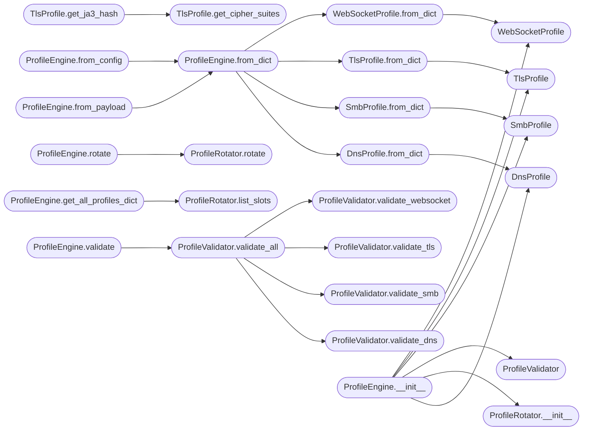

# `modules.c2_profile_engine`

> Source: [modules/c2_profile_engine.py:1](../../modules/c2_profile_engine.py#L1) | language `py` | coverage 95.7% | [API index](../index.md)

Extended malleable C2 profile engine with TLS, DNS, SMB, and WebSocket transports.

Complements ``modules/c2_profile.py`` by adding transport-layer profile types and
profile rotation. The base module handles HTTP profiles; this module extends to
the full transport stack required by modern C2 frameworks.

Contracts:
    - C2TransportProfile: base dataclass for transport profiles
    - TlsProfile: TLS 1.2/1.3 cipher suites, JA3/JA4 fingerprinting config
    - DnsProfile: DNS beacon configuration (A/AAAA/TXT, encoding, jitter)
    - SmbProfile: SMB peer-to-peer named pipe beacon config
    - WebSocketProfile: WebSocket transport with compression and masking
    - ProfileRotator: round-robin profile rotation with cooldown windows
    - ProfileEngine: composition root combining HTTP profiles from c2_profile.py
      with transport profiles defined here

Design (SOLID):
    - Single Responsibility: each class handles one transport concern
    - Open/Closed: new transports registered via dataclass without modifying engine
    - Liskov: all transport profiles are safely substitutable dataclasses
    - Interface Segregation: each profile exposes only its own config surface
    - Dependency Inversion: engine depends on abstract profile dicts, not on Flask

Usage:
    from modules.c2_profile_engine import (
        ProfileEngine,
        TlsProfile,
        DnsProfile,
        SmbProfile,
        WebSocketProfile,
    )

    engine = ProfileEngine.from_payload(payload)
    tls_profile = engine.tls_profile
    dns_profile = engine.dns_profile
    engine.rotate()  # advance to next profile in rotation queue

## Contents

- **Classes:** [`TlsProfile`](#tlsprofile), [`DnsProfile`](#dnsprofile), [`SmbProfile`](#smbprofile), [`WebSocketProfile`](#websocketprofile), [`RotationSlot`](#rotationslot), [`ProfileRotator`](#profilerotator), [`ProfileValidator`](#profilevalidator), [`ProfileEngine`](#profileengine)
- **Enums:** [`TransportType`](#transporttype)
- **Constants:** [`JA3_GREASE_CANDIDATES`](#ja3_grease_candidates), [`LIBRARY_CIPHER_SUITES`](#library_cipher_suites)

## Type Diagram

```mermaid
classDiagram
    direction LR
    class TlsProfile
    TlsProfile : bool enabled
    TlsProfile : str min_version
    TlsProfile : str max_version
    TlsProfile : list[str] cipher_suites
    TlsProfile : str sni_hostname
    TlsProfile : str certificate_path
    TlsProfile : str key_path
    TlsProfile : str ja3_fingerprint_library
    TlsProfile : bool grease_extensions
    TlsProfile : list[str] alpn_protocols
    TlsProfile : get_cipher_suites()
    TlsProfile : get_ja3_hash()
    TlsProfile : from_dict()
    TlsProfile : to_dict()
    class DnsProfile
    DnsProfile : bool enabled
    DnsProfile : str domain
    DnsProfile : list[str] query_types
    DnsProfile : str encoding
    DnsProfile : int max_query_length
    DnsProfile : int idle_jitter_ms
    DnsProfile : int poll_interval_ms
    DnsProfile : bool ttl_cache_bypass
    DnsProfile : build_query_subdomain()
    DnsProfile : from_dict()
    DnsProfile : to_dict()
    class SmbProfile
    SmbProfile : bool enabled
    SmbProfile : str pipe_name
    SmbProfile : str domain
    SmbProfile : str username
    SmbProfile : str ntlm_hash
    SmbProfile : int retry_count
    SmbProfile : int retry_interval_ms
    SmbProfile : int timeout_ms
    SmbProfile : bool encrypt_traffic
    SmbProfile : from_dict()
    SmbProfile : to_dict()
    class WebSocketProfile
    WebSocketProfile : bool enabled
    WebSocketProfile : str protocol
    WebSocketProfile : str path
    WebSocketProfile : str origin
    WebSocketProfile : list[str] subprotocols
    WebSocketProfile : bool use_compression
    WebSocketProfile : bool use_masking
    WebSocketProfile : int heartbeat_interval_ms
    WebSocketProfile : int max_message_size_kb
    WebSocketProfile : from_dict()
    WebSocketProfile : to_dict()
    class TransportType
    <<enum>> TransportType
    TransportType : HTTP
    TransportType : DNS
    TransportType : SMB
    TransportType : WEBSOCKET
    class RotationSlot
    RotationSlot : str name
    RotationSlot : TransportType transport
    RotationSlot : float last_used_at
    RotationSlot : int cooldown_s
    RotationSlot : is_available()
    RotationSlot : touch()
    class ProfileRotator
    ProfileRotator : __init__()
    ProfileRotator : current_slot()
    ProfileRotator : transport()
    ProfileRotator : rotate()
    ProfileRotator : list_slots()
    class ProfileValidator
    ProfileValidator : validate_tls()
    ProfileValidator : validate_dns()
    ProfileValidator : validate_smb()
    ProfileValidator : validate_websocket()
    ProfileValidator : validate_all()
    class ProfileEngine
    ProfileEngine : __init__()
    ProfileEngine : tls_profile()
    ProfileEngine : dns_profile()
    ProfileEngine : smb_profile()
    ProfileEngine : websocket_profile()
    ProfileEngine : rotator()
    ProfileEngine : active_transport()
    ProfileEngine : rotate()
    ProfileEngine : validate()
    ProfileEngine : get_active_profile_dict()
    ProfileEngine : get_all_profiles_dict()
    ProfileEngine : from_dict()
    ProfileEngine : from_payload()
    ProfileEngine : from_config()
```



## Call Graph

Solid arrows stay in this module, dashed arrows leave it.



## Classes

<a id="tlsprofile"></a>

### `TlsProfile`

`class` `dataclass` | [modules/c2_profile_engine.py:117](../../modules/c2_profile_engine.py#L117)

Decorators: `@dataclass`

```python
class TlsProfile
```

TLS transport configuration for HTTPS and WSS C2 channels.

**Attributes**

| Name | Type | Default | Description |
|---|---|---|---|
| [`enabled`](#tlsprofile-enabled) | `bool` | `True` | Whether TLS is active for this transport. |
| [`min_version`](#tlsprofile-min_version) | `str` | `TLS_VERSION_MIN` | Minimum TLS version string ('1.2' or '1.3'). |
| [`max_version`](#tlsprofile-max_version) | `str` | `TLS_VERSION_MAX` | Maximum TLS version string. |
| [`cipher_suites`](#tlsprofile-cipher_suites) | `list[str]` | `field(default_factory=list)` | Ordered list of cipher suite names. |
| [`sni_hostname`](#tlsprofile-sni_hostname) | `str` | `''` | Server Name Indication value (domain fronting). |
| [`certificate_path`](#tlsprofile-certificate_path) | `str` | `''` | Path to custom TLS certificate PEM file. |
| [`key_path`](#tlsprofile-key_path) | `str` | `''` | Path to custom TLS private key PEM file. |
| [`ja3_fingerprint_library`](#tlsprofile-ja3_fingerprint_library) | `str` | `'chrome_120'` | Browser library to emulate for JA3. |
| [`grease_extensions`](#tlsprofile-grease_extensions) | `bool` | `True` | Whether to include GREASE TLS extensions. |
| [`alpn_protocols`](#tlsprofile-alpn_protocols) | `list[str]` | `field(default_factory=lambda: ['h2', 'http/1.1'])` | Application-Layer Protocol Negotiation values. |

**Members**

| Member | Kind | Summary |
|---|---|---|
| [`get_cipher_suites`](#tlsprofile-get_cipher_suites) | method | Return cipher suites, resolving library alias if set. |
| [`get_ja3_hash`](#tlsprofile-get_ja3_hash) | method | Compute a JA3 fingerprint hash from the current profile. |
| [`from_dict`](#tlsprofile-from_dict) | staticmethod | Build a TlsProfile from a configuration dictionary. |
| [`to_dict`](#tlsprofile-to_dict) | method | Serialize this profile to a plain dictionary. |

<a id="tlsprofile-get_cipher_suites"></a>

#### `TlsProfile.get_cipher_suites`

`method` | [modules/c2_profile_engine.py:144](../../modules/c2_profile_engine.py#L144)

```python
def get_cipher_suites(self) -> list[str]
```

Return cipher suites, resolving library alias if set.

**Returns:** `list[str]`

*Called by:* [`C2ProfileCommandSet.do_c2_tls`](cli.commands.c2_profile.py.md#c2profilecommandset-do_c2_tls), [`TlsProfile.get_ja3_hash`](#tlsprofile-get_ja3_hash)

<a id="tlsprofile-get_ja3_hash"></a>

#### `TlsProfile.get_ja3_hash`

`method` | [modules/c2_profile_engine.py:155](../../modules/c2_profile_engine.py#L155)

```python
def get_ja3_hash(self) -> str
```

Compute a JA3 fingerprint hash from the current profile.

Returns an MD5 hex digest simulating what a JA3 fingerprint
would look like for this profile's TLS client hello.

**Returns:** `str`

*Calls:* [`TlsProfile.get_cipher_suites`](#tlsprofile-get_cipher_suites)

*Called by:* [`C2ProfileCommandSet.do_c2_tls`](cli.commands.c2_profile.py.md#c2profilecommandset-do_c2_tls)

<a id="tlsprofile-from_dict"></a>

#### `TlsProfile.from_dict`

`staticmethod` | [modules/c2_profile_engine.py:173](../../modules/c2_profile_engine.py#L173)

Decorators: `@staticmethod`

```python
def from_dict(raw: dict[str, Any]) -> TlsProfile
```

Build a TlsProfile from a configuration dictionary.

**Parameters**

| Name | Type | Default | Description |
|---|---|---|---|
| `raw` | `dict[str, Any]` |  |  |

**Returns:** `TlsProfile`

*Calls:* [`TlsProfile`](#tlsprofile)

*Called by:* [`ProfileEngine.from_dict`](#profileengine-from_dict)

<a id="tlsprofile-to_dict"></a>

#### `TlsProfile.to_dict`

`method` | [modules/c2_profile_engine.py:188](../../modules/c2_profile_engine.py#L188)

```python
def to_dict(self) -> dict[str, Any]
```

Serialize this profile to a plain dictionary.

**Returns:** `dict[str, Any]`

---

<a id="dnsprofile"></a>

### `DnsProfile`

`class` `dataclass` | [modules/c2_profile_engine.py:205](../../modules/c2_profile_engine.py#L205)

Decorators: `@dataclass`

```python
class DnsProfile
```

DNS tunneling beacon configuration.

Controls how the DNS beacon encodes commands and results in DNS
queries, including encoding scheme, domain structure, and timing.

**Attributes**

| Name | Type | Default | Description |
|---|---|---|---|
| [`enabled`](#dnsprofile-enabled) | `bool` | `False` | Whether DNS transport is active. |
| [`domain`](#dnsprofile-domain) | `str` | `''` | Parent domain for DNS queries (sub.<domain>). |
| [`query_types`](#dnsprofile-query_types) | `list[str]` | `field(default_factory=lambda: ['A', 'TXT'])` | Allowed DNS query types. |
| [`encoding`](#dnsprofile-encoding) | `str` | `'base64'` | Data encoding scheme (base32, base64, hex, raw). |
| [`max_query_length`](#dnsprofile-max_query_length) | `int` | `63` | Maximum length of a single DNS query label. |
| [`idle_jitter_ms`](#dnsprofile-idle_jitter_ms) | `int` | `2000` | Jitter in milliseconds between idle queries. |
| [`poll_interval_ms`](#dnsprofile-poll_interval_ms) | `int` | `10000` | Polling interval in milliseconds. |
| [`ttl_cache_bypass`](#dnsprofile-ttl_cache_bypass) | `bool` | `True` | Use unique subdomains to bypass DNS caching. |

**Members**

| Member | Kind | Summary |
|---|---|---|
| [`build_query_subdomain`](#dnsprofile-build_query_subdomain) | method | Build a DNS query subdomain from encoded data and a packet ID. |
| [`from_dict`](#dnsprofile-from_dict) | staticmethod | Build a DnsProfile from a configuration dictionary. |
| [`to_dict`](#dnsprofile-to_dict) | method | Serialize this profile to a plain dictionary. |

<a id="dnsprofile-build_query_subdomain"></a>

#### `DnsProfile.build_query_subdomain`

`method` | [modules/c2_profile_engine.py:231](../../modules/c2_profile_engine.py#L231)

```python
def build_query_subdomain(self, data: bytes, packet_id: int = 0) -> str
```

Build a DNS query subdomain from encoded data and a packet ID.

**Parameters**

| Name | Type | Default | Description |
|---|---|---|---|
| `data` | `bytes` |  | Raw bytes to encode in the subdomain. |
| `packet_id` | `int` | `0` | Sequence number for TTL cache bypass. |

**Returns:** `str` - A subdomain string like 'abc123.sessions.mydomain.com'.

<a id="dnsprofile-from_dict"></a>

#### `DnsProfile.from_dict`

`staticmethod` | [modules/c2_profile_engine.py:261](../../modules/c2_profile_engine.py#L261)

Decorators: `@staticmethod`

```python
def from_dict(raw: dict[str, Any]) -> DnsProfile
```

Build a DnsProfile from a configuration dictionary.

**Parameters**

| Name | Type | Default | Description |
|---|---|---|---|
| `raw` | `dict[str, Any]` |  |  |

**Returns:** `DnsProfile`

*Calls:* [`DnsProfile`](#dnsprofile)

*Called by:* [`C2ProfileCommandSet.do_c2_dns`](cli.commands.c2_profile.py.md#c2profilecommandset-do_c2_dns), [`ProfileEngine.from_dict`](#profileengine-from_dict)

<a id="dnsprofile-to_dict"></a>

#### `DnsProfile.to_dict`

`method` | [modules/c2_profile_engine.py:274](../../modules/c2_profile_engine.py#L274)

```python
def to_dict(self) -> dict[str, Any]
```

Serialize this profile to a plain dictionary.

**Returns:** `dict[str, Any]`

---

<a id="smbprofile"></a>

### `SmbProfile`

`class` `dataclass` | [modules/c2_profile_engine.py:289](../../modules/c2_profile_engine.py#L289)

Decorators: `@dataclass`

```python
class SmbProfile
```

SMB peer-to-peer named pipe beacon configuration.

Controls the named pipe path, authentication mechanism, and
retransmission settings for chained beacon communication over
SMB named pipes within an internal network.

**Attributes**

| Name | Type | Default | Description |
|---|---|---|---|
| [`enabled`](#smbprofile-enabled) | `bool` | `False` | Whether SMB transport is active. |
| [`pipe_name`](#smbprofile-pipe_name) | `str` | `''` | Named pipe path (e.g., '\\\.\pipe\MyPipe'). |
| [`domain`](#smbprofile-domain) | `str` | `''` | Windows domain for authentication. |
| [`username`](#smbprofile-username) | `str` | `''` | SMB authentication username. |
| [`ntlm_hash`](#smbprofile-ntlm_hash) | `str` | `''` | NTLM hash for pass-the-hash authentication. |
| [`retry_count`](#smbprofile-retry_count) | `int` | `3` | Maximum retransmission attempts. |
| [`retry_interval_ms`](#smbprofile-retry_interval_ms) | `int` | `5000` | Delay between retries in milliseconds. |
| [`timeout_ms`](#smbprofile-timeout_ms) | `int` | `30000` | I/O operation timeout in milliseconds. |
| [`encrypt_traffic`](#smbprofile-encrypt_traffic) | `bool` | `True` | Whether to request SMB encryption (3.x+). |

**Members**

| Member | Kind | Summary |
|---|---|---|
| [`from_dict`](#smbprofile-from_dict) | staticmethod | Build an SmbProfile from a configuration dictionary. |
| [`to_dict`](#smbprofile-to_dict) | method | Serialize this profile to a plain dictionary. |

<a id="smbprofile-from_dict"></a>

#### `SmbProfile.from_dict`

`staticmethod` | [modules/c2_profile_engine.py:319](../../modules/c2_profile_engine.py#L319)

Decorators: `@staticmethod`

```python
def from_dict(raw: dict[str, Any]) -> SmbProfile
```

Build an SmbProfile from a configuration dictionary.

**Parameters**

| Name | Type | Default | Description |
|---|---|---|---|
| `raw` | `dict[str, Any]` |  |  |

**Returns:** `SmbProfile`

*Calls:* [`SmbProfile`](#smbprofile)

*Called by:* [`ProfileEngine.from_dict`](#profileengine-from_dict)

<a id="smbprofile-to_dict"></a>

#### `SmbProfile.to_dict`

`method` | [modules/c2_profile_engine.py:333](../../modules/c2_profile_engine.py#L333)

```python
def to_dict(self) -> dict[str, Any]
```

Serialize this profile to a plain dictionary.

**Returns:** `dict[str, Any]`

---

<a id="websocketprofile"></a>

### `WebSocketProfile`

`class` `dataclass` | [modules/c2_profile_engine.py:349](../../modules/c2_profile_engine.py#L349)

Decorators: `@dataclass`

```python
class WebSocketProfile
```

WebSocket transport configuration for beacon channels.

**Attributes**

| Name | Type | Default | Description |
|---|---|---|---|
| [`enabled`](#websocketprofile-enabled) | `bool` | `False` | Whether WebSocket transport is active. |
| [`protocol`](#websocketprofile-protocol) | `str` | `'wss'` | 'ws' or 'wss'. |
| [`path`](#websocketprofile-path) | `str` | `'/ws/connect'` | URI path for the WebSocket endpoint. |
| [`origin`](#websocketprofile-origin) | `str` | `''` | Origin header value for the handshake. |
| [`subprotocols`](#websocketprofile-subprotocols) | `list[str]` | `field(default_factory=list)` | WebSocket subprotocol list. |
| [`use_compression`](#websocketprofile-use_compression) | `bool` | `True` | Enable per-message deflate extension. |
| [`use_masking`](#websocketprofile-use_masking) | `bool` | `True` | Apply client-to-server masking (RFC 6455). |
| [`heartbeat_interval_ms`](#websocketprofile-heartbeat_interval_ms) | `int` | `30000` | Ping/pong heartbeat interval. |
| [`max_message_size_kb`](#websocketprofile-max_message_size_kb) | `int` | `1024` | Maximum inbound message size in KB. |

**Members**

| Member | Kind | Summary |
|---|---|---|
| [`from_dict`](#websocketprofile-from_dict) | staticmethod | Build a WebSocketProfile from a configuration dictionary. |
| [`to_dict`](#websocketprofile-to_dict) | method | Serialize this profile to a plain dictionary. |

<a id="websocketprofile-from_dict"></a>

#### `WebSocketProfile.from_dict`

`staticmethod` | [modules/c2_profile_engine.py:375](../../modules/c2_profile_engine.py#L375)

Decorators: `@staticmethod`

```python
def from_dict(raw: dict[str, Any]) -> WebSocketProfile
```

Build a WebSocketProfile from a configuration dictionary.

**Parameters**

| Name | Type | Default | Description |
|---|---|---|---|
| `raw` | `dict[str, Any]` |  |  |

**Returns:** `WebSocketProfile`

*Calls:* [`WebSocketProfile`](#websocketprofile)

*Called by:* [`ProfileEngine.from_dict`](#profileengine-from_dict)

<a id="websocketprofile-to_dict"></a>

#### `WebSocketProfile.to_dict`

`method` | [modules/c2_profile_engine.py:389](../../modules/c2_profile_engine.py#L389)

```python
def to_dict(self) -> dict[str, Any]
```

Serialize this profile to a plain dictionary.

**Returns:** `dict[str, Any]`

---

<a id="rotationslot"></a>

### `RotationSlot`

`class` `dataclass` | [modules/c2_profile_engine.py:414](../../modules/c2_profile_engine.py#L414)

Decorators: `@dataclass`

```python
class RotationSlot
```

Tracks a profile slot in the rotation queue.

**Attributes**

| Name | Type | Default | Description |
|---|---|---|---|
| [`name`](#rotationslot-name) | `str` |  | Human-readable slot name. |
| [`transport`](#rotationslot-transport) | `TransportType` |  | Transport type this slot activates. |
| [`last_used_at`](#rotationslot-last_used_at) | `float` | `0.0` | Unix timestamp of last activation. |
| [`cooldown_s`](#rotationslot-cooldown_s) | `int` | `DEFAULT_ROTATION_COOLDOWN_S` | Minimum seconds between activations. |

**Members**

| Member | Kind | Summary |
|---|---|---|
| [`is_available`](#rotationslot-is_available) | method | Return True if the cooldown window has elapsed. |
| [`touch`](#rotationslot-touch) | method | Mark this slot as just used. |

<a id="rotationslot-is_available"></a>

#### `RotationSlot.is_available`

`method` | [modules/c2_profile_engine.py:429](../../modules/c2_profile_engine.py#L429)

```python
def is_available(self) -> bool
```

Return True if the cooldown window has elapsed.

**Returns:** `bool`

<a id="rotationslot-touch"></a>

#### `RotationSlot.touch`

`method` | [modules/c2_profile_engine.py:436](../../modules/c2_profile_engine.py#L436)

```python
def touch(self) -> None
```

Mark this slot as just used.

---

<a id="profilerotator"></a>

### `ProfileRotator`

`class` | [modules/c2_profile_engine.py:441](../../modules/c2_profile_engine.py#L441)

```python
class ProfileRotator
```

Round-robin profile rotation with cooldown windows.

Maintains a queue of RotationSlot objects and advances the active
slot on each call to `[`rotate`](#profilerotator-rotate)`. Slots that are within their
cooldown window are skipped automatically.

**Members**

| Member | Kind | Summary |
|---|---|---|
| [`__init__`](#profilerotator-__init__) | constructor |  |
| [`current_slot`](#profilerotator-current_slot) | property | Return the currently active rotation slot. |
| [`transport`](#profilerotator-transport) | property | Return the transport type of the current slot. |
| [`rotate`](#profilerotator-rotate) | method | Advance to the next available slot and return it. |
| [`list_slots`](#profilerotator-list_slots) | method | Return a list of slot states for inspection. |

<a id="profilerotator-__init__"></a>

#### `ProfileRotator.__init__`

`constructor` | [modules/c2_profile_engine.py:453](../../modules/c2_profile_engine.py#L453)

```python
def __init__(self, slots: list[RotationSlot]) -> None
```

**Parameters**

| Name | Type | Default | Description |
|---|---|---|---|
| `slots` | `list[RotationSlot]` |  |  |

**Raises**

- `ValueError`: (raised in the body, not documented)

*Called by:* [`ProfileEngine.__init__`](#profileengine-__init__)

<a id="profilerotator-current_slot"></a>

#### `ProfileRotator.current_slot`

`property` | [modules/c2_profile_engine.py:460](../../modules/c2_profile_engine.py#L460)

Decorators: `@property`

```python
def current_slot(self) -> RotationSlot
```

Return the currently active rotation slot.

**Returns:** `RotationSlot`

<a id="profilerotator-transport"></a>

#### `ProfileRotator.transport`

`property` | [modules/c2_profile_engine.py:465](../../modules/c2_profile_engine.py#L465)

Decorators: `@property`

```python
def transport(self) -> TransportType
```

Return the transport type of the current slot.

**Returns:** `TransportType`

<a id="profilerotator-rotate"></a>

#### `ProfileRotator.rotate`

`method` | [modules/c2_profile_engine.py:469](../../modules/c2_profile_engine.py#L469)

```python
def rotate(self) -> RotationSlot
```

Advance to the next available slot and return it.

Skips slots still in their cooldown window. If all slots are
on cooldown, the cooldowns are reset and rotation starts fresh.

**Returns:** `RotationSlot`

*Called by:* [`ProfileEngine.rotate`](#profileengine-rotate)

<a id="profilerotator-list_slots"></a>

#### `ProfileRotator.list_slots`

`method` | [modules/c2_profile_engine.py:487](../../modules/c2_profile_engine.py#L487)

```python
def list_slots(self) -> list[dict[str, Any]]
```

Return a list of slot states for inspection.

**Returns:** `list[dict[str, Any]]`

*Called by:* [`ProfileEngine.get_all_profiles_dict`](#profileengine-get_all_profiles_dict)

---

<a id="profilevalidator"></a>

### `ProfileValidator`

`class` | [modules/c2_profile_engine.py:503](../../modules/c2_profile_engine.py#L503)

```python
class ProfileValidator
```

Validates transport profile configurations.

Checks for logical inconsistencies such as enabled profiles
missing required fields (domain for DNS, pipe name for SMB).

**Members**

| Member | Kind | Summary |
|---|---|---|
| [`validate_tls`](#profilevalidator-validate_tls) | staticmethod | Validate a TlsProfile and return error messages. |
| [`validate_dns`](#profilevalidator-validate_dns) | staticmethod | Validate a DnsProfile and return error messages. |
| [`validate_smb`](#profilevalidator-validate_smb) | staticmethod | Validate an SmbProfile and return error messages. |
| [`validate_websocket`](#profilevalidator-validate_websocket) | staticmethod | Validate a WebSocketProfile and return error messages. |
| [`validate_all`](#profilevalidator-validate_all) | method | Validate all provided profiles and return a dict of transport -> errors. |

<a id="profilevalidator-validate_tls"></a>

#### `ProfileValidator.validate_tls`

`staticmethod` | [modules/c2_profile_engine.py:511](../../modules/c2_profile_engine.py#L511)

Decorators: `@staticmethod`

```python
def validate_tls(profile: TlsProfile) -> list[str]
```

Validate a TlsProfile and return error messages.

**Parameters**

| Name | Type | Default | Description |
|---|---|---|---|
| `profile` | `TlsProfile` |  |  |

**Returns:** `list[str]`

*Called by:* [`ProfileValidator.validate_all`](#profilevalidator-validate_all)

<a id="profilevalidator-validate_dns"></a>

#### `ProfileValidator.validate_dns`

`staticmethod` | [modules/c2_profile_engine.py:536](../../modules/c2_profile_engine.py#L536)

Decorators: `@staticmethod`

```python
def validate_dns(profile: DnsProfile) -> list[str]
```

Validate a DnsProfile and return error messages.

**Parameters**

| Name | Type | Default | Description |
|---|---|---|---|
| `profile` | `DnsProfile` |  |  |

**Returns:** `list[str]`

*Called by:* [`C2ProfileCommandSet.do_c2_dns`](cli.commands.c2_profile.py.md#c2profilecommandset-do_c2_dns), [`ProfileValidator.validate_all`](#profilevalidator-validate_all)

<a id="profilevalidator-validate_smb"></a>

#### `ProfileValidator.validate_smb`

`staticmethod` | [modules/c2_profile_engine.py:556](../../modules/c2_profile_engine.py#L556)

Decorators: `@staticmethod`

```python
def validate_smb(profile: SmbProfile) -> list[str]
```

Validate an SmbProfile and return error messages.

**Parameters**

| Name | Type | Default | Description |
|---|---|---|---|
| `profile` | `SmbProfile` |  |  |

**Returns:** `list[str]`

*Called by:* [`ProfileValidator.validate_all`](#profilevalidator-validate_all)

<a id="profilevalidator-validate_websocket"></a>

#### `ProfileValidator.validate_websocket`

`staticmethod` | [modules/c2_profile_engine.py:576](../../modules/c2_profile_engine.py#L576)

Decorators: `@staticmethod`

```python
def validate_websocket(profile: WebSocketProfile) -> list[str]
```

Validate a WebSocketProfile and return error messages.

**Parameters**

| Name | Type | Default | Description |
|---|---|---|---|
| `profile` | `WebSocketProfile` |  |  |

**Returns:** `list[str]`

*Called by:* [`ProfileValidator.validate_all`](#profilevalidator-validate_all)

<a id="profilevalidator-validate_all"></a>

#### `ProfileValidator.validate_all`

`method` | [modules/c2_profile_engine.py:591](../../modules/c2_profile_engine.py#L591)

```python
def validate_all(self, tls: TlsProfile | None = None, dns: DnsProfile | None = None, smb: SmbProfile | None = None, websocket: WebSocketProfile | None = None) -> dict[str, list[str]]
```

Validate all provided profiles and return a dict of transport -> errors.

**Parameters**

| Name | Type | Default | Description |
|---|---|---|---|
| `tls` | `TlsProfile \| None` | `None` |  |
| `dns` | `DnsProfile \| None` | `None` |  |
| `smb` | `SmbProfile \| None` | `None` |  |
| `websocket` | `WebSocketProfile \| None` | `None` |  |

**Returns:** `dict[str, list[str]]`

*Calls:* [`ProfileValidator.validate_dns`](#profilevalidator-validate_dns), [`ProfileValidator.validate_smb`](#profilevalidator-validate_smb), [`ProfileValidator.validate_tls`](#profilevalidator-validate_tls), [`ProfileValidator.validate_websocket`](#profilevalidator-validate_websocket)

*Called by:* [`ProfileEngine.validate`](#profileengine-validate)

---

<a id="profileengine"></a>

### `ProfileEngine`

`class` | [modules/c2_profile_engine.py:611](../../modules/c2_profile_engine.py#L611)

```python
class ProfileEngine
```

Composition root for the extended C2 profile system.

Combines HTTP profiles from ``modules.c2_profile.py`` with transport
profiles (TLS, DNS, SMB, WebSocket) defined in this module. Provides
profile rotation and validation across all transport layers.

**Members**

| Member | Kind | Summary |
|---|---|---|
| [`__init__`](#profileengine-__init__) | constructor |  |
| [`tls_profile`](#profileengine-tls_profile) | property | Return the current TLS profile. |
| [`dns_profile`](#profileengine-dns_profile) | property | Return the current DNS profile. |
| [`smb_profile`](#profileengine-smb_profile) | property | Return the current SMB profile. |
| [`websocket_profile`](#profileengine-websocket_profile) | property | Return the current WebSocket profile. |
| [`rotator`](#profileengine-rotator) | property | Return the profile rotator. |
| [`active_transport`](#profileengine-active_transport) | property | Return the currently active transport type. |
| [`rotate`](#profileengine-rotate) | method | Advance to the next transport in the rotation queue. |
| [`validate`](#profileengine-validate) | method | Validate all transport profiles and return error dict. |
| [`get_active_profile_dict`](#profileengine-get_active_profile_dict) | method | Return a JSON-serializable dict of the active transport config. |
| [`get_all_profiles_dict`](#profileengine-get_all_profiles_dict) | method | Return a JSON-serializable dict of all profiles. |
| [`from_dict`](#profileengine-from_dict) | classmethod | Build a ProfileEngine from a configuration dictionary. |
| [`from_payload`](#profileengine-from_payload) | classmethod | Build a ProfileEngine from a LazyOwn payload configuration dict. |
| [`from_config`](#profileengine-from_config) | classmethod | Build a ProfileEngine from a LazyOwn Config object. |

<a id="profileengine-__init__"></a>

#### `ProfileEngine.__init__`

`constructor` | [modules/c2_profile_engine.py:627](../../modules/c2_profile_engine.py#L627)

```python
def __init__(self, tls_profile: TlsProfile | None = None, dns_profile: DnsProfile | None = None, smb_profile: SmbProfile | None = None, websocket_profile: WebSocketProfile | None = None, rotation_slots: list[RotationSlot] | None = None) -> None
```

**Parameters**

| Name | Type | Default | Description |
|---|---|---|---|
| `tls_profile` | `TlsProfile \| None` | `None` |  |
| `dns_profile` | `DnsProfile \| None` | `None` |  |
| `smb_profile` | `SmbProfile \| None` | `None` |  |
| `websocket_profile` | `WebSocketProfile \| None` | `None` |  |
| `rotation_slots` | `list[RotationSlot] \| None` | `None` |  |

*Calls:* [`DnsProfile`](#dnsprofile), [`ProfileRotator.__init__`](#profilerotator-__init__), [`ProfileValidator`](#profilevalidator), [`SmbProfile`](#smbprofile), [`TlsProfile`](#tlsprofile), [`WebSocketProfile`](#websocketprofile)

*Called by:* [`C2ProfileCommandSet.do_c2_profiles`](cli.commands.c2_profile.py.md#c2profilecommandset-do_c2_profiles), [`C2ProfileCommandSet.do_c2_rotate`](cli.commands.c2_profile.py.md#c2profilecommandset-do_c2_rotate)

<a id="profileengine-tls_profile"></a>

#### `ProfileEngine.tls_profile`

`property` | [modules/c2_profile_engine.py:643](../../modules/c2_profile_engine.py#L643)

Decorators: `@property`

```python
def tls_profile(self) -> TlsProfile
```

Return the current TLS profile.

**Returns:** `TlsProfile`

<a id="profileengine-dns_profile"></a>

#### `ProfileEngine.dns_profile`

`property` | [modules/c2_profile_engine.py:648](../../modules/c2_profile_engine.py#L648)

Decorators: `@property`

```python
def dns_profile(self) -> DnsProfile
```

Return the current DNS profile.

**Returns:** `DnsProfile`

<a id="profileengine-smb_profile"></a>

#### `ProfileEngine.smb_profile`

`property` | [modules/c2_profile_engine.py:653](../../modules/c2_profile_engine.py#L653)

Decorators: `@property`

```python
def smb_profile(self) -> SmbProfile
```

Return the current SMB profile.

**Returns:** `SmbProfile`

<a id="profileengine-websocket_profile"></a>

#### `ProfileEngine.websocket_profile`

`property` | [modules/c2_profile_engine.py:658](../../modules/c2_profile_engine.py#L658)

Decorators: `@property`

```python
def websocket_profile(self) -> WebSocketProfile
```

Return the current WebSocket profile.

**Returns:** `WebSocketProfile`

<a id="profileengine-rotator"></a>

#### `ProfileEngine.rotator`

`property` | [modules/c2_profile_engine.py:663](../../modules/c2_profile_engine.py#L663)

Decorators: `@property`

```python
def rotator(self) -> ProfileRotator
```

Return the profile rotator.

**Returns:** `ProfileRotator`

<a id="profileengine-active_transport"></a>

#### `ProfileEngine.active_transport`

`property` | [modules/c2_profile_engine.py:668](../../modules/c2_profile_engine.py#L668)

Decorators: `@property`

```python
def active_transport(self) -> TransportType
```

Return the currently active transport type.

**Returns:** `TransportType`

<a id="profileengine-rotate"></a>

#### `ProfileEngine.rotate`

`method` | [modules/c2_profile_engine.py:672](../../modules/c2_profile_engine.py#L672)

```python
def rotate(self) -> RotationSlot
```

Advance to the next transport in the rotation queue.

**Returns:** `RotationSlot`

*Calls:* [`ProfileRotator.rotate`](#profilerotator-rotate)

*Called by:* [`C2ProfileCommandSet.do_c2_rotate`](cli.commands.c2_profile.py.md#c2profilecommandset-do_c2_rotate)

<a id="profileengine-validate"></a>

#### `ProfileEngine.validate`

`method` | [modules/c2_profile_engine.py:676](../../modules/c2_profile_engine.py#L676)

```python
def validate(self) -> dict[str, list[str]]
```

Validate all transport profiles and return error dict.

**Returns:** `dict[str, list[str]]`

*Calls:* [`ProfileValidator.validate_all`](#profilevalidator-validate_all)

<a id="profileengine-get_active_profile_dict"></a>

#### `ProfileEngine.get_active_profile_dict`

`method` | [modules/c2_profile_engine.py:685](../../modules/c2_profile_engine.py#L685)

```python
def get_active_profile_dict(self) -> dict[str, Any]
```

Return a JSON-serializable dict of the active transport config.

**Returns:** `dict[str, Any]`

<a id="profileengine-get_all_profiles_dict"></a>

#### `ProfileEngine.get_all_profiles_dict`

`method` | [modules/c2_profile_engine.py:699](../../modules/c2_profile_engine.py#L699)

```python
def get_all_profiles_dict(self) -> dict[str, Any]
```

Return a JSON-serializable dict of all profiles.

**Returns:** `dict[str, Any]`

*Calls:* [`ProfileRotator.list_slots`](#profilerotator-list_slots)

*Called by:* [`C2ProfileCommandSet.do_c2_profiles`](cli.commands.c2_profile.py.md#c2profilecommandset-do_c2_profiles)

<a id="profileengine-from_dict"></a>

#### `ProfileEngine.from_dict`

`classmethod` | [modules/c2_profile_engine.py:747](../../modules/c2_profile_engine.py#L747)

Decorators: `@classmethod`

```python
def from_dict(cls, raw: dict[str, Any]) -> ProfileEngine
```

Build a ProfileEngine from a configuration dictionary.

Expected structure:
    {
        "c2_tls": {...},
        "c2_dns": {...},
        "c2_smb": {...},
        "c2_websocket": {...}
    }

**Parameters**

| Name | Type | Default | Description |
|---|---|---|---|
| `raw` | `dict[str, Any]` |  |  |

**Returns:** `ProfileEngine`

*Calls:* [`DnsProfile.from_dict`](#dnsprofile-from_dict), [`SmbProfile.from_dict`](#smbprofile-from_dict), [`TlsProfile.from_dict`](#tlsprofile-from_dict), [`WebSocketProfile.from_dict`](#websocketprofile-from_dict)

*Called by:* [`ProfileEngine.from_config`](#profileengine-from_config), [`ProfileEngine.from_payload`](#profileengine-from_payload)

<a id="profileengine-from_payload"></a>

#### `ProfileEngine.from_payload`

`classmethod` | [modules/c2_profile_engine.py:766](../../modules/c2_profile_engine.py#L766)

Decorators: `@classmethod`

```python
def from_payload(cls, payload: dict[str, Any]) -> ProfileEngine
```

Build a ProfileEngine from a LazyOwn payload configuration dict.

**Parameters**

| Name | Type | Default | Description |
|---|---|---|---|
| `payload` | `dict[str, Any]` |  |  |

**Returns:** `ProfileEngine`

*Calls:* [`ProfileEngine.from_dict`](#profileengine-from_dict)

<a id="profileengine-from_config"></a>

#### `ProfileEngine.from_config`

`classmethod` | [modules/c2_profile_engine.py:771](../../modules/c2_profile_engine.py#L771)

Decorators: `@classmethod`

```python
def from_config(cls, config: Config) -> ProfileEngine
```

Build a ProfileEngine from a LazyOwn Config object.

**Parameters**

| Name | Type | Default | Description |
|---|---|---|---|
| `config` | `Config` |  |  |

**Returns:** `ProfileEngine`

*Calls:* [`ProfileEngine.from_dict`](#profileengine-from_dict)

---

## Enums

<a id="transporttype"></a>

### `TransportType`

`enum` | [modules/c2_profile_engine.py:404](../../modules/c2_profile_engine.py#L404)

```python
class TransportType(Enum)
```

Bases: `Enum`

Enumeration of supported C2 transport types.

**Attributes**

| Name | Type | Default | Description |
|---|---|---|---|
| [`HTTP`](#transporttype-http) |  | `'http'` |  |
| [`DNS`](#transporttype-dns) |  | `'dns'` |  |
| [`SMB`](#transporttype-smb) |  | `'smb'` |  |
| [`WEBSOCKET`](#transporttype-websocket) |  | `'websocket'` |  |

---

## Constants

<a id="ja3_grease_candidates"></a>

### `JA3_GREASE_CANDIDATES`

`constant` | [modules/c2_profile_engine.py:64](../../modules/c2_profile_engine.py#L64)

```python
JA3_GREASE_CANDIDATES
```

---

<a id="library_cipher_suites"></a>

### `LIBRARY_CIPHER_SUITES`

`constant` | [modules/c2_profile_engine.py:83](../../modules/c2_profile_engine.py#L83)

```python
LIBRARY_CIPHER_SUITES
```

---
