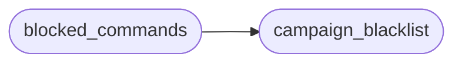

# `modules.campaign_blacklist`

> Source: [modules/campaign_blacklist.py:1](../../modules/campaign_blacklist.py#L1) | language `py` | coverage 100.0% | [API index](../index.md)

Campaign command blacklist loaded from ``sessions/campaign_lessons.jsonl``.

A lesson with ``outcome == "failed"`` blacklists its command head under the
lesson's ``context`` (or ``any``), so a history- or catalogue-driven selector
never re-proposes a command a past campaign already learned to be a dead end.
The loader lived privately in the daemon; it is shared here so both autonomous
runtimes consult one blacklist. The result is cached and reloaded when the
lessons file changes.

## Contents

- **Functions:** [`campaign_blacklist`](#campaign_blacklist), [`blocked_commands`](#blocked_commands)
- **Constants:** [`BASE_DIR`](#base_dir), [`SESSIONS_DIR`](#sessions_dir)

## Call Graph

Solid arrows stay in this module, dashed arrows leave it.



## Functions

<a id="campaign_blacklist"></a>

### `campaign_blacklist`

`function` | [modules/campaign_blacklist.py:53](../../modules/campaign_blacklist.py#L53)

```python
def campaign_blacklist() -> dict[str, list[str]]
```

Return the cached blacklist, reloading when the lessons file changes.

**Returns:** `dict[str, list[str]]`

*Called by:* [`blocked_commands`](#blocked_commands)

---

<a id="blocked_commands"></a>

### `blocked_commands`

`function` | [modules/campaign_blacklist.py:63](../../modules/campaign_blacklist.py#L63)

```python
def blocked_commands(category: str) -> set[str]
```

Return command heads blacklisted for a category plus the global ``any``.

**Parameters**

| Name | Type | Default | Description |
|---|---|---|---|
| `category` | `str` |  |  |

**Returns:** `set[str]`

*Calls:* [`campaign_blacklist`](#campaign_blacklist)

---

## Constants

<a id="base_dir"></a>

### `BASE_DIR`

`constant` | [modules/campaign_blacklist.py:16](../../modules/campaign_blacklist.py#L16)

```python
BASE_DIR = Path(__file__).resolve().parent.parent
```

---

<a id="sessions_dir"></a>

### `SESSIONS_DIR`

`constant` | [modules/campaign_blacklist.py:17](../../modules/campaign_blacklist.py#L17)

```python
SESSIONS_DIR = BASE_DIR / 'sessions'
```

---
