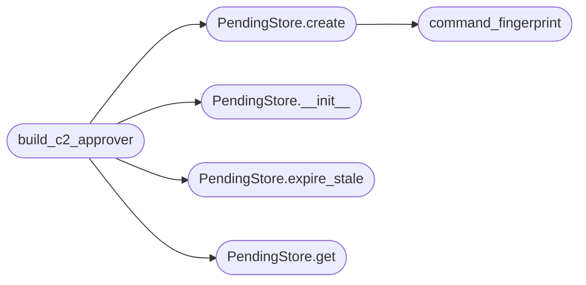

# `modules.chain_approval`

> Source: [modules/chain_approval.py:1](../../modules/chain_approval.py#L1) | language `py` | coverage 100.0% | [API index](../index.md)

Human-in-the-loop approval gate for confirm chain steps.

ARTEX intercept doctrine, adapted: every ``confirm`` step surfaces a
pending request instead of relying on a lone CLI prompt, a dashboard
operator decides from the C2 surface, and every transition is audited
with a SHA-256 command fingerprint. The approver is always
failure-closed: an expired request, a missing store, a malformed row or
a callback error denies the step.

State: ``sessions/chain_pending.json`` holds the pending registry and
``sessions/chain_audit.jsonl`` is the append-only decision trail.

## Contents

- **Classes:** [`PendingStore`](#pendingstore)
- **Functions:** [`command_fingerprint`](#command_fingerprint), [`approval_backend`](#approval_backend), [`build_c2_approver`](#build_c2_approver)
- **Constants:** [`PENDING_FILENAME`](#pending_filename), [`AUDIT_FILENAME`](#audit_filename), [`STATUS_PENDING`](#status_pending), [`STATUS_APPROVED`](#status_approved), [`STATUS_DENIED`](#status_denied), [`STATUS_EXPIRED`](#status_expired), [`STATUSES`](#statuses), [`DEFAULT_TIMEOUT_SEC`](#default_timeout_sec)

## Call Graph

Solid arrows stay in this module, dashed arrows leave it.



## Classes

<a id="pendingstore"></a>

### `PendingStore`

`class` | [modules/chain_approval.py:114](../../modules/chain_approval.py#L114)

```python
class PendingStore
```

Atomic pending-approval registry shared by CLI and C2 surface.

**Members**

| Member | Kind | Summary |
|---|---|---|
| [`__init__`](#pendingstore-__init__) | constructor | Bind the store to one sessions directory. |
| [`create`](#pendingstore-create) | method | Register one pending approval request. |
| [`get`](#pendingstore-get) | method | Return one request record or None. |
| [`list`](#pendingstore-list) | method | Return request records newest first, optionally by status. |
| [`decide`](#pendingstore-decide) | method | Record one decision or expiry, audited, idempotent-fail. |
| [`expire_stale`](#pendingstore-expire_stale) | method | Expire every pending request past its deadline. |

<a id="pendingstore-__init__"></a>

#### `PendingStore.__init__`

`constructor` | [modules/chain_approval.py:117](../../modules/chain_approval.py#L117)

```python
def __init__(self, sessions_dir: str | Path | None = None) -> None
```

Bind the store to one sessions directory.

**Parameters**

| Name | Type | Default | Description |
|---|---|---|---|
| `sessions_dir` | `str \| Path \| None` | `None` | Sessions base directory (default ``sessions``). |

*Called by:* [`resolve_admin`](cli.apt_chain_support.py.md#resolve_admin), [`build_c2_approver`](#build_c2_approver)

<a id="pendingstore-create"></a>

#### `PendingStore.create`

`method` | [modules/chain_approval.py:153](../../modules/chain_approval.py#L153)

```python
def create(self, chain: str, step_id: str, command: str, timeout: float | None = None, run_id: str = '', now_override: float | None = None) -> dict
```

Register one pending approval request.

**Parameters**

| Name | Type | Default | Description |
|---|---|---|---|
| `chain` | `str` |  | Chain name asking for approval. |
| `step_id` | `str` |  | Chain step identifier. |
| `command` | `str` |  | Rendered command awaiting execution. |
| `timeout` | `float \| None` | `None` | Optional approval window override in seconds. |
| `run_id` | `str` | `''` | Optional chain run identifier. |
| `now_override` | `float \| None` | `None` | Optional creation timestamp (test clocks). |

**Returns:** `dict` - The created record mapping.

*Calls:* [`command_fingerprint`](#command_fingerprint)

*Called by:* [`build_c2_approver`](#build_c2_approver)

<a id="pendingstore-get"></a>

#### `PendingStore.get`

`method` | [modules/chain_approval.py:204](../../modules/chain_approval.py#L204)

```python
def get(self, request_id: str) -> dict | None
```

Return one request record or None.

**Parameters**

| Name | Type | Default | Description |
|---|---|---|---|
| `request_id` | `str` |  | Request identifier. |

**Returns:** `dict | None` - Record mapping when present.

*Called by:* [`build_c2_approver`](#build_c2_approver)

<a id="pendingstore-list"></a>

#### `PendingStore.list`

`method` | [modules/chain_approval.py:215](../../modules/chain_approval.py#L215)

```python
def list(self, status: str | None = None) -> list[dict]
```

Return request records newest first, optionally by status.

**Parameters**

| Name | Type | Default | Description |
|---|---|---|---|
| `status` | `str \| None` | `None` | Optional status filter. |

**Returns:** `list[dict]` - List of record mappings sorted by ``ts`` descending.

<a id="pendingstore-decide"></a>

#### `PendingStore.decide`

`method` | [modules/chain_approval.py:229](../../modules/chain_approval.py#L229)

```python
def decide(self, request_id: str, allowed: bool, decided_by: str = '', note: str = '', expired: bool = False) -> dict | None
```

Record one decision or expiry, audited, idempotent-fail.

**Parameters**

| Name | Type | Default | Description |
|---|---|---|---|
| `request_id` | `str` |  | Request identifier. |
| `allowed` | `bool` |  | True approves, False denies (ignored when expired). |
| `decided_by` | `str` | `''` | Actor label (`[`c2`](discord_c2.py.md#c2)`, `[`cli`](cli.__init__.py.md)`, ``system``). |
| `note` | `str` | `''` | Optional operator note. |
| `expired` | `bool` | `False` | True marks the record expired regardless of verdict. |

**Returns:** `dict | None` - Updated record, or None when the id is unknown or already
decided (no silent double-decide).

*Called by:* [`resolve_admin`](cli.apt_chain_support.py.md#resolve_admin)

<a id="pendingstore-expire_stale"></a>

#### `PendingStore.expire_stale`

`method` | [modules/chain_approval.py:282](../../modules/chain_approval.py#L282)

```python
def expire_stale(self, now: float | None = None) -> int
```

Expire every pending request past its deadline.

**Parameters**

| Name | Type | Default | Description |
|---|---|---|---|
| `now` | `float \| None` | `None` | Optional clock override for tests. |

**Returns:** `int` - Count of records expired by this sweep.

*Called by:* [`resolve_admin`](cli.apt_chain_support.py.md#resolve_admin), [`build_c2_approver`](#build_c2_approver)

---

## Functions

<a id="command_fingerprint"></a>

### `command_fingerprint`

`function` | [modules/chain_approval.py:78](../../modules/chain_approval.py#L78)

```python
def command_fingerprint(command: str) -> str
```

Return the SHA-256 fingerprint of one command line.

**Parameters**

| Name | Type | Default | Description |
|---|---|---|---|
| `command` | `str` |  | Raw command text. |

**Returns:** `str` - Lowercase hex digest of the first 4096 characters.

*Called by:* [`PendingStore.create`](#pendingstore-create)

---

<a id="approval_backend"></a>

### `approval_backend`

`function` | [modules/chain_approval.py:318](../../modules/chain_approval.py#L318)

```python
def approval_backend() -> str
```

Return the configured approval backend.

**Returns:** `str` - `[`c2`](discord_c2.py.md#c2)` when ``LAZYOWN_APPROVAL_BACKEND=c2``; anything else
keeps the interactive CLI approver.

*Called by:* [`CommandAndControlMigratedCommandSet.do_apt_chain`](cli.commands.command_and_control_migrated.py.md#commandandcontrolmigratedcommandset-do_apt_chain)

---

<a id="build_c2_approver"></a>

### `build_c2_approver`

`function` | [modules/chain_approval.py:328](../../modules/chain_approval.py#L328)

```python
def build_c2_approver(printer=None, chain_name: str = '', run_id: str = '', timeout: float | None = None, poll_interval: float = _DEFAULT_POLL_INTERVAL, sessions_dir: str | Path | None = None, clock=None) -> Any
```

Return an approver that routes confirm steps to the C2 pending list.

The callback creates one pending record, then polls the shared store
until an operator approves or denies it from the dashboard or CLI.
Deadline expiry sweeps the record and votes deny (failure-closed);
any store or callback error denies as well.

**Parameters**

| Name | Type | Default | Description |
|---|---|---|---|
| `printer` |  | `None` | Optional progress printer. |
| `chain_name` | `str` | `''` | Chain name recorded in the request. |
| `run_id` | `str` | `''` | Optional chain run identifier. |
| `timeout` | `float \| None` | `None` | Optional approval window override in seconds. |
| `poll_interval` | `float` | `_DEFAULT_POLL_INTERVAL` | Seconds between store re-reads. |
| `sessions_dir` | `str \| Path \| None` | `None` | Optional sessions directory override. |
| `clock` |  | `None` | Optional ``time.time`` replacement for tests. |

**Returns:** `Any` - ``approve(step_id, command) -> bool``.

*Calls:* [`PendingStore.__init__`](#pendingstore-__init__), [`PendingStore.create`](#pendingstore-create), [`PendingStore.expire_stale`](#pendingstore-expire_stale), [`PendingStore.get`](#pendingstore-get)

*Called by:* [`CommandAndControlMigratedCommandSet.do_apt_chain`](cli.commands.command_and_control_migrated.py.md#commandandcontrolmigratedcommandset-do_apt_chain)

---

## Constants

<a id="pending_filename"></a>

### `PENDING_FILENAME`

`constant` | [modules/chain_approval.py:24](../../modules/chain_approval.py#L24)

```python
PENDING_FILENAME = 'chain_pending.json'
```

---

<a id="audit_filename"></a>

### `AUDIT_FILENAME`

`constant` | [modules/chain_approval.py:25](../../modules/chain_approval.py#L25)

```python
AUDIT_FILENAME = 'chain_audit.jsonl'
```

---

<a id="status_pending"></a>

### `STATUS_PENDING`

`constant` | [modules/chain_approval.py:27](../../modules/chain_approval.py#L27)

```python
STATUS_PENDING = 'pending'
```

---

<a id="status_approved"></a>

### `STATUS_APPROVED`

`constant` | [modules/chain_approval.py:28](../../modules/chain_approval.py#L28)

```python
STATUS_APPROVED = 'approved'
```

---

<a id="status_denied"></a>

### `STATUS_DENIED`

`constant` | [modules/chain_approval.py:29](../../modules/chain_approval.py#L29)

```python
STATUS_DENIED = 'denied'
```

---

<a id="status_expired"></a>

### `STATUS_EXPIRED`

`constant` | [modules/chain_approval.py:30](../../modules/chain_approval.py#L30)

```python
STATUS_EXPIRED = 'expired'
```

---

<a id="statuses"></a>

### `STATUSES`

`constant` | [modules/chain_approval.py:31](../../modules/chain_approval.py#L31)

```python
STATUSES = (STATUS_PENDING, STATUS_APPROVED, STATUS_DENIED, STATUS_EXPIRED)
```

---

<a id="default_timeout_sec"></a>

### `DEFAULT_TIMEOUT_SEC`

`constant` | [modules/chain_approval.py:33](../../modules/chain_approval.py#L33)

```python
DEFAULT_TIMEOUT_SEC = 300.0
```

---
