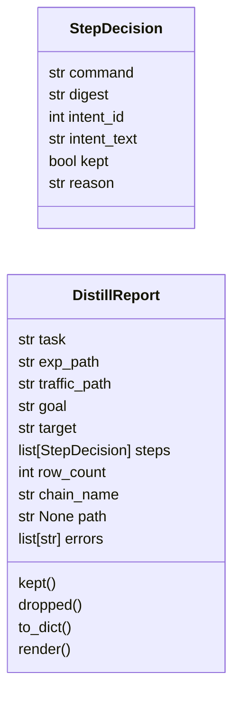
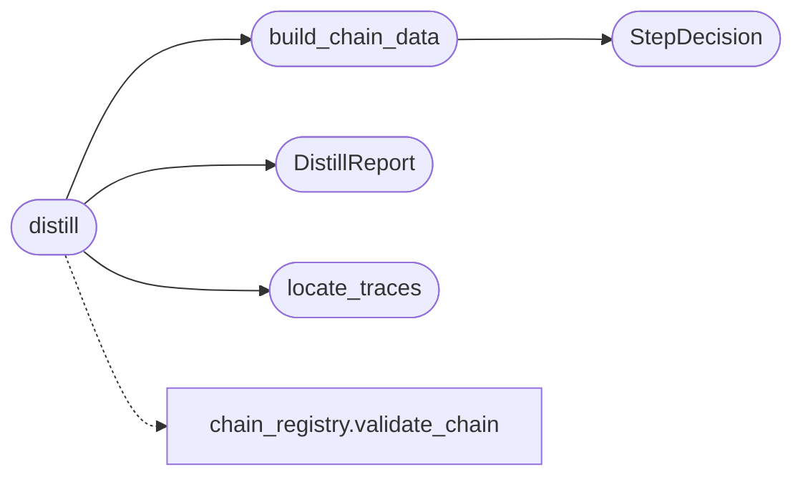

# `modules.chain_distill`

> Source: [modules/chain_distill.py:1](../../modules/chain_distill.py#L1) | language `py` | coverage 100.0% | [API index](../index.md)

chain_distill - crystallise one autonomous-loop trace into a chain YAML.

The loop keeps everything it does: the exploration graph
(``sessions/<dir>/exp_<task>.json``) and the append-only execution stream
(``sessions/<dir>/traffic_<task>.jsonl``). This module reads both and
emits a validated, reusable chain file under ``chains/`` so the next run
of the same goal is deterministic and free instead of LLM-priced.

Join contract (real on-disk formats):

- traffic row: ``{ts, kind: bash|http|note, command, output, preview,
  truncated, bytes, digest, template, meta:{worker, intent}}`` where
  `[`digest`](#stepdecision-digest)` is the sha12 of the command line and ``meta.intent`` is the
  claiming intent node id;
- graph node: ``{node_id, kind: goal|intent|fact, text, state, priority,
  created, updated, meta}`` plus ``edges`` (spawns/yields) and
  `[`anchors`](modules.loop_progress.py.md#loopsnapshot-anchors)`. The goal text carries the target the task was scoped to.

Policy v1: keep rows that produced output and carry no known failure
signature; drop silent probes and dead ends with their reason; dedupe by
digest and by rendered command; tokenise the task target as ``{target}``;
attach per-step lineage (intent id + digest) in ``description``. Scan
steps get the canonical `[`skip_if_exists`](modules.chain_registry.py.md#chainstep-skip_if_exists)` guard on the nmap XML
artefact. Verbs that have a manifest ([`modules.verb_manifest`](modules.verb_manifest.py.md))
inherit its phase and exploit-classification, so a distilled chain can
be audited for cost/noise before it ever runs.

Output is validated with [`modules.chain_registry.validate_chain`](modules.chain_registry.py.md#validate_chain)
before writing; a distilled file that cannot validate is never written.
Generated chains start ``enabled: false`` and belong to the operator.

## Contents

- **Classes:** [`StepDecision`](#stepdecision), [`DistillReport`](#distillreport)
- **Functions:** [`locate_traces`](#locate_traces), [`build_chain_data`](#build_chain_data), [`distill`](#distill)
- **Constants:** [`REPO_ROOT`](#repo_root), [`SESSIONS_DIR`](#sessions_dir), [`CHAINS_DIR`](#chains_dir), [`MAX_RUN_CHARS`](#max_run_chars)

## Type Diagram



## Call Graph

Solid arrows stay in this module, dashed arrows leave it.



## Classes

<a id="stepdecision"></a>

### `StepDecision`

`class` `dataclass` | [modules/chain_distill.py:325](../../modules/chain_distill.py#L325)

Decorators: `@dataclass`

```python
class StepDecision
```

One trace row and whether it becomes a chain step.

**Parameters**

| Name | Type | Default | Description |
|---|---|---|---|
| `command` | `str` |  | Raw command line from the trace. |
| `digest` | `str` |  | Trace digest (lineage). |
| `intent_id` | `int` |  | Claiming intent node id (0 when none). |
| `intent_text` | `str` | `''` | Intent text of the claiming node. |
| `kept` | `bool` | `False` | True when the row becomes a step. |
| `reason` | `str` | `''` | Why the row was kept or dropped. |

**Attributes**

| Name | Type | Default | Description |
|---|---|---|---|
| [`command`](#stepdecision-command) | `str` |  |  |
| [`digest`](#stepdecision-digest) | `str` |  |  |
| [`intent_id`](#stepdecision-intent_id) | `int` |  |  |
| [`intent_text`](#stepdecision-intent_text) | `str` | `''` |  |
| [`kept`](#stepdecision-kept) | `bool` | `False` |  |
| [`reason`](#stepdecision-reason) | `str` | `''` |  |

---

<a id="distillreport"></a>

### `DistillReport`

`class` `dataclass` | [modules/chain_distill.py:346](../../modules/chain_distill.py#L346)

Decorators: `@dataclass`

```python
class DistillReport
```

Full account of one distillation for operator review.

**Parameters**

| Name | Type | Default | Description |
|---|---|---|---|
| `task` | `str` | `''` | Task id distilled. |
| `exp_path` | `str` | `''` | Graph artefact used. |
| `traffic_path` | `str` | `''` | Traffic artefact used. |
| `goal` | `str` | `''` | Goal text of the trace. |
| `target` | `str` | `''` | Inferred ``{target}`` token (empty when unknown). |
| `steps` | `list[StepDecision]` | `field(default_factory=list)` | Kept and dropped decisions in trace order. |
| `row_count` | `int` | `0` | Raw rows read (post digest-dedupe). |
| `chain_name` | `str` | `''` | Built chain name (empty when build failed). |
| `path` | `str \| None` | `None` | Written chain path (None on dry-run / validation failure). |
| `errors` | `list[str]` | `field(default_factory=list)` | Registry validation errors. |

**Attributes**

| Name | Type | Default | Description |
|---|---|---|---|
| [`task`](#distillreport-task) | `str` | `''` |  |
| [`exp_path`](#distillreport-exp_path) | `str` | `''` |  |
| [`traffic_path`](#distillreport-traffic_path) | `str` | `''` |  |
| [`goal`](#distillreport-goal) | `str` | `''` |  |
| [`target`](#distillreport-target) | `str` | `''` |  |
| [`steps`](#distillreport-steps) | `list[StepDecision]` | `field(default_factory=list)` |  |
| [`row_count`](#distillreport-row_count) | `int` | `0` |  |
| [`chain_name`](#distillreport-chain_name) | `str` | `''` |  |
| [`path`](#distillreport-path) | `str \| None` | `None` |  |
| [`errors`](#distillreport-errors) | `list[str]` | `field(default_factory=list)` |  |

**Members**

| Member | Kind | Summary |
|---|---|---|
| [`kept`](#distillreport-kept) | property | Count decisions turned into steps. |
| [`dropped`](#distillreport-dropped) | property | Count decisions rejected with a reason. |
| [`to_dict`](#distillreport-to_dict) | method | Return a JSON-serializable report. |
| [`render`](#distillreport-render) | method | Return printable report lines. |

<a id="distillreport-kept"></a>

#### `DistillReport.kept`

`property` | [modules/chain_distill.py:374](../../modules/chain_distill.py#L374)

Decorators: `@property`

```python
def kept(self) -> int
```

Count decisions turned into steps.

**Returns:** `int`

<a id="distillreport-dropped"></a>

#### `DistillReport.dropped`

`property` | [modules/chain_distill.py:379](../../modules/chain_distill.py#L379)

Decorators: `@property`

```python
def dropped(self) -> int
```

Count decisions rejected with a reason.

**Returns:** `int`

<a id="distillreport-to_dict"></a>

#### `DistillReport.to_dict`

`method` | [modules/chain_distill.py:383](../../modules/chain_distill.py#L383)

```python
def to_dict(self) -> dict[str, Any]
```

Return a JSON-serializable report.

**Returns:** `dict[str, Any]`

<a id="distillreport-render"></a>

#### `DistillReport.render`

`method` | [modules/chain_distill.py:410](../../modules/chain_distill.py#L410)

```python
def render(self, verbose: bool = False) -> list[str]
```

Return printable report lines.

**Parameters**

| Name | Type | Default | Description |
|---|---|---|---|
| `verbose` | `bool` | `False` | Also list dropped rows. |

**Returns:** `list[str]` - Lines for the CLI printer.

---

## Functions

<a id="locate_traces"></a>

### `locate_traces`

`function` | [modules/chain_distill.py:89](../../modules/chain_distill.py#L89)

```python
def locate_traces(task: str, sessions_dir: Path | str | None = None) -> tuple[Union[Path, None], Union[Path, None]]
```

Find the exp/traffic pair of one loop task under sessions/.

**Parameters**

| Name | Type | Default | Description |
|---|---|---|---|
| `task` | `str` |  | Task id (``tNNNN``) or an explicit ``exp_*.json`` path. |
| `sessions_dir` | `Path \| str \| None` | `None` | Override the repository sessions root. |

**Returns:** `tuple[Union[Path, None], Union[Path, None]]` - ``(exp_path, traffic_path)``: each element None when absent.

*Called by:* [`distill`](#distill)

---

<a id="build_chain_data"></a>

### `build_chain_data`

`function` | [modules/chain_distill.py:441](../../modules/chain_distill.py#L441)

```python
def build_chain_data(task: str, rows: list[dict], graph: dict[str, Any], manifests: dict[str, Any] | None = None) -> tuple[dict[str, Any], list[StepDecision]]
```

Turn deduped traffic rows and graph context into chain YAML data.

**Parameters**

| Name | Type | Default | Description |
|---|---|---|---|
| `task` | `str` |  | Task id for naming. |
| `rows` | `list[dict]` |  | Dedupe traffic rows (first-seen digests). |
| `graph` | `dict[str, Any]` |  | Loaded graph shape (goal, intents). |
| `manifests` | `dict[str, Any] \| None` | `None` | Verb manifests keyed by verb (phase inheritance). |

**Returns:** `tuple[dict[str, Any], list[StepDecision]]` - ``(chain_data, decisions)`` with one decision per row.

*Calls:* [`StepDecision`](#stepdecision)

*Called by:* [`distill`](#distill)

---

<a id="distill"></a>

### `distill`

`function` | [modules/chain_distill.py:550](../../modules/chain_distill.py#L550)

```python
def distill(task: str, sessions_dir: Path | str | None = None, write: bool = False, chains_dir: Path | str | None = None) -> DistillReport
```

Distill one loop task into a validated chain YAML.

**Parameters**

| Name | Type | Default | Description |
|---|---|---|---|
| `task` | `str` |  | Task id (``tNNNN``). |
| `sessions_dir` | `Path \| str \| None` | `None` | Sessions root override. |
| `write` | `bool` | `False` | Persist ``chains/<name>.yaml`` when True and valid. |
| `chains_dir` | `Path \| str \| None` | `None` | Chains directory override (tests). |

**Returns:** `DistillReport` - The DistillReport; `[`path`](#distillreport-path)` set only after a successful write.

*Calls:* [`DistillReport`](#distillreport), [`build_chain_data`](#build_chain_data), [`locate_traces`](#locate_traces), [`validate_chain`](modules.chain_registry.py.md#validate_chain)

*Called by:* [`CommandAndControlMigratedCommandSet.do_chain_distill`](cli.commands.command_and_control_migrated.py.md#commandandcontrolmigratedcommandset-do_chain_distill)

---

## Constants

<a id="repo_root"></a>

### `REPO_ROOT`

`constant` | [modules/chain_distill.py:51](../../modules/chain_distill.py#L51)

```python
REPO_ROOT = Path(__file__).resolve().parent.parent
```

---

<a id="sessions_dir"></a>

### `SESSIONS_DIR`

`constant` | [modules/chain_distill.py:52](../../modules/chain_distill.py#L52)

```python
SESSIONS_DIR = REPO_ROOT / 'sessions'
```

---

<a id="chains_dir"></a>

### `CHAINS_DIR`

`constant` | [modules/chain_distill.py:53](../../modules/chain_distill.py#L53)

```python
CHAINS_DIR = REPO_ROOT / 'chains'
```

---

<a id="max_run_chars"></a>

### `MAX_RUN_CHARS`

`constant` | [modules/chain_distill.py:54](../../modules/chain_distill.py#L54)

```python
MAX_RUN_CHARS = 2000
```

---
