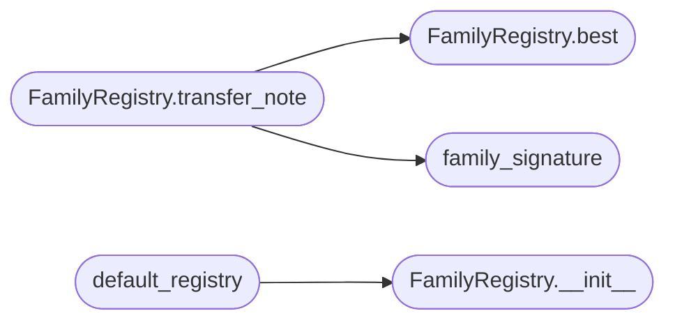

# `modules.chain_family`

> Source: [modules/chain_family.py:1](../../modules/chain_family.py#L1) | language `py` | coverage 100.0% | [API index](../index.md)

Isomorphism transfer: reuse a winning chain across structurally-similar targets.

sapper-v2 reuses a proven playbook across challenges that are structurally
identical ("isomorphism transfer"). LazyOwn's equivalent: derive a stable
*family signature* from a target's structural facts (its service set, OS hint
and whether credentials are known), remember which chain proved a target of
that family, and surface that winning chain the next time a same-family target
is synthesised, so the loop does not re-derive a plan it already has.

The signature function is pure. The registry persists to
``sessions/chain_families.json`` through the same atomic JSON helpers the rest
of the loop uses, and records both associations (synthesised chains) and wins
(chains whose run proved the goal), ranking proven chains first.

## Contents

- **Classes:** [`FamilyRegistry`](#familyregistry)
- **Functions:** [`family_signature`](#family_signature), [`default_registry`](#default_registry)

## Call Graph

Solid arrows stay in this module, dashed arrows leave it.



## Classes

<a id="familyregistry"></a>

### `FamilyRegistry`

`class` | [modules/chain_family.py:62](../../modules/chain_family.py#L62)

```python
class FamilyRegistry
```

Persisted map from a family signature to the chains seen for it.

Each signature holds per-chain counters (associations and wins). `[`best`](#familyregistry-best)`
ranks chains with recorded wins first, then by total sightings, so a chain
that actually proved a target is preferred over one merely synthesised.

**Members**

| Member | Kind | Summary |
|---|---|---|
| [`__init__`](#familyregistry-__init__) | constructor | Bind the registry to a JSON file. |
| [`record_association`](#familyregistry-record_association) | method | Record that ``chain`` was synthesised for a target of this family. |
| [`record_win`](#familyregistry-record_win) | method | Record that ``chain`` proved a target of this family. |
| [`best`](#familyregistry-best) | method | Return the strongest chain recorded for a family, or None. |
| [`transfer_note`](#familyregistry-transfer_note) | method | Return an operator note when this family has a known winning chain. |

<a id="familyregistry-__init__"></a>

#### `FamilyRegistry.__init__`

`constructor` | [modules/chain_family.py:70](../../modules/chain_family.py#L70)

```python
def __init__(self, path: str | Path) -> None
```

Bind the registry to a JSON file.

**Parameters**

| Name | Type | Default | Description |
|---|---|---|---|
| `path` | `str \| Path` |  | The ``chain_families.json`` path (created on first write). |

*Called by:* [`default_registry`](#default_registry)

<a id="familyregistry-record_association"></a>

#### `FamilyRegistry.record_association`

`method` | [modules/chain_family.py:105](../../modules/chain_family.py#L105)

```python
def record_association(self, signature: str, chain: str, target: str = '') -> None
```

Record that ``chain`` was synthesised for a target of this family.

**Parameters**

| Name | Type | Default | Description |
|---|---|---|---|
| `signature` | `str` |  |  |
| `chain` | `str` |  |  |
| `target` | `str` | `''` |  |

<a id="familyregistry-record_win"></a>

#### `FamilyRegistry.record_win`

`method` | [modules/chain_family.py:111](../../modules/chain_family.py#L111)

```python
def record_win(self, signature: str, chain: str, target: str = '') -> None
```

Record that ``chain`` proved a target of this family.

**Parameters**

| Name | Type | Default | Description |
|---|---|---|---|
| `signature` | `str` |  |  |
| `chain` | `str` |  |  |
| `target` | `str` | `''` |  |

<a id="familyregistry-best"></a>

#### `FamilyRegistry.best`

`method` | [modules/chain_family.py:117](../../modules/chain_family.py#L117)

```python
def best(self, signature: str) -> dict[str, Any] | None
```

Return the strongest chain recorded for a family, or None.

Chains with wins rank first, then by total sightings; ties break by
chain name for determinism.

**Parameters**

| Name | Type | Default | Description |
|---|---|---|---|
| `signature` | `str` |  | The family signature. |

**Returns:** `dict[str, Any] | None` - A dict ``{chain, wins, seen, targets}`` or None when unseen.

*Called by:* [`FamilyRegistry.transfer_note`](#familyregistry-transfer_note)

<a id="familyregistry-transfer_note"></a>

#### `FamilyRegistry.transfer_note`

`method` | [modules/chain_family.py:153](../../modules/chain_family.py#L153)

```python
def transfer_note(self, facts: Mapping[str, Any]) -> str
```

Return an operator note when this family has a known winning chain.

**Parameters**

| Name | Type | Default | Description |
|---|---|---|---|
| `facts` | `Mapping[str, Any]` |  | Target facts (see [`family_signature`](#family_signature)). |

**Returns:** `str` - A human-readable note, or an empty string when nothing transfers.

*Calls:* [`FamilyRegistry.best`](#familyregistry-best), [`family_signature`](#family_signature)

---

## Functions

<a id="family_signature"></a>

### `family_signature`

`function` | [modules/chain_family.py:35](../../modules/chain_family.py#L35)

```python
def family_signature(facts: Mapping[str, Any]) -> str
```

Return a stable structural signature for a target from its facts.

Two targets that expose the same set of services, the same OS hint and the
same credential posture share a signature, even when their addresses
differ. Service order and duplicates do not affect the result.

**Parameters**

| Name | Type | Default | Description |
|---|---|---|---|
| `facts` | `Mapping[str, Any]` |  | A mapping with ``services`` (iterable of names), ``os_hint`` (string) and `[`has_creds`](modules.selection.base.py.md#selectioncontext-has_creds)` (bool). |

**Returns:** `str` - A short hex signature string; ``"empty"`` when no service is known.

*Called by:* [`resolve_admin`](cli.apt_chain_support.py.md#resolve_admin), [`CommandAndControlMigratedCommandSet.do_apt_chain`](cli.commands.command_and_control_migrated.py.md#commandandcontrolmigratedcommandset-do_apt_chain), [`FamilyRegistry.transfer_note`](#familyregistry-transfer_note)

---

<a id="default_registry"></a>

### `default_registry`

`function` | [modules/chain_family.py:179](../../modules/chain_family.py#L179)

```python
def default_registry() -> FamilyRegistry
```

Return a registry bound to the shared ``chain_families.json``.

**Returns:** `FamilyRegistry`

*Calls:* [`FamilyRegistry.__init__`](#familyregistry-__init__)

*Called by:* [`resolve_admin`](cli.apt_chain_support.py.md#resolve_admin), [`CommandAndControlMigratedCommandSet.do_apt_chain`](cli.commands.command_and_control_migrated.py.md#commandandcontrolmigratedcommandset-do_apt_chain)

---
