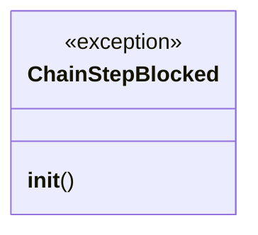
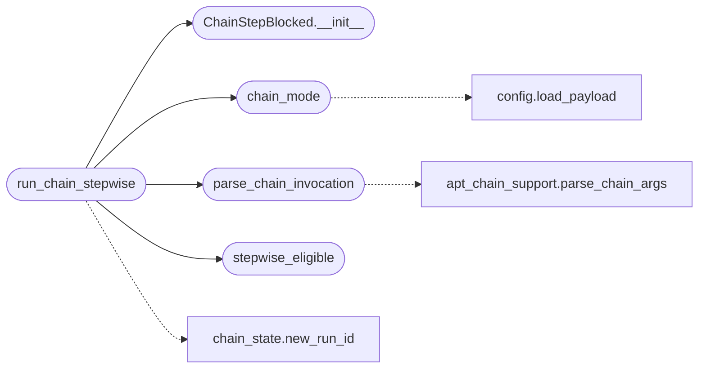

# `modules.chain_loop`

> Source: [modules/chain_loop.py:1](../../modules/chain_loop.py#L1) | language `py` | coverage 100.0% | [API index](../index.md)

Chain-aware loop execution: one contract, two transport modes.

When the autonomous planner emits an ``apt_chain <chain> <target>``
decision, this module decides how the chain executes:

- ``stepwise`` (default when eligible): a [`ChainRunner`](modules.chain_runner.py.md#chainrunner) runs the
  chain in-process and every chain step is routed through the worker's
  own `Worker._guard_step`, so each step inherits scope, deny,
  OS-gate, OPSEC, detection, missing-tool and budget guardrails and is
  recorded in the task traffic log individually. Per-step pacing comes
  from the shared EdrPacer plus the step's own ``sleep``/``jitter``.
- ``subprocess`` (fallback): the whole chain runs through the existing
  shell verb path exactly as before; stepwise is refused when a step
  is not loop-routable or a nested chain exceeds the depth budget.

The mode is chosen by ``payload.json -> orchestrator.chain_mode``
(`[`auto`](modules.atomic_exploit_bridge.py.md#auto)` default, or forced ``stepwise``/``subprocess``). Everything
reuses existing contracts: ``chain_registry`` resolves, ``chain_runner``
executes, ``chain_facts`` spools, ``chain_state`` names runs.

## Contents

- **Exceptions:** [`ChainStepBlocked`](#chainstepblocked)
- **Functions:** [`chain_mode`](#chain_mode), [`is_chain_command`](#is_chain_command), [`parse_chain_invocation`](#parse_chain_invocation), [`stepwise_eligible`](#stepwise_eligible), [`run_chain_stepwise`](#run_chain_stepwise)
- **Constants:** [`CHAIN_COMMAND_PREFIX`](#chain_command_prefix)

## Type Diagram



## Call Graph

Solid arrows stay in this module, dashed arrows leave it.



## Exceptions

<a id="chainstepblocked"></a>

### `ChainStepBlocked`

`exception` | [modules/chain_loop.py:138](../../modules/chain_loop.py#L138)

```python
class ChainStepBlocked(RuntimeError)
```

Bases: `RuntimeError`

A chain step was refused by the worker guardrails (blocked/skipped).

**Members**

| Member | Kind | Summary |
|---|---|---|
| [`__init__`](#chainstepblocked-__init__) | constructor | Record the guard status and reason. |

<a id="chainstepblocked-__init__"></a>

#### `ChainStepBlocked.__init__`

`constructor` | [modules/chain_loop.py:141](../../modules/chain_loop.py#L141)

```python
def __init__(self, status: str, detail: str) -> None
```

Record the guard status and reason.

**Parameters**

| Name | Type | Default | Description |
|---|---|---|---|
| `status` | `str` |  | `[`blocked`](modules.goals.py.md#taskconstraints-blocked)` or ``skipped``. |
| `detail` | `str` |  | Guard reason string. |

*Called by:* [`run_chain_stepwise`](#run_chain_stepwise)

---

## Functions

<a id="chain_mode"></a>

### `chain_mode`

`function` | [modules/chain_loop.py:34](../../modules/chain_loop.py#L34)

```python
def chain_mode() -> str
```

Return the configured chain transport mode for loop runs.

**Returns:** `str` - `[`auto`](modules.atomic_exploit_bridge.py.md#auto)`, ``stepwise`` or ``subprocess`` from the payload
``orchestrator.chain_mode`` key; unknown values fall back to
`[`auto`](modules.atomic_exploit_bridge.py.md#auto)`.

*Calls:* [`load_payload`](core.config.py.md#load_payload)

*Called by:* [`run_chain_stepwise`](#run_chain_stepwise)

---

<a id="is_chain_command"></a>

### `is_chain_command`

`function` | [modules/chain_loop.py:52](../../modules/chain_loop.py#L52)

```python
def is_chain_command(command: str) -> bool
```

True when the command line invokes the apt_chain verb.

**Parameters**

| Name | Type | Default | Description |
|---|---|---|---|
| `command` | `str` |  |  |

**Returns:** `bool`

---

<a id="parse_chain_invocation"></a>

### `parse_chain_invocation`

`function` | [modules/chain_loop.py:57](../../modules/chain_loop.py#L57)

```python
def parse_chain_invocation(command: str) -> tuple[str, str, dict[str, str]]
```

Split one ``apt_chain`` command line into name, target and vars.

Reuses the CLI argument parser so the loop and the shell accept the
exact same syntax.

**Parameters**

| Name | Type | Default | Description |
|---|---|---|---|
| `command` | `str` |  | Raw command line beginning with ``apt_chain``. |

**Returns:** `tuple[str, str, dict[str, str]]` - ``(chain_name, target, vars)`` where the name defaults to the
base chain and the target may be empty (the worker target wins
in `[`run_chain_stepwise`](#run_chain_stepwise)`).

*Calls:* [`parse_chain_args`](cli.apt_chain_support.py.md#parse_chain_args)

*Called by:* [`run_chain_stepwise`](#run_chain_stepwise)

---

<a id="stepwise_eligible"></a>

### `stepwise_eligible`

`function` | [modules/chain_loop.py:108](../../modules/chain_loop.py#L108)

```python
def stepwise_eligible(chain: Any, routable: Callable[[str], bool] | None = None) -> tuple[bool, str]
```

Decide whether one chain can run stepwise inside the worker.

A chain is eligible when every step's command routes through the
loop executor (registry verbs, shell verbs or CLI verbs). Interactive
steps are allowed: the worker's intercept queue gates them.

**Parameters**

| Name | Type | Default | Description |
|---|---|---|---|
| `chain` | `Any` |  | Resolved [`modules.chain_registry.Chain`](modules.chain_registry.py.md#chain). |
| `routable` | `Callable[[str], bool] \| None` | `None` | Routability probe (default [`modules.auto_registry.is_routable_command`](modules.auto_registry.py.md#is_routable_command)). |

**Returns:** `tuple[bool, str]` - ``(eligible, reason)`` with an empty reason when eligible.

*Called by:* [`run_chain_stepwise`](#run_chain_stepwise)

---

<a id="run_chain_stepwise"></a>

### `run_chain_stepwise`

`function` | [modules/chain_loop.py:153](../../modules/chain_loop.py#L153)

```python
def run_chain_stepwise(worker: Any, intent: Any, command: str, executor: Callable[[str], str], budget: Any, intercept: Any, retry_state: dict) -> tuple[str, str, str] | None
```

Run one ``apt_chain`` decision step-by-step inside the worker.

Every chain step passes through the worker's own
`Worker._guard_step`, so guardrails, traffic recording and
budget accounting apply per step; the shared EdrPacer paces between
steps and per-step ``sleep``/``jitter`` overrides apply on top.

**Parameters**

| Name | Type | Default | Description |
|---|---|---|---|
| `worker` | `Any` |  | Live loop worker (needs ``_guard_step``, `[`activity`](cli.killchain.py.md#phaseprogress-activity)`, ``_target_for``, ``task_id``). |
| `intent` | `Any` |  | Executed intent node. |
| `command` | `str` |  | The ``apt_chain ...`` decision line. |
| `executor` | `Callable[[str], str]` |  | Worker executor callable for leaf commands. |
| `budget` | `Any` |  | Loop budget tracker. |
| `intercept` | `Any` |  | Worker intercept queue. |
| `retry_state` | `dict` |  | Worker retry state for the current intent. |

**Returns:** `tuple[str, str, str] | None` - ``(output, status, detail)`` exactly like
`Worker._guard_step`, or ``None`` when the decision must
fall through to the whole-chain verb path (unknown chain,
subprocess mode, or an ineligible chain in auto mode).

*Calls:* [`ChainStepBlocked.__init__`](#chainstepblocked-__init__), [`chain_mode`](#chain_mode), [`parse_chain_invocation`](#parse_chain_invocation), [`stepwise_eligible`](#stepwise_eligible), [`new_run_id`](modules.chain_state.py.md#new_run_id)

---

## Constants

<a id="chain_command_prefix"></a>

### `CHAIN_COMMAND_PREFIX`

`constant` | [modules/chain_loop.py:27](../../modules/chain_loop.py#L27)

```python
CHAIN_COMMAND_PREFIX = 'apt_chain'
```

---
