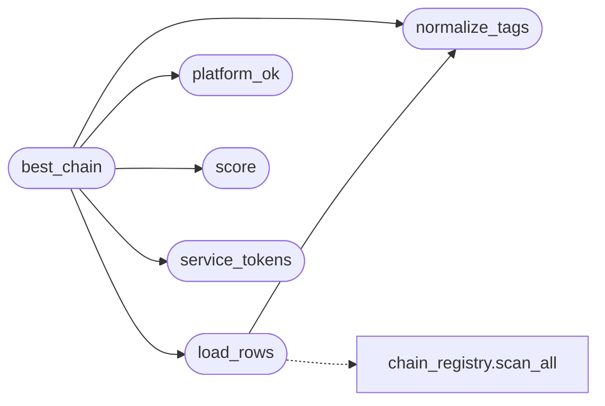

# `modules.chain_match`

> Source: [modules/chain_match.py:1](../../modules/chain_match.py#L1) | language `py` | coverage 100.0% | [API index](../index.md)

Shared selector for the best vetted chain given phase, platform and services.

Both the autonomous daemon's ChainSelector and the LazyLoopEngine planner need
to answer the same question -- "which chain under ``chains/`` fits what we have
discovered right now?" -- so the scoring rules live here once and both callers
delegate to [`best_chain`](#best_chain). Selection is evidence-based: a chain scores zero
unless at least one of its tags matches a discovered service, so a chain is never
proposed blindly. Phase affinity only re-ranks already service-matched chains.
Lab and gym chains are included by default because the framework is heavily
lab-oriented and most operators run it against ranges; real-engagement
operators exclude them by passing ``allow_lab=False`` (env
``AUTO_CHAIN_SELECTOR_LAB=0`` at the call sites).

## Contents

- **Functions:** [`normalize_tags`](#normalize_tags), [`service_tokens`](#service_tokens), [`platform_ok`](#platform_ok), [`score`](#score), [`reset_cache`](#reset_cache), [`load_rows`](#load_rows), [`best_chain`](#best_chain)
- **Constants:** [`STRATEGIC_PHASES`](#strategic_phases), [`LAB_TAGS`](#lab_tags), [`SERVICE_TAG_ALIASES`](#service_tag_aliases), [`PHASE_AFFINITY`](#phase_affinity)

## Call Graph

Solid arrows stay in this module, dashed arrows leave it.



## Functions

<a id="normalize_tags"></a>

### `normalize_tags`

`function` | [modules/chain_match.py:48](../../modules/chain_match.py#L48)

```python
def normalize_tags(tags: Any) -> list[str]
```

Return a chain's tags lowercased and aliased to the shared vocabulary.

Chain tags and discovered service names pass through the same alias map
(``samba`` -> ``smb``, ``https`` -> ``http``, ...) so a tag and a service
name that mean the same thing compare equal. Lab markers (``gym``,
``ad-lab``) are not aliased and survive for the lab exclusion filter.

**Parameters**

| Name | Type | Default | Description |
|---|---|---|---|
| `tags` | `Any` |  |  |

**Returns:** `list[str]`

*Called by:* [`best_chain`](#best_chain), [`load_rows`](#load_rows)

---

<a id="service_tokens"></a>

### `service_tokens`

`function` | [modules/chain_match.py:64](../../modules/chain_match.py#L64)

```python
def service_tokens(services: Any) -> set[str]
```

Normalise discovered service names into the chain tag vocabulary.

**Parameters**

| Name | Type | Default | Description |
|---|---|---|---|
| `services` | `Any` |  |  |

**Returns:** `set[str]`

*Called by:* [`best_chain`](#best_chain)

---

<a id="platform_ok"></a>

### `platform_ok`

`function` | [modules/chain_match.py:74](../../modules/chain_match.py#L74)

```python
def platform_ok(platforms: Any, os_hint: str) -> bool
```

Return True when a chain's platforms admit the target OS hint.

**Parameters**

| Name | Type | Default | Description |
|---|---|---|---|
| `platforms` | `Any` |  |  |
| `os_hint` | `str` |  |  |

**Returns:** `bool`

*Called by:* [`best_chain`](#best_chain)

---

<a id="score"></a>

### `score`

`function` | [modules/chain_match.py:85](../../modules/chain_match.py#L85)

```python
def score(tags: set[str], phase: str, svc_tokens: set[str]) -> int
```

Score one chain's tags for the phase and discovered services.

A chain scores zero without a service-tag match, so nothing is proposed
blindly; phase affinity only boosts a chain that already matched a service.

**Parameters**

| Name | Type | Default | Description |
|---|---|---|---|
| `tags` | `set[str]` |  |  |
| `phase` | `str` |  |  |
| `svc_tokens` | `set[str]` |  |  |

**Returns:** `int`

*Called by:* [`best_chain`](#best_chain)

---

<a id="reset_cache"></a>

### `reset_cache`

`function` | [modules/chain_match.py:97](../../modules/chain_match.py#L97)

```python
def reset_cache() -> None
```

Clear the process-wide registry scan cache (tests, long-lived loops).

---

<a id="load_rows"></a>

### `load_rows`

`function` | [modules/chain_match.py:105](../../modules/chain_match.py#L105)

```python
def load_rows(allow_lab: bool = False, ttl: float = _DEFAULT_TTL) -> list[dict]
```

Return enabled, valid, non-lab chain rows, cached for the TTL.

**Parameters**

| Name | Type | Default | Description |
|---|---|---|---|
| `allow_lab` | `bool` | `False` | Keep lab/gym chains when True. |
| `ttl` | `float` | `_DEFAULT_TTL` | Seconds the cached scan stays valid. |

**Returns:** `list[dict]` - List of ``chain_registry.scan_all`` rows after filtering.

*Calls:* [`normalize_tags`](#normalize_tags), [`scan_all`](modules.chain_registry.py.md#scan_all)

*Called by:* [`best_chain`](#best_chain)

---

<a id="best_chain"></a>

### `best_chain`

`function` | [modules/chain_match.py:135](../../modules/chain_match.py#L135)

```python
def best_chain(phase: str, os_hint: str, services: Any, exclude: Any = (), allow_lab: bool = True, rows: list[dict] | None = None, ttl: float = _DEFAULT_TTL) -> tuple[str, str] | None
```

Return the ``(name, reason)`` of the best matching chain, or None.

**Parameters**

| Name | Type | Default | Description |
|---|---|---|---|
| `phase` | `str` |  | Current kill-chain phase; only strategic phases match. |
| `os_hint` | `str` |  | Target OS hint (``linux``/``windows``/...); blank means any. |
| `services` | `Any` |  | Discovered service names for the target. |
| `exclude` | `Any` | `()` | Chain names already proposed, skipped to avoid repeats. |
| `allow_lab` | `bool` | `True` | Include lab/gym chains when True. |
| `rows` | `list[dict] \| None` | `None` | Pre-loaded registry rows (tests); None loads via cached scan. |
| `ttl` | `float` | `_DEFAULT_TTL` | Cache TTL seconds when ``rows`` is None. |

**Returns:** `tuple[str, str] | None` - The highest-scoring eligible chain as ``(name, reason)``, or None when
the phase is non-strategic or nothing scores on a service match.

*Calls:* [`load_rows`](#load_rows), [`normalize_tags`](#normalize_tags), [`platform_ok`](#platform_ok), [`score`](#score), [`service_tokens`](#service_tokens)

*Called by:* [`ChainSelector.propose`](modules.selection.chain.py.md#chainselector-propose)

---

## Constants

<a id="strategic_phases"></a>

### `STRATEGIC_PHASES`

`constant` | [modules/chain_match.py:21](../../modules/chain_match.py#L21)

```python
STRATEGIC_PHASES = frozenset({'exploit', 'lateral', 'privesc', 'cred', 'c2', 'postexp'})
```

---

<a id="lab_tags"></a>

### `LAB_TAGS`

`constant` | [modules/chain_match.py:22](../../modules/chain_match.py#L22)

```python
LAB_TAGS = frozenset({'gym', 'lab', 'ad-lab', 'metasploitable2', 'ms2'})
```

---

<a id="service_tag_aliases"></a>

### `SERVICE_TAG_ALIASES`

`constant` | [modules/chain_match.py:23](../../modules/chain_match.py#L23)

```python
SERVICE_TAG_ALIASES: dict[str, str]
```

---

<a id="phase_affinity"></a>

### `PHASE_AFFINITY`

`constant` | [modules/chain_match.py:34](../../modules/chain_match.py#L34)

```python
PHASE_AFFINITY: dict[str, frozenset[str]]
```

---
