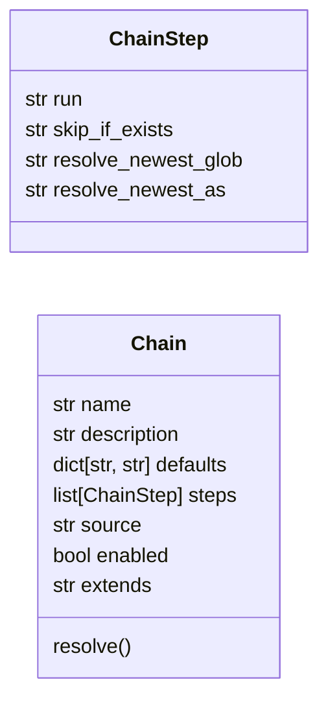
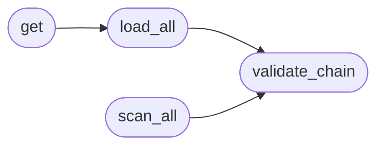

# `modules.chain_registry`

> Source: [modules/chain_registry.py:1](../../modules/chain_registry.py#L1) | language `py` | coverage 100.0% | [API index](../index.md)

Chain registry — ordered orchestration chains from ``chains/*.yaml``.

One file per chain, same philosophy as ``lazyaddons/`` and ``exploits/``.
The ``apt_chain`` shell command interprets these files instead of
hardcoding its steps, so operators extend the orchestration by editing
YAML. Every step must be a routable shell command; resolution (tokens,
skip conditions, newest-file globs) happens here, execution stays in
the shell where output and timeouts belong.

## Contents

- **Classes:** [`ChainStep`](#chainstep), [`Chain`](#chain)
- **Functions:** [`validate_chain`](#validate_chain), [`load_all`](#load_all), [`get`](#get), [`scan_all`](#scan_all), [`set_enabled`](#set_enabled), [`generate_for_playbook`](#generate_for_playbook)
- **Constants:** [`CHAINS_DIR`](#chains_dir)

## Type Diagram



## Call Graph

Solid arrows stay in this module, dashed arrows leave it.



## Classes

<a id="chainstep"></a>

### `ChainStep`

`class` `dataclass` | [modules/chain_registry.py:36](../../modules/chain_registry.py#L36)

Decorators: `@dataclass`

```python
class ChainStep
```

One ordered step: shell line plus optional guards.

**Attributes**

| Name | Type | Default | Description |
|---|---|---|---|
| [`run`](#chainstep-run) | `str` | `''` |  |
| [`skip_if_exists`](#chainstep-skip_if_exists) | `str` | `''` |  |
| [`resolve_newest_glob`](#chainstep-resolve_newest_glob) | `str` | `''` |  |
| [`resolve_newest_as`](#chainstep-resolve_newest_as) | `str` | `''` |  |

---

<a id="chain"></a>

### `Chain`

`class` `dataclass` | [modules/chain_registry.py:46](../../modules/chain_registry.py#L46)

Decorators: `@dataclass`

```python
class Chain
```

A validated chain with defaults and ordered steps.

**Attributes**

| Name | Type | Default | Description |
|---|---|---|---|
| [`name`](#chain-name) | `str` | `''` |  |
| [`description`](#chain-description) | `str` | `''` |  |
| [`defaults`](#chain-defaults) | `dict[str, str]` | `field(default_factory=dict)` |  |
| [`steps`](#chain-steps) | `list[ChainStep]` | `field(default_factory=list)` |  |
| [`source`](#chain-source) | `str` | `''` |  |
| [`enabled`](#chain-enabled) | `bool` | `True` |  |
| [`extends`](#chain-extends) | `str` | `''` |  |

**Members**

| Member | Kind | Summary |
|---|---|---|
| [`resolve`](#chain-resolve) | method | Substitute tokens and evaluate guards. |

<a id="chain-resolve"></a>

#### `Chain.resolve`

`method` | [modules/chain_registry.py:57](../../modules/chain_registry.py#L57)

```python
def resolve(self, tokens: dict[str, str]) -> list[dict[str, Any]]
```

Substitute tokens and evaluate guards.

Returns [{run, skipped, reason}...] in order. ``resolve_newest``
globs run at resolve time against the caller's cwd.

**Parameters**

| Name | Type | Default | Description |
|---|---|---|---|
| `tokens` | `dict[str, str]` |  |  |

**Returns:** `list[dict[str, Any]]`

---

## Functions

<a id="validate_chain"></a>

### `validate_chain`

`function` | [modules/chain_registry.py:93](../../modules/chain_registry.py#L93)

```python
def validate_chain(data: Any, filename: str = '', chains_dir: Path | str | None = None) -> list[str]
```

Validate raw YAML data against the chain schema.

**Parameters**

| Name | Type | Default | Description |
|---|---|---|---|
| `data` | `Any` |  |  |
| `filename` | `str` | `''` |  |
| `chains_dir` | `Path \| str \| None` | `None` |  |

**Returns:** `list[str]`

*Called by:* [`load_all`](#load_all), [`scan_all`](#scan_all)

---

<a id="load_all"></a>

### `load_all`

`function` | [modules/chain_registry.py:134](../../modules/chain_registry.py#L134)

```python
def load_all(chains_dir: Path | str = CHAINS_DIR) -> dict[str, Chain]
```

Load every valid, enabled chain file (skips the rest loudly).

Chains with ``extends: <parent>`` inherit the parent's steps (one
level is flattened here; deeper nesting resolves recursively) and
merge `[`defaults`](#chain-defaults)` over the parent's. Disabled chains never load.

**Parameters**

| Name | Type | Default | Description |
|---|---|---|---|
| `chains_dir` | `Path \| str` | `CHAINS_DIR` |  |

**Returns:** `dict[str, Chain]`

**Raises**

- `RuntimeError`: (raised in the body, not documented)

*Calls:* [`validate_chain`](#validate_chain)

*Called by:* [`get`](#get)

---

<a id="get"></a>

### `get`

`function` | [modules/chain_registry.py:215](../../modules/chain_registry.py#L215)

```python
def get(name: str, chains_dir: Path | str = CHAINS_DIR) -> Chain | None
```

Return one chain by name, or None.

**Parameters**

| Name | Type | Default | Description |
|---|---|---|---|
| `name` | `str` |  |  |
| `chains_dir` | `Path \| str` | `CHAINS_DIR` |  |

**Returns:** `Chain | None`

*Calls:* [`load_all`](#load_all)

---

<a id="scan_all"></a>

### `scan_all`

`function` | [modules/chain_registry.py:220](../../modules/chain_registry.py#L220)

```python
def scan_all(chains_dir: Path | str = CHAINS_DIR) -> list[dict[str, Any]]
```

List every chain file including disabled ones (for administration).

Returns [{name, enabled, extends, steps, playbook, description,
source}...] sorted by name. Unreadable or invalid files appear with
``valid: False`` and an ``error`` note instead of being silently
skipped — the admin surface must show what needs fixing.

**Parameters**

| Name | Type | Default | Description |
|---|---|---|---|
| `chains_dir` | `Path \| str` | `CHAINS_DIR` |  |

**Returns:** `list[dict[str, Any]]`

**Raises**

- `RuntimeError`: (raised in the body, not documented)

*Calls:* [`validate_chain`](#validate_chain)

*Called by:* [`LazyOrchestratorApp.chain_rows`](cli.lazy_orchestrator.py.md#lazyorchestratorapp-chain_rows), [`LazyOrchestratorApp.remove_chain`](cli.lazy_orchestrator.py.md#lazyorchestratorapp-remove_chain), [`LazyOrchestratorApp.toggle_chain`](cli.lazy_orchestrator.py.md#lazyorchestratorapp-toggle_chain)

---

<a id="set_enabled"></a>

### `set_enabled`

`function` | [modules/chain_registry.py:264](../../modules/chain_registry.py#L264)

```python
def set_enabled(name: str, enabled: bool, chains_dir: Path | str = CHAINS_DIR) -> bool
```

Flip a chain's `[`enabled`](#chain-enabled)` flag in its YAML file (round-trip).

Returns False when the file is missing or unreadable. Other keys
keep their values; key order is preserved on write.

**Parameters**

| Name | Type | Default | Description |
|---|---|---|---|
| `name` | `str` |  |  |
| `enabled` | `bool` |  |  |
| `chains_dir` | `Path \| str` | `CHAINS_DIR` |  |

**Returns:** `bool`

**Raises**

- `RuntimeError`: (raised in the body, not documented)

*Called by:* [`LazyOrchestratorApp.toggle_chain`](cli.lazy_orchestrator.py.md#lazyorchestratorapp-toggle_chain)

---

<a id="generate_for_playbook"></a>

### `generate_for_playbook`

`function` | [modules/chain_registry.py:291](../../modules/chain_registry.py#L291)

```python
def generate_for_playbook(engine_key: str, apt_display: str = '', description: str = '', chains_dir: Path | str = CHAINS_DIR, overwrite: bool = False) -> Path
```

Write a per-APT chain file inheriting the base APT chain.

``engine_key`` is the exact `[`AptPlaybookEngine`](modules.apt_playbooks.py.md#aptplaybookengine)` lookup key
(e.g. ``rocke``, ``apt29``) pinned as the playbook default; the
chain file name is a sanitized ``apt_<slug>.yaml``. Steps live in
the parent and stay in one place. Returns the written path.

**Parameters**

| Name | Type | Default | Description |
|---|---|---|---|
| `engine_key` | `str` |  |  |
| `apt_display` | `str` | `''` |  |
| `description` | `str` | `''` |  |
| `chains_dir` | `Path \| str` | `CHAINS_DIR` |  |
| `overwrite` | `bool` | `False` |  |

**Returns:** `Path`

**Raises**

- `FileExistsError`: (raised in the body, not documented)
- `RuntimeError`: (raised in the body, not documented)
- `ValueError`: (raised in the body, not documented)

*Called by:* [`LazyOrchestratorApp.generate_chain`](cli.lazy_orchestrator.py.md#lazyorchestratorapp-generate_chain)

---

## Constants

<a id="chains_dir"></a>

### `CHAINS_DIR`

`constant` | [modules/chain_registry.py:29](../../modules/chain_registry.py#L29)

```python
CHAINS_DIR = _BASE_DIR / 'chains'
```

---
