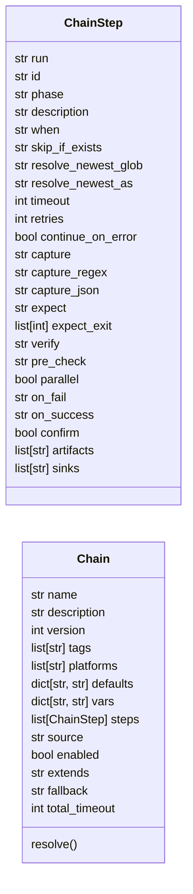
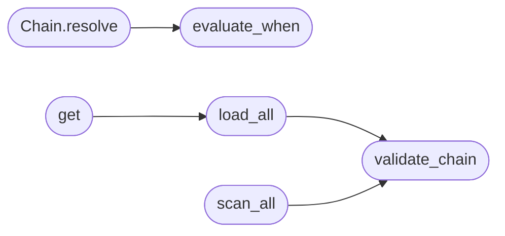

# `modules.chain_registry`

> Source: [modules/chain_registry.py:1](../../modules/chain_registry.py#L1) | language `py` | coverage 100.0% | [API index](../index.md)

Chain registry - ordered orchestration chains from ``chains/*.yaml``.

One file per chain, same philosophy as ``lazyaddons/`` and ``exploits/``.
The ``apt_chain`` shell command interprets these files instead of
hardcoding its steps, so operators extend the orchestration by editing
YAML. Every step must be a routable shell command; resolution (tokens,
conditions, skip rules, newest-file globs) happens here, execution stays
in [`modules.chain_runner`](modules.chain_runner.py.md) where timeouts and outcomes belong.

Schema version 2 adds `[`when`](#chainstep-when)` conditions, per-step timeouts, retries,
error policy, output capture, artefacts and sink tags. Version 1 files
remain valid with the same defaults.

## Contents

- **Classes:** [`ChainStep`](#chainstep), [`Chain`](#chain)
- **Functions:** [`evaluate_when`](#evaluate_when), [`validate_chain`](#validate_chain), [`load_all`](#load_all), [`get`](#get), [`scan_all`](#scan_all), [`set_enabled`](#set_enabled), [`generate_for_playbook`](#generate_for_playbook)
- **Constants:** [`CHAINS_DIR`](#chains_dir)

## Type Diagram



## Call Graph

Solid arrows stay in this module, dashed arrows leave it.



## Classes

<a id="chainstep"></a>

### `ChainStep`

`class` `dataclass` | [modules/chain_registry.py:55](../../modules/chain_registry.py#L55)

Decorators: `@dataclass`

```python
class ChainStep
```

One ordered step: shell line plus optional guards and outcome policy.

**Attributes**

| Name | Type | Default | Description |
|---|---|---|---|
| [`run`](#chainstep-run) | `str` | `''` |  |
| [`id`](#chainstep-id) | `str` | `''` |  |
| [`phase`](#chainstep-phase) | `str` | `''` |  |
| [`description`](#chainstep-description) | `str` | `''` |  |
| [`when`](#chainstep-when) | `str` | `''` |  |
| [`skip_if_exists`](#chainstep-skip_if_exists) | `str` | `''` |  |
| [`resolve_newest_glob`](#chainstep-resolve_newest_glob) | `str` | `''` |  |
| [`resolve_newest_as`](#chainstep-resolve_newest_as) | `str` | `''` |  |
| [`timeout`](#chainstep-timeout) | `int` | `0` |  |
| [`retries`](#chainstep-retries) | `int` | `0` |  |
| [`continue_on_error`](#chainstep-continue_on_error) | `bool` | `False` |  |
| [`capture`](#chainstep-capture) | `str` | `''` |  |
| [`capture_regex`](#chainstep-capture_regex) | `str` | `''` |  |
| [`capture_json`](#chainstep-capture_json) | `str` | `''` |  |
| [`expect`](#chainstep-expect) | `str` | `''` |  |
| [`expect_exit`](#chainstep-expect_exit) | `list[int]` | `field(default_factory=list)` |  |
| [`verify`](#chainstep-verify) | `str` | `''` |  |
| [`pre_check`](#chainstep-pre_check) | `str` | `''` |  |
| [`parallel`](#chainstep-parallel) | `bool` | `False` |  |
| [`on_fail`](#chainstep-on_fail) | `str` | `''` |  |
| [`on_success`](#chainstep-on_success) | `str` | `''` |  |
| [`confirm`](#chainstep-confirm) | `bool` | `False` |  |
| [`artifacts`](#chainstep-artifacts) | `list[str]` | `field(default_factory=list)` |  |
| [`sinks`](#chainstep-sinks) | `list[str]` | `field(default_factory=list)` |  |

**Members**

| Member | Kind | Summary |
|---|---|---|
| [`identifier`](#chainstep-identifier) | property | Return the declared id or a stable generated one. |

<a id="chainstep-identifier"></a>

#### `ChainStep.identifier`

`property` | [modules/chain_registry.py:84](../../modules/chain_registry.py#L84)

Decorators: `@property`

```python
def identifier(self) -> str
```

Return the declared id or a stable generated one.

**Returns:** `str`

---

<a id="chain"></a>

### `Chain`

`class` `dataclass` | [modules/chain_registry.py:90](../../modules/chain_registry.py#L90)

Decorators: `@dataclass`

```python
class Chain
```

A validated chain with defaults, variables and ordered steps.

**Attributes**

| Name | Type | Default | Description |
|---|---|---|---|
| [`name`](#chain-name) | `str` | `''` |  |
| [`description`](#chain-description) | `str` | `''` |  |
| [`version`](#chain-version) | `int` | `1` |  |
| [`tags`](#chain-tags) | `list[str]` | `field(default_factory=list)` |  |
| [`platforms`](#chain-platforms) | `list[str]` | `field(default_factory=list)` |  |
| [`defaults`](#chain-defaults) | `dict[str, str]` | `field(default_factory=dict)` |  |
| [`vars`](#chain-vars) | `dict[str, str]` | `field(default_factory=dict)` |  |
| [`steps`](#chain-steps) | `list[ChainStep]` | `field(default_factory=list)` |  |
| [`source`](#chain-source) | `str` | `''` |  |
| [`enabled`](#chain-enabled) | `bool` | `True` |  |
| [`extends`](#chain-extends) | `str` | `''` |  |
| [`fallback`](#chain-fallback) | `str` | `''` |  |
| [`total_timeout`](#chain-total_timeout) | `int` | `0` |  |

**Members**

| Member | Kind | Summary |
|---|---|---|
| [`resolve`](#chain-resolve) | method | Substitute tokens, evaluate conditions and guards. |

<a id="chain-resolve"></a>

#### `Chain.resolve`

`method` | [modules/chain_registry.py:107](../../modules/chain_registry.py#L107)

```python
def resolve(self, tokens: dict[str, str]) -> list[dict[str, Any]]
```

Substitute tokens, evaluate conditions and guards.

Returns one mapping per step with ``run``, ``skipped`` and
``reason`` plus the v2 policy fields. The runner repeats this
resolution after every capture so later steps see earlier output.

**Parameters**

| Name | Type | Default | Description |
|---|---|---|---|
| `tokens` | `dict[str, str]` |  |  |

**Returns:** `list[dict[str, Any]]`

*Calls:* [`evaluate_when`](#evaluate_when)

*Called by:* [`build_llm_recovery_chain`](cli.apt_chain_support.py.md#build_llm_recovery_chain)

---

## Functions

<a id="evaluate_when"></a>

### `evaluate_when`

`function` | [modules/chain_registry.py:220](../../modules/chain_registry.py#L220)

```python
def evaluate_when(expression: str, variables: dict[str, str] | None = None) -> bool
```

Evaluate a safe `[`when`](#chainstep-when)` expression against string variables.

The grammar accepts names, string/boolean constants, ``and``, ``or``,
``not``, ``==``, ``!=``, ``in`` and ``not in``. Calls, attributes and
arithmetic are rejected. Undefined names resolve to an empty string.

**Parameters**

| Name | Type | Default | Description |
|---|---|---|---|
| `expression` | `str` |  | Condition text; empty means true. |
| `variables` | `dict[str, str] \| None` | `None` | Name-to-string mapping. |

**Returns:** `bool` - Boolean result; malformed expressions evaluate to False.

*Called by:* [`Chain.resolve`](#chain-resolve)

---

<a id="validate_chain"></a>

### `validate_chain`

`function` | [modules/chain_registry.py:285](../../modules/chain_registry.py#L285)

```python
def validate_chain(data: Any, filename: str = '', chains_dir: Path | str | None = None) -> list[str]
```

Validate raw YAML data against the chain schema.

**Parameters**

| Name | Type | Default | Description |
|---|---|---|---|
| `data` | `Any` |  |  |
| `filename` | `str` | `''` |  |
| `chains_dir` | `Path \| str \| None` | `None` |  |

**Returns:** `list[str]`

*Called by:* [`resolve_admin`](cli.apt_chain_support.py.md#resolve_admin), [`distill`](modules.chain_distill.py.md#distill), [`load_all`](#load_all), [`scan_all`](#scan_all), [`write_generated_chain`](modules.chain_synth.py.md#write_generated_chain)

---

<a id="load_all"></a>

### `load_all`

`function` | [modules/chain_registry.py:435](../../modules/chain_registry.py#L435)

```python
def load_all(chains_dir: Path | str = CHAINS_DIR) -> dict[str, Chain]
```

Load every valid, enabled chain file (skips the rest loudly).

**Parameters**

| Name | Type | Default | Description |
|---|---|---|---|
| `chains_dir` | `Path \| str` | `CHAINS_DIR` |  |

**Returns:** `dict[str, Chain]`

**Raises**

- `RuntimeError`: (raised in the body, not documented)

*Calls:* [`validate_chain`](#validate_chain)

*Called by:* [`ExploitMigratedCommandSet.do_chain`](cli.commands.exploit_migrated.py.md#exploitmigratedcommandset-do_chain), [`get`](#get)

---

<a id="get"></a>

### `get`

`function` | [modules/chain_registry.py:550](../../modules/chain_registry.py#L550)

```python
def get(name: str, chains_dir: Path | str = CHAINS_DIR) -> Chain | None
```

Return one chain by name, or None.

**Parameters**

| Name | Type | Default | Description |
|---|---|---|---|
| `name` | `str` |  |  |
| `chains_dir` | `Path \| str` | `CHAINS_DIR` |  |

**Returns:** `Chain | None`

*Calls:* [`load_all`](#load_all)

---

<a id="scan_all"></a>

### `scan_all`

`function` | [modules/chain_registry.py:555](../../modules/chain_registry.py#L555)

```python
def scan_all(chains_dir: Path | str = CHAINS_DIR) -> list[dict[str, Any]]
```

List every chain file including disabled ones (for administration).

**Parameters**

| Name | Type | Default | Description |
|---|---|---|---|
| `chains_dir` | `Path \| str` | `CHAINS_DIR` |  |

**Returns:** `list[dict[str, Any]]`

**Raises**

- `RuntimeError`: (raised in the body, not documented)

*Calls:* [`validate_chain`](#validate_chain)

*Called by:* [`resolve_admin`](cli.apt_chain_support.py.md#resolve_admin), [`ExploitMigratedCommandSet.do_chain`](cli.commands.exploit_migrated.py.md#exploitmigratedcommandset-do_chain), [`OrchestratorAssetsMixin.chain_rows`](cli.orchestrator_assets_tabs.py.md#orchestratorassetsmixin-chain_rows), [`OrchestratorAssetsMixin.remove_chain`](cli.orchestrator_assets_tabs.py.md#orchestratorassetsmixin-remove_chain), [`OrchestratorAssetsMixin.toggle_chain`](cli.orchestrator_assets_tabs.py.md#orchestratorassetsmixin-toggle_chain)

---

<a id="set_enabled"></a>

### `set_enabled`

`function` | [modules/chain_registry.py:615](../../modules/chain_registry.py#L615)

```python
def set_enabled(name: str, enabled: bool, chains_dir: Path | str = CHAINS_DIR) -> bool
```

Flip a chain's `[`enabled`](#chain-enabled)` flag in its YAML file (round-trip).

**Parameters**

| Name | Type | Default | Description |
|---|---|---|---|
| `name` | `str` |  |  |
| `enabled` | `bool` |  |  |
| `chains_dir` | `Path \| str` | `CHAINS_DIR` |  |

**Returns:** `bool`

**Raises**

- `RuntimeError`: (raised in the body, not documented)

*Called by:* [`resolve_admin`](cli.apt_chain_support.py.md#resolve_admin), [`OrchestratorAssetsMixin.toggle_chain`](cli.orchestrator_assets_tabs.py.md#orchestratorassetsmixin-toggle_chain)

---

<a id="generate_for_playbook"></a>

### `generate_for_playbook`

`function` | [modules/chain_registry.py:638](../../modules/chain_registry.py#L638)

```python
def generate_for_playbook(engine_key: str, apt_display: str = '', description: str = '', chains_dir: Path | str = CHAINS_DIR, overwrite: bool = False) -> Path
```

Write a per-APT chain file inheriting the base APT chain.

**Parameters**

| Name | Type | Default | Description |
|---|---|---|---|
| `engine_key` | `str` |  |  |
| `apt_display` | `str` | `''` |  |
| `description` | `str` | `''` |  |
| `chains_dir` | `Path \| str` | `CHAINS_DIR` |  |
| `overwrite` | `bool` | `False` |  |

**Returns:** `Path`

**Raises**

- `FileExistsError`: (raised in the body, not documented)
- `RuntimeError`: (raised in the body, not documented)
- `ValueError`: (raised in the body, not documented)

*Called by:* [`OrchestratorAssetsMixin.generate_chain`](cli.orchestrator_assets_tabs.py.md#orchestratorassetsmixin-generate_chain)

---

## Constants

<a id="chains_dir"></a>

### `CHAINS_DIR`

`constant` | [modules/chain_registry.py:35](../../modules/chain_registry.py#L35)

```python
CHAINS_DIR = _BASE_DIR / 'chains'
```

---
