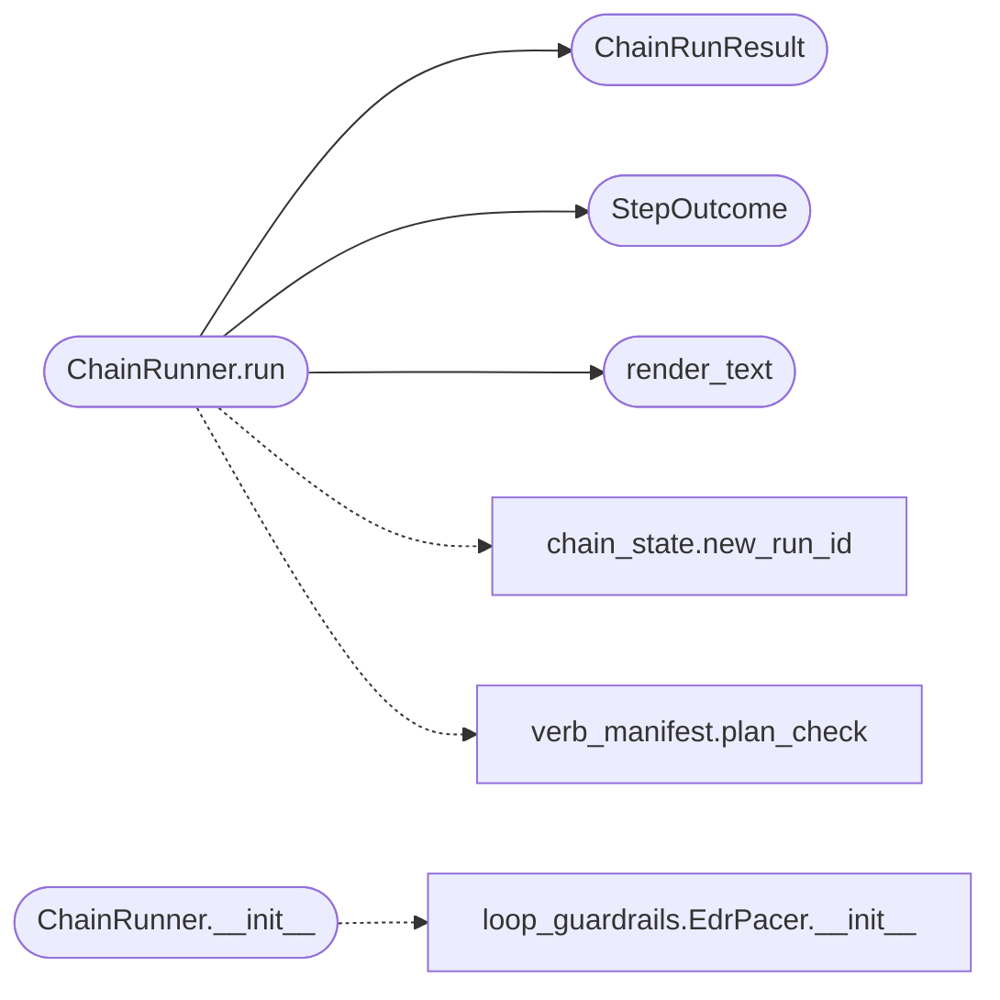

# `modules.chain_runner`

> Source: [modules/chain_runner.py:1](../../modules/chain_runner.py#L1) | language `py` | coverage 100.0% | [API index](../index.md)

Single execution engine for YAML orchestration chains.

``chain_registry`` resolves and validates; this module executes. It owns
step conditions, timeouts, retries, error policy, output capture (text,
regex and JSON), post-step verification, pre-step LLM-predicted
pre-checks, parallel step groups, branching, approval gates, checkpoints
and the structured result every caller (CLI, loop, MCP) consumes. It
never retries a successful step, never hides a failure unless the YAML
asked for it, and never writes to the graph directly: sink tags travel
in the result so the outcome bus can fan them out.

## Contents

- **Classes:** [`StepOutcome`](#stepoutcome), [`ChainRunResult`](#chainrunresult), [`ReplanContext`](#replancontext), [`ChainRunner`](#chainrunner)
- **Functions:** [`render_text`](#render_text)

## Type Diagram

```mermaid
classDiagram
    direction LR
    class StepOutcome
    StepOutcome : str id
    StepOutcome : str run
    StepOutcome : str phase
    StepOutcome : str status
    StepOutcome : str output
    StepOutcome : str reason
    StepOutcome : int attempts
    StepOutcome : str captured
    StepOutcome : str verify_output
    StepOutcome : list[str] artifacts
    StepOutcome : list[str] sinks
    StepOutcome : float duration_ms
    StepOutcome : str verdict
    StepOutcome : list[str] evidence_refs
    StepOutcome : list[str] missing_fields
    StepOutcome : list[str] alternatives
    StepOutcome : dict[str, int] budget_used
    StepOutcome : ok()
    StepOutcome : to_dict()
    class ChainRunResult
    ChainRunResult : str name
    ChainRunResult : str target
    ChainRunResult : bool ok
    ChainRunResult : bool aborted
    ChainRunResult : str reason
    ChainRunResult : str run_id
    ChainRunResult : list[StepOutcome] steps
    ChainRunResult : dict[str, str] variables
    ChainRunResult : list[str] artifacts
    ChainRunResult : list[str] branches
    ChainRunResult : int filtered
    ChainRunResult : float started_at
    ChainRunResult : float finished_at
    ChainRunResult : list[str] plan_warnings
    ChainRunResult : str fallback_used
    ChainRunResult : int fallback_depth
    ChainRunResult : dict[str, str] verdicts
    ChainRunResult : to_dict()
    ChainRunResult : chain_proven()
    class ReplanContext
    ReplanContext : str chain_name
    ReplanContext : str target
    ReplanContext : StepOutcome  None outcome
    ReplanContext : list[str] executed_ids
    ReplanContext : dict[str, str] variables
    ReplanContext : set_var()
    ReplanContext : insert_step()
    ReplanContext : skip_rest()
    ReplanContext : applied_vars()
    ReplanContext : inserted()
    ReplanContext : skip_rest_flag()
    class ChainRunner
    ChainRunner : __init__()
    ChainRunner : run()
```



## Call Graph

Solid arrows stay in this module, dashed arrows leave it.



## Classes

<a id="stepoutcome"></a>

### `StepOutcome`

`class` `dataclass` | [modules/chain_runner.py:54](../../modules/chain_runner.py#L54)

Decorators: `@dataclass`

```python
class StepOutcome
```

One executed or skipped step.

`[`verdict`](#stepoutcome-verdict)` carries the chain-of-evidence result for steps that
declare hunting fields: ``evidence_observed`` (success with every
required field present in the captured evidence), ``insufficient_data``
(success but required fields missing) and ``not_observed`` (failure).

**Attributes**

| Name | Type | Default | Description |
|---|---|---|---|
| [`id`](#stepoutcome-id) | `str` | `''` |  |
| [`run`](#stepoutcome-run) | `str` | `''` |  |
| [`phase`](#stepoutcome-phase) | `str` | `''` |  |
| [`status`](#stepoutcome-status) | `str` | `'pending'` |  |
| [`output`](#stepoutcome-output) | `str` | `''` |  |
| [`reason`](#stepoutcome-reason) | `str` | `''` |  |
| [`attempts`](#stepoutcome-attempts) | `int` | `0` |  |
| [`captured`](#stepoutcome-captured) | `str` | `''` |  |
| [`verify_output`](#stepoutcome-verify_output) | `str` | `''` |  |
| [`artifacts`](#stepoutcome-artifacts) | `list[str]` | `field(default_factory=list)` |  |
| [`sinks`](#stepoutcome-sinks) | `list[str]` | `field(default_factory=list)` |  |
| [`duration_ms`](#stepoutcome-duration_ms) | `float` | `0.0` |  |
| [`verdict`](#stepoutcome-verdict) | `str` | `''` |  |
| [`evidence_refs`](#stepoutcome-evidence_refs) | `list[str]` | `field(default_factory=list)` |  |
| [`missing_fields`](#stepoutcome-missing_fields) | `list[str]` | `field(default_factory=list)` |  |
| [`alternatives`](#stepoutcome-alternatives) | `list[str]` | `field(default_factory=list)` |  |
| [`budget_used`](#stepoutcome-budget_used) | `dict[str, int]` | `field(default_factory=dict)` |  |

**Members**

| Member | Kind | Summary |
|---|---|---|
| [`ok`](#stepoutcome-ok) | property | Return True for success, dry-run and skipped steps. |
| [`to_dict`](#stepoutcome-to_dict) | method | Return a JSON-serializable view. |

<a id="stepoutcome-ok"></a>

#### `StepOutcome.ok`

`property` | [modules/chain_runner.py:82](../../modules/chain_runner.py#L82)

Decorators: `@property`

```python
def ok(self) -> bool
```

Return True for success, dry-run and skipped steps.

**Returns:** `bool`

<a id="stepoutcome-to_dict"></a>

#### `StepOutcome.to_dict`

`method` | [modules/chain_runner.py:86](../../modules/chain_runner.py#L86)

```python
def to_dict(self) -> dict[str, Any]
```

Return a JSON-serializable view.

**Returns:** `dict[str, Any]`

---

<a id="chainrunresult"></a>

### `ChainRunResult`

`class` `dataclass` | [modules/chain_runner.py:110](../../modules/chain_runner.py#L110)

Decorators: `@dataclass`

```python
class ChainRunResult
```

Structured result of one chain execution.

**Attributes**

| Name | Type | Default | Description |
|---|---|---|---|
| [`name`](#chainrunresult-name) | `str` | `''` |  |
| [`target`](#chainrunresult-target) | `str` | `''` |  |
| [`ok`](#chainrunresult-ok) | `bool` | `True` |  |
| [`aborted`](#chainrunresult-aborted) | `bool` | `False` |  |
| [`reason`](#chainrunresult-reason) | `str` | `''` |  |
| [`run_id`](#chainrunresult-run_id) | `str` | `''` |  |
| [`steps`](#chainrunresult-steps) | `list[StepOutcome]` | `field(default_factory=list)` |  |
| [`variables`](#chainrunresult-variables) | `dict[str, str]` | `field(default_factory=dict)` |  |
| [`artifacts`](#chainrunresult-artifacts) | `list[str]` | `field(default_factory=list)` |  |
| [`branches`](#chainrunresult-branches) | `list[str]` | `field(default_factory=list)` |  |
| [`filtered`](#chainrunresult-filtered) | `int` | `0` |  |
| [`started_at`](#chainrunresult-started_at) | `float` | `0.0` |  |
| [`finished_at`](#chainrunresult-finished_at) | `float` | `0.0` |  |
| [`plan_warnings`](#chainrunresult-plan_warnings) | `list[str]` | `field(default_factory=list)` |  |
| [`fallback_used`](#chainrunresult-fallback_used) | `str` | `''` |  |
| [`fallback_depth`](#chainrunresult-fallback_depth) | `int` | `0` |  |
| [`verdicts`](#chainrunresult-verdicts) | `dict[str, str]` | `field(default_factory=dict)` |  |

**Members**

| Member | Kind | Summary |
|---|---|---|
| [`to_dict`](#chainrunresult-to_dict) | method | Return a JSON-serializable view. |
| [`chain_proven`](#chainrunresult-chain_proven) | property | Return whether every declared hunting dependency is observed. |

<a id="chainrunresult-to_dict"></a>

#### `ChainRunResult.to_dict`

`method` | [modules/chain_runner.py:131](../../modules/chain_runner.py#L131)

```python
def to_dict(self) -> dict[str, Any]
```

Return a JSON-serializable view.

**Returns:** `dict[str, Any]`

<a id="chainrunresult-chain_proven"></a>

#### `ChainRunResult.chain_proven`

`property` | [modules/chain_runner.py:155](../../modules/chain_runner.py#L155)

Decorators: `@property`

```python
def chain_proven(self) -> bool
```

Return whether every declared hunting dependency is observed.

**Returns:** `bool`

---

<a id="replancontext"></a>

### `ReplanContext`

`class` `dataclass` | [modules/chain_runner.py:161](../../modules/chain_runner.py#L161)

Decorators: `@dataclass`

```python
class ReplanContext
```

What one replanner may do after a step executes.

The runner owns the context: a replanner records desired changes and
the runner applies them under its own caps, so a misbehaving advice
source cannot break the chain invariants.

**Attributes**

| Name | Type | Default | Description |
|---|---|---|---|
| [`chain_name`](#replancontext-chain_name) | `str` | `''` |  |
| [`target`](#replancontext-target) | `str` | `''` |  |
| [`outcome`](#replancontext-outcome) | `StepOutcome \| None` | `None` |  |
| [`executed_ids`](#replancontext-executed_ids) | `list[str]` | `field(default_factory=list)` |  |
| [`variables`](#replancontext-variables) | `dict[str, str]` | `field(default_factory=dict)` |  |

**Members**

| Member | Kind | Summary |
|---|---|---|
| [`set_var`](#replancontext-set_var) | method | Record a variable the next steps should see. |
| [`insert_step`](#replancontext-insert_step) | method | Record one step to execute right after the finished step. |
| [`skip_rest`](#replancontext-skip_rest) | method | Record that remaining steps must not execute. |
| [`applied_vars`](#replancontext-applied_vars) | property | Return recorded variable changes. |
| [`inserted`](#replancontext-inserted) | property | Return recorded steps to insert. |
| [`skip_rest_flag`](#replancontext-skip_rest_flag) | property | Return True when remaining steps should be skipped. |

<a id="replancontext-set_var"></a>

#### `ReplanContext.set_var`

`method` | [modules/chain_runner.py:178](../../modules/chain_runner.py#L178)

```python
def set_var(self, name: str, value: str) -> None
```

Record a variable the next steps should see.

**Parameters**

| Name | Type | Default | Description |
|---|---|---|---|
| `name` | `str` |  |  |
| `value` | `str` |  |  |

<a id="replancontext-insert_step"></a>

#### `ReplanContext.insert_step`

`method` | [modules/chain_runner.py:183](../../modules/chain_runner.py#L183)

```python
def insert_step(self, step: ChainStep) -> None
```

Record one step to execute right after the finished step.

**Parameters**

| Name | Type | Default | Description |
|---|---|---|---|
| `step` | `ChainStep` |  |  |

*Called by:* [`build_reactive_replanner`](cli.apt_chain_support.py.md#build_reactive_replanner)

<a id="replancontext-skip_rest"></a>

#### `ReplanContext.skip_rest`

`method` | [modules/chain_runner.py:188](../../modules/chain_runner.py#L188)

```python
def skip_rest(self) -> None
```

Record that remaining steps must not execute.

<a id="replancontext-applied_vars"></a>

#### `ReplanContext.applied_vars`

`property` | [modules/chain_runner.py:193](../../modules/chain_runner.py#L193)

Decorators: `@property`

```python
def applied_vars(self) -> dict[str, str]
```

Return recorded variable changes.

**Returns:** `dict[str, str]`

<a id="replancontext-inserted"></a>

#### `ReplanContext.inserted`

`property` | [modules/chain_runner.py:198](../../modules/chain_runner.py#L198)

Decorators: `@property`

```python
def inserted(self) -> list[ChainStep]
```

Return recorded steps to insert.

**Returns:** `list[ChainStep]`

<a id="replancontext-skip_rest_flag"></a>

#### `ReplanContext.skip_rest_flag`

`property` | [modules/chain_runner.py:203](../../modules/chain_runner.py#L203)

Decorators: `@property`

```python
def skip_rest_flag(self) -> bool
```

Return True when remaining steps should be skipped.

**Returns:** `bool`

---

<a id="chainrunner"></a>

### `ChainRunner`

`class` | [modules/chain_runner.py:216](../../modules/chain_runner.py#L216)

```python
class ChainRunner
```

Execute one chain with per-step policy and structured outcomes.

**Members**

| Member | Kind | Summary |
|---|---|---|
| [`__init__`](#chainrunner-__init__) | constructor | Bind the chain, the execution primitive and operator switches. |
| [`run`](#chainrunner-run) | method | Execute the chain in order and return every step outcome. |

<a id="chainrunner-__init__"></a>

#### `ChainRunner.__init__`

`constructor` | [modules/chain_runner.py:219](../../modules/chain_runner.py#L219)

```python
def __init__(self, chain: Chain, tokens: dict[str, str] | None = None, shell: Any = None, executor: Callable[[str], str] | None = None, default_timeout: float = _DEFAULT_TIMEOUT, dry_run: bool = False, on_step: Callable[[StepOutcome], None] | None = None, retry_backoff: float = 0.5, total_timeout: float = 0.0, approver: Callable[[str, str], bool] | None = None, checkpoint_dir: str | os.PathLike | None = None, run_id: str = '', resume_state: dict[str, Any] | None = None, step_filter: set[str] | None = None, replanner: Callable[[ReplanContext], None] | None = None, command_filter: Callable[[str], str] | None = None, fallback_loader: Callable[[str], Chain | None] | None = None, max_fallback_depth: int = _MAX_FALLBACK_DEPTH, fallback_depth: int = 0, pace: bool = True) -> None
```

Bind the chain, the execution primitive and operator switches.

**Parameters**

| Name | Type | Default | Description |
|---|---|---|---|
| `chain` | `Chain` |  | Chain to execute. |
| `tokens` | `dict[str, str] \| None` | `None` | Chain tokens (target, playbook, artefact paths...). |
| `shell` | `Any` | `None` | Live cmd2 shell for verb steps (None uses raw exec). |
| `executor` | `Callable[[str], str] \| None` | `None` | Optional alternative execution primitive. |
| `default_timeout` | `float` | `_DEFAULT_TIMEOUT` | Per-step wall clock fallback. |
| `dry_run` | `bool` | `False` | Resolve without executing anything. |
| `on_step` | `Callable[[StepOutcome], None] \| None` | `None` | Optional per-step observer callback. |
| `retry_backoff` | `float` | `0.5` | Base seconds between retry attempts. |
| `total_timeout` | `float` | `0.0` | Whole-chain wall clock cap (0 disables). |
| `approver` | `Callable[[str, str], bool] \| None` | `None` | Callback for ``confirm`` steps (None: denied). |
| `checkpoint_dir` | `str \| os.PathLike \| None` | `None` | When set, persist resumable checkpoints. |
| `run_id` | `str` | `''` | Explicit run id (else generated with checkpointing). |
| `resume_state` | `dict[str, Any] \| None` | `None` | Previously saved checkpoint to continue from. |
| `step_filter` | `set[str] \| None` | `None` | Restrict execution to these step ids. |
| `replanner` | `Callable[[ReplanContext], None] \| None` | `None` | Optional after-step advice hook. |
| `command_filter` | `Callable[[str], str] \| None` | `None` | Optional transform applied to every command (run and verify) right before execution, such as the retry-session ``sudo -A`` askpass rewrite. A filter error keeps the original command instead of aborting. |
| `fallback_loader` | `Callable[[str], Chain \| None] \| None` | `None` | Resolver for the chain's `[`fallback`](modules.chain_registry.py.md#chain-fallback)` name (default: ``chain_registry.get``). |
| `max_fallback_depth` | `int` | `_MAX_FALLBACK_DEPTH` | How many fallback hops one run may take. |
| `fallback_depth` | `int` | `0` | Current fallback depth (internal). |
| `pace` | `bool` | `True` | Enable defense-aware inter-step pacing. The shared EdrPacer stays inert until a step runs slowly or its output shows reset/timeout markers, then it inserts a bounded quiet period before the next step, matching the autonomous loop's OPSEC behaviour. Dry runs never pace. |

*Calls:* [`EdrPacer.__init__`](modules.loop_guardrails.py.md#edrpacer-__init__)

*Called by:* [`CommandAndControlMigratedCommandSet.do_apt_chain`](cli.commands.command_and_control_migrated.py.md#commandandcontrolmigratedcommandset-do_apt_chain), [`retry_chain`](cli.retry_support.py.md#retry_chain), [`run_matrix`](modules.gym_matrix_runner.py.md#run_matrix)

<a id="chainrunner-run"></a>

#### `ChainRunner.run`

`method` | [modules/chain_runner.py:332](../../modules/chain_runner.py#L332)

```python
def run(self) -> ChainRunResult
```

Execute the chain in order and return every step outcome.

**Returns:** `ChainRunResult`

*Calls:* [`ChainRunResult`](#chainrunresult), [`StepOutcome`](#stepoutcome), [`render_text`](#render_text), [`new_run_id`](modules.chain_state.py.md#new_run_id), [`plan_check`](modules.verb_manifest.py.md#plan_check)

*Called by:* [`CommandAndControlMigratedCommandSet.do_apt_chain`](cli.commands.command_and_control_migrated.py.md#commandandcontrolmigratedcommandset-do_apt_chain), [`retry_chain`](cli.retry_support.py.md#retry_chain), [`run_matrix`](modules.gym_matrix_runner.py.md#run_matrix)

---

## Functions

<a id="render_text"></a>

### `render_text`

`function` | [modules/chain_runner.py:208](../../modules/chain_runner.py#L208)

```python
def render_text(template: str, variables: dict[str, str]) -> str
```

Substitute single-brace tokens in one pass.

**Parameters**

| Name | Type | Default | Description |
|---|---|---|---|
| `template` | `str` |  |  |
| `variables` | `dict[str, str]` |  |  |

**Returns:** `str`

*Called by:* [`ChainRunner.run`](#chainrunner-run)

---
