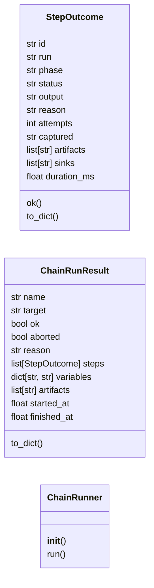
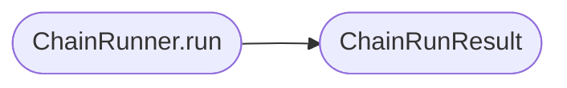

# `modules.chain_runner`

> Source: [modules/chain_runner.py:1](../../modules/chain_runner.py#L1) | language `py` | coverage 100.0% | [API index](../index.md)

Single execution engine for YAML orchestration chains.

``chain_registry`` resolves and validates; this module executes. It owns
step conditions, timeouts, retries, error policy, output capture and the
structured result every caller (CLI, loop, MCP) consumes. It never
retries a successful step, never hides a failure unless the YAML asked
for it, and never writes to the graph directly: sink tags travel in the
result so the outcome bus can fan them out.

## Contents

- **Classes:** [`StepOutcome`](#stepoutcome), [`ChainRunResult`](#chainrunresult), [`ChainRunner`](#chainrunner)
- **Functions:** [`render_text`](#render_text)

## Type Diagram



## Call Graph

Solid arrows stay in this module, dashed arrows leave it.



## Classes

<a id="stepoutcome"></a>

### `StepOutcome`

`class` `dataclass` | [modules/chain_runner.py:34](../../modules/chain_runner.py#L34)

Decorators: `@dataclass`

```python
class StepOutcome
```

One executed or skipped step.

**Attributes**

| Name | Type | Default | Description |
|---|---|---|---|
| [`id`](#stepoutcome-id) | `str` | `''` |  |
| [`run`](#stepoutcome-run) | `str` | `''` |  |
| [`phase`](#stepoutcome-phase) | `str` | `''` |  |
| [`status`](#stepoutcome-status) | `str` | `'pending'` |  |
| [`output`](#stepoutcome-output) | `str` | `''` |  |
| [`reason`](#stepoutcome-reason) | `str` | `''` |  |
| [`attempts`](#stepoutcome-attempts) | `int` | `0` |  |
| [`captured`](#stepoutcome-captured) | `str` | `''` |  |
| [`artifacts`](#stepoutcome-artifacts) | `list[str]` | `field(default_factory=list)` |  |
| [`sinks`](#stepoutcome-sinks) | `list[str]` | `field(default_factory=list)` |  |
| [`duration_ms`](#stepoutcome-duration_ms) | `float` | `0.0` |  |

**Members**

| Member | Kind | Summary |
|---|---|---|
| [`ok`](#stepoutcome-ok) | property | Return True for success and dry-run steps. |
| [`to_dict`](#stepoutcome-to_dict) | method | Return a JSON-serializable view. |

<a id="stepoutcome-ok"></a>

#### `StepOutcome.ok`

`property` | [modules/chain_runner.py:50](../../modules/chain_runner.py#L50)

Decorators: `@property`

```python
def ok(self) -> bool
```

Return True for success and dry-run steps.

**Returns:** `bool`

<a id="stepoutcome-to_dict"></a>

#### `StepOutcome.to_dict`

`method` | [modules/chain_runner.py:54](../../modules/chain_runner.py#L54)

```python
def to_dict(self) -> dict[str, Any]
```

Return a JSON-serializable view.

**Returns:** `dict[str, Any]`

---

<a id="chainrunresult"></a>

### `ChainRunResult`

`class` `dataclass` | [modules/chain_runner.py:72](../../modules/chain_runner.py#L72)

Decorators: `@dataclass`

```python
class ChainRunResult
```

Structured result of one chain execution.

**Attributes**

| Name | Type | Default | Description |
|---|---|---|---|
| [`name`](#chainrunresult-name) | `str` | `''` |  |
| [`target`](#chainrunresult-target) | `str` | `''` |  |
| [`ok`](#chainrunresult-ok) | `bool` | `True` |  |
| [`aborted`](#chainrunresult-aborted) | `bool` | `False` |  |
| [`reason`](#chainrunresult-reason) | `str` | `''` |  |
| [`steps`](#chainrunresult-steps) | `list[StepOutcome]` | `field(default_factory=list)` |  |
| [`variables`](#chainrunresult-variables) | `dict[str, str]` | `field(default_factory=dict)` |  |
| [`artifacts`](#chainrunresult-artifacts) | `list[str]` | `field(default_factory=list)` |  |
| [`started_at`](#chainrunresult-started_at) | `float` | `0.0` |  |
| [`finished_at`](#chainrunresult-finished_at) | `float` | `0.0` |  |

**Members**

| Member | Kind | Summary |
|---|---|---|
| [`to_dict`](#chainrunresult-to_dict) | method | Return a JSON-serializable view. |

<a id="chainrunresult-to_dict"></a>

#### `ChainRunResult.to_dict`

`method` | [modules/chain_runner.py:86](../../modules/chain_runner.py#L86)

```python
def to_dict(self) -> dict[str, Any]
```

Return a JSON-serializable view.

**Returns:** `dict[str, Any]`

---

<a id="chainrunner"></a>

### `ChainRunner`

`class` | [modules/chain_runner.py:111](../../modules/chain_runner.py#L111)

```python
class ChainRunner
```

Execute one chain with per-step policy and structured outcomes.

**Members**

| Member | Kind | Summary |
|---|---|---|
| [`__init__`](#chainrunner-__init__) | constructor | Bind the chain, the execution primitive and operator switches. |
| [`run`](#chainrunner-run) | method | Execute the chain in order and return every step outcome. |

<a id="chainrunner-__init__"></a>

#### `ChainRunner.__init__`

`constructor` | [modules/chain_runner.py:114](../../modules/chain_runner.py#L114)

```python
def __init__(self, chain: Chain, tokens: dict[str, str] | None = None, shell: Any = None, executor: Callable[[str], str] | None = None, default_timeout: float = _DEFAULT_TIMEOUT, dry_run: bool = False, on_step: Callable[[StepOutcome], None] | None = None, retry_backoff: float = 0.5) -> None
```

Bind the chain, the execution primitive and operator switches.

**Parameters**

| Name | Type | Default | Description |
|---|---|---|---|
| `chain` | `Chain` |  |  |
| `tokens` | `dict[str, str] \| None` | `None` |  |
| `shell` | `Any` | `None` |  |
| `executor` | `Callable[[str], str] \| None` | `None` |  |
| `default_timeout` | `float` | `_DEFAULT_TIMEOUT` |  |
| `dry_run` | `bool` | `False` |  |
| `on_step` | `Callable[[StepOutcome], None] \| None` | `None` |  |
| `retry_backoff` | `float` | `0.5` |  |

*Called by:* [`CommandAndControlMigratedCommandSet.do_apt_chain`](cli.commands.command_and_control_migrated.py.md#commandandcontrolmigratedcommandset-do_apt_chain)

<a id="chainrunner-run"></a>

#### `ChainRunner.run`

`method` | [modules/chain_runner.py:135](../../modules/chain_runner.py#L135)

```python
def run(self) -> ChainRunResult
```

Execute the chain in order and return every step outcome.

**Returns:** `ChainRunResult`

*Calls:* [`ChainRunResult`](#chainrunresult)

*Called by:* [`CommandAndControlMigratedCommandSet.do_apt_chain`](cli.commands.command_and_control_migrated.py.md#commandandcontrolmigratedcommandset-do_apt_chain)

---

## Functions

<a id="render_text"></a>

### `render_text`

`function` | [modules/chain_runner.py:103](../../modules/chain_runner.py#L103)

```python
def render_text(template: str, variables: dict[str, str]) -> str
```

Substitute single-brace tokens in one pass.

**Parameters**

| Name | Type | Default | Description |
|---|---|---|---|
| `template` | `str` |  |  |
| `variables` | `dict[str, str]` |  |  |

**Returns:** `str`

---
