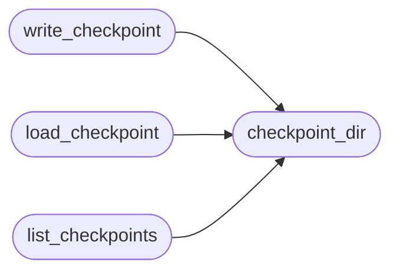

# `modules.chain_state`

> Source: [modules/chain_state.py:1](../../modules/chain_state.py#L1) | language `py` | coverage 100.0% | [API index](../index.md)

Durable chain checkpoints for pause, resume and audit.

A checkpoint records everything one chain run needs to continue after
an interruption: chains/ run id, target, tokens, variables, captured
keys, executed steps and the next index. Files live under
``sessions/chains/`` as ``<run_id>.json`` so the ``apt_chain resume``
command can pick them up. Storage is additive only: writing never
mutates an existing run id, and loading never executes anything.

## Contents

- **Functions:** [`checkpoint_dir`](#checkpoint_dir), [`new_run_id`](#new_run_id), [`write_checkpoint`](#write_checkpoint), [`load_checkpoint`](#load_checkpoint), [`list_checkpoints`](#list_checkpoints)

## Call Graph

Solid arrows stay in this module, dashed arrows leave it.



## Functions

<a id="checkpoint_dir"></a>

### `checkpoint_dir`

`function` | [modules/chain_state.py:26](../../modules/chain_state.py#L26)

```python
def checkpoint_dir(base_dir: str | Path | None = None) -> Path
```

Return the directory that stores chain checkpoints.

**Parameters**

| Name | Type | Default | Description |
|---|---|---|---|
| `base_dir` | `str \| Path \| None` | `None` |  |

**Returns:** `Path`

*Called by:* [`CommandAndControlMigratedCommandSet.do_apt_chain`](cli.commands.command_and_control_migrated.py.md#commandandcontrolmigratedcommandset-do_apt_chain), [`status_snapshot`](cli.retry_support.py.md#status_snapshot), [`list_checkpoints`](#list_checkpoints), [`load_checkpoint`](#load_checkpoint), [`write_checkpoint`](#write_checkpoint), [`newest_failed_checkpoint`](modules.retry_session.py.md#newest_failed_checkpoint)

---

<a id="new_run_id"></a>

### `new_run_id`

`function` | [modules/chain_state.py:33](../../modules/chain_state.py#L33)

```python
def new_run_id(chain_name: str) -> str
```

Return a collision-resistant run id for one chain execution.

**Parameters**

| Name | Type | Default | Description |
|---|---|---|---|
| `chain_name` | `str` |  |  |

**Returns:** `str`

*Called by:* [`ChainRunner.run`](modules.chain_runner.py.md#chainrunner-run)

---

<a id="write_checkpoint"></a>

### `write_checkpoint`

`function` | [modules/chain_state.py:39](../../modules/chain_state.py#L39)

```python
def write_checkpoint(directory: Path | str, state: dict[str, Any]) -> Path
```

Persist one chain run state as JSON and return the file path.

**Parameters**

| Name | Type | Default | Description |
|---|---|---|---|
| `directory` | `Path \| str` |  | Target checkpoint directory (created when missing). |
| `state` | `dict[str, Any]` |  | JSON-serializable run state; keys are truncated so a pathological chain cannot bloat the file. |

**Returns:** `Path` - Path of the written checkpoint.

**Raises**

- `OSError`: When the directory cannot be created or written.

*Calls:* [`checkpoint_dir`](#checkpoint_dir)

---

<a id="load_checkpoint"></a>

### `load_checkpoint`

`function` | [modules/chain_state.py:65](../../modules/chain_state.py#L65)

```python
def load_checkpoint(directory: Path | str, run_id: str) -> dict[str, Any] | None
```

Load one checkpoint by run id, or None when missing/unreadable.

**Parameters**

| Name | Type | Default | Description |
|---|---|---|---|
| `directory` | `Path \| str` |  |  |
| `run_id` | `str` |  |  |

**Returns:** `dict[str, Any] | None`

*Calls:* [`checkpoint_dir`](#checkpoint_dir)

*Called by:* [`CommandAndControlMigratedCommandSet.do_apt_chain`](cli.commands.command_and_control_migrated.py.md#commandandcontrolmigratedcommandset-do_apt_chain), [`newest_failed_checkpoint`](modules.retry_session.py.md#newest_failed_checkpoint)

---

<a id="list_checkpoints"></a>

### `list_checkpoints`

`function` | [modules/chain_state.py:80](../../modules/chain_state.py#L80)

```python
def list_checkpoints(directory: Path | str | None = None, limit: int = 20, chain: str = '') -> list[dict[str, Any]]
```

Return the newest checkpoints (run_id, chain, target, state, times).

**Parameters**

| Name | Type | Default | Description |
|---|---|---|---|
| `directory` | `Path \| str \| None` | `None` | Checkpoint directory override. |
| `limit` | `int` | `20` | Maximum rows to return. |
| `chain` | `str` | `''` | Optional chain-name filter, case-insensitive. |

**Returns:** `list[dict[str, Any]]` - Newest-first rows; each row also carries `[`ok`](scripts.top_tier_check.py.md#ok)`/`[`aborted`](modules.chain_runner.py.md#chainrunresult-aborted)`/
``reason`` so callers can identify the failed runs.

*Calls:* [`checkpoint_dir`](#checkpoint_dir)

*Called by:* [`resolve_admin`](cli.apt_chain_support.py.md#resolve_admin), [`status_snapshot`](cli.retry_support.py.md#status_snapshot), [`newest_failed_checkpoint`](modules.retry_session.py.md#newest_failed_checkpoint)

---
