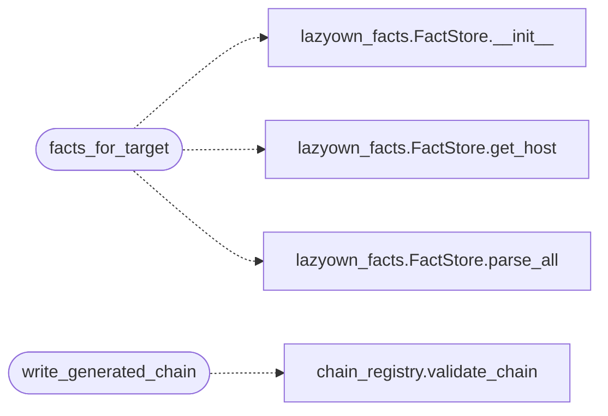

# `modules.chain_synth`

> Source: [modules/chain_synth.py:1](../../modules/chain_synth.py#L1) | language `py` | coverage 100.0% | [API index](../index.md)

Runtime chain synthesis from fact-store evidence.

Builds a chain YAML tailored to one host: the shared kill-chain spine
(assign, one-shot scan with reuse, fact refresh, C2 surface, exploit
sweep, session report) plus service-aware steps derived from the
FactStore (gobuster for http, hydra for ssh, enum4linux for smb/rdp) and
an optional playbook binding. Output is validated with
``chain_registry.validate_chain`` before writing, so a generated file
never poisons the registry; the operator owns the file afterwards.

## Contents

- **Functions:** [`synth_chain_data`](#synth_chain_data), [`facts_for_target`](#facts_for_target), [`synth_technique_chain_data`](#synth_technique_chain_data), [`write_generated_chain`](#write_generated_chain)

## Call Graph

Solid arrows stay in this module, dashed arrows leave it.



## Functions

<a id="synth_chain_data"></a>

### `synth_chain_data`

`function` | [modules/chain_synth.py:91](../../modules/chain_synth.py#L91)

```python
def synth_chain_data(playbook: str, target: str, services: list[dict], has_creds: bool = False, os_hint: str = '', include_c2: bool = True, techniques: list[str] | None = None) -> tuple[dict[str, Any], list[str]]
```

Compose the chain dict for a host; (data, notes).

**Parameters**

| Name | Type | Default | Description |
|---|---|---|---|
| `playbook` | `str` |  | Playbook token to pin in defaults (enabled: false with '' value). |
| `target` | `str` |  | Host the chain binds to. |
| `services` | `list[dict]` |  | Open service dicts with service/port entries. |
| `has_creds` | `bool` | `False` | Whether credentials exist for the host already. |
| `os_hint` | `str` | `''` | OS string from the fact store. |
| `include_c2` | `bool` | `True` | Whether C2 deploy/loot steps are included. |
| `techniques` | `list[str] \| None` | `None` | Optional MITRE technique ids staged as atomic_tests steps. |

**Returns:** `tuple[dict[str, Any], list[str]]`

*Called by:* [`resolve_admin`](cli.apt_chain_support.py.md#resolve_admin)

---

<a id="facts_for_target"></a>

### `facts_for_target`

`function` | [modules/chain_synth.py:243](../../modules/chain_synth.py#L243)

```python
def facts_for_target(target: str) -> dict[str, Any]
```

Pull host facts from the FactStore for synthesis inputs.

**Parameters**

| Name | Type | Default | Description |
|---|---|---|---|
| `target` | `str` |  |  |

**Returns:** `dict[str, Any]` - {services: [...], has_creds: bool, os_hint: str} — empty services
when nothing about the target is known.

*Calls:* [`FactStore.__init__`](skills.lazyown_facts.py.md#factstore-__init__), [`FactStore.get_host`](skills.lazyown_facts.py.md#factstore-get_host), [`FactStore.parse_all`](skills.lazyown_facts.py.md#factstore-parse_all)

*Called by:* [`resolve_admin`](cli.apt_chain_support.py.md#resolve_admin)

---

<a id="synth_technique_chain_data"></a>

### `synth_technique_chain_data`

`function` | [modules/chain_synth.py:272](../../modules/chain_synth.py#L272)

```python
def synth_technique_chain_data(target: str, techniques: list[str], os_hint: str = '') -> tuple[dict[str, Any], list[str]]
```

Compose a focused chain of ordered MITRE/atomic technique steps.

Unlike [`synth_chain_data`](#synth_chain_data), this produces no scan, C2 or service
spine: it binds the target then emulates each supplied technique in
order as its own ``atomic_tests`` step, so the ChainRunner's shared
EdrPacer applies the configured jitter and sleeper windows between
techniques. Only well-formed technique ids are kept, deduplicated and
uppercased; a bad id can never abort the chain.

**Parameters**

| Name | Type | Default | Description |
|---|---|---|---|
| `target` | `str` |  | Host the chain binds to. |
| `techniques` | `list[str]` |  | Ordered MITRE technique ids (``T1059``, ``T1059.001``). |
| `os_hint` | `str` | `''` | OS string recorded in the chain description. |

**Returns:** `tuple[dict[str, Any], list[str]]` - A ``(data, techniques_used)`` pair. ``data`` is empty with the
reason in ``techniques_used`` when fewer than two valid ids remain.

*Called by:* [`TechniqueChainSelector.propose`](modules.selection.technique_chain.py.md#techniquechainselector-propose)

---

<a id="write_generated_chain"></a>

### `write_generated_chain`

`function` | [modules/chain_synth.py:339](../../modules/chain_synth.py#L339)

```python
def write_generated_chain(data: dict[str, Any], chains_dir: Path | str | None = None) -> tuple[Path | None, list[str]]
```

Validate and persist the generated chain file; returns (path, errors).

Invalid data is never written: errors come back instead either way.

**Parameters**

| Name | Type | Default | Description |
|---|---|---|---|
| `data` | `dict[str, Any]` |  |  |
| `chains_dir` | `Path \| str \| None` | `None` |  |

**Returns:** `tuple[Path | None, list[str]]`

*Calls:* [`validate_chain`](modules.chain_registry.py.md#validate_chain)

*Called by:* [`resolve_admin`](cli.apt_chain_support.py.md#resolve_admin), [`consider_report`](modules.lazy_autofire.py.md#consider_report), [`TechniqueChainSelector.propose`](modules.selection.technique_chain.py.md#techniquechainselector-propose)

---
