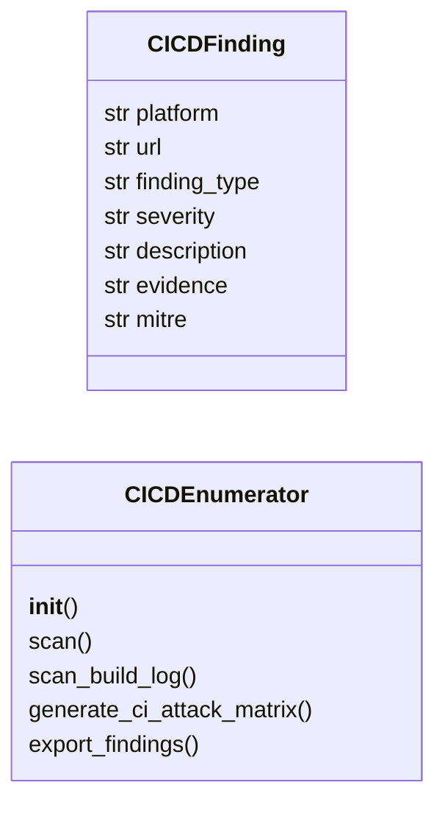

# `modules.cicd_enumerator`

> Source: [modules/cicd_enumerator.py:1](../../modules/cicd_enumerator.py#L1) | language `py` | coverage 87.5% | [API index](../index.md)

CI/CD Pipeline Enumeration Module.

Enumerates CI/CD platforms (Jenkins, GitLab, GitHub Actions) for:
- Exposed build logs with leaked secrets
- Misconfigured pipeline triggers (PRs from forks)
- Unauthenticated pipeline execution
- Build server credential stores
- Repository secrets accessible to pipeline YAML
- Artifact storage with sensitive build outputs

## Contents

- **Classes:** [`CICDFinding`](#cicdfinding), [`CICDEnumerator`](#cicdenumerator)
- **Constants:** [`SECRET_PATTERNS`](#secret_patterns)

## Type Diagram



## Classes

<a id="cicdfinding"></a>

### `CICDFinding`

`class` `dataclass` | [modules/cicd_enumerator.py:33](../../modules/cicd_enumerator.py#L33)

Decorators: `@dataclass`

```python
class CICDFinding
```

**Attributes**

| Name | Type | Default | Description |
|---|---|---|---|
| [`platform`](#cicdfinding-platform) | `str` |  |  |
| [`url`](#cicdfinding-url) | `str` |  |  |
| [`finding_type`](#cicdfinding-finding_type) | `str` |  |  |
| [`severity`](#cicdfinding-severity) | `str` |  |  |
| [`description`](#cicdfinding-description) | `str` |  |  |
| [`evidence`](#cicdfinding-evidence) | `str` | `''` |  |
| [`mitre`](#cicdfinding-mitre) | `str` | `''` |  |

---

<a id="cicdenumerator"></a>

### `CICDEnumerator`

`class` | [modules/cicd_enumerator.py:43](../../modules/cicd_enumerator.py#L43)

```python
class CICDEnumerator
```

Enumerate CI/CD platforms for security misconfigurations.

Supports Jenkins, GitLab CI, GitHub Actions, Bitbucket Pipelines,
and Azure DevOps.

**Parameters**

| Name | Type | Default | Description |
|---|---|---|---|
| `target_url` |  |  | Base URL of the CI/CD platform. |
| `sessions_dir` |  |  | Directory for discovery output. |

**Members**

| Member | Kind | Summary |
|---|---|---|
| [`__init__`](#cicdenumerator-__init__) | constructor |  |
| [`scan`](#cicdenumerator-scan) | method | Run all CI/CD scans. |
| [`scan_build_log`](#cicdenumerator-scan_build_log) | method | Scan a build log for leaked secrets. |
| [`generate_ci_attack_matrix`](#cicdenumerator-generate_ci_attack_matrix) | method | Generate a comprehensive CI/CD attack matrix. |
| [`export_findings`](#cicdenumerator-export_findings) | method | Export CI/CD findings to a JSON file. |

<a id="cicdenumerator-__init__"></a>

#### `CICDEnumerator.__init__`

`constructor` | [modules/cicd_enumerator.py:54](../../modules/cicd_enumerator.py#L54)

```python
def __init__(self, target_url: str = '', sessions_dir: str = 'sessions')
```

**Parameters**

| Name | Type | Default | Description |
|---|---|---|---|
| `target_url` | `str` | `''` | Base URL of the CI/CD platform. |
| `sessions_dir` | `str` | `'sessions'` | Directory for discovery output. |

*Called by:* [`CICDCommandSet.do_cicd_scan`](cli.commands.cicd.py.md#cicdcommandset-do_cicd_scan), [`CICDCommandSet.do_cicd_secrets`](cli.commands.cicd.py.md#cicdcommandset-do_cicd_secrets)

<a id="cicdenumerator-scan"></a>

#### `CICDEnumerator.scan`

`method` | [modules/cicd_enumerator.py:60](../../modules/cicd_enumerator.py#L60)

```python
def scan(self) -> list[CICDFinding]
```

Run all CI/CD scans.

**Returns:** `list[CICDFinding]` - List of CICDFinding objects.

*Called by:* [`CICDCommandSet.do_cicd_scan`](cli.commands.cicd.py.md#cicdcommandset-do_cicd_scan)

<a id="cicdenumerator-scan_build_log"></a>

#### `CICDEnumerator.scan_build_log`

`method` | [modules/cicd_enumerator.py:297](../../modules/cicd_enumerator.py#L297)

```python
def scan_build_log(self, log_content: str, source: str = '') -> list[dict[str, str]]
```

Scan a build log for leaked secrets.

**Parameters**

| Name | Type | Default | Description |
|---|---|---|---|
| `log_content` | `str` |  | Raw build log text. |
| `source` | `str` | `''` | Description of the log source. |

**Returns:** `list[dict[str, str]]` - List of dicts with matched secrets.

*Called by:* [`CICDCommandSet.do_cicd_secrets`](cli.commands.cicd.py.md#cicdcommandset-do_cicd_secrets)

<a id="cicdenumerator-generate_ci_attack_matrix"></a>

#### `CICDEnumerator.generate_ci_attack_matrix`

`method` | [modules/cicd_enumerator.py:322](../../modules/cicd_enumerator.py#L322)

```python
def generate_ci_attack_matrix(self) -> str
```

Generate a comprehensive CI/CD attack matrix.

**Returns:** `str` - Path to the JSON attack matrix file.

*Called by:* [`CICDCommandSet.do_cicd_scan`](cli.commands.cicd.py.md#cicdcommandset-do_cicd_scan)

<a id="cicdenumerator-export_findings"></a>

#### `CICDEnumerator.export_findings`

`method` | [modules/cicd_enumerator.py:387](../../modules/cicd_enumerator.py#L387)

```python
def export_findings(self) -> str
```

Export CI/CD findings to a JSON file.

**Returns:** `str` - Path to the findings file.

*Called by:* [`CICDCommandSet.do_cicd_scan`](cli.commands.cicd.py.md#cicdcommandset-do_cicd_scan)

---

## Constants

<a id="secret_patterns"></a>

### `SECRET_PATTERNS`

`constant` | [modules/cicd_enumerator.py:19](../../modules/cicd_enumerator.py#L19)

```python
SECRET_PATTERNS: list[tuple[str, str, str]]
```

---
